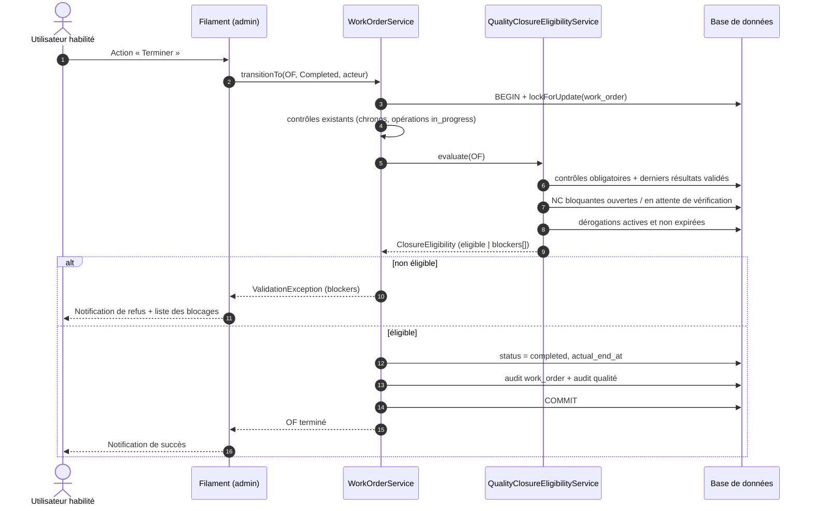
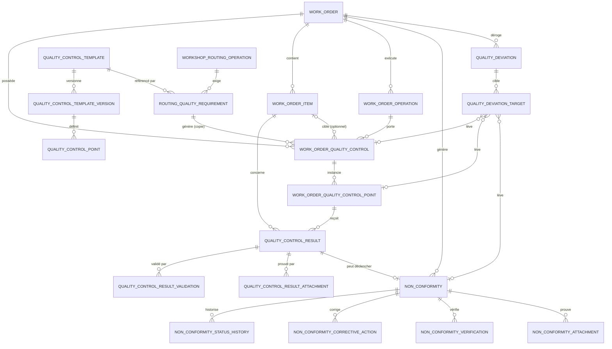
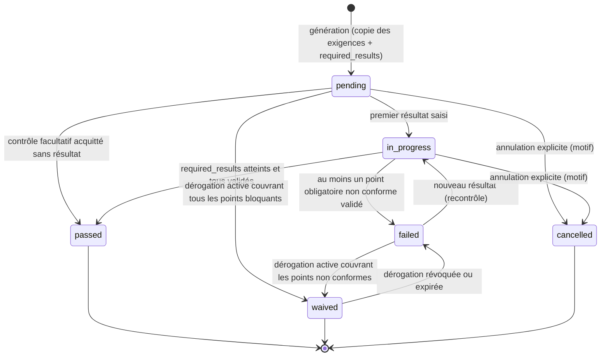
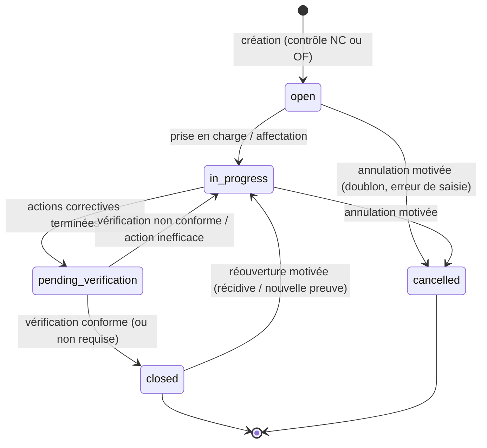
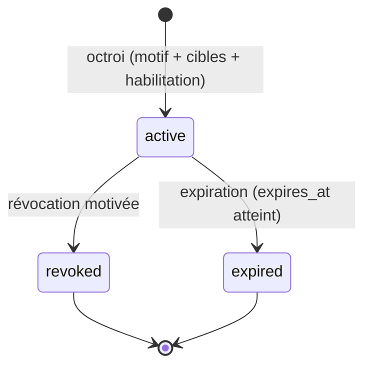
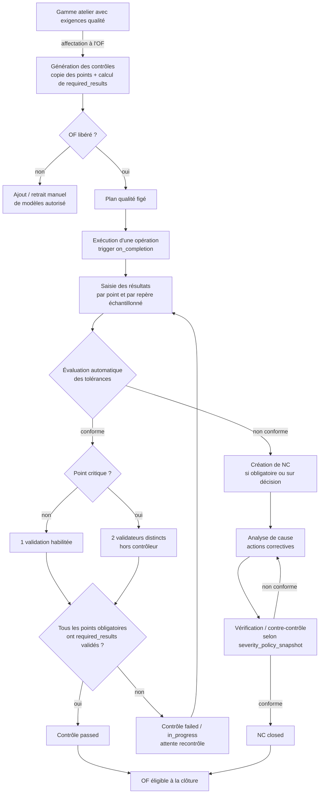
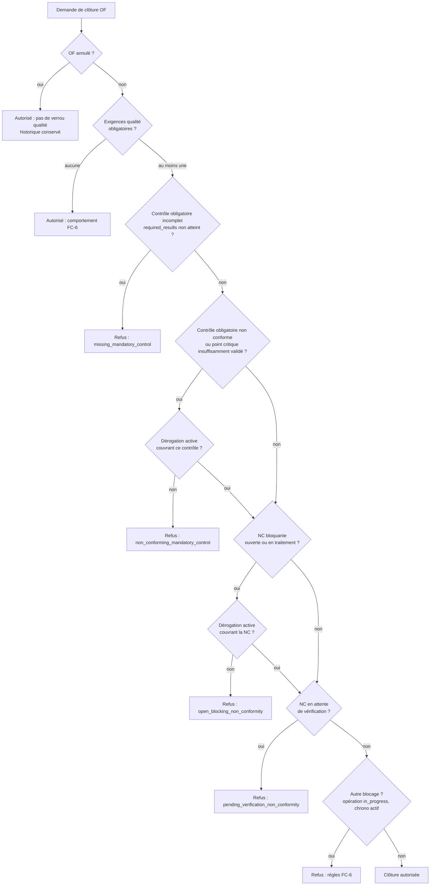

# FC-7 — Contrôles qualité et non-conformités

> **Lot 1 — Analyse de l'existant et conception métier / technique**
>
> Statut : **conception finalisée — les quatre arbitrages métier sont validés**. Aucune implémentation n'est incluse dans ce lot ; le document est le contrat d'implémentation des lots 2 à 7.
> Branche de travail : `feature/fc-7-quality-control`, créée depuis `develop` au commit `a7e1fa5ed2ef667a5439ca638c99f8f4441980a1`.
> Document de référence technique associé : [WORKSHOP.md](WORKSHOP.md) (FC-6), [DOMAIN.md](DOMAIN.md) (socle Affaires / OF / Documents / BOM).
>
> **Arbitrages de référence intégrés** : rattachement hybride et échantillonnage paramétrable (§14.1), habilitations par drapeaux sans Spatie (§14.2), vérification des NC paramétrable par gravité et figée (§14.3), dérogations sélectives et encadrées (§14.4).

---

## Sommaire

1. [Objet et périmètre](#1-objet-et-périmètre)
2. [État des lieux de l'architecture existante](#2-état-des-lieux-de-larchitecture-existante)
3. [Composants FC-6 réutilisables](#3-composants-fc-6-réutilisables)
4. [Points d'intégration avec le workflow OF](#4-points-dintégration-avec-le-workflow-of)
5. [Modèle de données retenu](#5-modèle-de-données-retenu)
6. [Entités, relations et cardinalités](#6-entités-relations-et-cardinalités)
7. [Statuts et transitions](#7-statuts-et-transitions)
8. [Règles métier détaillées](#8-règles-métier-détaillées)
9. [Matrice des permissions](#9-matrice-des-permissions)
10. [Traçabilité et audit](#10-traçabilité-et-audit)
11. [Contraintes d'intégrité et de concurrence](#11-contraintes-dintégrité-et-de-concurrence)
12. [Stratégie de tests](#12-stratégie-de-tests)
13. [Découpage technique des lots 1 à 7](#13-découpage-technique-des-lots-1-à-7)
14. [Arbitrages métier validés](#14-arbitrages-métier-validés)
15. [Risques et points d'attention](#15-risques-et-points-dattention)
16. [Annexes](#16-annexes)

---

## 1. Objet et périmètre

FC-7 ajoute un système qualité complet au-dessus du socle Affaires / OF et du module atelier FC-6 :

- référentiel de modèles de contrôle versionnés ;
- points de contrôle paramétrables (conformité, mesure, texte, liste) ;
- génération de contrôles dans un OF par copie indépendante des exigences ;
- enregistrement de résultats, évaluation automatique des tolérances, preuves jointes ;
- gestion des non-conformités (NC), actions correctives, vérifications et contre-contrôles ;
- verrouillage qualité de la clôture d'un OF, centralisé côté serveur ;
- dérogations qualité encadrées, motivées et auditées.

**Hors périmètre du Lot 1** : toute migration, tout modèle, tout service, toute Policy et tout écran. Ce document est le contrat d'implémentation des lots 2 à 7.

### 1.1 Principes directeurs retenus

| Principe | Conséquence de conception |
| --- | --- |
| Ne pas dupliquer le moteur FC-6 | Les contrôles référencent `work_order_operations` / `work_order_items` ; aucune donnée d'opération n'est recopiée dans le domaine qualité. |
| Copie indépendante | Les exigences sont recopiées dans l'OF à la génération ; toute modification ultérieure du référentiel est sans effet sur l'existant. |
| Rattachement hybride | Un contrôle peut viser un repère, une opération ou l'OF ; le niveau est porté par `scope` (arbitrage 1). |
| Échantillonnage paramétrable | `sampling_mode` + `sampling_every` + `required_results` définissent le nombre de résultats attendus (arbitrage 1). |
| Jamais d'écrasement | Résultats, validations, transitions de NC et dérogations sont append-only ou à historique complet. |
| Règles côté serveur | Toute règle est dans un service ; Filament ne fait qu'appeler le service et afficher ses refus. |
| Séparation des responsabilités | Concevoir, exécuter, valider et déroger sont des capacités distinctes ; ségrégation contrôleur / valideur sur les points critiques. |
| Habilitations par drapeaux | `is_admin`, `is_workshop_supervisor`, `is_quality_manager` + Policies ; **aucune dépendance Spatie** (arbitrage 2). |
| Politique qualité figée | La politique de vérification d'une NC est copiée à sa création et reste traçable (arbitrage 3). |
| Rétro-compatibilité | Un OF sans exigence qualité reste clôturable (voir §8.6.4). |

---

## 2. État des lieux de l'architecture existante

### 2.1 Socle technique réellement installé — **écart avec la mission**

| Élément annoncé | Constat dans le dépôt | Impact |
| --- | --- | --- |
| Laravel 13 | `laravel/framework: ^13.0` | conforme |
| PHP 8.4 | `php: ^8.3` (compatible 8.4, aucune contrainte bloquante) | conforme |
| Filament 5 | `filament/filament: ~5.4` | conforme |
| Livewire 4 | `livewire/livewire: ~4.2` | conforme |
| MySQL / MariaDB en production | migrations compatibles, suite MySQL dédiée `phpunit.mysql.xml` | conforme |
| SQLite pour la CI | `phpunit.xml` : `DB_CONNECTION=sqlite`, `:memory:` | conforme |
| **Spatie Laravel Permission** | **absent de `composer.json` et de `vendor/`** | **écart résolu** : l'arbitrage 2 retient explicitement l'absence de Spatie (§14.2) |

**Constat.** Les autorisations reposent aujourd'hui sur des **drapeaux booléens** portés par `users` et exposés par des méthodes métier :

- `users.is_admin` (migration `2026_10_27_000005_add_is_admin_to_users_table.php`) ;
- `users.is_workshop_supervisor` (migration `2026_11_09_000018_add_is_workshop_supervisor_to_users_table.php`), non mass-assignable ;
- `User::canManageWorkshopRoutings()`, `canUnblockWorkshopOperations()`, `canManageOperationTimes()` ;
- Policies Laravel auto-découvertes dans `app/Policies`, sans `Gate::before` ni permissions nommées ;
- contrôle d'accès aux panneaux via `User::canAccessPanel(Panel)`.

Les services appliquent l'autorisation **côté serveur** avec `$actor->can(...)` ou `Gate::forUser($actor)->authorize(...)` (ex. `WorkOrderBomImportService`).

> **Décision (arbitrage 2)** : **aucune dépendance Spatie n'est introduite**. FC-7 conserve le système existant (booléens sur `users` + Policies Laravel) et ajoute `users.is_quality_manager`. Les noms d'abilités restent stables afin qu'une migration ultérieure éventuelle vers un moteur de permissions ne réécrive pas les Policies.

### 2.2 Socle Affaires / OF

| Élément | Détail constaté |
| --- | --- |
| `jobs` | Affaire ; statuts `JobStatus` ; `acceptsNewWorkOrders()` |
| `work_orders` | `number` unique, `status`, `priority`, dates prévues/réelles, `created_by`, `released_by/released_at`, approbation BE (`be_approved_by/at`, `be_approval_batch_id`, `be_approval_snapshot_id`), `workshop_routing_id` |
| `WorkOrder::PROTECTED_FIELDS` | Champs techniques non mass-assignables (`number`, `status`, dates, validations, `workshop_routing_id`, …) |
| `WorkOrderService` | **Point d'entrée unique** : `create()`, `update()`, `transitionTo()`, `approveByBE()`, `delete()`, `lockForMutation()` |
| Transactions | `DB::transaction(..., attempts: 3)` ; verrouillage `lockForUpdate()` de l'OF, puis de l'affaire, puis des documents |
| Audit | `WorkOrderAuditService` → `work_order_audit_logs` (immuable : `performUpdate()` / `performDeleteOnModel()` lèvent une exception) |

Statuts actuels (`WorkOrderStatus`) :

| Statut | Libellé | Transitions autorisées |
| --- | --- | --- |
| `draft` | Brouillon | `ready`, `cancelled` |
| `ready` | Prêt | `released`, `cancelled` |
| `released` | Libéré | `in_progress`, `cancelled` |
| `in_progress` | En cours | `quality_check`, `cancelled` |
| `quality_check` | Contrôle qualité | `in_progress`, `completed`, `cancelled` |
| `completed` | Terminé | — (figé) |
| `cancelled` | Annulé | — (figé) |

> **Constat important** : le statut `quality_check` **existe déjà** mais n'a **aucune sémantique métier** en dehors de la matrice de transitions. FC-7 doit lui donner un sens précis (§7.1) sans changer la matrice existante.

### 2.3 Documents techniques (réutilisable pour les preuves)

- `documents` / `document_versions` / `work_order_document_snapshots` / `document_audit_logs`.
- `DocumentStorageService::store(UploadedFile $file, Document $document)` : chemin **généré serveur** `documents/{document_id}/{uuid}.{ext}`, disque privé `documents`, extensions/MIME autorisés via `config/documents.php`, taille max 50 Mo, SHA-256 calculé après écriture.
- `DocumentCategory::QualityDocument` existe déjà (`quality_document`), mais le module Documents est un module de **documents techniques versionnés** (indices, validation, snapshots) : inadapté aux photos de contrôle.

> **Recommandation** : ne pas détourner `documents` pour les preuves qualité. Créer un service de stockage de preuves dédié, qui **reprend à l'identique** les règles de sécurité de `DocumentStorageService` (disque privé, UUID, MIME réel, SHA-256, nettoyage en cas d'échec de transaction), sans modifier le module existant.

### 2.4 Pièces / repères et nomenclature

- `work_order_items` : `mark` (unique par OF, normalisé majuscules/ASCII), `designation`, `profile`, `steel_grade`, `length_mm`, quantités, poids, `status` (`WorkOrderItemStatus`), `operation_group`.
- `WorkOrderItem::acceptedQuantity`, `remainingQuantity`, `hasRecordedProduction()`.
- Les repères sont la maille naturelle d'un contrôle dimensionnel.

### 2.5 Module atelier FC-6

| Composant | Rôle |
| --- | --- |
| `workshop_routings` | Gamme modèle : `code` unique, `name`, `description`, `is_active` |
| `workshop_routing_operations` | Opération modèle : `code`, `name`, `instructions`, `position`, `estimated_duration_minutes`, `is_mandatory` |
| `workshop_routing_operation_dependencies` | Graphe de dépendances (unicité par paire) |
| `work_order_operations` | **Copie indépendante** dans l'OF : `source_routing_operation_id` nullable, statut, blocage, début/fin |
| `work_order_operation_dependencies` | Dépendances remappées |
| `operation_time_entries` | Sessions `timer` / `manual` / `adjustment`, colonne générée `active_user_id` + index unique |
| `work_order_operation_audit_logs` | Journal immuable atelier, colonnes dénormalisées `work_order_number`, `operation_code` |
| `WorkOrderRoutingService` | Affectation/remplacement de gamme, **copie** des opérations, remappage des dépendances, `assertGenerationIntegrity()` |
| `WorkOrderOperationService` | Moteur d'exécution : `start`, `pause`, `resume`, `block`, `unblock`, `complete`, `cancel` |
| `OperationDependencyService` | Propagation `pending` → `ready` après terminaison |
| `WorkshopRoutingValidationService` | Validation métier d'une gamme avant activation/affectation |
| `WorkOrderOperationAuditService` | Écriture du journal atelier |
| `WorkshopDashboardService` | Indicateurs tableau de bord / supervision |

**Pattern de copie à réutiliser** (`WorkOrderRoutingService::generateOperations()`) :

1. lire les objets sources avec leurs dépendances ;
2. créer les copies avec les champs métier (liste blanche) ;
3. écrire les champs protégés par `forceFill()` (`source_*_id`, `status`) ;
4. remapper les relations par une table de correspondance `source_id → generated_id` ;
5. **vérifier l'intégrité de la copie** champ par champ (`assertGenerationIntegrity`) ;
6. auditer chaque création dans la même transaction.

**Pattern d'activation à réutiliser** (`WorkshopRoutingService::activate()`) : une gamme est créée **inactive**, activable seulement si la validation métier complète passe ; la désactivation reste toujours possible ; la suppression physique est interdite dès qu'un OF l'a utilisée.

### 2.6 Mécanismes de clôture / annulation existants

`WorkOrderService::transitionTo(WorkOrder, WorkOrderStatus, ?User, ?string)` :

- verrouille l'OF (`lockForUpdate`) ;
- vérifie `WorkOrderStatus::canTransitionTo()` ;
- pour `completed` **et** `cancelled` :
  - refuse si une session de chronométrage est active (`assertNoActiveTimeEntries`) ;
  - refuse si une opération est encore `in_progress` (`assertNoInProgressOperations`) ;
- pour `released` : exige l'approbation BE, l'affaire active, la validité des snapshots documentaires ;
- pour `completed` : renseigne `actual_end_at` ;
- écrit l'audit **dans la même transaction** ;
- cas particulier : l'audit `BeApprovalObsolete` est écrit **après** le rollback (transaction séparée).

**Point d'insertion FC-7** : ajouter l'évaluation d'éligibilité qualité **avant** le passage à `completed`, dans la même transaction, après les contrôles d'opérations/chronos existants.

### 2.7 Événements et listeners

**Aucun** `app/Events`, `app/Listeners`, `EventServiceProvider` métier. L'architecture est **impérative par services** : les écrans appellent un service, le service orchestre et audite.

> **Recommandation** : conserver ce style pour FC-7. Ne pas introduire d'événements de domaine pour la génération des contrôles : la génération doit être **transactionnelle avec la copie de gamme** et échouer si elle est incomplète. Des événements ultérieurs (notifications) pourront être ajoutés sans changer le modèle.

### 2.8 Policies et autorisations existantes

| Policy | Règles principales |
| --- | --- |
| `WorkOrderPolicy` | `viewAny/view/create/update/delete/transition/approveBE` : administrateur ; `manageRouting` : administrateur + OF modifiable ; `reReviewDocuments` : administrateur + OF `released/in_progress/quality_check` |
| `WorkOrderOperationPolicy` | Exécution ouverte à tout utilisateur authentifié sur OF en exécution ; déblocage/annulation réservés superviseur/admin ; `update/delete/manageDependencies` admin avant libération ; `recordManualTime` superviseur/admin ; `correctTime` superviseur/admin même après clôture |
| `WorkshopRoutingPolicy` | `viewAny/view/create/update` superviseur ou admin ; `delete` si jamais utilisée ; `activate/deactivate` |
| `WorkOrderItemPolicy`, `DocumentPolicy`, `DocumentVersionPolicy`, `WorkOrderBomImportPolicy` | Détail dans le code |
| `User::canAccessPanel()` | Panneau `admin` = `is_admin` ; panneau `workshop` = tout authentifié (filtrage par Policies) |

### 2.9 Filament

- **Panneau `/admin`** (`AdminPanelProvider`) : découverte automatique de `app/Filament/Resources`, `Pages`, `Widgets`. Accès réservé aux admins.
- **Panneau `/workshop`** (`WorkshopPanelProvider`) : ressources déclarées explicitement (`WorkshopRoutingResource`, `WorkshopOperationResource`), pages `WorkshopDashboard`, `WorkshopSupervision`. Accessible à tout authentifié, filtrage par Policies.
- `WorkOrderResource` : relation managers `WorkOrderOperationsRelationManager`, `ItemsRelationManager`, `BomImportsRelationManager` ; actions de transition générées automatiquement depuis `WorkOrderStatus::cases()` dans `WorkOrdersTable::transitionActions()`.
- Les actions attrapent `ValidationException` et affichent une `Notification` de refus (`notifyRefusal`).

**Conséquence FC-7** : les nouvelles actions Filament doivent suivre exactement ce pattern (service + `try/catch ValidationException` + notification), et la visibilité doit être pilotée par Policy **et** par l'état de l'entité.

### 2.10 Conventions de nommage et d'organisation

| Élément | Convention constatée |
| --- | --- |
| Tables | pluriel `snake_case` anglais (`work_order_operations`, `workshop_routing_operation_dependencies`) |
| Modèles | PascalCase anglais singulier dans `App\Models` |
| Enums | `App\Enums`, backed `string`, implémentent `HasLabel` / `HasColor` (Filament), méthode `options()` |
| Services | `App\Services`, suffixe `Service`, dépendances injectées par constructeur |
| DTO | `App\DTO`, classes `readonly`-style simples |
| Policies | `App\Policies\{Model}Policy`, auto-découvertes |
| Migrations | `YYYY_MM_DD_NNNNNN_verbe_objet_table.php`, commentaires métier en français dans le code |
| Filament | `app/Filament/Resources/{Plural}/{Resource,Pages,Schemas,Tables,RelationManagers,Actions}` |
| Libellés | UI en français, code et base en anglais |
| Tests | `tests/Feature/{Domaine}Test.php`, `tests/Unit/{Enum}Test.php`, PHPUnit 12 (pas de Pest) |

### 2.11 Tests existants concernant les OF et FC-6

- `WorkOrderTest`, `WorkOrderClosureTest`, `WorkOrderAuditLogTest`, `WorkOrderResponsibleAndBEApprovalTest`, `WorkOrderBEApprovalDocumentConsistencyTest`, `WorkOrderBomImport*`, `WorkOrderItem*`, `WorkOrderRouting*`, `WorkOrderOperation*`, `OperationTimer*`, `OperationTime*`, `Workshop*`, `WorkshopDashboard*`, `FilamentAuthorizationTest`, `DatabaseSchemaTest`.
- `phpunit.xml` : SQLite `:memory:`.
- `phpunit.mysql.xml` : suite MySQL dédiée (`fab_c2me_test`) pour la concurrence ; les tests de concurrence sont `markTestSkipped` sous SQLite.

> **Contrainte de non-régression majeure** : `WorkOrderClosureTest` clôture des OF **sans aucun contrôle qualité**. Le verrou qualité doit donc être **conditionnel à l'existence d'exigences** (voir §8.6.4).

---

## 3. Composants FC-6 réutilisables

| Composant existant | Réutilisation FC-7 | Adaptation nécessaire |
| --- | --- | --- |
| `work_order_operations` | Cible des contrôles `scope=operation` ; déclencheur `on_completion` | Aucune (lecture seule côté qualité) |
| `work_order_items` | Cible des contrôles `scope=item` ; repère sur le résultat | Aucune |
| `WorkOrderStatus::QualityCheck` | Phase de contrôle avant clôture | **Définir la sémantique** (§7.1), sans modifier la matrice |
| `WorkOrderService::transitionTo()` | Porte d'entrée du verrou de clôture | Ajouter un appel au service d'éligibilité qualité |
| `DB::transaction(..., attempts: 3)` + `lockForUpdate()` | Transactions et verrous | Respecter l'ordre de verrouillage (§11) |
| Pattern « copie indépendante » de `WorkOrderRoutingService` | Génération des contrôles | Nouveau service, même algorithme + `assertGenerationIntegrity` |
| Pattern « activation par validation complète » de `WorkshopRoutingService` | Activation d'une version de modèle | Nouveau service, mêmes règles d'état |
| `WorkOrderAuditService` / `WorkOrderOperationAuditService` | Modèle d'écriture d'audit immuable | Journal qualité dédié (§10) |
| `DocumentStorageService` (règles de sécurité) | Stockage des preuves | Nouveau service, sans toucher l'existant |
| `WorkOrderNumberGenerator` (`lockForUpdate` + table de séquence) | Références `NC-AAAA-NNNN` et `DER-AAAA-NNNN` | Générateur générique de séquences qualité |
| Enums + `options()` + `HasLabel/HasColor` | Statuts, types, gravités | Nouveaux enums |
| Policies + `canAccessPanel` | Habilitations | Nouvelles Policies qualité + drapeau `is_quality_manager` (arbitrage 2) |
| `ValidationException::withMessages()` | Refus métier lisibles | Convention conservée |
| `Filament` actions → service → notification | Écrans qualité | Mêmes patterns |

**Ce qui ne doit pas être réutilisé :**

- Le module `documents` comme stockage de photos (workflow de révision trop lourd, table liée aux OF/affaires uniquement).
- Les événements/listeners (inexistants).
- Une duplication des champs d'opération dans les tables qualité.

---

## 4. Points d'intégration avec le workflow OF

### 4.1 Cartographie des points d'accroche

| # | Point d'accroche | Moment | Comportement FC-7 |
| --- | --- | --- | --- |
| I1 | `WorkOrderRoutingService::affect()` / `replace()` | Affectation ou remplacement de gamme | Génère les contrôles qualité issus des exigences de la gamme (dans la même transaction) |
| I2 | `WorkOrderRoutingService::deleteOperation()` | Suppression d'une opération générée avant libération | Refus si l'opération porte des contrôles non annulés ou des résultats |
| I3 | `WorkOrderService::update()` (OF `draft`/`ready`) | Ajout manuel d'un modèle de contrôle à l'OF | Nouvelle méthode de service, auditée |
| I4 | `WorkOrderService::transitionTo(..., Released)` | Libération | Plus d'ajout, de retrait ni de modification de contrôle ou de point. Seul `required_results` peut encore être recalculé si des repères sont ajoutés (§8.3.2), de façon auditée |
| I5 | `WorkOrderOperationService::complete()` | Terminaison d'une opération | Contrôles `trigger=on_completion` de cette opération : deviennent exigibles (et bloquants si obligatoires) |
| I6 | `WorkOrderService::transitionTo(..., QualityCheck)` | Entrée en phase qualité | Aucune génération : les contrôles existent déjà ; l'écran de contrôle s'ouvre |
| I7 | `WorkOrderService::transitionTo(..., Completed)` | Clôture | **Verrou qualité centralisé** (`QualityClosureEligibilityService`) |
| I8 | `WorkOrderService::transitionTo(..., Cancelled)` | Annulation | **Pas de verrou qualité** ; les contrôles/NC sont conservés et consultables |
| I9 | `WorkOrderService::delete()` | Suppression d'un brouillon | Refus si un contrôle a déjà un résultat, une NC ou une dérogation |
| I10 | `WorkOrderItemService` (suppression/fusion de repères) | Modification des repères | Refus si un résultat qualité référence le repère |
| I11 | Panneau `/workshop` | Exécution des contrôles | Nouvelle ressource « Contrôles qualité » |
| I12 | Panneau `/admin` | Référentiel, NC, dérogations, supervision | Nouvelles ressources et pages |

### 4.2 Séquence d'intégration (clôture)



### 4.3 Compatibilité ascendante

Le verrou de clôture s'applique **uniquement si l'OF possède au moins une exigence qualité obligatoire**. Un OF sans exigence (comportement FC-6 actuel) reste clôturable. Cette règle garantit :

- la non-régression de `WorkOrderClosureTest` ;
- l'absence de blocage des OF historiques ;
- une montée en charge progressive (les gammes sont enrichies d'exigences quand le métier le décide).

Cette règle est une **décision technique de compatibilité** retenue par défaut : elle garantit la non-régression demandée et ne contredit aucun des quatre arbitrages (voir §8.6.4). Si le métier souhaite rendre la qualité obligatoire dès la première gamme, elle sera réévaluée à la recette, sans impact sur le modèle de données.

---

## 5. Modèle de données retenu

### 5.1 Vue d'ensemble des tables

**Référentiel (versionné, mutable) :**

| Table | Rôle |
| --- | --- |
| `quality_control_templates` | Identité d'un modèle de contrôle (code, nom, type, activation) |
| `quality_control_template_versions` | Versions immuables d'un modèle (`draft` / `active` / `retired`) |
| `quality_control_points` | Points de contrôle d'une **version** de modèle |
| `workshop_routing_operation_quality_requirements` | Exigences qualité portées par une opération de gamme |

**Plan qualité généré dans l'OF (instantané, immuable après libération) :**

| Table | Rôle |
| --- | --- |
| `work_order_quality_controls` | Contrôle généré pour un OF (en-tête, snapshot du modèle) |
| `work_order_quality_control_points` | Points générés (snapshot des points de la version) |
| `quality_control_results` | Résultats append-only (une ligne par mesure / constat) |
| `quality_control_result_validations` | Décisions de validation append-only |
| `quality_control_result_attachments` | Preuves (photos, documents) |

**Non-conformités :**

| Table | Rôle |
| --- | --- |
| `non_conformities` | NC (référence unique, gravité, cycle de vie) |
| `non_conformity_status_histories` | Historique append-only des transitions de NC |
| `non_conformity_corrective_actions` | Actions correctives |
| `non_conformity_verifications` | Vérifications, contre-contrôles, efficacité |
| `non_conformity_attachments` | Preuves de NC |

**Dérogations et audit :**

| Table | Rôle |
| --- | --- |
| `quality_deviations` | Dérogation qualité (référence unique, motif, périmètre, statut) |
| `quality_deviation_targets` | Cibles précises d'une dérogation (contrôle, point, NC) |
| `quality_audit_logs` | Journal append-only du domaine qualité |
| `quality_sequences` | Compteurs annuels des références NC / DER |

### 5.2 Détail des colonnes

> Convention : toutes les dates sont stockées en **UTC**. Les colonnes de type `decimal` sont en précision fixe, séparateur `.` côté base. Les colonnes `*_snapshot` sont des copies dénormalisées destinées à l'audit et à l'affichage.

#### 5.2.1 `quality_control_templates`

| Colonne | Type | Contraintes |
| --- | --- | --- |
| `id` | bigint | PK |
| `code` | string(50) | unique, normalisé majuscules |
| `name` | string(255) | requis |
| `description` | text | nullable |
| `control_type` | string(30) | `dimensional`, `visual`, `welding`, `preparation_finishing`, `final`, `other` |
| `is_active` | boolean | défaut `false` ; reflète l'existence d'une version active |
| `current_version_id` | bigint | nullable, FK `quality_control_template_versions`, `nullOnDelete` |
| `created_by` | bigint | nullable, FK `users`, `nullOnDelete` |
| `timestamps` | | |

Index : `is_active`, `control_type`. Contrainte : `code` unique.

> La FK circulaire `templates.current_version_id ⇄ template_versions.template_id` suit le pattern déjà utilisé par `documents.current_version_id`.

#### 5.2.2 `quality_control_template_versions`

| Colonne | Type | Contraintes |
| --- | --- | --- |
| `id` | bigint | PK |
| `quality_control_template_id` | bigint | FK `quality_control_templates`, `cascadeOnDelete` |
| `version_number` | unsigned int | unique par modèle |
| `status` | string(20) | `draft`, `active`, `retired` |
| `change_note` | text | nullable (obligatoire à l'activation) |
| `activated_by` | bigint | nullable, FK `users`, `nullOnDelete` |
| `activated_at` | timestamp | nullable |
| `retired_at` | timestamp | nullable |
| `created_by` | bigint | nullable, FK `users`, `nullOnDelete` |
| `timestamps` | | |

Contraintes :

- `unique(quality_control_template_id, version_number)` ;
- **une seule version active par modèle**, garantie par une colonne générée portable SQLite/MySQL :

```php
$table->unsignedBigInteger('active_template_id')->nullable()
    ->storedAs("CASE WHEN status = 'active' THEN quality_control_template_id ELSE NULL END");
$table->unique('active_template_id', 'quality_template_versions_active_unique');
```

(Même technique que `operation_time_entries.active_user_id`, déjà éprouvée sur les deux SGBD.)

#### 5.2.3 `quality_control_points`

| Colonne | Type | Contraintes |
| --- | --- | --- |
| `id` | bigint | PK |
| `quality_control_template_version_id` | bigint | FK version, `cascadeOnDelete` |
| `position` | unsigned int | unique par version |
| `label` | string(255) | requis |
| `instructions` | text | nullable |
| `result_type` | string(30) | `conformity`, `numeric`, `text`, `choice` |
| `unit` | string(20) | nullable, requis si `numeric` |
| `tolerance_min` | decimal(14,4) | nullable, seulement si `numeric` |
| `tolerance_max` | decimal(14,4) | nullable, seulement si `numeric` |
| `is_mandatory` | boolean | défaut `true` |
| `is_critical` | boolean | défaut `false` ; pilote la double validation et le contre-contrôle |
| `allow_deviation` | boolean | défaut **`false`** ; seul un point explicitement autorisé peut faire l'objet d'une dérogation (arbitrage 4) |
| `sampling_mode` | string(20) | `all`, `every_n`, `fixed` ; défaut `all` (arbitrage 1) |
| `sampling_every` | unsigned int | nullable ; requis si `sampling_mode = every_n`, valeur ≥ 2 (ex. `5` = une pièce sur cinq) |
| `required_results` | unsigned int | défaut `1` ; nombre de résultats validés attendus. En mode `fixed`, valeur saisie au modèle. En modes `all`/`every_n`, valeur **calculée à la génération** et figée dans le point généré (`work_order_quality_control_points.required_results`) |
| `options` | json | nullable ; requis si `choice` : `[{"value":"...","label":"...","conformant":true}]` |
| `timestamps` | | |

Contraintes : `unique(version_id, position)` ; `index(version_id, result_type)`.

Règles de cohérence (service) :

- `numeric` ⇒ `unit` non vide, `tolerance_min ≤ tolerance_max` si les deux sont renseignés ;
- `choice` ⇒ `options` non vide, au moins une option `conformant = true` ;
- `conformity` / `text` ⇒ pas de tolérance ;
- `text` est la valeur retenue pour le type « texte libre » (ne pas utiliser `TEXT`) ;
- **échantillonnage** :
  - `all` ⇒ `sampling_every` nul ; `required_results` vaut `1` au niveau du modèle et est **calculé à la génération** (nombre de repères applicables) ;
  - `every_n` ⇒ `sampling_every` obligatoire (≥ 2), les autres paramètres d'échantillonnage étant nuls ; `required_results` vaut `1` au niveau du modèle et est **calculé à la génération** (`ceil(nombre_de_repères / sampling_every)`) ;
  - `fixed` ⇒ `sampling_every` nul et `required_results` saisi au modèle (≥ 1) ;
  - `required_results` est toujours ≥ 1 ;
  - pour les portées `operation` et `work_order`, l'échantillonnage porte sur des **résultats** (pas des repères) : `all` équivaut à `1`, `every_n` est refusé, `fixed` reste possible.

> **Sémantique de `required_results`** : c'est le nombre minimal de résultats **validés conformes** nécessaires pour que le point soit considéré conforme. En portée `item`, les résultats comptabilisés doivent porter sur des **repères distincts**. La sélection des repères échantillonnés est libre et tracée ; le système contrôle le nombre, pas l'algorithme de tirage.

#### 5.2.4 `workshop_routing_operation_quality_requirements`

| Colonne | Type | Contraintes |
| --- | --- | --- |
| `id` | bigint | PK |
| `workshop_routing_operation_id` | bigint | FK `workshop_routing_operations`, `cascadeOnDelete` |
| `quality_control_template_id` | bigint | FK templates, `restrictOnDelete` |
| `scope` | string(20) | `operation`, `item`, `work_order` |
| `trigger` | string(20) | `on_start`, `on_completion`, `final` |
| `is_mandatory` | boolean | défaut `true` |
| `position` | unsigned int | ordre d'exécution |
| `timestamps` | | |

Contraintes :

- `unique(workshop_routing_operation_id, quality_control_template_id)` ;
- `index(quality_control_template_id)`.

> `restrictOnDelete` sur le modèle garantit qu'un modèle utilisé dans une gamme ne peut pas être supprimé : il doit être désactivé (même logique que `WorkshopRoutingService::delete()`).

#### 5.2.5 `work_order_quality_controls`

| Colonne | Type | Contraintes |
| --- | --- | --- |
| `id` | bigint | PK |
| `work_order_id` | bigint | FK `work_orders`, `cascadeOnDelete` |
| `work_order_operation_id` | bigint | nullable, FK `work_order_operations`, `nullOnDelete` |
| `work_order_item_id` | bigint | nullable, FK `work_order_items`, `nullOnDelete` |
| `source_requirement_id` | bigint | nullable, FK `workshop_routing_operation_quality_requirements`, `nullOnDelete` |
| `source_type` | string(20) | `routing`, `manual` |
| `template_code` | string(50) | snapshot |
| `template_name` | string(255) | snapshot |
| `template_version_number` | unsigned int | snapshot |
| `control_type` | string(30) | snapshot |
| `scope` | string(20) | snapshot |
| `trigger` | string(20) | snapshot |
| `is_mandatory` | boolean | snapshot |
| `allow_deviation` | boolean | snapshot, agrégat d'affichage : `true` si au moins un point autorise la dérogation ; la décision réelle se prend **au niveau du point** |
| `position` | unsigned int | ordre d'exécution |
| `status` | string(20) | `pending`, `in_progress`, `passed`, `failed`, `waived`, `cancelled` |
| `required_by_at` | timestamp | nullable (échéance indicative si opération terminée) |
| `completed_at` | timestamp | nullable |
| `completed_by` | bigint | nullable, FK `users`, `nullOnDelete` |
| `snapshot_metadata` | json | nullable : version, empreinte des points, gamme source, horodatage |
| `timestamps` | | |

Contraintes :

- `index(work_order_id, status)` ;
- `index(work_order_operation_id)` ;
- `index(work_order_item_id)` ;
- **anti-doublon de génération** : `unique(work_order_id, unique_source_requirement_id)` via colonne générée `unique_source_requirement_id = CASE WHEN source_requirement_id IS NULL THEN NULL ELSE source_requirement_id END` (les ajouts manuels, à `source_requirement_id NULL`, restent libres).

#### 5.2.6 `work_order_quality_control_points`

| Colonne | Type | Contraintes |
| --- | --- | --- |
| `id` | bigint | PK |
| `work_order_quality_control_id` | bigint | FK contrôle, `cascadeOnDelete` |
| `position` | unsigned int | unique par contrôle |
| `label` | string(255) | snapshot |
| `instructions` | text | nullable |
| `result_type` | string(30) | snapshot |
| `unit` | string(20) | nullable |
| `tolerance_min` | decimal(14,4) | nullable |
| `tolerance_max` | decimal(14,4) | nullable |
| `is_mandatory` | boolean | snapshot |
| `is_critical` | boolean | snapshot |
| `allow_deviation` | boolean | snapshot |
| `sampling_mode` | string(20) | snapshot (`all`, `every_n`, `fixed`) |
| `sampling_every` | unsigned int | nullable, snapshot |
| `required_results` | unsigned int | snapshot ; nombre de résultats validés attendus |
| `options` | json | nullable |
| `timestamps` | | |

Contraintes : `unique(control_id, position)`.

> Le snapshot de l'échantillonnage est **indépendant** du référentiel : une modification ultérieure du modèle ne change ni le mode, ni le nombre de résultats attendus d'un contrôle déjà généré.

#### 5.2.7 `quality_control_results` (append-only)

| Colonne | Type | Contraintes |
| --- | --- | --- |
| `id` | bigint | PK |
| `work_order_quality_control_point_id` | bigint | FK point généré, `cascadeOnDelete` |
| `work_order_id` | bigint | FK `work_orders`, `cascadeOnDelete` (dénormalisé pour requêtes/audit) |
| `work_order_item_id` | bigint | nullable, FK `work_order_items`, `nullOnDelete` |
| `performed_by` | bigint | nullable, FK `users`, `nullOnDelete` (contrôleur) |
| `performed_at` | timestamp | requis (UTC) |
| `value_boolean` | boolean | nullable |
| `value_numeric` | decimal(14,4) | nullable |
| `value_text` | text | nullable |
| `value_choice` | string(100) | nullable |
| `unit_snapshot` | string(20) | nullable |
| `tolerance_min_snapshot` | decimal(14,4) | nullable |
| `tolerance_max_snapshot` | decimal(14,4) | nullable |
| `is_conform` | boolean | nullable (calculé à l'écriture) |
| `evaluation_detail` | json | nullable : règle appliquée, écart, option, motif |
| `comment` | text | nullable |
| `supersedes_result_id` | bigint | nullable, FK self, `nullOnDelete` |
| `recorded_by` | bigint | nullable, FK `users`, `nullOnDelete` |
| `created_at` | timestamp | `useCurrent()` — pas d'`updated_at` |

Contraintes :

- `index(control_point_id, id)` ;
- `index(work_order_id, id)` ;
- `index(work_order_item_id)` ;
- **immuabilité applicative** : `performUpdate()` / `performDeleteOnModel()` lèvent une `RuntimeException` (même pattern que `WorkOrderAuditLog`).

#### 5.2.8 `quality_control_result_validations` (append-only)

| Colonne | Type | Contraintes |
| --- | --- | --- |
| `id` | bigint | PK |
| `quality_control_result_id` | bigint | FK résultat, `cascadeOnDelete` |
| `decision` | string(20) | `validated`, `rejected` |
| `validated_by` | bigint | nullable, FK `users`, `nullOnDelete` |
| `validated_at` | timestamp | requis |
| `comment` | text | nullable (obligatoire si `rejected`) |
| `created_at` | timestamp | `useCurrent()` |

Contraintes : `index(result_id, id)` ; `unique(quality_control_result_id, validated_by)` (un utilisateur ne vote qu'une fois par résultat).

> La décision courante d'un résultat est **la dernière validation** (par `id`). Aucune ligne n'est modifiée.
>
> **Contrôles critiques (arbitrage 2)** : un résultat portant sur un point `is_critical` exige **deux validations distinctes** (`validated`) par **deux utilisateurs différents**, aucun ne pouvant être le contrôleur (`performed_by`). Les deux décisions sont conservées append-only. Un rejet, même unique, suffit à invalider le résultat. Le nombre de validations requises est dérivé de `is_critical` (1 sinon, 2 si critique) et n'est pas modifiable par un formulaire.

#### 5.2.9 `quality_control_result_attachments`

| Colonne | Type | Contraintes |
| --- | --- | --- |
| `id` | bigint | PK |
| `quality_control_result_id` | bigint | FK résultat, `cascadeOnDelete` |
| `work_order_id` | bigint | FK OF, `cascadeOnDelete` (dénormalisé) |
| `disk` | string(50) | ex. `documents` |
| `path` | string(500) | unique |
| `original_filename` | string(255) | |
| `extension` | string(10) | |
| `mime_type` | string(150) | |
| `size_bytes` | unsigned bigint | |
| `sha256` | string(64) | |
| `uploaded_by` | bigint | nullable, FK `users`, `nullOnDelete` |
| `created_at` | timestamp | `useCurrent()` |

#### 5.2.10 `non_conformities`

| Colonne | Type | Contraintes |
| --- | --- | --- |
| `id` | bigint | PK |
| `reference` | string(30) | unique (`NC-AAAA-NNNN`) |
| `origin` | string(30) | `control_result`, `operation`, `item`, `work_order`, `external` |
| `work_order_id` | bigint | nullable, FK `work_orders`, `nullOnDelete` |
| `work_order_number` | string(20) | nullable, dénormalisé |
| `work_order_item_id` | bigint | nullable, FK `work_order_items`, `nullOnDelete` |
| `work_order_operation_id` | bigint | nullable, FK `work_order_operations`, `nullOnDelete` |
| `quality_control_result_id` | bigint | nullable, FK résultats, `nullOnDelete` |
| `description` | text | requis |
| `severity` | string(20) | `minor`, `major`, `critical` |
| `category` | string(30) | `dimensional`, `visual`, `welding`, `material`, `documentation`, `process`, `other` |
| `status` | string(20) | `open`, `in_progress`, `pending_verification`, `closed`, `cancelled` |
| `is_blocking` | boolean | **snapshot** de la matrice de gravité à la création |
| `verification_required` | boolean | **snapshot** à la création |
| `counter_control_required` | boolean | **snapshot** à la création |
| `severity_policy_snapshot` | json | **snapshot complet** de la politique appliquée (gravité, exigences, échéance, version de configuration) |
| `detected_at` | timestamp | requis |
| `detected_by` | bigint | nullable, FK `users`, `nullOnDelete` |
| `created_by` | bigint | nullable, FK `users`, `nullOnDelete` |
| `responsible_id` | bigint | nullable, FK `users`, `nullOnDelete` |
| `due_date` | date | nullable |
| `immediate_action` | text | nullable (confinement) |
| `containment_at` | timestamp | nullable |
| `root_cause` | text | nullable |
| `root_cause_method` | string(30) | nullable (`5_why`, `ishikawa`, `8d`, `other`) |
| `verification_due_at` | timestamp | nullable |
| `closed_at` | timestamp | nullable |
| `closed_by` | bigint | nullable, FK `users`, `nullOnDelete` |
| `closure_comment` | text | nullable |
| `timestamps` | | |

Contraintes : `index(status, severity)`, `index(work_order_id, status)`, `index(responsible_id, due_date)`, `index(reference)`.

#### 5.2.11 `non_conformity_status_histories` (append-only)

`id`, `non_conformity_id` (FK `cascadeOnDelete`), `from_status` nullable, `to_status`, `actor_id` nullable, `comment` text nullable, `metadata` json nullable, `created_at`. Index `(non_conformity_id, id)`.

#### 5.2.12 `non_conformity_corrective_actions`

| Colonne | Type | Contraintes |
| --- | --- | --- |
| `id` | bigint | PK |
| `non_conformity_id` | bigint | FK, `cascadeOnDelete` |
| `position` | unsigned int | unique par NC |
| `description` | text | requis |
| `responsible_id` | bigint | nullable, FK `users`, `nullOnDelete` |
| `due_date` | date | nullable |
| `status` | string(20) | `planned`, `in_progress`, `done`, `verified`, `ineffective`, `cancelled` |
| `completed_at` | timestamp | nullable |
| `completed_by` | bigint | nullable, FK `users`, `nullOnDelete` |
| `evidence_comment` | text | nullable (obligatoire au passage `done`) |
| `verification_required` | boolean | défaut `true` |
| `timestamps` | | |

#### 5.2.13 `non_conformity_verifications` (append-only)

| Colonne | Type | Contraintes |
| --- | --- | --- |
| `id` | bigint | PK |
| `non_conformity_id` | bigint | FK, `cascadeOnDelete` |
| `type` | string(30) | `counter_control`, `effectiveness`, `closure_review` |
| `performed_by` | bigint | nullable, FK `users`, `nullOnDelete` |
| `performed_at` | timestamp | requis |
| `result` | string(20) | `conforming`, `non_conforming` |
| `comment` | text | requis |
| `counter_control_id` | bigint | nullable, FK `work_order_quality_controls`, `nullOnDelete` |
| `created_at` | timestamp | `useCurrent()` |

Index : `(non_conformity_id, type, id)`.

#### 5.2.14 `quality_deviations`

| Colonne | Type | Contraintes |
| --- | --- | --- |
| `id` | bigint | PK |
| `reference` | string(30) | unique (`DER-AAAA-NNNN`) |
| `work_order_id` | bigint | nullable, FK `work_orders`, `nullOnDelete` |
| `work_order_number` | string(20) | nullable, dénormalisé |
| `granted_by` | bigint | nullable, FK `users`, `nullOnDelete` |
| `granted_at` | timestamp | requis |
| `reason` | text | requis (min. 20 caractères) |
| `scope` | string(20) | `control`, `non_conformity`, `work_order` |
| `description` | text | nullable |
| `status` | string(20) | `active`, `revoked`, `expired` |
| `expires_at` | timestamp | nullable |
| `revoked_by` | bigint | nullable, FK `users`, `nullOnDelete` |
| `revoked_at` | timestamp | nullable |
| `revoke_reason` | text | nullable |
| `second_approver_id` | bigint | nullable, FK `users`, `nullOnDelete` |
| `timestamps` | | |

Contraintes : `index(work_order_id, status)`, `index(status, expires_at)`.

#### 5.2.15 `quality_deviation_targets`

| Colonne | Type | Contraintes |
| --- | --- | --- |
| `id` | bigint | PK |
| `quality_deviation_id` | bigint | FK, `cascadeOnDelete` |
| `work_order_quality_control_id` | bigint | nullable, FK, `cascadeOnDelete` |
| `work_order_quality_control_point_id` | bigint | nullable, FK, `cascadeOnDelete` |
| `non_conformity_id` | bigint | nullable, FK, `cascadeOnDelete` |
| `timestamps` | | |

Contraintes d'unicité : garanties par service (le SQL `UNIQUE` avec `NULL` multiples ne suffit pas). Index sur chaque FK.

#### 5.2.16 `quality_audit_logs` (append-only)

| Colonne | Type | Contraintes |
| --- | --- | --- |
| `id` | bigint | PK |
| `work_order_id` | bigint | nullable, FK `work_orders`, `nullOnDelete` |
| `work_order_number` | string(20) | nullable, dénormalisé |
| `subject_type` | string(30) | `control`, `control_point`, `result`, `non_conformity`, `corrective_action`, `verification`, `deviation`, `template_version` |
| `subject_id` | unsigned bigint | nullable (référence logique, sans FK) |
| `subject_reference` | string(80) | nullable, dénormalisé (ex. `NC-2026-0001`, `DER-2026-0003`, `OF-2026-0001 / contrôle #12`) |
| `user_id` | bigint | nullable, FK `users`, `nullOnDelete` |
| `event` | string(50) | enum `QualityAuditEvent` |
| `from_status` | string(20) | nullable |
| `to_status` | string(20) | nullable |
| `comment` | text | nullable |
| `metadata` | json | nullable |
| `created_at` | timestamp | `useCurrent()` |

Index : `(work_order_id, created_at)`, `(subject_type, subject_id, created_at)`, `(event)`.

> **Justification du choix `subject_type` + `subject_id`** : le domaine qualité couvre 8 types d'entités. Une table d'audit par entité multiplierait les tables ; une relation polymorphe Eloquent (`morphTo`) serait le premier `morph` du projet. On retient une **référence typée explicite** (colonne string contrôlée par un enum applicatif + identifiant sans FK), avec `subject_reference` dénormalisée pour garantir la traçabilité même après suppression. Ce compromis est cohérent avec les journaux existants qui conservent `work_order_number` / `operation_code` après suppression.

#### 5.2.17 `quality_sequences`

`id`, `type` string(20) (`non_conformity`, `deviation`), `year` smallint, `last_number` unsigned int, `timestamps`. `unique(type, year)`.

#### 5.2.18 Colonne `users` — `is_quality_manager` (validé)

Ajout de `users.is_quality_manager` (boolean, défaut `false`, **non mass-assignable**, positionné explicitement comme `is_workshop_supervisor`). Ce drapeau porte les habilitations du responsable qualité définies par l'arbitrage 2 (§9). Aucune autre colonne de rôle n'est ajoutée et aucune dépendance de permissions n'est introduite.

### 5.3 Configuration retenue — `config/quality.php`

```php
return [
    // Gravité → comportement appliqué et FIGÉ à la création d'une NC (arbitrage 3).
    'severities' => [
        'minor'    => ['blocking' => false, 'verification' => false, 'counter_control' => false, 'due_days' => 30],
        'major'    => ['blocking' => true,  'verification' => true,  'counter_control' => false, 'due_days' => 15],
        'critical' => ['blocking' => true,  'verification' => true,  'counter_control' => true,  'due_days' => 5],
    ],

    // Contrôles et validation (arbitrage 2).
    'controls' => [
        'sampling_modes' => ['all', 'every_n', 'fixed'],
        'required_validations_default' => 1,
        'required_validations_critical' => 2,
        'segregation_on_critical' => true, // le contrôleur ne peut pas valider
        'reopen_on_item_added_after_pass' => true,
    ],

    // Verrou de clôture : n'appliquer que si l'OF a des exigences obligatoires.
    'closure' => [
        'enforce_only_when_requirements_exist' => true,
        'block_on_pending_verification' => true,
        'block_on_non_conforming_mandatory' => true,
    ],

    // Dérogations (arbitrage 4).
    'deviations' => [
        'reason_min_length' => 20,
        'require_second_approver_for_critical' => true,
        'allowed_on_missing_control' => false,      // une dérogation ne remplace pas un contrôle non fait
        'forbid_on_final_documentary' => true,      // contrôle final documentaire jamais dérogeable
        'forbid_on_critical_non_conformity' => true,// NC critique jamais close par dérogation
    ],

    // Preuves.
    'evidence' => [
        'disk' => env('QUALITY_EVIDENCE_DISK', 'documents'),
        'directory' => 'quality',
        'max_size_kb' => 25600,
        'allowed_extensions' => ['pdf', 'png', 'jpg', 'jpeg', 'webp', 'heic'],
    ],

    'display_timezone' => env('APP_DISPLAY_TIMEZONE', 'Europe/Paris'),
];
```

> La configuration n'est **jamais lue en direct** pour une NC existante : le service copie la politique applicable dans `non_conformities.severity_policy_snapshot`. Une évolution de `config/quality.php` ne modifie donc aucune NC déjà créée (arbitrage 3).
>
> De même, la configuration d'échantillonnage est **copiée dans le plan qualité généré** ; elle ne peut plus changer les `required_results` d'un contrôle déjà généré, hors recalcul explicite et audité décrit au §8.3.

---

## 6. Entités, relations et cardinalités



### 6.1 Tableau des cardinalités

| Relation | Cardinalité | Règle |
| --- | --- | --- |
| `quality_control_templates` → `quality_control_template_versions` | 1..N | Une version `active` au maximum ; les versions `retired` restent consultables |
| `quality_control_template_versions` → `quality_control_points` | 1..N | Points immuables dès que la version est `active` |
| `workshop_routing_operations` → `quality_requirements` | 0..N | Un modèle ne peut être exigé qu'une fois par opération |
| `workshop_routings` → contrôles générés | 0..N | Via les opérations de la gamme |
| `work_order_quality_controls` → `points` | 1..N | Toujours au moins 1 point (copie complète) |
| `work_order_quality_controls` → `work_order_items` | 0..1 | Renseigné uniquement pour un contrôle ciblé sur un repère unique |
| `work_order_quality_control_points` → `quality_control_results` | 0..N | Append-only ; `required_results` définit le nombre attendu (voir §8.3 et §8.4) |
| `quality_control_results` → `validations` | 0..N | 1 validation par défaut, **2 pour un point critique** (validateurs distincts, aucun contrôleur) |
| `quality_control_results` → `attachments` | 0..N | Preuves optionnelles, obligatoires si `config` le demande |
| `quality_control_results` → `non_conformities` | 0..N | 0 ou 1 NC par résultat non conforme (unicité applicative) |
| `work_order_items` → résultats | 0..N | Un résultat peut cibler un repère précis ; en portée `item`, les résultats comptés portent sur des repères **distincts** |
| `non_conformities` → `corrective_actions` | 0..N | Au moins 1 action pour passer en `pending_verification` |
| `non_conformities` → `verifications` | 0..N | Nombre imposé par la gravité et **figé** dans `severity_policy_snapshot` |
| `quality_deviations` → `targets` | 1..N | Une dérogation sans cible est refusée ; cible = contrôle, point ou NC |
| `work_orders` → `quality_deviations` | 0..N | Dérogation rattachée à un OF ; jamais globale |

---

## 7. Statuts et transitions

### 7.1 Sémantique du statut OF `quality_check`

Le statut existe déjà. FC-7 lui donne le sens suivant :

- **Entrée** : depuis `in_progress`, librement, quand la fabrication est déclarée terminée.
- **Sortie vers `completed`** : soumise au verrou qualité (§8.6).
- **Retour vers `in_progress`** : autorisé (reprise / retouche) ; déjà prévu par la matrice.
- **Annulation** : possible ; aucune exigence qualité n'est imposée, mais l'historique est conservé.
- Aucune modification de `WorkOrderStatus::allowedTransitions()` n'est nécessaire.

> **Décision résiduelle (non bloquante, à confirmer au Lot 3)** : `in_progress → quality_check` reste-t-il libre (proposition retenue), ou doit-il exiger que toutes les opérations soient terminées ou annulées ? La conception retient l'entrée libre et concentre les règles sur `quality_check → completed`, afin de ne pas casser le workflow existant. Ce point ne remet pas en cause le modèle de données.

### 7.2 Cycle de vie d'un contrôle généré



Règles :

- `passed` exige que **chaque point obligatoire** ait atteint `required_results` résultats **validés conformes** (en portée `item`, sur des repères distincts) ;
- pour un point `is_critical`, chaque résultat comptabilisé doit avoir reçu **deux validations distinctes** par deux utilisateurs différents, hors contrôleur ;
- `failed` dès qu'un point obligatoire a un résultat validé non conforme ;
- le statut est **recalculé par le service** après chaque enregistrement/validation, jamais écrit par un formulaire ;
- `waived` exige une dérogation **active** couvrant tous les points bloquants (contrôle ou point) ;
- `cancelled` exige un motif et une habilitation ;
- le passage `waived → failed` est automatique à la révocation/expiration de la dérogation ;
- lorsqu'un repère est ajouté à l'OF alors qu'un contrôle `scope = item` est déjà `passed`, le service recalcule `required_results`, repasse le contrôle en `in_progress` (ou `failed` si un écart existe) et trace `sampling_plan_recalculated` (décision technique, §8.3).

### 7.3 Cycle de vie d'une non-conformité



Règles :

- une NC `closed` ne peut être modifiée que par une **réouverture** explicite, motivée et auditée ;
- `pending_verification` n'est atteint que si toutes les actions correctives sont `done` ou `cancelled` ;
- `closed` exige, selon la politique **figée à la création** (`severity_policy_snapshot`) :
  - `minor` : clôture possible par un superviseur ou un responsable qualité, avec commentaire ;
  - `major` : au moins une vérification `closure_review` (ou `effectiveness`) conforme, par une personne habilitée ;
  - `critical` : contre-contrôle **et** vérification d'efficacité conformes ;
- l'évolution ultérieure de `config/quality.php` ne modifie **jamais** les exigences d'une NC existante ;
- la réouverture conserve l'intégralité de l'historique (aucune remise à zéro).

### 7.4 Cycle de vie d'une dérogation



- Une dérogation est **immuable** une fois créée, sauf révocation (qui n'efface ni le motif ni les cibles).
- Une dérogation expirée est calculée à la lecture (`expires_at < now()`), et matérialisée par le service lors du prochain contrôle d'éligibilité (audit `deviation_expired`).
- Aucune prolongation en place : une nouvelle dérogation doit être accordée.

### 7.5 Diagramme du processus de contrôle qualité



### 7.6 Diagramme de décision — clôture d'un OF



---

## 8. Règles métier détaillées

### 8.1 Référentiel : création, versionnement, activation

1. **Création** : un modèle est créé avec `code` normalisé (majuscules, espaces compactés) et une **version `draft` n°1** contenant zéro point.
2. **Modification d'une version `draft`** : libre (ajout/suppression/réordonnancement de points).
3. **Activation** (`QualityControlTemplateService::activate()`) : exige
   - au moins un point ;
   - positions strictement positives et uniques (normalisées par pas de 10) ;
   - au moins un point `is_mandatory` ;
   - cohérence type/tolérance/options (§5.2.3) ;
   - `change_note` non vide si ce n'est pas la version 1 ;
   - transactions + verrou sur le modèle.
4. **Activation** : la version passe `active`, l'ancienne passe `retired`, `templates.current_version_id` est mis à jour, `templates.is_active = true`.
5. **Modification d'une version `active`** : **refusée**. Le service crée une nouvelle version `draft` par **copie** de la version active (copy-on-write), puis la modifie. Une seule version `draft` à la fois par modèle.
6. **Désactivation** : `templates.is_active = false` ; la version active devient `retired`. La désactivation est toujours possible, même si le modèle est utilisé (les OF existants gardent leur copie).
7. **Suppression** : autorisée uniquement si le modèle n'a **jamais** été référencé par une gamme ni copié dans un OF. Sinon → désactivation (même règle que les gammes).
8. **Points** : jamais modifiables directement en base une fois la version `active` (garde applicative dans le modèle `QualityControlPoint`).

### 8.2 Exigences portées par les gammes

1. Une exigence associe une **opération de gamme** à un **modèle** (identité, pas une version).
2. Champs : `scope`, `trigger`, `is_mandatory`, `position`.
3. `scope` :
   - `operation` : un contrôle pour l'opération (constat process) ;
   - `item` : un contrôle par repère concerné (résultats multiples) ;
   - `work_order` : un contrôle transverse (documentaire, final) rattaché à l'opération déclencheuse.
4. `trigger` : `on_start` (avant démarrage), `on_completion` (à la terminaison), `final` (contrôle final, exigible avant clôture).
5. Une gamme **active** peut être modifiée ; l'ajout d'exigences ne rend pas la gamme invalide mais `WorkshopRoutingValidationService` doit être étendu au Lot 2 pour signaler les modèles inactifs.
6. L'affectation d'une gamme dont une exigence référence un modèle **inactif** est refusée (aucune version active ⇒ impossible de copier des points).
7. **Échantillonnage (arbitrage 1)** : il est défini **au niveau du point de contrôle** (`sampling_mode`, `sampling_every`, `required_results`), pas au niveau de l'exigence. Plusieurs exigences d'une même opération peuvent donc appliquer des échantillonnages différents.
8. **Cohérence portée / échantillonnage** :
   - `scope = item` : `all`, `every_n` et `fixed` sont autorisés, avec décompte sur des repères distincts ;
   - `scope = operation` ou `work_order` : `fixed` est autorisé ; `all` est interprété comme « 1 résultat » ; `every_n` est refusé (aucun repère à échantillonner).

### 8.3 Génération des contrôles dans l'OF

**Service** : `QualityControlPlanGenerationService::generateForWorkOrder(WorkOrder $workOrder, ?User $actor): Collection`.

Déclencheurs :

- appelé **dans la transaction** de `WorkOrderRoutingService::affect()` / `replace()`, après la génération des opérations et avant l'audit final ;
- appelé lors d'un ajout manuel de modèle sur un OF `draft`/`ready` (via `WorkOrderQualityPlanService::addTemplate()`).

Algorithme :

1. verrouiller l'OF (déjà fait par l'appelant) ;
2. charger les exigences via les opérations générées (`source_routing_operation_id`) ;
3. pour chaque exigence :
   - résoudre le modèle et sa **version active** ;
   - refuser si aucune version active ;
   - créer un `work_order_quality_control` (snapshot des champs du modèle) ;
   - copier **tous** les points de la version dans `work_order_quality_control_points` ;
   - **calculer `required_results`** selon `sampling_mode` et le nombre de repères applicables de l'OF (§8.3.1) ;
   - positionner `status = pending`, `source_type = routing` ;
4. **vérifier l'intégrité de la copie** : nombre de contrôles = nombre d'exigences ; nombre de points par contrôle = nombre de points de la version ; chaque champ copié est identique à la source (y compris le mode d'échantillonnage et `required_results` calculé) ;
5. auditer chaque contrôle généré (`control_generated`), avec `template_version`, `requirement_id`, `sampling_mode`, `required_results` et nombre de points.

#### 8.3.1 Calcul de `required_results` à la génération

| `sampling_mode` | Portée `item` | Portée `operation` / `work_order` |
| --- | --- | --- |
| `all` | nombre de `work_order_items` de l'OF | `1` |
| `every_n` | `ceil(nombre_de_repères / sampling_every)` | **refusé** à la validation du point |
| `fixed` | `required_results` saisi (≥ 1) | `required_results` saisi (≥ 1) |

Le calcul est effectué **dans la transaction de génération**, sur une lecture verrouillée des repères de l'OF, puis figé dans le snapshot du point généré.

#### 8.3.2 Recalcul de `required_results` après modification des repères

Les repères d'un OF peuvent évoluer (`WorkOrderItemService`) tant que l'OF n'est pas figé.

- **Ajout d'un repère** alors qu'un contrôle `scope = item` existe :
  - si le contrôle est `pending` ou `in_progress` : `required_results` est recalculé (mode `all` ou `every_n`) et l'audit `sampling_plan_recalculated` est écrit ;
  - si le contrôle est `passed` : il repasse en `in_progress` (ou `failed` si un écart est déjà constaté), `required_results` est recalculé et l'événement est audité. Comportement piloté par `config('quality.controls.reopen_on_item_added_after_pass')`.
- **Suppression ou fusion d'un repère** : refusée dès qu'un résultat qualité le référence (garde-fou `WorkOrderItemService`, §11.5).
- **Diminution** : `required_results` ne peut jamais devenir inférieur au nombre de repères déjà couverts par un résultat validé ; le service refuse la suppression de repère dans ce cas.
- Le recalcul ne modifie **jamais** un résultat existant ; il ne change que le nombre attendu et le statut du contrôle.

> **Décision technique résiduelle** : le mode `every_n` ne définit pas **quels** repères sont contrôlés (le système contrôle le nombre, pas l'algorithme de tirage). Si le métier souhaite un tirage déterministe (ex. ordre des repères), il faudra le préciser avant le Lot 3.

**Indépendance** : aucune synchronisation ultérieure. Modifier/retirer une exigence de gamme ne change rien aux OF déjà générés. Le remplacement de gamme **supprime** les contrôles générés uniquement s'ils n'ont **aucun résultat** ; sinon le remplacement est refusé (même logique que `assertOperationsCanBeReplaced`).

**Suppression d'une opération** : refusée si un contrôle rattaché possède un résultat, une NC ou une dérogation.

**Ajout manuel** : possible en `draft`/`ready` uniquement, audité, `source_type = manual`, sans `source_requirement_id`.

### 8.4 Enregistrement et validation des résultats

**Service** : `QualityControlResultService`.

#### 8.4.1 Enregistrement

`record(WorkOrderQualityControlPoint $point, array $data, User $actor): QualityControlResult`

Règles :

1. l'OF doit être en exécution ou en phase qualité (`released`, `in_progress`, `quality_check`) — jamais `draft`/`ready`, jamais figé ;
2. le contrôle ne doit pas être `cancelled` ;
3. le type de valeur fourni doit correspondre au `result_type` du point (une seule valeur non nulle) ;
4. `performed_at` est fourni ou vaut `now()` (UTC) ; il ne peut pas être dans le futur (> 5 min de tolérance) ni antérieur à la libération de l'OF ;
5. le contrôleur (`performed_by`) doit être un utilisateur existant ;
6. **repère (arbitrage 1)** : en portée `item`, `work_order_item_id` est **obligatoire** et doit appartenir à l'OF ; en portée `operation` ou `work_order`, il est facultatif et, s'il est fourni, doit appartenir à l'OF ;
7. **échantillonnage** : un même repère ne peut pas être compté deux fois pour un point (un nouveau résultat sur le même repère remplace le précédent dans le décompte, sans effacer l'historique). Des résultats supplémentaires au-delà de `required_results` sont **autorisés** : ils restent dans l'historique et n'augmentent pas le seuil de conformité ;
8. **évaluation automatique** via `QualityToleranceEvaluator` ;
9. écriture append-only du résultat ;
10. recalcul du statut du contrôle et du nombre de résultats validés ;
11. audit `result_recorded`.

#### 8.4.2 Évaluation automatique (`QualityToleranceEvaluator`)

| Type | Règle | `is_conform` |
| --- | --- | --- |
| `conformity` | valeur booléenne | la valeur elle-même |
| `numeric` | `min ≤ valeur ≤ max` (bornes incluses) ; borne absente = infinie | calculé ; `null` seulement si aucune borne n'est définie (mesure informative) |
| `text` | pas d'évaluation automatique | `null`, l'utilisateur doit qualifier (conforme / non conforme) via un champ dédié |
| `choice` | option dans `options` avec `conformant = true` | calculé depuis l'option |

`evaluation_detail` conserve : type, borne(s), valeur, écart (`valeur − borne`), règle appliquée, version du moteur d'évaluation (`evaluator_version`) pour permettre une réévaluation historique.

> **Décision technique résiduelle (non bloquante)** : le type `text` ne peut pas être évalué automatiquement. La conception retient un indicateur `conformity` explicite saisi avec le texte, afin que `is_conform` reste renseigné pour les points obligatoires. Le libellé exact du champ sera arrêté au Lot 3.

#### 8.4.3 Validation et ségrégation

`validate(QualityControlResult $result, string $decision, User $actor, ?string $comment)`

- `validated` : ajoute une validation append-only ; le résultat n'est compté comme conforme que lorsque le **nombre requis de validations** est atteint ;
- **nombre requis** : `1` par défaut, **`2` pour un point `is_critical`** (arbitrage 2) ;
- `rejected` : commentaire obligatoire ; le résultat reste dans l'historique mais n'est plus compté pour la conformité ; un nouveau résultat doit être saisi (éventuellement via `supersedes_result_id`) ;
- **ségrégation des tâches (obligatoire sur point critique)** : le contrôleur (`performed_by`) ne peut jamais valider son propre résultat ; les deux validateurs d'un point critique doivent être **distincts entre eux** et **distincts du contrôleur** ;
- un même utilisateur ne peut valider qu'une seule fois un même résultat ;
- une fois le nombre requis de validations atteint, aucune validation supplémentaire n'est acceptée (ni rejet) : il faut un nouveau résultat ;
- audit `result_validated` / `result_rejected`, avec le rang de validation (`1` ou `2`) dans `metadata`.

#### 8.4.4 Historique

- aucun `UPDATE`/`DELETE` sur `quality_control_results` et `quality_control_result_validations` via Eloquent ;
- la correction d'un résultat passe par un **nouveau** résultat (`supersedes_result_id`), jamais par une modification ;
- un `rejected` n'est jamais compté pour la conformité ;
- le **résultat retenu** pour un repère (portée `item`) ou pour le point (portée `operation`/`work_order`) est le dernier résultat non rejeté, dans l'ordre `id` décroissant, ayant atteint le nombre requis de validations ;
- un résultat critique n'est retenu qu'après **deux validations distinctes** ; un résultat partiellement validé reste `in_progress` et ne compte pas.

### 8.5 Non-conformités

**Services** : `NonConformityService` (création/affectation), `NonConformityLifecycleService` (transitions), `CorrectiveActionService`, `NonConformityVerificationService`.

#### 8.5.1 Création

- **depuis un résultat non conforme** : `origin = control_result`, OF/opération/repère/résultat recopiés ; une seule NC active par résultat (unicité applicative) ;
- **directement depuis un OF** : `origin = work_order` (ou `operation` / `item`) ;
- champs requis : `description` (≥ 10 caractères), `severity`, `category`, `detected_at` (≤ maintenant) ;
- la politique applicable est **copiée intégralement** dans `severity_policy_snapshot` : `is_blocking`, `verification_required`, `counter_control_required`, `due_days`, gravité et version de configuration. `due_date` est calculée depuis ce snapshot si elle n'est pas fournie ;
- le snapshot est **immuable** : une évolution ultérieure de `config/quality.php` ne modifie ni les exigences de vérification, ni les échéances, ni le caractère bloquant d'une NC existante (arbitrage 3) ;
- référence générée par `QualityReferenceGenerator` (`NC-AAAA-NNNN`) dans la même transaction, via `quality_sequences` verrouillée ;
- statut initial `open` ; première ligne dans `non_conformity_status_histories` (`from_status = null`) ;
- audit `non_conformity_created`.

#### 8.5.2 Prise en charge et affectation

- `assign(responsible_id, due_date, actor)` : audité (`non_conformity_assigned`), n'ouvre pas de transition de statut ;
- passage `open → in_progress` possible à la prise en charge (`actor` = responsable ou habilité).

#### 8.5.3 Actions correctives

- ajout possible en `open` / `in_progress` ;
- `done` exige `evidence_comment` non vide et `completed_at` ;
- une action `verified` ne peut l'être que par une vérification d'efficacité ;
- une action `ineffective` renvoie la NC en `in_progress`.

#### 8.5.4 Vérification et contre-contrôle

- `pending_verification` exige au moins une action `done` et aucune action `planned`/`in_progress` (sauf `cancelled`) ;
- selon le `severity_policy_snapshot` (arbitrage 3), les vérifications exigées sont :

| Gravité | Vérification | Contre-contrôle | Effet sur la clôture |
| --- | --- | --- | --- |
| `minor` | Non requise | Non | Clôture possible par responsable atelier ou qualité, avec commentaire |
| `major` | `closure_review` **ou** `effectiveness` conforme, par une personne habilitée | Non | Clôture par responsable qualité (ou admin) après vérification conforme |
| `critical` | `effectiveness` **obligatoire** | `counter_control` **obligatoire** | Clôture par responsable qualité (ou admin) après **les deux** conformes |

- une vérification `non_conforming` renvoie la NC en `in_progress` avec commentaire obligatoire ;
- une vérification ne peut jamais être réalisée par la personne qui a déclaré la NC (ségrégation appliquée aux NC `major` et `critical`) ;
- le contre-contrôle peut référencer un contrôle qualité réalisé sur l'OF (`counter_control_id`) ou être enregistré comme constat autonome.

#### 8.5.5 Clôture et réouverture

- `close` : exige les vérifications requises conformes ; enregistre `closed_at/closed_by/closure_comment` ; audit ;
- `reopen` : depuis `closed` uniquement, motif obligatoire ; repasse en `in_progress` ; conserve toutes les lignes précédentes ; audit ;
- une NC d'un OF `cancelled` peut être clôturée ou annulée, mais ne bloque rien.

### 8.6 Verrouillage de la clôture d'un OF

#### 8.6.1 Service central

`QualityClosureEligibilityService::evaluate(WorkOrder $workOrder): ClosureEligibility`

DTO `ClosureEligibility` :

```php
final class ClosureEligibility
{
    /** @param ClosureBlocker[] $blockers */
    public function __construct(
        public readonly bool $eligible,
        public readonly array $blockers,
        public readonly ?string $evaluatedAt,
    ) {}

    public function hasBlockers(): bool;
    public function message(): string; // message agrégé pour ValidationException
}
```

`ClosureBlocker` : `code`, `message`, `controlId`, `pointId`, `nonConformityId`, `deviationId`.

#### 8.6.2 Contrôles d'éligibilité

| Code | Condition |
| --- | --- |
| `missing_mandatory_control` | contrôle obligatoire dont un point obligatoire n'a pas atteint `required_results` résultats **validés conformes** (repères distincts en portée `item`) ; pour un point `is_critical`, les résultats doivent avoir reçu **deux validations distinctes** |
| `non_conforming_mandatory_control` | dernier résultat validé d'un point obligatoire non conforme, sans dérogation active couvrant le point ou le contrôle |
| `open_blocking_non_conformity` | NC `is_blocking = true` et statut `open` ou `in_progress` |
| `pending_verification_non_conformity` | NC en `pending_verification` alors que `verification_required = true` (config `block_on_pending_verification`) |
| `ineffective_corrective_action` | action `ineffective` non remplacée |
| `expired_deviation` | dérogation utilisée mais expirée |

Les contrôles **facultatifs** ne bloquent jamais. Les contrôles `cancelled` ne bloquent pas. Les contrôles `waived` ne bloquent que si la dérogation n'est plus active.

#### 8.6.3 Intégration

Dans `WorkOrderService::transitionTo()`, branche `Completed`, **après** `assertNoActiveTimeEntries` / `assertNoInProgressOperations` et **avant** l'écriture du statut :

```php
if ($target === WorkOrderStatus::Completed) {
    $eligibility = $this->qualityClosure->evaluate($locked);

    if (! $eligibility->eligible) {
        $this->fail('quality', $eligibility->message());
    }
}
```

Le service reste le seul point d'entrée : une validation Filament ne peut pas être contournée.

#### 8.6.4 Cas des OF sans exigence (rétro-compatibilité)

Si l'OF ne possède **aucun** contrôle obligatoire, l'éligibilité est `true`, sauf si une NC bloquante existe (une NC peut être créée manuellement sur un OF sans exigence). Cela préserve le comportement FC-6 et les tests existants.

#### 8.6.5 Cas des OF annulés

- **Aucun verrou qualité** : une annulation ne doit pas être empêchée par des contrôles manquants (on annule justement un travail non conforme ou abandonné).
- Les contrôles, résultats, NC et dérogations sont **conservés** et consultables.
- Une NC bloquante d'un OF annulé ne bloque plus rien, mais reste ouverte jusqu'à clôture/annulation explicite.
- L'annulation reste soumise aux règles FC-6 (pas de chrono actif, pas d'opération `in_progress`).
- Audit spécifique `work_order_cancelled_with_open_quality_issues` si des NC restent ouvertes (traçabilité de la décision).

### 8.7 Dérogations qualité

**Services** : `QualityDeviationService`.

#### 8.7.1 Octroi

- **habilitation (arbitrage 2 et 4)** : responsable qualité (`is_quality_manager`) et administrateur ; double approbation (`second_approver_id`) si un point `is_critical` est ciblé ;
- champ `reason` obligatoire (**≥ 20 caractères**) ;
- au moins une cible (`scope` cohérent avec les cibles fournies) ;
- refus si l'OF est `draft`/`ready` (on ne déroge pas à un contrôle qui n'est pas encore exigible) ;
- refus si la cible est un contrôle **manquant** (`allowed_on_missing_control = false`) : une dérogation couvre un résultat non conforme, pas une absence de contrôle ;
- **la cible doit porter au moins un résultat enregistré et non conforme** ; une dérogation ne peut pas précéder le constat ;
- refus si la cible est un **contrôle final documentaire** (`control_type = final` + `scope = work_order`) ;
- refus si la cible est une **NC critique** (`forbid_on_critical_non_conformity = true`) : elle suit son cycle de vérification ;
- refus si le point ciblé a `allow_deviation = false` ;
- **auteur et date** enregistrés de façon immuable (`granted_by`, `granted_at`) ;
- référence `DER-AAAA-NNNN` via `quality_sequences` ;
- audit `deviation_granted` avec motif, cibles, approbateur(s) et référence.

#### 8.7.2 Effet

- une dérogation **ne modifie jamais** un résultat, un statut de contrôle ni une NC ;
- elle est **lue** par `QualityClosureEligibilityService` pour lever un blocage précis ;
- le contrôle passe `waived` (statut calculé), mais son historique de résultats reste intact ;
- à la révocation/expiration, le statut est recalculé (`failed` ou `pending`).

#### 8.7.3 Périmètre autorisé (arbitrage 4 — validé)

Règles définitives :

1. `allow_deviation` est **désactivé par défaut** sur les points de contrôle ; une dérogation ne peut cibler qu'un point explicitement autorisé ;
2. un **contrôle manquant** ne peut **jamais** être contourné par une dérogation ; la dérogation ne couvre qu'un résultat non conforme déjà enregistré ;
3. les **contrôles finaux documentaires** (`control_type = final` + `scope = work_order`) ne sont **jamais** dérogeables ;
4. les **NC critiques** ne sont **jamais** dérogeables : elles doivent suivre leur cycle de vérification (contre-contrôle + efficacité) ;
5. un point `is_critical` ne peut être dérogé qu'avec **double approbation** par deux utilisateurs habilités distincts ;
6. le **motif** est obligatoire et contient au moins **20 caractères** ;
7. l'**auteur** et la **date** sont enregistrés et ne peuvent plus être modifiés ;
8. la dérogation **cible précisément** un contrôle, un point de contrôle ou une NC ; aucune dérogation « globale » ou implicite ;
9. la dérogation peut être **révoquée**, mais n'est **jamais supprimée** ; motif, auteur, date et cibles de la révocation sont conservés ;
10. la dérogation **ne modifie jamais le résultat initial** ni les décisions de validation : elle ne joue que sur l'éligibilité à la clôture et sur le statut calculé `waived`.

#### 8.7.4 Révocation

- motif obligatoire (≥ 20 caractères) ;
- la dérogation passe `revoked` ; elle n'est **jamais supprimée** ; `granted_by`, `granted_at`, `reason`, cibles et historique restent intacts ;
- `revoked_by`, `revoked_at` et `revoke_reason` sont enregistrés ;
- audit `deviation_revoked` avec les cibles et le motif ;
- recalcul immédiat des statuts de contrôle concernés (`waived` → `failed` ou `pending`) ;
- une dérogation révoquée ne peut pas être « réactivée » : il faut en accorder une nouvelle, ce qui garantit une nouvelle trace complète.

---

## 9. Matrice des permissions

### 9.1 Rôles et principes (arbitrage 2 — validé)

Le système d'autorisation existant est **conservé** :

- booléens portés par `users` : `is_admin`, `is_workshop_supervisor`, **`is_quality_manager`** (nouveau) ;
- Policies Laravel auto-découvertes ;
- **aucune dépendance Spatie**, aucun rôle ni permission externe ;
- `is_quality_manager` non mass-assignable, positionné explicitement (comme `is_workshop_supervisor`) ;
- habilitations vérifiées **côté serveur** dans les services, jamais uniquement dans Filament ;
- **ségrégation des tâches** : sur un point critique, le contrôleur ne peut pas valider, et les deux validateurs doivent être distincts.

| Rôle | Source | Portée |
| --- | --- | --- |
| Opérateur | tout utilisateur authentifié | réaliser les contrôles, déclarer des non-conformités |
| Responsable atelier | `users.is_workshop_supervisor` | valider les contrôles, clôturer les NC mineures |
| Responsable qualité | `users.is_quality_manager` | gérer le référentiel, accorder les dérogations, clôturer les NC majeures et critiques |
| Administrateur | `users.is_admin` | accès complet, avec **double approbation obligatoire** pour les contrôles critiques |

### 9.2 Matrice des habilitations

| Capacité (ability) | Opérateur | Responsable atelier | Responsable qualité | Administrateur |
| --- | --- | --- | --- | --- |
| `view` (contrôles de l'OF en exécution ou en phase qualité) | ✅ | ✅ | ✅ | ✅ |
| `view` (historique OF clôturé/annulé) | ❌ | ✅ | ✅ | ✅ |
| `recordResult` | ✅ | ✅ | ✅ | ✅ |
| `validateResult` — 1ʳᵉ validation | ❌ | ✅ si ≠ contrôleur | ✅ si ≠ contrôleur | ✅ si ≠ contrôleur |
| `validateResult` — 2ᵉ validation d'un point `is_critical` | ❌ | ✅ si ≠ contrôleur et ≠ 1ᵉʳ valideur | ✅ si ≠ contrôleur et ≠ 1ᵉʳ valideur | ✅ si ≠ contrôleur et ≠ 1ᵉʳ valideur |
| `cancelControl` | ❌ | ✅ | ✅ | ✅ |
| `manageTemplates` (référentiel) | ❌ | ❌ | ✅ | ✅ |
| `activateTemplate` / `deactivateTemplate` | ❌ | ❌ | ✅ | ✅ |
| `manageRequirements` (exigences de gamme) | ❌ | ✅ | ✅ | ✅ |
| `addTemplateToWorkOrder` / retrait avant libération | ❌ | ❌ | ✅ | ✅ |
| `reportNonConformity` | ✅ | ✅ | ✅ | ✅ |
| `manageNonConformity` (affectation, actions) | ❌ | ✅ | ✅ | ✅ |
| `closeNonConformity` — `minor` | ❌ | ✅ | ✅ | ✅ |
| `closeNonConformity` — `major` / `critical` | ❌ | ❌ | ✅ | ✅ |
| `reopenNonConformity` | ❌ | ❌ | ✅ | ✅ |
| `grantDeviation` | ❌ | ❌ | ✅ | ✅ |
| `grantDeviation` — 2ᵉ approbateur (point critique) | ❌ | ❌ | ✅ | ✅ |
| `revokeDeviation` | ❌ | ❌ | ✅ | ✅ |
| `viewQualityDashboard` | ❌ | ✅ | ✅ | ✅ |
| `closeWorkOrder` (verrou qualité inclus) | ❌ | ❌ | ❌ | ✅ (règle actuelle) |

Légende : ✅ autorisé ; ❌ refusé.

Règles impératives :

- **aucun profil ne peut valider deux fois le même résultat** ;
- **aucun profil ne peut valider son propre résultat** (contrôleur) ;
- un point critique exige **deux validateurs distincts** en plus du contrôleur ;
- ces règles sont vérifiées dans `QualityControlResultService`, pas seulement dans les Policies ;
- les habilitations ne dépendent jamais du panneau Filament utilisé.

### 9.3 Policies à créer

| Policy | Abilités |
| --- | --- |
| `QualityControlPolicy` | `viewAny`, `view`, `recordResult`, `validateResult`, `cancel`, `generate` |
| `QualityControlTemplatePolicy` | `viewAny`, `view`, `create`, `update`, `activate`, `deactivate`, `delete` |
| `QualityControlPointPolicy` | `view`, `update`, `delete` (version `draft` uniquement) |
| `NonConformityPolicy` | `viewAny`, `view`, `create`, `update`, `assign`, `close`, `reopen`, `cancel` |
| `NonConformityCorrectiveActionPolicy` | `view`, `create`, `update`, `complete`, `verify` |
| `QualityDeviationPolicy` | `viewAny`, `view`, `create` (grant), `revoke`, `downloadEvidence` |
| `QualityClosurePolicy` | `view` (consultation de l'éligibilité) |

### 9.4 Implémentation côté `User`

```php
public function isQualityManager(): bool;

public function canRecordQualityControls(): bool;          // tout authentifié (OF en exécution ou en phase qualité)
public function canValidateQualityControls(): bool;        // atelier || qualité || admin
public function canValidateCriticalQualityControls(): bool;// atelier || qualité || admin (rang vérifié par le service)
public function canManageQualityTemplates(): bool;         // qualité || admin
public function canCloseMinorNonConformities(): bool;      // atelier || qualité || admin
public function canCloseMajorNonConformities(): bool;      // qualité || admin
public function canGrantQualityDeviations(): bool;         // qualité || admin
```

Les méthodes composent `isAdmin()`, `isWorkshopSupervisor()` et `isQualityManager()`. **Aucune règle dans les vues.** Le rang de validation (1ʳᵉ / 2ᵉ) et la ségrégation sont vérifiés dans le service, car ils dépendent des données (contrôleur, validateurs déjà enregistrés) et non du seul rôle.

### 9.5 Points de vigilance

- `FilamentAuthorizationTest` vérifie que les non-admins sont refusés sur `/admin` : les nouvelles ressources admin respectent automatiquement cette règle via `canAccessPanel`.
- Le panneau `/workshop` est accessible à tout authentifié : chaque nouvelle ressource **doit** déclarer ses Policies, sinon un opérateur verrait le référentiel.
- Le drapeau `is_quality_manager` doit être **non mass-assignable** et positionné explicitement.
- **Aucun contournement de la double validation**, y compris pour un administrateur : le service ne se base jamais sur `isAdmin()` pour accepter une seconde validation du même utilisateur.
- La révocation d'une dérogation est un acte tracé (auteur, date, motif) et ne supprime jamais la dérogation.
- Les nouvelles ressources `/workshop` doivent être ajoutées explicitement dans `WorkshopPanelProvider` (découverte automatique non utilisée sur ce panneau).

---

## 10. Traçabilité et audit

### 10.1 Événements d'audit (`QualityAuditEvent`)

| Événement | Déclencheur |
| --- | --- |
| `template_created` | Création d'un modèle |
| `template_version_created` | Nouvelle version `draft` |
| `template_version_activated` | Activation |
| `template_version_retired` | Désactivation / remplacement |
| `template_deleted` | Suppression physique (jamais utilisée) |
| `point_added` / `point_updated` / `point_removed` | Modification d'une version `draft` |
| `requirement_added` / `requirement_updated` / `requirement_removed` | Exigence de gamme |
| `control_generated` | Copie dans l'OF (avec `sampling_mode` et `required_results`) |
| `control_added_manually` | Ajout manuel |
| `control_cancelled` | Annulation d'un contrôle |
| `sampling_plan_recalculated` | Recalcul de `required_results` après ajout/retrait de repères |
| `result_recorded` | Saisie d'un résultat |
| `result_validated` / `result_rejected` | Décision de validation (rang 1 ou 2 pour les points critiques) |
| `result_superseded` | Nouveau résultat remplaçant un ancien |
| `control_status_changed` | Recalcul `pending/in_progress/passed/failed/waived` |
| `non_conformity_created` | Création NC (avec `severity_policy_snapshot`) |
| `severity_policy_applied` | Application de la politique de gravité figée |
| `non_conformity_assigned` | Affectation |
| `non_conformity_status_changed` | Transition de NC |
| `non_conformity_closed` / `non_conformity_reopened` | Clôture / réouverture |
| `corrective_action_added` / `corrective_action_completed` / `corrective_action_ineffective` | Actions |
| `verification_recorded` | Vérification / contre-contrôle |
| `deviation_granted` / `deviation_revoked` / `deviation_expired` | Dérogations |
| `closure_evaluated` | Évaluation d'éligibilité (résultat et blocages) |
| `closure_blocked` | Refus de clôture pour motif qualité |
| `work_order_cancelled_with_open_quality_issues` | Annulation avec NC ouvertes |

### 10.2 Règles d'écriture

1. **Même transaction** que la mutation métier : un rollback annule l'audit (sauf événement explicitement post-rollback, comme `closure_blocked`, écrit dans une transaction séparée après échec — même pattern que `BeApprovalObsolete`).
2. **Append-only** : `QualityAuditLog` refuse `performUpdate()` et `performDeleteOnModel()`.
3. **Dénormalisation** : `work_order_number`, `subject_reference` conservés même après suppression de la cible.
4. **Métadonnées** : `metadata` contient les valeurs avant/après pour les champs sensibles (statut, décision, cibles de dérogation).
5. **Aucun secret** : jamais de contenu binaire ni de données personnelles inutiles.

### 10.3 Traçabilité croisée avec l'existant

- Les événements qualité **ne remplacent pas** `work_order_audit_logs` : la clôture produit une entrée OF (`completed`) **et** une entrée qualité (`closure_evaluated`).
- Les événements atelier (FC-6) ne sont pas dupliqués dans le journal qualité ; on référence l'`operation_code` dans `subject_reference`.
- Les preuves sont liées à `sha256` : toute substitution de fichier est détectable.

### 10.4 Affichage des dates

- Stockage : **UTC** (`config('app.timezone') = 'UTC'`, `now()` en UTC).
- Affichage : `Europe/Paris` via `config('quality.display_timezone')`, appliqué dans les composants Filament (`->timezone(...)`) et un helper unique.
- Les exports et PDF qualité doivent afficher le fuseau explicitement (pas de conversion implicite côté navigateur).

---

## 11. Contraintes d'intégrité et de concurrence

### 11.1 Contraintes de base de données

| Contrainte | Table(s) | Portable SQLite/MySQL |
| --- | --- | --- |
| Unicité du code de modèle | `quality_control_templates.code` | ✅ |
| Unicité de version | `(template_id, version_number)` | ✅ |
| Une seule version active | colonne générée `active_template_id` + unique | ✅ (pattern FC-6) |
| Unicité de position des points | `(version_id, position)` | ✅ |
| Une exigence par opération et modèle | `(operation_id, template_id)` | ✅ |
| Pas de double génération | colonne générée `unique_source_requirement_id` + unique | ✅ |
| Unicité des références NC/DER | `reference` unique | ✅ |
| Compteurs atomiques | `quality_sequences` + `lockForUpdate` | ✅ MySQL ; ⚠️ SQLite sérialisé |
| Un seul vote de validation par utilisateur et par résultat | `unique(quality_control_result_id, validated_by)` | ✅ |
| Nombre de validations requis par criticité | service + comptage | ⚠️ applicatif (contrôlé par service et testé) |
| `required_results ≥ 1` | points de modèle et points générés | ✅ (`unsigned int`) |
| Pas de doublon de cible de dérogation | service + index | ⚠️ unicité applicative |

### 11.2 Ordre de verrouillage (anti-interblocage)

Ordre **constant** pour toutes les opérations qualité :

```
work_order → work_order_operation(s) → work_order_quality_control(s) → work_order_quality_control_point(s) → quality_control_result(s)
non_conformity → corrective_action(s) → verification(s)
quality_deviation → deviation_target(s)
```

- Toujours verrouiller les collections **par `id` croissant** (`orderBy('id')`).
- Ne jamais verrouiller un contrôle avant son OF.
- Les générations verrouillent l'OF **avant** de lire les exigences de gamme.

### 11.3 Transactions

- `DB::transaction(..., attempts: 3)` pour toutes les mutations critiques.
- Génération de plan qualité : **dans** la transaction de `WorkOrderRoutingService::affect()`.
- Enregistrement d'un résultat + recalcul du statut + audit : une seule transaction.
- Création d'une NC depuis un résultat : une seule transaction (le résultat est relu et verrouillé).
- Clôture NC : verrou NC, vérifications, actions, puis statut + audit.
- Octroi de dérogation : verrou OF, vérification des cibles, création, audit.

### 11.4 Risques de concurrence identifiés

| Risque | Mitigation |
| --- | --- |
| Deux générations simultanées du plan qualité | `unique(work_order_id, unique_source_requirement_id)` + transaction de gamme |
| Deux NC créées pour le même résultat | vérification verrouillée + index applicatif (service) ; possibilité d'index unique sur `quality_control_result_id` si la règle « 1 NC par résultat » est validée |
| Deux clôtures simultanées d'un OF | `lockForUpdate` sur l'OF (existant) + évaluation dans la même transaction |
| Deux dérogations concurrentes sur le même point | verrou contrôle/point + vérification d'absence de dérogation active |
| Deux validateurs concurrents sur un résultat critique | contrainte `unique(result_id, validated_by)` + verrou du résultat avant comptage |
| Recalcul de `required_results` pendant une saisie de résultat | verrouillage du contrôle puis du point ; le recalcul relit les résultats validés sous verrou |
| Révocation pendant la clôture | la clôture verrouille l'OF puis lit les dérogations ; la révocation verrouille aussi l'OF |
| Numérotation NC/DER | `insertOrIgnore` + `lockForUpdate` sur `quality_sequences` (pattern `WorkOrderNumberGenerator`) |

### 11.5 Suppressions et cascades

| Suppression | Comportement |
| --- | --- |
| OF `draft` avec contrôles sans résultat | cascade (contrôles + points) |
| OF `draft` avec résultat/NC/dérogation | **refus** (service `WorkOrderService::delete()`) |
| Contrôle généré sans résultat | suppression autorisée avant libération, auditée |
| Contrôle avec résultat | suppression **interdite** |
| Opération générée avec contrôle | suppression **interdite** |
| Repère avec résultat | suppression/fusion **interdite** |
| Modèle jamais utilisé | suppression autorisée |
| Modèle utilisé | suppression **interdite** (désactivation) |
| Gamme utilisée | suppression **interdite** (désactivation) — règle FC-6 existante |

> Les clés étrangères `nullOnDelete` sur les journaux et sur les références de NC/dérogation garantissent que la trace survit à la suppression d'un utilisateur ou d'un OF brouillon.

---

## 12. Stratégie de tests

### 12.1 Niveaux

| Niveau | Outil | Portée |
| --- | --- | --- |
| Unitaire | PHPUnit `tests/Unit` | Enums (`allowedTransitions`, `options`), évaluateur de tolérance, calculs de statut, DTO d'éligibilité |
| Fonctionnel | PHPUnit `tests/Feature` + `RefreshDatabase` (SQLite) | Services, Policies, Filament, migrations, rétro-compatibilité |
| Concurrence | `phpunit.mysql.xml` | Verrous (`lockForUpdate`), unicité des séquences, double génération |
| Schéma | `DatabaseSchemaTest` | Existence des tables/colonnes/index, valeurs par défaut |
| Non-régression | suites existantes | OF, FC-6, documents, BOM |

### 12.2 Plan de tests par lot

**Lot 2 — Référentiel**
- création d'un modèle + version `draft` ;
- activation refusée sans point / sans point obligatoire / avec positions dupliquées / avec tolérance incohérente / avec choix sans option conforme ;
- **échantillonnage** : `all`, `every_n`, `fixed` acceptés en portée `item` ; `every_n` refusé en portée `operation`/`work_order` ; `sampling_every` obligatoire et ≥ 2 pour `every_n` ; `required_results` ≥ 1 ;
- `allow_deviation` vaut `false` par défaut ; `is_critical` vaut `false` par défaut ;
- copy-on-write : modification d'une version active crée une nouvelle `draft` ;
- une seule version active (violation d'unicité interceptée) ;
- suppression refusée si le modèle est référencé par une gamme ou copié dans un OF ; désactivation toujours possible ;
- Policy : opérateur **et** responsable atelier refusés sur le référentiel ; responsable qualité et admin autorisés ;
- **audit** : création, nouvelle version, activation, retrait et suppression produisent une entrée `quality_audit_logs` immuable ;
- Filament : formulaire de modèle, relation manager des points, activation.

**Lot 3 — Contrôles OF**
- génération à l'affectation de gamme : nombre de contrôles/points, snapshots exacts, `assertGenerationIntegrity` ;
- **génération de l'échantillonnage** : `all` = nombre de repères, `every_n` = `ceil(n / every)`, `fixed` = valeur saisie ; cohérence des `required_results` ;
- **recalcul** de `required_results` après ajout d'un repère (contrôle `pending`, `in_progress` et `passed`), audit `sampling_plan_recalculated` ;
- indépendance : modifier la gamme/le modèle après génération ne change rien ;
- ajout manuel avant libération, refusé après ;
- suppression d'opération/repère refusée si résultats ;
- enregistrement de résultat par type, évaluation des bornes (incluses), hors tolérance → `is_conform = false` ;
- mesure sans borne → `is_conform = null` ;
- **repère obligatoire en portée `item`** ; repère d'un autre OF refusé ; double comptage d'un même repère refusé dans le décompte ;
- résultat futur refusé, résultat antérieur à la libération refusé ;
- **validation simple** (1 validation) et **validation critique** (2 validateurs distincts, hors contrôleur) ;
- **ségrégation** : le contrôleur ne peut jamais valider ; un utilisateur ne peut valider deux fois ; un rejet invalide le résultat ;
- append-only : `update`/`delete` lèvent une exception ;
- correction par nouveau résultat (`supersedes_result_id`) ;
- pièces jointes : extension/MIME/taille, SHA-256, nettoyage si échec ;
- recalcul du statut du contrôle (`passed`/`failed`/`in_progress`).

**Lot 4 — Non-conformités**
- création depuis résultat NC (une seule NC active) et depuis OF ;
- référence unique et séquentielle (deux créations concurrentes → deux références) ;
- **politique figée** : `severity_policy_snapshot` complet ; changer `config/quality.php` après coup ne modifie ni `is_blocking`, ni les vérifications requises, ni `due_date` ;
- transitions valides/invalides, historique append-only ;
- actions correctives : `done` sans preuve refusé ;
- `pending_verification` sans action terminée refusé ;
- **vérification par gravité** : `minor` sans vérification ; `major` avec `closure_review`/`effectiveness` par une personne habilitée ; `critical` avec contre-contrôle **et** efficacité ;
- vérification non conforme → retour `in_progress` ;
- réouverture motivée, historique conservé ;
- Policies et Filament (dont refus de clôture `major`/`critical` au responsable atelier).

**Lot 5 — Clôture et dérogations**
- OF sans exigence clôturable (non-régression `WorkOrderClosureTest`) ;
- contrôle obligatoire manquant (y compris `required_results` non atteint) → refus `missing_mandatory_control` ;
- contrôle obligatoire non conforme (ou point critique insuffisamment validé) → refus `non_conforming_mandatory_control` ;
- NC bloquante ouverte → refus ; NC en attente de vérification → refus ;
- dérogation active → clôture autorisée, **résultat et validations inchangés** ;
- dérogation expirée ou révoquée → refus ;
- dérogation sur contrôle manquant → refus ;
- dérogation sur contrôle final documentaire → refus ;
- dérogation sur NC `critical` → refus ;
- point `allow_deviation = false` → dérogation refusée ;
- point critique → **double approbation** requise (deux utilisateurs distincts) ;
- révocation : motif, auteur, date conservés ; dérogation jamais supprimée ; statut de contrôle recalculé ;
- OF annulé → aucun verrou qualité, historique conservé ;
- évaluation appelée depuis `WorkOrderService::transitionTo()` (pas seulement Filament) ;
- audit `closure_blocked` écrit après rollback ;
- test de concurrence MySQL : clôture vs révocation de dérogation ; deux validations simultanées d'un point critique.

**Lot 6 — Interfaces Filament**
- onglet « Qualité » sur la fiche OF (plan, contrôles, NC, dérogations) ;
- ressource « Contrôles qualité » dans `/workshop` : saisie par repère, affichage du mode d'échantillonnage et de l'avancement (`n / required_results`) ;
- action de **seconde validation** visible uniquement pour un point critique et un utilisateur éligible distinct du contrôleur et du premier valideur ;
- écran de dérogation : cibles précises, motif ≥ 20 caractères, double approbation, révocation motivée ;
- tableau de bord qualité (taux de conformité, NC ouvertes, contrôles en retard, dérogations actives) ;
- filtres, badges, actions conditionnées par Policy + statut ;
- tests de rendu (`assertOk`, `assertForbidden`) et tests d'action (service appelé, notification).

**Lot 7 — Tests transverses et livraison**
- suite complète SQLite + MySQL ciblée ;
- tests de charge légers (liste de contrôles paginée) ;
- documentation `docs/QUALITY.md` ;
- mise à jour `DOMAIN.md`, `DEVELOPMENT.md` (commandes de test) ;
- revue de sécurité (IDOR, mass assignment, upload) ;
- recette métier.

### 12.3 Conventions de test à respecter

- PHPUnit 12, classes `Tests\Feature\...`, `RefreshDatabase`.
- Utiliser les factories existantes (`WorkOrderFactory::status()`, `WorkOrderOperationFactory::forWorkOrder()`, `WorkOrderItemFactory`, `UserFactory::admin()`).
- Créer les factories manquantes : `QualityControlTemplateFactory`, `QualityControlTemplateVersionFactory`, `QualityControlPointFactory`, `WorkOrderQualityControlFactory`, `WorkOrderQualityControlPointFactory`, `QualityControlResultFactory`, `QualityControlResultValidationFactory`, `NonConformityFactory`, `NonConformityCorrectiveActionFactory`, `QualityDeviationFactory`, `QualityDeviationTargetFactory`.
- Ne pas exécuter la suite complète à chaque modification (consigne `DEVELOPMENT.md`) : lancer uniquement les filtres concernés, la CI exécute tout.

---

## 13. Découpage technique des lots 1 à 7

Le découpage existant est conservé. Les arbitrages validés n'ont pas nécessité de fusion ni de réorganisation ; ils ont été intégrés à chaque lot (voir le tableau de traçabilité ci-dessous).

### 13.0 Dépendances entre lots

| Lot | Dépend de | Peut démarrer quand | Bloque |
| --- | --- | --- | --- |
| **Lot 1 — Conception** | — | immédiatement | tous |
| **Lot 2 — Référentiel** | Lot 1 | arbitrages validés (fait) | Lot 3, Lot 6 (partiel) |
| **Lot 3 — Contrôles OF** | Lot 2 (modèles/points versionnés) | Lot 2 livré | Lot 4 (NC depuis résultat), Lot 5, Lot 6 |
| **Lot 4 — Non-conformités** | Lot 3 (résultat NC) et Lot 2 (référentiel) | Lot 3 livré | Lot 5 (verrou NC), Lot 6 |
| **Lot 5 — Clôture et dérogations** | Lots 3 et 4 | Lots 3 et 4 livrés | Lot 7 (recette) |
| **Lot 6 — Interfaces Filament** | Lots 2 à 5 (services + Policies) | services disponibles | Lot 7 (recette UI) |
| **Lot 7 — Tests, doc, livraison** | Lots 1 à 6 | tout livré | — |

> Le Lot 6 peut être mené en parallèle partiel du Lot 5 pour les écrans déjà servis par les lots 2 à 4, mais le verrou de clôture et les dérogations doivent être finalisés avant la recette.

### 13.1 Traçabilité des arbitrages dans les lots

| Arbitrage | Lot 2 | Lot 3 | Lot 4 | Lot 5 | Lot 6 |
| --- | --- | --- | --- | --- | --- |
| 1 — rattachement / échantillonnage | Champs `scope`, `sampling_mode`, `sampling_every`, `required_results` | Génération et recalcul, repère obligatoire en `item` | NC rattachée au résultat/repère | Blocage fondé sur `required_results` | Saisie par repère, affichage de l'échantillonnage |
| 2 — habilitations | Policies référentiel | Validation simple/critique, ségrégation | Clôture NC par gravité | Dérogations réservées qualité/admin | Visibilité par rôle |
| 3 — vérification NC | — | — | `severity_policy_snapshot`, matrice de vérification | Blocage `pending_verification` | Écran de vérification |
| 4 — dérogations | `allow_deviation`, `is_critical` | — | Exclusion des NC critiques | Octroi/révocation encadrés | Écran de dérogation |

### Lot 1 — Cadrage métier et modèle de données *(ce document)*

**Livrable** : `docs/FC-7-QUALITY-DESIGN.md`.
**Critère de sortie** : arbitrages 1 à 4 intégrés et validés ; modèle de données, règles, permissions, audit et découpage cohérents. **Atteint.**

---

### Lot 2 — Référentiel des contrôles qualité

**Migrations** (préfixe `2026_11_10_*`) :

1. `create_quality_control_templates_table`
2. `create_quality_control_template_versions_table`
3. `create_quality_control_points_table`
4. `create_workshop_routing_operation_quality_requirements_table`
5. `add_is_quality_manager_to_users_table` **(prérequis des Policies de ce lot)**
6. `create_quality_audit_logs_table` **(journal immuable utilisé dès le référentiel)**

**Enums** : `QualityControlType`, `QualityControlResultType`, `QualityControlSamplingMode`, `QualityControlTemplateVersionStatus`, `QualityRequirementScope`, `QualityRequirementTrigger`, `QualityAuditEvent`, `QualityAuditSubject`.

**Modèles** : `QualityControlTemplate`, `QualityControlTemplateVersion`, `QualityControlPoint`, `WorkshopRoutingOperationQualityRequirement`, `QualityAuditLog`.

**Services** :
- `QualityControlTemplateService` (create/update/activate/deactivate/delete) ;
- `QualityControlTemplateVersionService` (copy-on-write, activation, retrait) ;
- `QualityControlPointService` (CRUD `draft`, réordonnancement, normalisation des positions) ;
- `QualityControlSamplingService` (validation et calcul de `required_results` selon `sampling_mode`, portée et nombre de repères) ;
- `QualityControlTemplateValidationService` (règles d'activation, dont cohérence échantillonnage / portée) ;
- `QualityAuditService` (création dès le référentiel) ;
- extension de `WorkshopRoutingValidationService` (signalement des modèles inactifs).

**Policies** : `QualityControlTemplatePolicy`, `QualityControlPointPolicy` (responsable qualité et admin uniquement ; responsable atelier limité aux exigences de gamme).

**Filament** : `QualityControlTemplateResource` (admin), relation manager des points avec champs d'échantillonnage, action d'activation, intégration dans `WorkshopRoutingResource` (relation manager des exigences).

**Tests** : cf. §12.2 Lot 2.

**Critères d'acceptation** : un modèle peut être créé, versionné et activé ; une seule version active par modèle ; les points d'une version active sont immuables ; les modes d'échantillonnage sont validés ; toute action sensible est auditée ; les Policies refusent opérateur et responsable atelier sur le référentiel.

---

### Lot 3 — Contrôles et résultats sur OF

**Migrations** :

1. `create_work_order_quality_controls_table`
2. `create_work_order_quality_control_points_table`
3. `create_quality_control_results_table`
4. `create_quality_control_result_validations_table`
5. `create_quality_control_result_attachments_table`

> `quality_audit_logs` et `users.is_quality_manager` sont livrés au Lot 2 ; le Lot 3 les consomme sans les recréer.

**Enums** : `QualityControlStatus`, `QualityResultDecision`. (Les enums d'audit sont livrés au Lot 2.)

**DTO** : `QualityControlSnapshot`, `QualityEvaluation`, `QualityControlProgress`, `SamplingPlan`.

**Modèles** : `WorkOrderQualityControl`, `WorkOrderQualityControlPoint`, `QualityControlResult`, `QualityControlResultValidation`, `QualityControlResultAttachment`. (`QualityAuditLog` est livré au Lot 2.)

**Services** :
- `QualityControlPlanGenerationService` (copie + calcul de l'échantillonnage) ;
- `WorkOrderQualityPlanService` (ajout/retrait manuel avant libération) ;
- `QualityControlSamplingService` (calcul et recalcul de `required_results`, partagé avec le Lot 2) ;
- `QualityToleranceEvaluator` ;
- `QualityControlResultService` (saisie, validation simple/critique, ségrégation) ;
- `QualityControlEvaluationService` (recalcul de statut, décompte des repères distincts) ;
- `QualityEvidenceStorageService` ;
- `QualityAuditService`.

**Intégrations** : `WorkOrderRoutingService::affect()`, `deleteOperation()`, `WorkOrderItemService` (garde-fous de suppression/fusion + recalcul de `required_results` à l'ajout d'un repère), `WorkOrderService::delete()`.

**Policies** : `QualityControlPolicy`.

**Filament** : `WorkOrderQualityControlsRelationManager`, `QualityControlInfolist`, actions de saisie/validation (dont seconde validation des points critiques), formulaire de résultat avec sélection du repère.

**Critères d'acceptation** : l'affectation d'une gamme génère un plan qualité complet et indépendant ; `required_results` est calculé et recalculé de façon auditée ; un résultat est append-only ; l'évaluation des tolérances est automatique ; un point critique exige deux validateurs distincts hors contrôleur ; le statut du contrôle est recalculé par le service.

---

### Lot 4 — Gestion des non-conformités

**Migrations** :

1. `create_quality_sequences_table`
2. `create_non_conformities_table`
3. `create_non_conformity_status_histories_table`
4. `create_non_conformity_corrective_actions_table`
5. `create_non_conformity_verifications_table`
6. `create_non_conformity_attachments_table`

**Enums** : `NonConformityStatus`, `NonConformitySeverity`, `NonConformityOrigin`, `NonConformityCategory`, `CorrectiveActionStatus`, `NonConformityVerificationType`, `NonConformityVerificationResult`.

**Services** :
- `QualityReferenceGenerator` ;
- `NonConformityService` (création depuis résultat / OF, affectation, **snapshot de la politique de gravité**) ;
- `QualitySeverityPolicyService` (lecture de `config/quality.php`, production du snapshot figé) ;
- `NonConformityLifecycleService` (transitions, clôture, réouverture) ;
- `CorrectiveActionService` ;
- `NonConformityVerificationService` (vérifications imposées par le snapshot) ;
- `QualityAttachmentStorageService` (mutualisé avec le Lot 3).

**Policies** : `NonConformityPolicy` (clôture `minor` : atelier/qualité/admin ; `major`/`critical` : qualité/admin uniquement), `NonConformityCorrectiveActionPolicy`.

**Filament** : `NonConformityResource` (admin), actions de transition, relation managers actions/vérifications/preuves.

**Critères d'acceptation** : une NC est créée avec une référence unique et un snapshot de politique immuable ; le cycle de vie est complet et historisé ; les vérifications exigées dépendent de la gravité figée ; la clôture `major`/`critical` est refusée au responsable atelier ; toute transition est auditée.

---

### Lot 5 — Verrouillage de clôture OF et dérogations

**Migrations** :

1. `create_quality_deviations_table`
2. `create_quality_deviation_targets_table`

> `users.is_quality_manager` est livré au Lot 2 (prérequis des Policies).

**DTO** : `ClosureEligibility`, `ClosureBlocker`.

**Enums** : `QualityDeviationStatus`, `QualityDeviationScope`, `QualityDeviationRevocationReason` (optionnel), `ClosureBlockerCode`.

**Services** :
- `QualityClosureEligibilityService` (résultats validés, `required_results`, double validation critique, NC bloquantes, dérogations actives) ;
- `QualityDeviationService` (octroi avec double approbation, révocation, expiration, effets sur `waived`) ;
- extension `WorkOrderAuditEvent` (`QualityClosureBlocked`, `QualityDeviationGranted`, `QualityDeviationRevoked`).

**Intégrations** : `WorkOrderService::transitionTo()` (branche `Completed` et `Cancelled`).

**Policies** : `QualityDeviationPolicy` (`create`/`revoke` : responsable qualité et admin uniquement ; double approbation vérifiée côté service), `QualityClosurePolicy`.

**Tests** : cf. §12.2 Lot 5, dont la non-régression complète des tests de clôture FC-6.

**Critères d'acceptation** : la clôture d'un OF est refusée côté serveur tant qu'un blocage qualité subsiste ; un OF sans exigence reste clôturable ; une dérogation lève un blocage précis sans modifier le résultat ; les dérogations interdites (contrôle manquant, final documentaire, NC critique, point non autorisé) sont refusées ; l'octroi et la révocation sont tracés et réservés au responsable qualité/admin.

---

### Lot 6 — Interfaces Filament et supervision qualité

**Pages / widgets** :
- onglet « Qualité » sur `ViewWorkOrder` (plan, avancement, NC, dérogations) ;
- `QualityDashboard` (panneau `/workshop`) : taux de conformité, contrôles en retard, NC par gravité, dérogations actives ;
- `QualitySupervision` (responsables) : contrôles en attente, NC en dépassement d'échéance, dérogations expirant sous 7 jours ;
- ressource `QualityControlResource` dans `/workshop` (saisie terrain, optimisée tablette) ;
- badges et filtres sur les listes OF.

**Règles** : toute action appelle un service ; aucune règle métier dans les composants ; visibilité pilotée par Policy + état.

**Tests** : rendu, autorisations, actions, notifications.

**Critères d'acceptation** : toutes les actions métier sont accessibles depuis Filament sans contourner les règles ; la saisie par repère et l'avancement de l'échantillonnage sont lisibles ; la seconde validation critique est proposée uniquement aux utilisateurs éligibles ; les écrans sont filtrés par Policy.

---

### Lot 7 — Tests, documentation et livraison

- suite complète SQLite ;
- exécution MySQL ciblée (`OperationTimerConcurrencyTest`, nouveaux tests qualité) ;
- `docs/QUALITY.md` (guide fonctionnel + technique, sur le modèle de `WORKSHOP.md`) ;
- mise à jour `DOMAIN.md` (section qualité), `DEVELOPMENT.md` (commandes de test qualité) ;
- seeders de démonstration (modèles de contrôle, exigences de gamme) ;
- revue de sécurité : mass assignment, IDOR (contrôles d'appartenance à l'OF), upload, XSS sur commentaires ;
- recette métier des quatre arbitrages validés (non-régression et conformité aux décisions) ;
- contrôle final de non-régression : `WorkOrderClosureTest`, `DatabaseSchemaTest`, `FilamentAuthorizationTest`, suites atelier et documents.

**Critères d'acceptation** : suites SQLite et MySQL ciblée au vert ; documentation `docs/QUALITY.md` publiée ; quatre arbitrages vérifiés en recette ; aucune régression FC-6, OF, documents ou BOM.

---

## 14. Arbitrages métier validés

> Les quatre arbitrages ci-dessous ont été **validés par le responsable du projet**. Ils constituent les décisions de référence de FC-7 et sont intégrés dans tout le document (§5 à §13). Chaque section conserve la traçabilité question → décision → règles d'implémentation.

### 14.1 Arbitrage 1 — Rattachement des contrôles et échantillonnage

**Statut** : ✅ **validé**.

**Décision** : rattachement **hybride** (repère, opération, OF) et **échantillonnage paramétrable**.

| Niveau (`scope`) | Usage retenu | Résultats |
| --- | --- | --- |
| `item` | Contrôles dimensionnels, soudure, préparation/finition sur un repère | Un ou plusieurs résultats, chacun rattaché à un `work_order_item_id` |
| `operation` | Contrôles process (réglage, paramètres machine, aspect d'un lot) | Résultats rattachés à l'opération |
| `work_order` | Contrôle final, contrôle documentaire, conformité globale | Résultats rattachés à l'OF |

**Échantillonnage retenu** (`quality_control_points`, snapshot dans le point généré) :

| Mode | Signification | `required_results` |
| --- | --- | --- |
| `all` | Contrôle de **toutes** les pièces applicables | Nombre de repères applicables |
| `every_n` | Contrôle d'une **fréquence** définie (ex. une pièce sur cinq) | `ceil(nombre_de_repères / sampling_every)` |
| `fixed` | Contrôle d'un **nombre déterminé** de pièces | Valeur saisie (≥ 1) |

**Mise en œuvre retenue** :
- la **définition** du contrôle est unique (une ligne `work_order_quality_controls`) ;
- le **résultat** porte le repère effectif (`quality_control_results.work_order_item_id`) ;
- en portée `item`, `required_results` compte des **repères distincts** ; en portée `operation`/`work_order`, il compte des **résultats** ;
- `work_order_quality_controls.work_order_item_id` n'est renseigné que pour un contrôle ciblé sur un repère unique ;
- `every_n` est **refusé** en portée `operation`/`work_order` (aucun repère à échantillonner) ;
- la sélection des repères échantillonnés est **libre et tracée** : le système contrôle le nombre, pas l'algorithme de tirage ;
- le recalcul de `required_results` après ajout d'un repère est encadré et audité (§8.3.2).

**Avantages** : pas d'explosion du nombre de contrôles (un contrôle par exigence, pas un par repère), traçabilité par pièce, tableau de bord agrégé.

> **Décision technique résiduelle** : si le métier souhaite un tirage **déterministe** des repères pour `every_n` (ex. ordre des repères), il doit le préciser avant le Lot 3. À défaut, la sélection reste opérateur.

---

### 14.2 Arbitrage 2 — Habilitations

**Statut** : ✅ **validé**.

**Décision** : conserver le système existant (booléens + Policies), **sans Spatie Laravel Permission**, et ajouter `users.is_quality_manager`.

| Profil | Autorisations retenues |
| --- | --- |
| Opérateur | Réaliser les contrôles et déclarer des non-conformités |
| Responsable atelier | Valider les contrôles et clôturer les NC **mineures** |
| Responsable qualité | Gérer le référentiel, accorder les dérogations et clôturer les NC **majeures ou critiques** |
| Administrateur | Accès complet, avec **double approbation** pour les contrôles critiques |

**Ségrégation des tâches (obligatoire)** :
- le contrôleur ne peut jamais valider son propre résultat ;
- un point `is_critical` exige **deux validateurs distincts**, différents du contrôleur ;
- un utilisateur ne peut valider qu'une seule fois un même résultat ;
- ces règles sont appliquées **côté serveur** et ne peuvent pas être contournées par un administrateur.

**Mise en œuvre** : `users.is_quality_manager` (boolean, défaut `false`, non mass-assignable), Policies dédiées (§9), méthodes de capacité sur `User` (§9.4).

> **Décision résiduelle (non bloquante)** : le responsable atelier peut-il **réaliser** un contrôle ? La matrice retenue l'autorise (il est aussi un utilisateur de l'atelier). Si le métier souhaite réserver la réalisation aux opérateurs et au responsable qualité, cette restriction sera appliquée au Lot 3.

---

### 14.3 Arbitrage 3 — Vérification des non-conformités

**Statut** : ✅ **validé**.

**Décision** : exigences de vérification **paramétrables selon la gravité** et **figées à la création** de la NC.

| Gravité | Exigences retenues |
| --- | --- |
| Mineure (`minor`) | Aucune vérification obligatoire |
| Majeure (`major`) | Vérification obligatoire par une personne habilitée |
| Critique (`critical`) | Contre-contrôle **et** vérification de l'efficacité obligatoires |

**Traçabilité retenue** : la politique appliquée est copiée intégralement dans `non_conformities.severity_policy_snapshot` (gravité, `is_blocking`, `verification_required`, `counter_control_required`, `due_days`, version de configuration). Une évolution ultérieure de `config/quality.php` ne modifie **jamais** une NC existante.

**Mise en œuvre** : `NonConformityService` (snapshot) et `QualitySeverityPolicyService` (lecture de la configuration), `NonConformityVerificationService` (contrôle des exigences), `QualityClosureEligibilityService` (blocage `pending_verification`).

> **Décision résiduelle (non bloquante)** : une NC `minor` rouverte devient-elle `major` automatiquement en cas de récidive ? La conception retient **non** : le service signale la récidive (même OF + même point) et propose une requalification manuelle auditée.

---

### 14.4 Arbitrage 4 — Dérogations qualité

**Statut** : ✅ **validé**.

**Décision** : dérogations **sélectives et strictement encadrées**.

Règles définitives :

1. `allow_deviation` est **désactivé par défaut** sur les points de contrôle ;
2. un **contrôle manquant** ne peut **jamais** être contourné par une dérogation ;
3. les **contrôles finaux documentaires** ne sont **jamais** dérogeables ;
4. les **non-conformités critiques** ne sont **jamais** dérogeables ;
5. le **motif** doit contenir au minimum **20 caractères** ;
6. l'**auteur** et la **date** sont enregistrés ;
7. la dérogation **cible précisément** un contrôle ou un élément concerné (contrôle, point, NC) ;
8. elle peut être **révoquée**, mais son **historique est conservé** ;
9. elle **ne modifie jamais** le résultat initial du contrôle.

**Compléments retenus** :
- un point `is_critical` ne peut être dérogé qu'avec **double approbation** (deux utilisateurs habilités distincts) ;
- aucune dérogation « globale » : le rattachement à un OF et à des cibles précises est obligatoire ;
- une dérogation expirée ou révoquée ne peut pas être réactivée : une nouvelle dérogation doit être accordée et tracée ;
- l'octroi et la révocation sont réservés au responsable qualité et à l'administrateur.

**Mise en œuvre** : `quality_control_points.allow_deviation` / `is_critical`, `quality_deviations` + `quality_deviation_targets`, `QualityDeviationService`, `QualityClosureEligibilityService` (lecture seule des dérogations actives), audit `deviation_granted` / `deviation_revoked` / `deviation_expired`.

> **Décision résiduelle (non bloquante)** : la durée de validité (`expires_at`) est **recommandée** mais reste optionnelle ; si elle est renseignée, l'expiration est calculée à l'échéance et auditée. Ce point n'empêche pas le démarrage du Lot 5.

---

## 15. Risques et points d'attention

| # | Risque | Impact | Mitigation proposée |
| --- | --- | --- | --- |
| R1 | Écart initial : Spatie Laravel Permission annoncé mais absent | Aucun impact résiduel | **Résolu par l'arbitrage 2** : aucune dépendance Spatie ; `is_quality_manager` + Policies. Le §2.1 documente la décision. |
| R2 | `quality_check` existe sans sémantique | Interprétations divergentes (phase obligatoire ? simple étape ?) | Sémantique définie au §7.1 ; entrée libre retenue ; à couvrir par des tests au Lot 5 |
| R3 | Le verrou de clôture peut casser `WorkOrderClosureTest` et les OF historiques | Non-régression, régressions métier | Verrou conditionnel à l'existence d'exigences obligatoires (§8.6.4) + tests dédiés |
| R4 | Complexité croissante de `WorkOrderService::transitionTo()` | Risque de régression et d'interblocage | Extraire l'éligibilité dans un service dédié ; conserver l'ordre de verrouillage ; tests de concurrence |
| R5 | `DocumentStorageService` est couplé à `Document` | Impossible de stocker une photo de contrôle sans créer un document technique | Nouveau service de preuves, mêmes règles de sécurité, sans modifier l'existant |
| R6 | Absence de morphs dans le projet | Le journal qualité doit référencer 8 types d'entités | Référence typée explicite + colonnes dénormalisées (§5.2.16) |
| R7 | Index partiels non portables SQLite/MySQL | Unicité « une version active », « pas de double génération » | Colonnes générées + index unique (pattern FC-6 déjà validé) |
| R8 | Volumétrie des contrôles par repère | Explosion du nombre de lignes (contrôle × repères × points) | Un contrôle par exigence + résultats par repère ; index et pagination |
| R9 | Précision décimale et séparateur | Écarts d'arrondi entre SQLite et MySQL | `decimal(14,4)`, comparaison en `string`/`bcmath` côté évaluation, tests de bornes |
| R10 | Fuseau horaire | Dates affichées en UTC au lieu de `Europe/Paris` | `config('quality.display_timezone')` + helper unique + tests de conversion |
| R11 | Audit et cascades de suppression | Perte de trace si un OF brouillon est supprimé | Refus de suppression dès qu'un résultat/NC/dérogation existe ; `nullOnDelete` + dénormalisation |
| R12 | Upload de preuves | Fichiers malveillants, XSS, stockage public | Disque privé, MIME réel, extension contrôlée, nom UUID, route de téléchargement authentifiée + Policy |
| R13 | Ségrégation des tâches | Un contrôleur pourrait valider son propre contrôle, ou un admin effectuer les deux validations critiques | Vérification serveur obligatoire (contrôleur ≠ valideurs, valideurs distincts), testée ; aucun contournement par `isAdmin()` |
| R19 | Recalcul de `required_results` après ajout d'un repère | Un contrôle déjà `passed` peut redevenir incomplet, ou un repère peut être supprimé alors qu'il porte un résultat | Recalcul audité (§8.3.2) ; suppression/fusion de repère interdite si un résultat existe ; `required_results` jamais inférieur au nombre de repères déjà validés |
| R20 | Double validation des points critiques | Blocage si un seul valideur habilité existe | Supervision des validateurs disponibles ; la seconde validation peut être assurée par le responsable atelier, le responsable qualité ou un administrateur, à condition d'être distinct |
| R21 | Snapshot de politique de gravité en JSON | Structure non contrainte en base, divergence entre environnements | Validation de structure dans `QualitySeverityPolicyService` ; `json` supporté par SQLite et MySQL ; tests de compatibilité |
| R14 | Performance des tableaux de bord | Requêtes N+1 sur les listes de contrôles | `with()` explicites, agrégats SQL, tests de requêtes |
| R15 | Modification d'une version active du référentiel | Incohérence historique | Copy-on-write + immuabilité des versions `active` |
| R16 | Suppression d'une gamme/opération utilisée par la qualité | Perte de référence | `restrictOnDelete` / garde-fous services (§11.5) |
| R17 | Absence d'événements/listeners | Difficile d'ajouter des notifications sans toucher aux services | Conserver le style service ; notifications appelées dans le service ou via un listener ajouté plus tard |
| R18 | Tests de concurrence non exécutés en CI SQLite | Faux sentiment de sécurité | Suite MySQL ciblée obligatoire avant livraison |

---

## 16. Annexes

### 16.1 Glossaire

| Terme | Définition |
| --- | --- |
| **Modèle de contrôle** | Référentiel réutilisable décrivant un type de contrôle et ses points |
| **Version de modèle** | Instantané immuable d'un modèle, seul support des points |
| **Point de contrôle** | Exigence élémentaire (intitulé, consigne, type, tolérance, obligation) |
| **Exigence de gamme** | Association d'une opération de gamme à un modèle, avec portée et déclencheur |
| **Contrôle généré** | Copie d'une exigence dans un OF, avec ses points figés |
| **Résultat** | Constat ou mesure saisi pour un point, append-only |
| **Validation** | Décision d'accepter ou rejeter un résultat |
| **NC** | Non-conformité : écart constaté, avec gravité et cycle de vie |
| **Action corrective** | Action destinée à supprimer la cause de la NC |
| **Vérification** | Preuve d'efficacité ou contre-contrôle après action |
| **Dérogation** | Autorisation encadrée de clôturer malgré un écart, sans modifier le résultat |
| **Verrou qualité** | Contrôle d'éligibilité bloquant la clôture d'un OF |

### 16.2 Correspondance abréviations / préfixes de référence

| Préfixe | Objet | Format |
| --- | --- | --- |
| `OF-` | Ordre de fabrication (existant) | `OF-AAAA-NNNN` |
| `NC-` | Non-conformité | `NC-AAAA-NNNN` |
| `DER-` | Dérogation | `DER-AAAA-NNNN` |

### 16.3 Nomenclature des migrations prévue

```
2026_11_10_000001_create_quality_control_templates_table
2026_11_10_000002_create_quality_control_template_versions_table
2026_11_10_000003_create_quality_control_points_table
2026_11_10_000004_create_workshop_routing_operation_quality_requirements_table
2026_11_10_000005_add_is_quality_manager_to_users_table
2026_11_10_000006_create_quality_audit_logs_table
2026_11_10_000010_create_work_order_quality_controls_table
2026_11_10_000011_create_work_order_quality_control_points_table
2026_11_10_000012_create_quality_control_results_table
2026_11_10_000013_create_quality_control_result_validations_table
2026_11_10_000014_create_quality_control_result_attachments_table
2026_11_10_000020_create_quality_sequences_table
2026_11_10_000021_create_non_conformities_table
2026_11_10_000022_create_non_conformity_status_histories_table
2026_11_10_000023_create_non_conformity_corrective_actions_table
2026_11_10_000024_create_non_conformity_verifications_table
2026_11_10_000025_create_non_conformity_attachments_table
2026_11_10_000030_create_quality_deviations_table
2026_11_10_000031_create_quality_deviation_targets_table
```

### 16.4 Fichiers applicatifs prévus

```
app/Enums/
  QualityControlType.php
  QualityControlResultType.php
  QualityControlSamplingMode.php
  QualityControlStatus.php
  QualityControlTemplateVersionStatus.php
  QualityRequirementScope.php
  QualityRequirementTrigger.php
  QualityAuditEvent.php
  QualityAuditSubject.php
  QualityResultDecision.php
  ClosureBlockerCode.php
  NonConformityStatus.php
  NonConformitySeverity.php
  NonConformityOrigin.php
  NonConformityCategory.php
  CorrectiveActionStatus.php
  NonConformityVerificationType.php
  NonConformityVerificationResult.php
  QualityDeviationStatus.php
  QualityDeviationScope.php

app/Models/
  QualityControlTemplate.php
  QualityControlTemplateVersion.php
  QualityControlPoint.php
  WorkshopRoutingOperationQualityRequirement.php
  WorkOrderQualityControl.php
  WorkOrderQualityControlPoint.php
  QualityControlResult.php
  QualityControlResultValidation.php
  QualityControlResultAttachment.php
  NonConformity.php
  NonConformityStatusHistory.php
  NonConformityCorrectiveAction.php
  NonConformityVerification.php
  NonConformityAttachment.php
  QualityDeviation.php
  QualityDeviationTarget.php
  QualityAuditLog.php
  QualitySequence.php

app/Services/
  QualityControlTemplateService.php
  QualityControlTemplateVersionService.php
  QualityControlPointService.php
  QualityControlSamplingService.php
  QualityControlTemplateValidationService.php
  QualityControlPlanGenerationService.php
  WorkOrderQualityPlanService.php
  QualityToleranceEvaluator.php
  QualityControlResultService.php
  QualityControlEvaluationService.php
  QualityEvidenceStorageService.php
  QualityReferenceGenerator.php
  QualitySeverityPolicyService.php
  QualityAuditService.php
  NonConformityService.php
  NonConformityLifecycleService.php
  CorrectiveActionService.php
  NonConformityVerificationService.php
  QualityClosureEligibilityService.php
  QualityDeviationService.php

app/DTO/
  QualityEvaluation.php
  SamplingPlan.php
  ClosureEligibility.php
  ClosureBlocker.php
  QualityControlProgress.php

app/Policies/
  QualityControlTemplatePolicy.php
  QualityControlPointPolicy.php
  QualityControlPolicy.php
  NonConformityPolicy.php
  NonConformityCorrectiveActionPolicy.php
  QualityDeviationPolicy.php
  QualityClosurePolicy.php

app/Filament/Resources/QualityControlTemplates/...
app/Filament/Resources/WorkOrders/RelationManagers/QualityControlsRelationManager.php
app/Filament/Resources/NonConformities/...
app/Filament/Resources/QualityDeviations/...
app/Filament/Workshop/Resources/QualityControls/...
app/Filament/Workshop/Pages/QualityDashboard.php
app/Filament/Workshop/Pages/QualitySupervision.php

config/quality.php
```

### 16.5 Modifications de fichiers existants (à prévoir, Lots 2 à 5)

| Fichier | Modification |
| --- | --- |
| `app/Services/WorkshopRoutingValidationService.php` | Signalement des modèles inactifs dans les exigences (Lot 2) |
| `app/Filament/Resources/WorkshopRoutings/...` | Relation manager des exigences qualité (Lot 2) |
| `app/Services/WorkOrderService.php` | Appel au service d'éligibilité qualité avant `completed` ; garde-fous de suppression (Lot 5) |
| `app/Services/WorkOrderRoutingService.php` | Appel à la génération du plan qualité dans la transaction d'affectation ; garde-fous de suppression d'opération (Lot 3) |
| `app/Services/WorkOrderItemService.php` | Garde-fous de suppression/fusion si résultat qualité ; recalcul de `required_results` à l'ajout d'un repère (Lot 3) |
| `app/Enums/WorkOrderAuditEvent.php` | Nouveaux événements qualité (Lot 5) |
| `app/Models/WorkOrder.php` | Relations `qualityControls()`, `nonConformities()`, `qualityDeviations()` (Lots 3 à 5) |
| `app/Models/User.php` | `isQualityManager()` + méthodes de capacité (Lot 2) |
| `app/Providers/Filament/AdminPanelProvider.php` | Aucune modification (découverte automatique) |
| `app/Providers/Filament/WorkshopPanelProvider.php` | Déclaration de `QualityControlResource`, `QualityDashboard`, `QualitySupervision` (Lot 6) |
| `docs/DEVELOPMENT.md` | Commandes de test qualité (Lot 7) |

> **Aucune modification de FC-6 n'est réalisée au Lot 1.** Les modifications ci-dessus sont planifiées pour les lots suivants et devront faire l'objet d'une validation.

### 16.6 Critères d'acceptation du Lot 1

- [x] Le modèle de données couvre tous les objets demandés (référentiel, points, exigences, contrôles, résultats, NC, actions, vérifications, dérogations, audit).
- [x] Les relations et cardinalités sont explicites.
- [x] Les statuts et transitions sont définis pour les contrôles, les NC et les dérogations.
- [x] Les règles de clôture sont centralisées et testables.
- [x] La matrice de permissions est définie et cohérente avec l'existant (booléens + Policies, sans Spatie).
- [x] Les risques techniques sont identifiés.
- [x] Les quatre arbitrages métier sont intégrés dans toutes les sections concernées.
- [x] Le découpage des lots 2 à 7 est suffisamment précis pour démarrer sans ambiguïté.
- [x] Les diagrammes Mermaid sont cohérents avec le modèle final.

**Critères spécifiques aux arbitrages** :

- [x] **Arbitrage 1** : `scope` hybride, `sampling_mode` (`all`/`every_n`/`fixed`), `sampling_every` et `required_results` définis et snapshottés.
- [x] **Arbitrage 2** : `users.is_quality_manager`, matrice de responsabilités, ségrégation et double validation des points critiques.
- [x] **Arbitrage 3** : exigences de vérification par gravité et `severity_policy_snapshot` immuable.
- [x] **Arbitrage 4** : `allow_deviation` par défaut à `false`, exclusions (contrôle manquant, final documentaire, NC critique), motif ≥ 20 caractères, ciblage précis, révocation tracée, résultat jamais modifié.

> Les deux décisions techniques résiduelles (tirage déterministe de `every_n`, liberté de réalisation d'un contrôle par le responsable atelier) sont documentées comme **non bloquantes** au §14.1 et §14.2. Elles peuvent être tranchées au démarrage des lots 3 et 2 respectivement.
