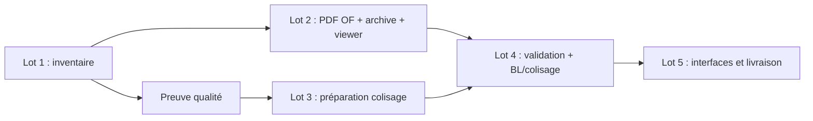

# FC-8 — Lot 1 : Inventaire technique et plan d'implémentation

> **Statut : inventaire et planification uniquement. Aucun développement applicatif n'est inclus.**
>
> Branche de travail : `feature/FC-8-technical-design`
> Commit de base : `414814d2d78f67e19ddece7f711f4932051a6db4`
> Document de référence : [FC-8-TECHNICAL-DESIGN.md](FC-8-TECHNICAL-DESIGN.md)
> Date d'analyse : 2026-11-11
> Périmètre : préparation des Lots 2 à 5 de FC-8.

## Sommaire

1. [Synthèse de l'architecture existante](#1-synthèse-de-larchitecture-existante)
2. [Inventaire des composants réutilisables](#2-inventaire-des-composants-réutilisables)
3. [Écarts entre la conception et le code existant](#3-écarts-entre-la-conception-et-le-code-existant)
4. [Proposition de modèle de données](#4-proposition-de-modèle-de-données)
5. [Contrats de services](#5-contrats-de-services)
6. [Architecture Filament](#6-architecture-filament)
7. [Matrice de sécurité et d'intégrité](#7-matrice-de-sécurité-et-dintégrité)
8. [Dépendances PDF](#8-dépendances-pdf)
9. [Décisions métier en attente](#9-décisions-métier-en-attente)
10. [Découpage détaillé des Lots 2 à 5](#10-découpage-détaillé-des-lots-2-à-5)
11. [Ordre recommandé d'implémentation](#11-ordre-recommandé-dimplémentation)
12. [Critères d'acceptation globaux](#12-critères-dacceptation-globaux)
13. [Annexes](#13-annexes)

### Légende

| Marqueur | Signification |
| --- | --- |
| **Existant confirmé** | Présent dans le code au commit de base et vérifié. |
| **Existant à adapter** | Présent mais doit être étendu ou modifié pour FC-8. |
| **Nouveau** | À créer, absent du dépôt. |
| **Proposition** | Choix technique proposé, non implémenté. |
| **Décision métier** | Point qui nécessite une validation métier avant implémentation. |

---

## 1. Synthèse de l'architecture existante

### 1.1 Environnement réellement constaté

| Élément | Valeur constatée | Source |
| --- | --- | --- |
| Laravel | `13.39.0` | `composer show laravel/framework` |
| Contrainte Laravel | `^13.0` | `composer.json` |
| PHP CLI local | **`8.5.12`** | `php -v` |
| Contrainte PHP | `^8.3` | `composer.json` |
| Cible annoncée du projet | PHP 8.4 | contexte FC-8 |
| Filament | `5.11.0` | `composer show filament/filament` |
| Contrainte Filament | `~5.4` | `composer.json` |
| Livewire | `4.4.8` | `composer show livewire/livewire` |
| PHPUnit | `12.5.42` | `composer show --direct` |
| `spatie/laravel-package-tools` | `1.93.3` (transitif) | `composer show` |
| MySQL dev | `.env` : `DB_CONNECTION=mysql`, `DB_DATABASE=fab_c2me` | `.env` |
| SQLite tests | `phpunit.xml`, `:memory:` | `phpunit.xml` |
| MySQL tests | `phpunit.mysql.xml`, `fab_c2me_test` | `phpunit.mysql.xml` |
| Moteur PDF | **absent** | `composer.lock`, `composer.json` |
| Visionneuse PDF | **absente** | `composer.lock`, `composer.json` |
| Node PDF/Chromium | **absent** | `package.json`, `node_modules` |

**Écart d'environnement à traiter au Lot 2 :** la CLI locale est PHP 8.5.12 alors que la cible annoncée est PHP 8.4. Les contraintes Composer (`php ^8.3`) acceptent les deux, mais les tests de compatibilité PDF et la CI doivent être exécutés sur la version réellement déployée. Ne pas supposer que PHP 8.5 et PHP 8.4 sont interchangeables pour tous les packages.

### 1.2 Style d'architecture constaté

- Architecture **impérative par services** : les écrans Filament appellent des services, qui portent les règles, transactions, verrous et audits.
- Aucun `app/Events`, `app/Listeners`, `app/Observers`, `app/Jobs` ou `app/Notifications` métier.
- Deux panneaux Filament : `/admin` et `/workshop`.
- Autorisations par drapeaux utilisateurs et Policies, sans Spatie Permission.
- Journaux d'audit append-only pour les OF, opérations et qualité.
- Documents techniques sur disque privé, avec versions, snapshots et téléchargement authentifié.
- Transactions `DB::transaction(..., attempts: 3)` et verrous `lockForUpdate()`.
- Tests PHPUnit 12, SQLite par défaut, suite MySQL dédiée pour la concurrence.

### 1.3 Domaines existants

| Domaine | Éléments structurants | État |
| --- | --- | --- |
| Affaires / OF | `Job`, `WorkOrder`, `WorkOrderService`, `WorkOrderNumberGenerator` | **Existant confirmé** |
| Pièces / nomenclature | `WorkOrderItem`, `WorkOrderItemService`, `WorkOrderBomImport` | **Existant confirmé** |
| Atelier / temps | `WorkOrderOperation`, `OperationTimeEntry`, services FC-6 | **Existant confirmé** |
| Qualité FC-7 | `WorkOrderQualityControl`, `QualityClosureEligibilityService`, NC, dérogations, audit | **Existant confirmé** |
| Documents | `Document`, `DocumentVersion`, snapshots, stockage privé | **Existant confirmé** |
| Expéditions | Aucun modèle ni table | **Nouveau** |
| PDF OF | Aucun service, aucune archive | **Nouveau** |
| Preuve de libération qualité dédiée | Aucune table dédiée | **Nouveau** |

### 1.4 Contraintes de non-régression

- `WorkOrderClosureTest` clôture des OF sans contrôle qualité : le verrou FC-7 est conditionnel aux exigences obligatoires (`config/quality.php`, `closure.enforce_only_when_requirements_exist`). FC-8 ne doit pas modifier cette règle.
- `WorkOrderPolicy::view()` est actuellement réservé aux administrateurs.
- `WorkOrderService::delete()` n'autorise que les brouillons ; les nouvelles contraintes doivent empêcher la suppression d'un OF avec PDF ou expédition.
- `DocumentSnapshotService::refreshForWorkOrder()` n'accepte que `released`, `in_progress` et `quality_check` ; il n'est pas autorisé pour `completed` ou `cancelled`.
- `QualityClosureEligibilityService::evaluate()` retourne `eligible = true` pour un OF figé (`completed`/`cancelled`) à cause du court-circuit `isLocked()`. Il ne doit pas être utilisé tel quel pour l'expédition.
- Aucun champ `function` ou rôle RH n'existe dans `users`.
- Aucune validation atelier explicite n'existe dans le code actuel.

---

## 2. Inventaire des composants réutilisables

### 2.1 Ordres de fabrication

| Composant | Chemin | Constat | Usage FC-8 |
| --- | --- | --- | --- |
| `WorkOrder` | `app/Models/WorkOrder.php` | Relations `job`, `items`, `operations`, `documents`, `documentSnapshots`, `qualityControls`, `qualityResults`, `nonConformities`, `qualityDeviations`, `auditLogs`, `operationAuditLogs` ; méthodes `isRoutingEditable`, `isLocked`, `allowsOperationExecution`, `isAccessibleBy`, `hasRecordedItemProduction` | **Existant confirmé** ; ajouter relations `qualityReleases`, `shipments`, `generatedDocuments` |
| `WorkOrderStatus` | `app/Enums/WorkOrderStatus.php` | `draft`, `ready`, `released`, `in_progress`, `quality_check`, `completed`, `cancelled` ; matrice de transitions | **Existant confirmé** ; ne pas modifier la matrice |
| `WorkOrderService` | `app/Services/WorkOrderService.php` | `create`, `update`, `transitionTo`, `approveByBE`, `delete`, `lockForMutation` | **Existant à adapter** : écrire la preuve qualité à la clôture, renforcer `delete()` |
| `WorkOrderNumberGenerator` | `app/Services/WorkOrderNumberGenerator.php` | Compteur annuel, verrou `lockForUpdate()` | **Existant confirmé** ; modèle pour `ShipmentNumberGenerator` |
| `WorkOrderAuditService` | `app/Services/WorkOrderAuditService.php` | `record()` transactionnel | **Existant à adapter** : nouveaux événements PDF |
| `WorkOrderAuditLog` | `app/Models/WorkOrderAuditLog.php` | Journal immuable | **Existant confirmé** |
| `WorkOrderAuditEvent` | `app/Enums/WorkOrderAuditEvent.php` | Événements existants, dont `be_approved`, `released`, `completed` | **Existant à adapter** : ajouter événements PDF |
| `WorkOrderPolicy` | `app/Policies/WorkOrderPolicy.php` | `view`, `update`, `delete`, `transition`, `approveBE`, `manageItems`, `manageRouting`, `reReviewDocuments` | **Existant à adapter** : `generatePdf`, `viewPdf` |
| `WorkOrderResource` | `app/Filament/Resources/WorkOrders/WorkOrderResource.php` | Relation managers et pages | **Existant à adapter** : PDF et expéditions |
| `WorkOrdersTable` | `app/Filament/Resources/WorkOrders/Tables/WorkOrdersTable.php` | Actions de transition, approbation, `notifyRefusal()` | **Existant confirmé** ; réutiliser les patterns |
| `ViewWorkOrder` | `app/Filament/Resources/WorkOrders/Pages/ViewWorkOrder.php` | Header actions | **Existant à adapter** : action PDF |
| `WorkOrderInfolist` | `app/Filament/Resources/WorkOrders/Schemas/WorkOrderInfolist.php` | Sections et rendus Blade | **Existant confirmé** ; peut accueillir un lien PDF |

### 2.2 Pièces, quantités et nomenclature

| Composant | Chemin | Constat | Usage FC-8 |
| --- | --- | --- | --- |
| `WorkOrderItem` | `app/Models/WorkOrderItem.php` | `mark`, `quantity_planned`, `quantity_produced`, `quantity_rejected`, `accepted_quantity`, `remaining_quantity`, `status` | **Existant confirmé** ; ajouter relation `shipmentLines` |
| `WorkOrderItemService` | `app/Services/WorkOrderItemService.php` | Création, mise à jour, production, clôture, annulation, suppression, fusion | **Existant à adapter** : refuser la suppression d'un repère expédié |
| `WorkOrderItemPolicy` | `app/Policies/WorkOrderItemPolicy.php` | Administration et états | **Existant confirmé** ; la règle d'expédition sera dans le service |
| `WorkOrderItemStatus` | `app/Enums/WorkOrderItemStatus.php` | États de production | **Existant confirmé** |
| `WorkOrderItemSummary` | `app/DTO/WorkOrderItemSummary.php` | Agrégats de quantités et poids | **Existant confirmé** ; réutiliser pour le PDF |
| `WorkOrderBomImport` | `app/Models/WorkOrderBomImport.php` | Historique des imports | **Existant confirmé** ; ne pas modifier sa logique |

### 2.3 Atelier, opérations et temps

| Composant | Chemin | Constat | Usage FC-8 |
| --- | --- | --- | --- |
| `WorkOrderOperation` | `app/Models/WorkOrderOperation.php` | Opérations OF, statuts, audit, temps | **Existant confirmé** |
| `WorkOrderOperationService` | `app/Services/WorkOrderOperationService.php` | `start`, `pause`, `resume`, `block`, `unblock`, `complete`, `cancel` | **Existant confirmé** |
| `OperationTimeEntry` | `app/Models/OperationTimeEntry.php` | Sessions de temps, index unique de session active | **Existant confirmé** |
| `OperationTimeAggregationService` | `app/Services/OperationTimeAggregationService.php` | Agrégats par opération/OF | **Existant confirmé** ; réutiliser pour le PDF |
| `WorkOrderOperationAuditLog` | `app/Models/WorkOrderOperationAuditLog.php` | Journal immuable ; événement `completed` | **Existant confirmé** ; source d'avancement atelier, pas de visa |
| `WorkOrderOperationAuditService` | `app/Services/WorkOrderOperationAuditService.php` | Écriture du journal atelier | **Existant confirmé** |

**Point vérifié :** les opérations sont au niveau de l'OF, pas de la pièce. `work_order_operations` ne contient pas `work_order_item_id`. Le PDF doit rester au niveau OF ; ne pas inventer une gamme par repère.

### 2.4 Qualité FC-7

| Composant | Chemin | Constat | Usage FC-8 |
| --- | --- | --- | --- |
| `QualityClosureEligibilityService` | `app/Services/QualityClosureEligibilityService.php` | `evaluate()`, phases `release` et `closure`, court-circuit `isLocked()` | **Existant à adapter** : phases `shipment` et `historical_review`, `ignoreLocked` |
| `QualityControlEvaluationService` | `app/Services/QualityControlEvaluationService.php` | `progress()`, `recalculate()`, résultats retenus | **Existant confirmé** ; réutiliser sans duplication |
| `WorkOrderQualityControl` | `app/Models/WorkOrderQualityControl.php` | Contrôles générés, snapshots, points | **Existant confirmé** |
| `WorkOrderQualityControlPoint` | `app/Models/WorkOrderQualityControlPoint.php` | Points, résultats requis, validations | **Existant confirmé** |
| `QualityControlResult` | `app/Models/QualityControlResult.php` | Résultats append-only | **Existant confirmé** |
| `QualityControlResultValidation` | `app/Models/QualityControlResultValidation.php` | Validations append-only | **Existant confirmé** |
| `NonConformity` | `app/Models/NonConformity.php` | NC, statuts, blocage, vérifications | **Existant confirmé** |
| `QualityDeviation` | `app/Models/QualityDeviation.php` | Dérogations, statuts, expiration | **Existant confirmé** |
| `QualityAuditService` | `app/Services/QualityAuditService.php` | Écriture `quality_audit_logs` | **Existant confirmé** ; source de trace, pas de preuve de libération dédiée |
| `QualityAuditLog` | `app/Models/QualityAuditLog.php` | Journal immuable, `closure_evaluated` | **Existant confirmé** ; ne pas considérer comme preuve de libération |
| `QualityClosurePolicy` | `app/Policies/QualityClosurePolicy.php` | Consultation de l'éligibilité | **Existant confirmé** |
| `config/quality.php` | `config/quality.php` | `closure.enforce_only_when_requirements_exist = true` | **Existant confirmé** ; ne pas modifier la règle |

**Lacune majeure :** aucune table `work_order_quality_releases` n'existe. `quality_audit_logs.event = closure_evaluated` est une trace d'audit, pas une preuve dédiée de libération avec identité, date, éligibilité et hash structurés.

### 2.5 Documents, révisions et stockage

| Composant | Chemin | Constat | Usage FC-8 |
| --- | --- | --- | --- |
| `Document` | `app/Models/Document.php` | `job`, `workOrder`, `versions`, `currentVersion`, `latestApprovedVersion`, `snapshots`, `auditLogs`, `resolvedJobId` | **Existant confirmé** ; source des documents d'expédition |
| `DocumentVersion` | `app/Models/DocumentVersion.php` | `revision`, `version_number`, `storage_disk`, `storage_path`, `sha256`, `status`, validations | **Existant confirmé** |
| `WorkOrderDocumentSnapshot` | `app/Models/WorkOrderDocumentSnapshot.php` | Snapshots `release`, `be_approval`, `re_review` | **Existant confirmé** |
| `DocumentApplicabilityService` | `app/Services/DocumentApplicabilityService.php` | `applicableDocumentsFor`, `snapshotsWithImpact`, `releaseSnapshotsFor`, `impactedReleasedWorkOrders` | **Existant confirmé** |
| `DocumentSnapshotService` | `app/Services/DocumentSnapshotService.php` | `captureForRelease`, `captureForBEApproval`, `isBEApprovalStillValid`, `refreshForWorkOrder` | **Existant confirmé** ; `refreshForWorkOrder` limité aux statuts `released`, `in_progress`, `quality_check` |
| `DocumentStorageService` | `app/Services/DocumentStorageService.php` | `store(UploadedFile)`, MIME, SHA-256, disque privé | **Existant confirmé** ; ne stocke pas des bytes générés |
| `DocumentVersionService` | `app/Services/DocumentVersionService.php` | Upload, soumission, approbation, refus, indice | **Existant confirmé** ; ne pas détourner pour les PDF générés |
| `DocumentService` | `app/Services/DocumentService.php` | Création, mise à jour, archivage | **Existant confirmé** |
| `DocumentDownloadController` | `app/Http/Controllers/DocumentDownloadController.php` | `Gate::authorize('download', $version)` + `Storage::download()` | **Existant confirmé** ; modèle pour les routes PDF |
| `DocumentPolicy` | `app/Policies/DocumentPolicy.php` | Accès admin uniquement | **Existant confirmé** ; ne pas élargir sans décision |
| `DocumentVersionPolicy` | `app/Policies/DocumentVersionPolicy.php` | Accès admin uniquement | **Existant confirmé** |
| `config/documents.php` | `config/documents.php` | Disque `documents`, 50 Mo, MIME/extensions | **Existant confirmé** |
| `config/filesystems.php` | `config/filesystems.php` | Disques `local`, `documents`, `bom_imports`, `public`, `s3` | **Existant à adapter** : ajouter `generated_documents` |
| `DocumentCategory` | `app/Enums/DocumentCategory.php` | Inclut `shipping_document` | **Existant confirmé** |
| `DocumentAuditLog` | `app/Models/DocumentAuditLog.php` | Journal applicatif, **pas immuable techniquement** | **Existant confirmé** ; ne pas réutiliser comme journal d'expédition |

### 2.6 Utilisateurs et habilitations

| Composant | Chemin | Constat | Usage FC-8 |
| --- | --- | --- | --- |
| `User` | `app/Models/User.php` | `name`, `email`, `is_admin`, `is_workshop_supervisor`, `is_quality_manager` | **Existant confirmé** ; aucune fonction RH |
| `User::canAccessPanel` | `app/Models/User.php` | admin = `is_admin` ; workshop = authentifié | **Existant confirmé** |
| `User::isWorkshopSupervisor` | `app/Models/User.php` | Responsable atelier | **Existant confirmé** |
| `User::isQualityManager` | `app/Models/User.php` | Responsable qualité | **Existant confirmé** |
| `User::canValidateQualityControls` | `app/Models/User.php` | Admin, atelier, qualité | **Existant confirmé** |
| `User::canViewQualityHistory` | `app/Models/User.php` | Admin, atelier, qualité | **Existant confirmé** |
| Spatie Permission | absent | Aucun package de rôles | **Existant confirmé** ; ne pas installer |

**Constat :** `users` ne contient ni `function`, ni `job_title`, ni rôle BE. La fonction affichée dans les visas sera dérivée des drapeaux, conformément au document de conception. Ne pas inventer de champ RH.

### 2.7 Filament

| Composant | Chemin | Constat | Usage FC-8 |
| --- | --- | --- | --- |
| Admin panel | `app/Providers/Filament/AdminPanelProvider.php` | Découverte automatique des ressources/pages/widgets | **Existant confirmé** |
| Workshop panel | `app/Providers/Filament/WorkshopPanelProvider.php` | Ressources explicites, pages atelier/qualité | **Existant à adapter** : expéditions et PDF atelier |
| WorkOrderResource | `app/Filament/Resources/WorkOrders/WorkOrderResource.php` | Pages et relation managers | **Existant à adapter** |
| WorkOrdersTable | `app/Filament/Resources/WorkOrders/Tables/WorkOrdersTable.php` | Actions de transition, approbation, documents | **Existant confirmé** |
| ViewWorkOrder | `app/Filament/Resources/WorkOrders/Pages/ViewWorkOrder.php` | Header actions | **Existant à adapter** |
| WorkOrderInfolist | `app/Filament/Resources/WorkOrders/Schemas/WorkOrderInfolist.php` | Sections qualité/documents/audit | **Existant à adapter** |
| WorkOrderDocumentActions | `app/Filament/Resources/WorkOrders/Actions/WorkOrderDocumentActions.php` | Pattern action + service + notification | **Existant confirmé** ; modèle pour PDF |
| ItemsRelationManager | `app/Filament/Resources/WorkOrders/RelationManagers/ItemsRelationManager.php` | Gestion des pièces | **Existant confirmé** ; modèle pour lignes d'expédition |
| Documents resource | `app/Filament/Resources/Documents/DocumentResource.php` | Documents techniques | **Existant confirmé** ; ne pas détourner |
| Workshop resources | `app/Filament/Workshop/Resources` | Opérations, contrôles qualité | **Existant confirmé** |

### 2.8 Audit et concurrence

| Mécanisme | Chemin | Constat |
| --- | --- | --- |
| OF audit | `app/Models/WorkOrderAuditLog.php`, `app/Services/WorkOrderAuditService.php` | Immuable, transactionnel |
| Opérations audit | `app/Models/WorkOrderOperationAuditLog.php` | Immuable |
| Qualité audit | `app/Models/QualityAuditLog.php`, `app/Services/QualityAuditService.php` | Immuable |
| Documents audit | `app/Models/DocumentAuditLog.php` | Journal applicatif non protégé techniquement |
| Transactions | Services existants | `DB::transaction(..., attempts: 3)` |
| Verrous | Services existants | `lockForUpdate()` sur OF, pièces, documents |
| Concurrence MySQL | `tests/Feature/QualityControlConcurrencyTest.php` | Pattern `assertRowIsLocked()` |

### 2.9 Tests et helpers

| Élément | Chemin | Réutilisation |
| --- | --- | --- |
| `BuildsQualityPlan` | `tests/Feature/Concerns/BuildsQualityPlan.php` | Créer modèle, exigence, gamme, OF, pièces, libération |
| `BuildsQualityEligibilityScenarios` | `tests/Feature/Concerns/BuildsQualityEligibilityScenarios.php` | Contrôles, résultats validés, NC, dérogations |
| `WorkOrderClosureTest` | `tests/Feature/WorkOrderClosureTest.php` | Non-régression du verrou conditionnel |
| `DatabaseSchemaTest` | `tests/Feature/DatabaseSchemaTest.php` | Assertions de schéma |
| `FilamentAuthorizationTest` | `tests/Feature/FilamentAuthorizationTest.php` | Accès panneaux et Policies |
| `QualityControlConcurrencyTest` | `tests/Feature/QualityControlConcurrencyTest.php` | Verrou MySQL |

---

## 3. Écarts entre la conception et le code existant

| # | Élément de conception | Constat dans le code | Traitement |
| --- | --- | --- | --- |
| E1 | `work_order_quality_releases` | Table absente | **Nouveau** |
| E2 | `quality_audit_logs.closure_evaluated` comme preuve | Trace d'audit, pas preuve dédiée | **Ne pas réutiliser comme visa** ; créer la table dédiée |
| E3 | Évaluation `shipment` sans `isLocked()` | `evaluate()` court-circuite les OF figés | **Existant à adapter** |
| E4 | Évaluation `historical_review` | Aucune phase dédiée | **Nouveau** |
| E5 | `generated_documents` | Table absente | **Nouveau** |
| E6 | PDF d'OF | Aucun service, aucun moteur, aucune archive | **Nouveau** |
| E7 | Visionneuse PDF | Aucun plugin, aucun composant | **Nouveau** |
| E8 | `shipments` | Aucun modèle/table | **Nouveau** |
| E9 | Colis et lignes de colisage | Aucun modèle/table | **Nouveau** |
| E10 | BL et liste de colisage | Aucun modèle/table | **Nouveau** (`generated_documents`) |
| E11 | Preuve documentaire de révision | `shipment_document_reviews` absent | **Nouveau** |
| E12 | Rôle décisionnaire de revue | `ShipmentPolicy::decideDocumentReview` absent ; `WorkOrderPolicy::reReviewDocuments` admin-only | **Décision métier P7** |
| E13 | `refreshForWorkOrder()` sur OF terminé | Limité à `released`, `in_progress`, `quality_check` | **Décision métier P7** |
| E14 | Fonction RH dans les visas | Aucun champ `function` | **Dériver des drapeaux**, ne pas inventer |
| E15 | Validation atelier | Aucun événement/table | **Nouveau hors MVP**, décision P6 |
| E16 | PDF privé accessible atelier | `DocumentPolicy` admin-only ; `WorkOrderPolicy::view` admin-only | **Existant à adapter** : `viewPdf` |
| E17 | Accès PDF par IDOR | Routes PDF absentes | **Nouveau** + Policy + routes |
| E18 | Suppression d'un OF avec PDF/expédition | `WorkOrderService::delete` ne vérifie pas ces objets | **Existant à adapter** |
| E19 | Suppression d'un repère expédié | `WorkOrderItemService::delete` ne vérifie pas les expéditions | **Existant à adapter** |
| E20 | Numérotation d'expédition | `shipment_sequences` absent | **Nouveau** |
| E21 | Audit d'expédition | Aucun journal dédié | **Nouveau** |
| E22 | Événements PDF | `WorkOrderAuditEvent` ne contient pas d'événement PDF | **Existant à adapter** |
| E23 | Disque PDF | Aucun disque `generated_documents` | **Existant à adapter** (`config/filesystems.php`) |
| E24 | Routes PDF | Aucune route de consultation | **Nouveau** (`routes/web.php`) |
| E25 | Plugin/viewer | Absent | **Nouveau** après validation Lot 2 |
| E26 | Moteur PDF | Absent | **Nouveau** après validation Lot 2 |
| E27 | PHP 8.4 cible | CLI locale 8.5.12 | **Risque de compatibilité** à tester |
| E28 | Filament 5.4 de conception | Installé 5.11.0 | **À vérifier** avec les packages PDF |
| E29 | Transporteurs | Aucune table | **Texte libre au MVP**, pas de référentiel |
| E30 | Lots matière | Aucun modèle | **Hors MVP** |
| E31 | Reliquat | Aucune procédure | **Décision métier ultérieure**, non bloquant |
| E32 | PDF/A et rétention | Aucune configuration | **Décision P2**, non bloquant pour Lot 2 |

---

## 4. Proposition de modèle de données

### 4.1 Principes

- Ne pas modifier les tables existantes pour le cœur FC-8, sauf ajout de relations Eloquent et de garde-fous de service.
- Créer des tables additives, avec clés étrangères explicites.
- Utiliser `bigint` pour les PK, `unsignedInteger` pour les quantités, `decimal` pour les poids, `char(64)` pour SHA-256.
- Stocker les dates en UTC.
- Conserver les anciennes générations et les anciens snapshots.
- Appliquer les invariants complexes par service sous verrou ; les index uniques sont la dernière barrière.
- Ne pas utiliser de `CHECK` SQL pour les quantités, pour rester portable SQLite/MySQL/MariaDB.

### 4.2 `work_order_quality_releases` — **Nouveau**

Preuve dédiée de libération qualité, écrite depuis le processus FC-7.

| Colonne | Type SQL | Contraintes |
| --- | --- | --- |
| `id` | `bigint unsigned` | PK |
| `work_order_id` | `bigint unsigned` | FK `work_orders.id`, `restrictOnDelete`, index |
| `released_by` | `bigint unsigned` | nullable, FK `users.id`, `nullOnDelete` |
| `released_at` | `timestamp` | requis |
| `phase` | `varchar(20)` | `closure` par défaut ; `historical_review` pour une re-libération forcée |
| `eligible` | `boolean` | requis, défaut `false` |
| `requirements_present` | `boolean` | requis, défaut `false` |
| `eligibility_snapshot` | `json` | nullable ; `ClosureEligibility::toArray()` |
| `snapshot_hash` | `char(64)` | nullable ; SHA-256 du snapshot normalisé |
| `rules_version` | `varchar(50)` | nullable ; empreinte/version de la configuration qualité |
| `reason` | `varchar(20)` | `completion`, `re_release`, `historical_review` |
| `comment` | `text` | nullable ; requis pour une re-libération |
| `created_at` | `timestamp` | `useCurrent()` |

Index :

- `index(work_order_id, released_at)` ;
- `index(released_at)` ;
- aucun `unique(work_order_id)` : l'historique est append-only.

Relations Eloquent :

- `WorkOrderQualityRelease::workOrder()` ;
- `WorkOrderQualityRelease::releaser()`.

Modèle : `$timestamps = false`, `created_at` géré par la base, `performUpdate()` et `performDeleteOnModel()` interdits.

Contraintes applicatives :

- une preuve n'est jamais modifiée ni supprimée ;
- la preuve courante est la dernière ligne par `released_at`, puis `id` ;
- `eligible = true` est obligatoire pour un visa Qualité et une expédition ;
- aucune preuve ne peut être créée par migration, seeder ou backfill ;
- `historical_review` exige un commentaire et une évaluation FC-7 hors `isLocked()`.

### 4.3 `generated_documents` — **Nouveau**

Archive privée des PDF générés (OF, BL, liste de colisage).

| Colonne | Type SQL | Contraintes |
| --- | --- | --- |
| `id` | `bigint unsigned` | PK |
| `work_order_id` | `bigint unsigned` | FK `work_orders.id`, `restrictOnDelete`, index |
| `shipment_id` | `bigint unsigned` | nullable, FK `shipments.id`, `restrictOnDelete`, index |
| `type` | `varchar(30)` | `work_order_pdf`, `delivery_note`, `packing_list` |
| `scope_key` | `varchar(100)` | ex. `wo:123:work_order_pdf`, `shp:45:delivery_note` |
| `version` | `int unsigned` | version par portée/type |
| `reference` | `varchar(50)` | unique, ex. `OF-2026-0001-PDF-0001` |
| `status` | `varchar(20)` | `archived`, `superseded`, `cancelled` |
| `disk` | `varchar(32)` | disque privé `generated_documents` |
| `path` | `varchar(500)` | unique ; chemin UUID généré serveur |
| `original_filename` | `varchar(255)` | nom lisible |
| `mime_type` | `varchar(150)` | `application/pdf` |
| `size_bytes` | `bigint unsigned` | taille réelle |
| `sha256` | `char(64)` | empreinte, index |
| `template_version` | `varchar(30)` | version du gabarit |
| `source_data_hash` | `char(64)` | hash des données sources |
| `of_revision` | `varchar(100)` | nullable ; libellé calculé |
| `revision_snapshot` | `json` | nullable ; révisions documentaires utilisées |
| `visa_snapshot` | `json` | nullable ; état des quatre visas |
| `generated_by` | `bigint unsigned` | nullable, FK `users.id`, `nullOnDelete` |
| `generated_at` | `timestamp` | requis |
| `supersedes_id` | `bigint unsigned` | nullable, FK self, `nullOnDelete` |
| `superseded_at` | `timestamp` | nullable |
| `notes` | `text` | nullable |
| `created_at`, `updated_at` | `timestamp` | |

Contraintes :

- `unique(reference)` ;
- `unique(scope_key, version)` ;
- `index(work_order_id, type, generated_at)` ;
- `index(shipment_id, type, generated_at)` ;
- `index(sha256)` ;
- `index(status)`.

Relations Eloquent :

- `GeneratedDocument::workOrder()` ;
- `GeneratedDocument::shipment()` ;
- `GeneratedDocument::supersedes()` ;
- `GeneratedDocument::supersededBy()` ;
- `GeneratedDocument::generator()`.

Règles :

- fichier, hash, référence et version immuables ;
- seuls `status`, `superseded_at`, `supersedes_id` évoluent ;
- une nouvelle génération passe l'ancienne à `superseded` ;
- `cancelled` conserve le fichier ;
- aucune suppression physique ;
- `visa_snapshot` suit la structure du §8.9.4 du document de conception ;
- la suppression de l'OF est interdite par `restrictOnDelete`.

### 4.4 Expéditions — **Nouveau**

#### 4.4.1 `shipment_sequences`

| Colonne | Type | Contraintes |
| --- | --- | --- |
| `id` | bigint | PK |
| `year` | `smallint` | unique |
| `last_number` | `int unsigned` | défaut 0 |
| `created_at`, `updated_at` | timestamp | |

#### 4.4.2 `shipments`

| Colonne | Type | Contraintes |
| --- | --- | --- |
| `id` | bigint | PK |
| `work_order_id` | bigint | FK `work_orders.id`, `restrictOnDelete`, index |
| `number` | varchar(30) | unique, `EXP-AAAA-NNNN` |
| `status` | varchar(20) | `draft`, `prepared`, `validated`, `shipped`, `cancelled` |
| `planned_ship_at` | timestamp | nullable |
| `actual_ship_at` | timestamp | nullable ; requis à `shipped` |
| `carrier_name` | varchar(150) | nullable |
| `carrier_reference` | varchar(100) | nullable |
| `delivery_note_reference` | varchar(100) | nullable |
| `delivery_address` | varchar(255) | nullable |
| `notes` | text | nullable |
| `prepared_by`, `prepared_at` | bigint / timestamp | nullable |
| `validated_by`, `validated_at` | bigint / timestamp | nullable |
| `shipped_by` | bigint | nullable |
| `cancelled_by`, `cancelled_at` | bigint / timestamp | nullable |
| `cancellation_reason` | text | nullable ; requis à l'annulation |
| `created_by` | bigint | nullable |
| `created_at`, `updated_at` | timestamp | |

Contraintes :

- `unique(work_order_id, delivery_note_reference)` (NULL multiples autorisés) ;
- `index(work_order_id, status)` ;
- `index(status, planned_ship_at)`.

#### 4.4.3 `shipment_packages`

`id`, `shipment_id` (FK cascade), `code` varchar(50), `label` nullable, `package_type` varchar(30), `position` unsignedInteger, `weight_kg` decimal(12,3) nullable, dimensions nullable, `seal_number` nullable, `notes` nullable, timestamps.

- `unique(shipment_id, code)` ;
- `index(shipment_id, position)`.

#### 4.4.4 `shipment_lines`

`id`, `shipment_id` (FK cascade), `work_order_item_id` (FK restrict), `mark_snapshot`, `designation_snapshot`, `quantity_prepared` unsignedInteger, `quantity_shipped` unsignedInteger, `unit_weight_kg_snapshot` decimal(12,3) nullable, `notes` nullable, timestamps.

- `unique(shipment_id, work_order_item_id)` ;
- `index(work_order_item_id)`.

#### 4.4.5 `shipment_package_lines`

`id`, `shipment_package_id` (FK cascade), `shipment_line_id` (FK cascade), `quantity` unsignedInteger, timestamps.

- `unique(shipment_package_id, shipment_line_id)` ;
- `index(shipment_line_id)`.

**Intégrité croisée :** le colis et la ligne doivent appartenir à la même expédition. Contrôle par `ShipmentPackagingService`, pas par clé étrangère composite.

#### 4.4.6 `shipment_documents`

Documents sources (certificats, plans), pas les PDF générés.

`id`, `shipment_id` (FK cascade), `document_id` (FK restrict), `document_version_id` (nullable FK restrict), `role` varchar(30) (`material_certificate`, `certificate_of_conformity`, `plan`, `other`), `is_required` boolean, `reference_snapshot`, `revision_snapshot`, `sha256_snapshot`, `added_by`, `added_at`, timestamps.

- `unique(shipment_id, document_id, role)` ;
- `index(shipment_id, role)`.

#### 4.4.7 `shipment_document_reviews`

`id`, `shipment_id` (FK cascade), `work_order_id` (FK restrict), `status` varchar(20) (`pending`, `no_impact`, `reviewed`, `blocked`), `revision_snapshot` json, `reason` text nullable, `requested_by`/`requested_at`, `decided_by`/`decided_at`, `created_at`.

- append-only ;
- dernière ligne = décision courante ;
- `reason` requis pour `no_impact`, `reviewed` et `blocked` ;
- `pending`/`blocked` bloquent validation et départ.

#### 4.4.8 `shipment_audit_logs`

`id`, `shipment_id` nullable (FK nullOnDelete), `work_order_id` nullable, `shipment_number`, `work_order_number`, `user_id`, `event` varchar(50), `from_status`, `to_status`, `comment`, `metadata` json, `created_at`.

- immuable ;
- index `(shipment_id, created_at)`, `(work_order_id, created_at)`, `(event)`.

### 4.5 Relations Eloquent à ajouter

| Modèle | Relations |
| --- | --- |
| `WorkOrder` | `qualityReleases()`, `latestQualityRelease()`, `shipments()`, `generatedDocuments()` |
| `WorkOrderItem` | `shipmentLines()` |
| `WorkOrderQualityRelease` | `workOrder()`, `releaser()` |
| `GeneratedDocument` | `workOrder()`, `supersedes()`, `supersededBy()`, `generator()` au Lot 2 ; `shipment()` ajouté au Lot 3 |
| `Shipment` | `workOrder()`, `packages()`, `lines()`, `documents()`, `documentReviews()`, `generatedDocuments()`, `auditLogs()`, `creator()`, `preparer()`, `validator()`, `shipper()`, `canceller()` |
| `ShipmentPackage` | `shipment()`, `packageLines()` |
| `ShipmentLine` | `shipment()`, `item()`, `packageLines()` |
| `ShipmentPackageLine` | `package()`, `line()` |
| `ShipmentDocument` | `shipment()`, `document()`, `version()`, `addedBy()` |
| `ShipmentDocumentReview` | `shipment()`, `workOrder()`, `requester()`, `decider()` |
| `ShipmentAuditLog` | `shipment()`, `workOrder()`, `user()` |

### 4.6 Migrations à prévoir

Aucune migration ne doit être créée dans ce lot. Noms proposés, dans cet ordre :

```text
2026_11_11_000001_create_work_order_quality_releases_table.php
2026_11_11_000002_create_shipment_sequences_table.php
2026_11_11_000003_create_shipments_table.php
2026_11_11_000004_create_shipment_packages_table.php
2026_11_11_000005_create_shipment_lines_table.php
2026_11_11_000006_create_shipment_package_lines_table.php
2026_11_11_000007_create_shipment_documents_table.php
2026_11_11_000008_create_shipment_document_reviews_table.php
2026_11_11_000009_create_shipment_audit_logs_table.php
2026_11_11_000020_create_generated_documents_table.php
2026_11_11_000021_add_shipment_foreign_to_generated_documents_table.php
```

**Pourquoi cet ordre et cette coupure :** `generated_documents` est nécessaire dès le Lot 2 pour le PDF d'OF. Pour ne pas dépendre de la table `shipments` avant le Lot 3, sa migration du Lot 2 crée `shipment_id` nullable **sans clé étrangère**. La migration `000021`, livrée au Lot 3 après `shipments`, ajoute la contrainte de clé étrangère. L'état final est identique à celui du document de conception, mais l'ordre d'implémentation est respecté.

`work_order_quality_releases` est indépendant et doit être créé avant le Lot 4. Les tables `shipment_*` référencent `work_orders`, `documents` et `document_versions` déjà existants.

### 4.7 Colonnes et index à vérifier dans `DatabaseSchemaTest`

- présence de toutes les tables ;
- FK `restrictOnDelete` sur `work_orders`/`work_order_items` ;
- `unique(generated_documents.reference)` ;
- `unique(generated_documents.scope_key, version)` ;
- `unique(shipment_id, code)` ;
- `unique(shipment_id, work_order_item_id)` ;
- `unique(shipment_package_id, shipment_line_id)` ;
- index de statut et de date ;
- `visibility` privée du disque `generated_documents` (test de configuration, pas de schéma).

### 4.8 Données existantes à ne pas dupliquer

- Ne pas recopier `mark`, `designation`, `quantity_planned` dans une table de nomenclature parallèle ; les snapshots de lignes sont limités à l'historique d'expédition.
- Ne pas créer de table de documents techniques parallèle ; `shipment_documents` pointe vers `documents`/`document_versions`.
- Ne pas créer de table de contrôles qualité dans l'expédition ; réutiliser `work_order_quality_controls`.
- Ne pas créer de table de statuts d'OF dans l'expédition ; `WorkOrderStatus` reste la source.
- Ne pas recopier les opérations atelier dans le PDF ou dans l'expédition ; utiliser `work_order_operations` et les agrégats existants.

---

## 5. Contrats de services

### 5.1 `PdfRenderer` — interface **Nouveau**

**Responsabilité :** convertir une vue et des données en bytes PDF, sans connaître l'OF, l'expédition ou l'archivage.

| Méthode | Entrée | Retour | Exceptions | Dépendances |
| --- | --- | --- | --- | --- |
| `render(string $view, array $data, array $options = []): string` | Vue Blade, données, options papier/orientation | Bytes PDF | `RuntimeException` si le moteur échoue | Aucune dépendance métier |

**Contraintes :** pas de HTML utilisateur non échappé ; pas de chargement distant ; options de sécurité du moteur appliquées.

### 5.2 `DomPdfRenderer` — **Nouveau**

**Responsabilité :** implémentation de `PdfRenderer` avec `barryvdh/laravel-dompdf`.

| Méthode | Entrée | Retour | Exceptions |
| --- | --- | --- | --- |
| `render(...)` | Vue, données, options | Bytes PDF | `RuntimeException` |

**Dépendances :** `Barryvdh\DomPDF\Facade\Pdf`.

**Transactions :** aucune.

**Audit :** aucun ; l'audit est porté par l'archive.

### 5.3 `WorkOrderPrintService` — **Nouveau**

**Responsabilité :** construire un `WorkOrderPrintData` cohérent et hashé depuis les données persistées, y compris les visas.

| Méthode | Entrée | Retour | Exceptions |
| --- | --- | --- | --- |
| `build(WorkOrder $workOrder): WorkOrderPrintData` | OF | DTO complet | `ValidationException` si l'OF est introuvable/incohérent |
| `dataHash(WorkOrderPrintData $data): string` | DTO | SHA-256 canonique | — |

**Dépendances :** `DocumentApplicabilityService`, `DocumentSnapshotService` (lecture), `WorkOrderItemService` (agrégats), `OperationTimeAggregationService`, `WorkOrderQualityControl`, `WorkOrderQualityReleaseService`, `WorkOrderPrintVisa` builder.

**Transactions :** transaction de lecture dans `WorkOrderPrintController` ou service ; pas de verrou long.

**Audit :** aucun directement ; `GeneratedDocumentArchiveService` écrit l'événement.

**Contenu :** affaire, OF, dates, documents, pièces, opérations, qualité, libération qualité, visas, historique, hash.

### 5.4 `WorkOrderPrintVisa` — **Nouveau DTO**

**Responsabilité :** représenter un visa avec :

- `type` (`bureau_etudes`, `liberation`, `qualite`, `atelier`) ;
- `status` (`effectue`, `non_effectue`, `non_renseigne`) ;
- `person_name`, `function_label`, `validated_at` ;
- `evidence_type`, `evidence_id`, `evidence_reference`.

**Règles :**

- BE : `work_orders.be_approved_by/at` + audit `be_approved` ;
- Libération : `released_by/at` + audit `released` ;
- Qualité : dernière `work_order_quality_releases` éligible ;
- Atelier : **non effectué** dans le code actuel ; la dernière opération terminée est une information d'avancement distincte.

### 5.5 `GeneratedDocumentStorageService` — **Nouveau**

**Responsabilité :** stocker les bytes PDF sur le disque privé, calculer SHA-256/taille, nettoyer en cas d'échec.

| Méthode | Entrée | Retour | Exceptions |
| --- | --- | --- | --- |
| `store(string $contents, string $directory, string $filename): array` | Bytes, répertoire, nom | `disk`, `path`, `size_bytes`, `sha256`, `mime_type` | `ValidationException` si écriture/hash échoue |
| `delete(string $disk, string $path): bool` | Disque, chemin | Booléen | — |

**Dépendances :** `Storage`, `config/pdf.php`, `Str::uuid()`.

**Transactions :** écriture fichier hors transaction ; l'appelant nettoie si la transaction DB échoue.

### 5.6 `GeneratedDocumentArchiveService` — **Nouveau**

**Responsabilité :** créer la ligne `generated_documents`, gérer version/scope, supersession et cohérence fichier/base.

| Méthode | Entrée | Retour | Exceptions |
| --- | --- | --- | --- |
| `archive(WorkOrder $workOrder, string $contents, GeneratedDocumentType $type, array $metadata, ?User $actor): GeneratedDocument` | OF, bytes, type, métadonnées | Document archivé | `ValidationException` |
| `archiveForShipment(Shipment $shipment, string $contents, GeneratedDocumentType $type, array $metadata, ?User $actor): GeneratedDocument` | Expédition, bytes, type | Document archivé | `ValidationException` |
| `markCancelled(Shipment $shipment, ?User $actor): void` | Expédition | — | — |

**Dépendances :** `GeneratedDocumentStorageService`, `WorkOrder`, `DB`. Les méthodes `archiveForShipment()` et `markCancelled()` ne sont livrées qu'au Lot 4, après création du modèle `Shipment`.

**Transactions :** verrou OF/expédition, calcul de version, insertion, supersession, audit.

**Audit :** `GeneratedDocumentAuditService`.

**Coupure d'implémentation :** le Lot 2 ne livre que `archive()` pour le PDF d'OF. Les méthodes d'expédition sont ajoutées au Lot 4 ; la relation `GeneratedDocument::shipment()` est ajoutée avec le schéma d'expédition au Lot 3.

### 5.7 `GeneratedDocumentAuditService` — **Nouveau**

**Responsabilité :** écrire les événements de génération/supersession/annulation dans le journal OF ou expédition.

| Méthode | Entrée | Retour | Exceptions |
| --- | --- | --- | --- |
| `recordGenerated(GeneratedDocument $document, ?User $actor): void` | Document | — | — |
| `recordSuperseded(GeneratedDocument $document, ?User $actor): void` | Document | — | — |
| `recordCancelled(GeneratedDocument $document, ?User $actor): void` | Document | — | — |

**Dépendances :** `WorkOrderAuditService` au Lot 2 ; `ShipmentAuditService` à partir du Lot 4.

**Décision :** ajouter les cas nécessaires à `WorkOrderAuditEvent` au Lot 2 et créer `ShipmentAuditEvent` au Lot 3 ; pas de table d'audit PDF séparée au MVP.

### 5.8 `WorkOrderQualityReleaseService` — **Nouveau**

**Responsabilité :** enregistrer et lire la preuve de libération qualité.

| Méthode | Entrée | Retour | Exceptions |
| --- | --- | --- | --- |
| `recordForCompletion(WorkOrder $workOrder, ClosureEligibility $eligibility, User $actor): WorkOrderQualityRelease` | OF, éligibilité, acteur | Preuve | `ValidationException` si non éligible |
| `recordHistoricalReview(WorkOrder $workOrder, ClosureEligibility $eligibility, User $actor, string $comment): WorkOrderQualityRelease` | OF, éligibilité, acteur, motif | Preuve | `ValidationException` |
| `latestFor(WorkOrder $workOrder): ?WorkOrderQualityRelease` | OF | Dernière preuve | — |
| `assertReleasedForShipment(WorkOrder $workOrder): WorkOrderQualityRelease` | OF | Preuve éligible | `ValidationException` |
| `snapshotHash(ClosureEligibility $eligibility): string` | Éligibilité | SHA-256 | — |

**Dépendances :** `WorkOrderQualityRelease` model, `QualityEligibilityEvaluator`.

**Transactions :** écriture dans la transaction de clôture ou de re-libération.

**Audit :** `QualityAuditService` + `WorkOrderAuditService`.

### 5.9 `QualityEligibilityEvaluator` / `QualityClosureEligibilityService` — **Existant à adapter**

**Responsabilité :** calcul unique de l'éligibilité FC-7, avec phases explicites.

| Méthode | Entrée | Retour | Exceptions |
| --- | --- | --- | --- |
| `evaluate(WorkOrder $workOrder, string $phase, bool $ignoreLocked = false): ClosureEligibility` | OF, phase, option | `ClosureEligibility` | — |
| `evaluateForShipment(WorkOrder $workOrder): ClosureEligibility` | OF | Éligibilité phase shipment | — |
| `evaluateForHistoricalReview(WorkOrder $workOrder): ClosureEligibility` | OF | Éligibilité phase historical_review | — |

**Phases :** `release`, `closure`, `shipment`, `historical_review`.

**Règles :** `shipment` et `historical_review` ne court-circuitent pas `isLocked()`. Aucune duplication des règles de contrôles/NC/dérogations.

**Dépendances :** services qualité existants.

### 5.10 `ShipmentNumberGenerator` — **Nouveau**

**Responsabilité :** générer `EXP-AAAA-NNNN` avec un compteur annuel verrouillé.

| Méthode | Entrée | Retour | Exceptions |
| --- | --- | --- | --- |
| `nextNumber(?int $year = null): string` | Année optionnelle | Numéro | `RuntimeException` si compteur invalide |

**Modèle :** `WorkOrderNumberGenerator`.

**Transactions :** `insertOrIgnore` + `lockForUpdate` dans la transaction de création.

### 5.11 `ShipmentService` — **Nouveau**

**Responsabilité :** orchestrer la création et les mutations de l'expédition, hors validation métier approfondie.

| Méthode | Entrée | Retour | Exceptions |
| --- | --- | --- | --- |
| `create(WorkOrder $workOrder, array $data, User $actor): Shipment` | OF, données d'en-tête, acteur | Expédition `draft` | `ValidationException` |
| `updateHeader(Shipment $shipment, array $data, User $actor): Shipment` | Expédition, données | Expédition | `ValidationException` |
| `addLine(Shipment $shipment, WorkOrderItem $item, int $quantity, User $actor): ShipmentLine` | Expédition, pièce, quantité | Ligne | `ValidationException` |
| `updateLine(ShipmentLine $line, int $quantity, User $actor): ShipmentLine` | Ligne, quantité | Ligne | `ValidationException` |
| `removeLine(ShipmentLine $line, User $actor): void` | Ligne | — | `ValidationException` |
| `prepare(Shipment $shipment, User $actor): Shipment` | Expédition | `prepared` | `ValidationException` |
| `reopen(Shipment $shipment, User $actor, string $reason): Shipment` | Expédition, motif | `draft` | `ValidationException` |
| `ship(Shipment $shipment, User $actor): Shipment` | Expédition | `shipped` | `ValidationException` |
| `cancel(Shipment $shipment, User $actor, string $reason): Shipment` | Expédition, motif | `cancelled` | `ValidationException` |

**Dépendances :** `ShipmentNumberGenerator`, `ShipmentQuantityGuard`, `ShipmentPackagingService`, `ShipmentAuditService`.

**Transactions :** `DB::transaction(..., attempts: 3)` ; verrou OF puis expédition.

**Audit :** création, préparation, réouverture, départ, annulation.

**Départ :** `ship()` revérifie la situation documentaire si une nouvelle révision est apparue depuis la validation, puis fige `actual_ship_at` et `quantity_shipped`.

**Annulation :** `cancel()` exige un motif (20 caractères si `validated`), marque les `generated_documents` de l'expédition `cancelled`, conserve les fichiers et libère la réservation. Une expédition `shipped` ne peut pas être annulée.

### 5.12 `ShipmentPackagingService` — **Nouveau**

**Responsabilité :** gérer les colis et la répartition physique ; vérifier l'intégrité et le colisage complet.

| Méthode | Entrée | Retour | Exceptions |
| --- | --- | --- | --- |
| `addPackage(Shipment $shipment, array $data, User $actor): ShipmentPackage` | Expédition, données | Colis | `ValidationException` |
| `updatePackage(ShipmentPackage $package, array $data, User $actor): ShipmentPackage` | Colis, données | Colis | `ValidationException` |
| `removePackage(ShipmentPackage $package, User $actor): void` | Colis | — | `ValidationException` |
| `assign(ShipmentLine $line, ShipmentPackage $package, int $quantity, User $actor): ShipmentPackageLine` | Ligne, colis, quantité | Affectation | `ValidationException` |
| `removeAssignment(ShipmentPackageLine $line, User $actor): void` | Affectation | — | `ValidationException` |
| `assertCompleteForValidation(Shipment $shipment): void` | Expédition | — | `ValidationException` |

**Contrôles :**

- colis et ligne de la même expédition ;
- quantité strictement positive ;
- somme colisée <= `quantity_prepared` en préparation ;
- somme colisée == `quantity_prepared` à la validation ;
- multi-colis et multi-pièces.

**Transactions :** appelé dans la transaction de préparation/validation.

### 5.13 `ShipmentQuantityGuard` — **Nouveau**

**Responsabilité :** calculer les quantités disponibles et refuser les dépassements.

| Méthode | Entrée | Retour | Exceptions |
| --- | --- | --- | --- |
| `availableForItem(WorkOrderItem $item, ?Shipment $ignored = null): int` | Pièce, expédition ignorée | Quantité disponible | — |
| `assertLineQuantity(ShipmentLine $line): void` | Ligne | — | `ValidationException` |
| `assertShipmentQuantities(Shipment $shipment): void` | Expédition | — | `ValidationException` |
| `committedQuantityForItem(WorkOrderItem $item): int` | Pièce | Quantité validée/expédiée | — |

**Règle de cumul :**

- `validated` : `quantity_prepared` réservée ;
- `shipped` : `quantity_shipped` réellement partie ;
- `draft`, `prepared`, `cancelled` : exclues.

### 5.14 `ShipmentValidationService` — **Nouveau**

**Responsabilité :** orchestrer la validation d'une expédition.

| Méthode | Entrée | Retour | Exceptions |
| --- | --- | --- | --- |
| `validate(Shipment $shipment, User $actor): Shipment` | Expédition | `validated` | `ValidationException` |

**Séquence :**

1. verrou OF ;
2. statut OF `completed` ;
3. dernière preuve qualité éligible ;
4. évaluation `shipment` ;
5. décision documentaire `no_impact` ou `reviewed` ;
6. verrou pièces/expédition/lignes/colis ;
7. quantités disponibles ;
8. `ShipmentPackagingService::assertCompleteForValidation()` ;
9. documents sources obligatoires figés ;
10. génération/archivage BL + liste de colisage ;
11. statut `validated`, audit, commit.

**Dépendances :** `ShipmentQualityGateService`, `ShipmentDocumentService`, `ShipmentQuantityGuard`, `ShipmentPackagingService`, `ShipmentPrintService`, `GeneratedDocumentArchiveService`, `ShipmentAuditService`.

### 5.15 `ShipmentQualityGateService` — **Nouveau**

**Responsabilité :** garde qualité de l'expédition.

| Méthode | Entrée | Retour | Exceptions |
| --- | --- | --- | --- |
| `assertShippable(WorkOrder $workOrder): WorkOrderQualityRelease` | OF | Preuve éligible | `ValidationException` |

**Contrôles :**

- statut `completed` ;
- dernière preuve `work_order_quality_releases` éligible ;
- `QualityEligibilityEvaluator::evaluateForShipment()` éligible ;
- aucune NC bloquante rouverte.

**Note :** ne pas appeler `evaluate()` sur un OF `completed` sans `ignoreLocked()`.

### 5.16 `ShipmentDocumentService` — **Nouveau**

**Responsabilité :** associer les documents sources, figer les versions et gérer les décisions documentaires.

| Méthode | Entrée | Retour | Exceptions |
| --- | --- | --- | --- |
| `attach(Shipment $shipment, Document $document, string $role, bool $required, User $actor): ShipmentDocument` | Expédition, document, rôle | Pivot | `ValidationException` |
| `detach(ShipmentDocument $document, User $actor): void` | Pivot | — | `ValidationException` |
| `freezeRequired(Shipment $shipment, User $actor): void` | Expédition | — | `ValidationException` |
| `compareRevisions(Shipment $shipment): array` | Expédition | Écarts | — |
| `assertDocumentSituationDecided(Shipment $shipment): void` | Expédition | — | `ValidationException` |
| `decide(Shipment $shipment, string $status, string $reason, User $actor): ShipmentDocumentReview` | Expédition, décision, motif | Décision | `ValidationException` |

**P7 :** le rôle autorisé à `decide()` reste à définir. Le service peut être testé avec un acteur injecté, mais la Policy ne doit pas présumer admin/qualité.

### 5.17 `ShipmentPrintService` — **Nouveau**

**Responsabilité :** produire les données et les vues du BL et de la liste de colisage.

| Méthode | Entrée | Retour | Exceptions |
| --- | --- | --- | --- |
| `buildDeliveryNote(Shipment $shipment): ShipmentPrintData` | Expédition | DTO | `ValidationException` |
| `buildPackingList(Shipment $shipment): ShipmentPrintData` | Expédition | DTO | `ValidationException` |
| `renderPdf(ShipmentPrintData $data, string $view): string` | DTO, vue | Bytes PDF | `RuntimeException` |

**Dépendances :** `PdfRenderer`, `GeneratedDocumentArchiveService`, `ShipmentAuditService`.

**Transactions :** génération/archivage dans la transaction de validation ; nettoyage des fichiers si échec.

### 5.18 Services existants à modifier

| Service | Modification | Justification |
| --- | --- | --- |
| `WorkOrderService` | Écrire `work_order_quality_releases` à `completed` ; refuser la suppression si PDF/expédition ; injecter le service qualité | Preuve et intégrité |
| `WorkOrderItemService` | Refuser la suppression/fusion d'un repère référencé par une expédition | Intégrité historique |
| `QualityClosureEligibilityService` | Ajouter `shipment`, `historical_review`, `ignoreLocked` | Réutilisation FC-7 |
| `WorkOrderPolicy` | `generatePdf`, `viewPdf` | Accès PDF |
| `WorkOrderResource` | Relation managers PDF/expéditions | Interface |
| `ViewWorkOrder` | Action Générer le PDF | Interface |
| `WorkOrderAuditEvent` | Événements PDF | Audit |
| `config/filesystems.php` | Disque `generated_documents` | Stockage privé |
| `routes/web.php` | Routes view/download PDF | Consultation sécurisée |
| `WorkshopPanelProvider` | Ressource Shipment + pages PDF atelier | Interface atelier |
| `WorkOrderItem` | Relation `shipmentLines()` | Lecture |
| `WorkOrder` | Relations `qualityReleases`, `shipments`, `generatedDocuments` | Lecture |

---

## 6. Architecture Filament

### 6.1 Principes

- Les écrans appellent les services ; aucune règle métier dans les formulaires.
- Les actions vérifient les Policies et attrapent `ValidationException` avec une `Notification`.
- Les relation managers existants servent de modèles.
- Les PDF sont affichés via `PdfViewerEntry` avec une `fileUrl` vers une route authentifiée, jamais un chemin privé.
- Le panneau atelier reçoit les ressources d'expédition et de consultation PDF ; les Policies filtrent.

### 6.2 OF — adaptations

| Élément | Adaptation |
| --- | --- |
| `WorkOrderResource` | Ajouter `GeneratedDocumentsRelationManager` et `ShipmentsRelationManager` |
| `ViewWorkOrder` | Ajouter `WorkOrderPrintActions::generatePdf()` |
| `WorkOrdersTable` | Optionnel : action « Voir PDF » ou « Générer PDF » si la Policy l'autorise |
| `WorkOrderInfolist` | Lien vers le dernier PDF et statut de génération |
| `WorkOrderPdfViewer` | Nouvelle page Filament avec `PdfViewerEntry` |
| `GeneratedDocumentsRelationManager` | Liste des générations, actions Voir/Télécharger, aucun Delete |

### 6.3 PDF OF

- `WorkOrderPrintActions::generatePdf()` : action de header, visible si `generatePdf`.
- `WorkOrderPrintController` : POST protégé, appelle `WorkOrderPrintService` + archive, redirige vers `WorkOrderPdfViewer`.
- `WorkOrderPdfViewer` : page Filament, `PdfViewerEntry::make('pdf')->fileUrl(fn () => route('generated-documents.view', $document))`.
- `GeneratedDocumentsRelationManager` : historique, statut `archived`/`superseded`, hash, auteur, date.
- Atelier : page `WorkOrderPdfViewer` enregistrée dans le panneau `workshop`, accessible via `viewPdf`.

Routes proposées :

```text
POST /work-orders/{workOrder}/pdf
  -> work-orders.pdf.generate

GET /generated-documents/{generatedDocument}/view
  -> generated-documents.view

GET /generated-documents/{generatedDocument}/download
  -> generated-documents.download
```

Les routes PDF utilisent l'authentification Filament et les Policies, comme `documents.versions.download` dans `routes/web.php`.

### 6.4 Shipments

| Élément | Contenu |
| --- | --- |
| `ShipmentResource` | Liste, création, vue, édition ; enregistrée dans admin et workshop |
| `ShipmentsTable` | Numéro, OF, statut, transporteur, BL, dates, colis, quantités |
| `ShipmentForm` | OF, dates, transporteur, référence BL, adresse, notes |
| `ViewShipment` | Actions Préparer, Rouvrir, Valider, Expédier, Annuler, Imprimer |
| `PackagesRelationManager` | Colis, code, type, poids, dimensions |
| `LinesRelationManager` | Repères, quantités préparées/expédiées |
| `DocumentsRelationManager` | Documents sources, rôle, obligatoire, version |
| `AuditLogsRelationManager` | Journal |
| `GeneratedDocumentsRelationManager` | BL/listes de colisage archivés |
| `ShipmentPdfViewer` | Visionneuse BL/colisage |

**Préparation :** les relation managers permettent de créer les lignes et colis ; les contrôles de cohérence restent dans `ShipmentPackagingService` et `ShipmentQuantityGuard`.

### 6.5 Panneau atelier

`WorkshopPanelProvider` enregistre :

- `ShipmentResource` (préparation, consultation) ;
- `WorkOrderPdfViewer` (consultation/téléchargement) ;
- `ShipmentPdfViewer` (BL/colisage) ;
- éventuellement une action depuis `WorkshopOperationResource` ou `QualityControlResource` pour ouvrir le PDF de l'OF.

La Policy `WorkOrderPolicy::viewPdf` utilise `WorkOrder::isAccessibleBy($user)` et le rôle atelier/qualité, sans élargir `update` ou `delete`. `WorkOrderPolicy::view()` reste inchangé (admin-only) pour éviter une régression d'accès aux fiches OF.

### 6.6 Fichiers Filament

**À créer :**

```text
app/Filament/Pages/WorkOrderPdfViewer.php
app/Filament/Pages/ShipmentPdfViewer.php
app/Filament/Resources/Shipments/ShipmentResource.php
app/Filament/Resources/Shipments/Pages/ListShipments.php
app/Filament/Resources/Shipments/Pages/CreateShipment.php
app/Filament/Resources/Shipments/Pages/ViewShipment.php
app/Filament/Resources/Shipments/Pages/EditShipment.php
app/Filament/Resources/Shipments/Schemas/ShipmentForm.php
app/Filament/Resources/Shipments/Schemas/ShipmentInfolist.php
app/Filament/Resources/Shipments/Tables/ShipmentsTable.php
app/Filament/Resources/Shipments/RelationManagers/PackagesRelationManager.php
app/Filament/Resources/Shipments/RelationManagers/LinesRelationManager.php
app/Filament/Resources/Shipments/RelationManagers/DocumentsRelationManager.php
app/Filament/Resources/Shipments/RelationManagers/AuditLogsRelationManager.php
app/Filament/Resources/Shipments/RelationManagers/GeneratedDocumentsRelationManager.php
app/Filament/Resources/Shipments/Actions/ShipmentActions.php
app/Filament/Resources/WorkOrders/Actions/WorkOrderPrintActions.php
app/Filament/Resources/WorkOrders/RelationManagers/GeneratedDocumentsRelationManager.php
app/Filament/Resources/WorkOrders/RelationManagers/ShipmentsRelationManager.php
```

**À modifier :**

- `app/Filament/Resources/WorkOrders/WorkOrderResource.php` ;
- `app/Filament/Resources/WorkOrders/Pages/ViewWorkOrder.php` ;
- `app/Filament/Resources/WorkOrders/Schemas/WorkOrderInfolist.php` ;
- `app/Providers/Filament/WorkshopPanelProvider.php`.

---

## 7. Matrice de sécurité et d'intégrité

### 7.1 Autorisations

| Action | Admin | Responsable atelier | Responsable qualité | Opérateur | Contrôle serveur |
| --- | --- | --- | --- | --- | --- |
| Générer un PDF d'OF | Oui | Non | Non | Non | `WorkOrderPolicy::generatePdf` |
| Voir/télécharger un PDF d'OF | Oui | Oui si accès OF | Oui si accès OF | Non | `WorkOrderPolicy::viewPdf` + `GeneratedDocumentPolicy` |
| Voir les anciennes générations | Oui | Oui si accès OF | Oui si accès OF | Non | `GeneratedDocumentPolicy::view` |
| Créer une expédition | Oui | Oui | Non | Non | `ShipmentPolicy::create` |
| Préparer le colisage | Oui | Oui | Non | Non | `ShipmentPolicy::prepare` |
| Valider le BL | Oui | Non | Non | Non | `ShipmentPolicy::validate` |
| Expédier | Oui | Non | Non | Non | `ShipmentPolicy::ship` |
| Annuler une expédition | Oui | Non | Non | Non | `ShipmentPolicy::cancel` |
| Décider une revue documentaire | **À définir P7** | **À définir P7** | **À définir P7** | Non | `ShipmentPolicy::decideDocumentReview` |
| Voir les documents sources | Oui | Selon Policy | Selon Policy | Non | `ShipmentDocumentPolicy` |
| Voir BL/liste de colisage | Oui | Oui si accès OF | Oui si accès OF | Non | `GeneratedDocumentPolicy` |

**Règle :** ne pas attribuer `decideDocumentReview` avant la décision P7. L'action Filament doit être absente ou refusée côté serveur tant que la Policy n'est pas définie.

`GeneratedDocumentPolicy::update` et `delete` doivent retourner `false` pour tous les profils : un PDF archivé n'est jamais modifié ni supprimé. Seuls `view`, `download` et `generate` sont exposés.

### 7.2 Protections existantes vs à développer

| Protection | État |
| --- | --- |
| Authentification Filament | **Existant** |
| Policies OF/items/qualité/documents | **Existant** |
| `WorkOrderPolicy::view` admin-only | **Existant**, à compléter par `viewPdf` |
| Verrou OF/pièces/documents | **Existant** |
| Audit OF/opérations/qualité | **Existant** |
| Transactions `attempts: 3` | **Existant** |
| Policies Shipment/GeneratedDocument | **Nouveau** |
| Routes PDF authentifiées | **Nouveau** |
| Contrôle IDOR PDF | **Nouveau** |
| Contrôle colisage complet | **Nouveau** |
| Contrôle de cumul quantités | **Nouveau** |
| Immutabilité `validated` | **Nouveau** |
| Annulation auditée | **Nouveau** |
| Suppression OF avec PDF/expédition | **Existant à adapter** |
| Suppression pièce expédiée | **Existant à adapter** |

### 7.3 IDOR et fichiers privés

Scénarios à couvrir :

- `/generated-documents/{id}/view` d'un autre OF ;
- `/generated-documents/{id}/download` d'un autre OF ;
- PDF d'une expédition d'un autre OF ;
- document source d'un autre OF ;
- action Filament forgée avec un ID de colis/ligne ;
- accès à une génération `superseded` d'un autre OF ;
- accès direct au chemin de stockage.

Réponse :

- Policy sur `GeneratedDocument` et `ShipmentDocument` ;
- contrôle `work_order_id` et `shipment_id` ;
- `Gate::authorize` avant toute lecture ;
- `Storage::response` / `Storage::download` ;
- aucun `Storage::url` pour le privé ;
- aucun chemin physique dans l'URL.

### 7.4 Quantités et concurrence

- verrou `work_order` en premier ;
- verrou `shipment` ensuite ;
- verrou lignes/colis ;
- `ShipmentQuantityGuard` sous verrou ;
- `ShipmentPackagingService::assertCompleteForValidation()` dans la transaction ;
- `unique(scope_key, version)` pour les PDF ;
- `unique(shipment_id, work_order_item_id)` pour les lignes ;
- `unique(shipment_package_id, shipment_line_id)` pour les affectations ;
- refus explicite de double validation ;
- aucune modification d'une expédition `validated` hors `ship`/`cancel`.

### 7.5 Immutabilité et audit

- `ShipmentAuditLog` immuable ;
- `work_order_quality_releases` append-only ;
- `generated_documents` contenu immuable ;
- `shipment_document_reviews` append-only ;
- `validated` figé ;
- `cancelled` conserve les PDF ;
- aucun delete physique ;
- `restrictOnDelete` sur les parents.

---

## 8. Dépendances PDF

### 8.1 État installé

| Package | État |
| --- | --- |
| `barryvdh/laravel-dompdf` | **Absent** |
| `spatie/laravel-pdf` | **Absent** |
| `dompdf/dompdf` | **Absent** |
| `joaopaulolndev/filament-pdf-viewer` | **Absent** |
| `spatie/laravel-package-tools` | `1.93.3` présent (transitif) |
| Chromium/Puppeteer/Playwright | **Absent** |

### 8.2 Compatibilité à vérifier au Lot 2

| Package | Contrainte déclarée | Compatibilité attendue |
| --- | --- | --- |
| `barryvdh/laravel-dompdf` 3.1.x | PHP `^8.1`, `illuminate/support ^13.0`, `dompdf/dompdf ^3.0` | Compatible Laravel 13.39 / PHP 8.4-8.5 sur le papier |
| `spatie/laravel-pdf` 2.14.x | PHP `^8.2`, `illuminate/contracts ^13.0` | Compatible sur le papier ; drivers additionnels |
| `joaopaulolndev/filament-pdf-viewer` 3.0.x | PHP `^8.2`, `filament/filament ^5.3`, `spatie/laravel-package-tools ^1.15` | Filament 5.11 satisfait ; Laravel 13 non explicitement déclaré, à tester |

**Tests de compatibilité Lot 2 :**

```powershell
composer require --dry-run barryvdh/laravel-dompdf:^3.1
composer require --dry-run joaopaulolndev/filament-pdf-viewer:^3.0
composer why-not barryvdh/laravel-dompdf ^3.1
composer why-not joaopaulolndev/filament-pdf-viewer ^3.0
```

Puis, sur une branche d'essai :

1. générer un PDF avec accents, tableaux, en-tête répété, saut de page ;
2. vérifier `%PDF-`, taille, hash ;
3. vérifier le rendu des polices et des tableaux ;
4. installer le viewer et vérifier l'iframe sur une route authentifiée ;
5. vérifier qu'aucun chemin privé ni `Storage::url` n'est utilisé ;
6. tester PHP 8.4 et la version réellement déployée (CLI locale 8.5.12).

### 8.3 Recommandation

**Principale :** `barryvdh/laravel-dompdf` 3.x + `joaopaulolndev/filament-pdf-viewer` 3.x.

**Justification :** rendu suffisant pour les tableaux d'atelier, aucune dépendance système, déploiement Ubuntu simple, compatible Laravel 13 sur le papier, maintenance faible.

**Alternative :** `spatie/laravel-pdf` + Chromium si le rendu CSS moderne devient indispensable. Plus lourd (Node/Chromium, mémoire, isolation). À ne pas retenir au MVP.

---

## 9. Décisions métier en attente

### 9.1 P1 — contrôle qualité pour tous les OF

**Comportement actuel :** verrou conditionnel FC-7 (`config/quality.php`, `enforce_only_when_requirements_exist`). Un OF sans exigence reste clôturable et expédiable si la preuve qualité est éligible.

**Décision en attente :** étendre ou non le contrôle à tous les OF.

**Impact :**

- aucune modification nécessaire pour FC-8 ;
- si extension : `QualityClosureEligibilityService`, `config/quality.php`, tests de non-régression ;
- non bloquant pour les Lots 2 à 5.

### 9.2 P2 — PDF/A et rétention

**Décision en attente :** archivage PDF/A, durée de conservation, purge.

**Impact :**

- `GeneratedDocument` et `config/pdf.php` ;
- commande de purge éventuelle ;
- non bloquant pour le Lot 2 ; à traiter avant la mise en production.

### 9.3 P6 — validation atelier dédiée

**Constat code :** aucune validation atelier explicite ; `work_order_operations.completed_at` et `work_order_operation_audit_logs.event = completed` ne prouvent que l'achèvement d'une opération.

**Décision en attente :** créer une validation atelier dédiée (table/événement) ou conserver le visa « Non effectué ».

**Impact :**

- aucune implémentation dans les Lots 2–5 ;
- si évolution : nouvelle structure, Policy, visa Atelier, tests ;
- non bloquant pour le MVP.

### 9.4 P7 — rôle et processus de revue documentaire

**Points de code concernés :**

- `app/Services/DocumentSnapshotService.php::refreshForWorkOrder()` : ajoute des snapshots `re_review`, limité à `released`, `in_progress`, `quality_check` ;
- `app/Policies/WorkOrderPolicy.php::reReviewDocuments()` : admin uniquement ; cette capacité concerne la remise en revue documentaire de l'OF, pas la décision d'expédition, et ne doit pas être réutilisée par défaut ;
- `app/Filament/Resources/WorkOrders/Actions/WorkOrderDocumentActions.php` : action de remise en revue ;
- `app/Services/DocumentApplicabilityService.php::impactedReleasedWorkOrders()` : exclut `completed`/`cancelled` ;
- nouveau `ShipmentDocumentService` et `shipment_document_reviews` ;
- `ShipmentPolicy::decideDocumentReview` ;
- `ShipmentValidationService` et `ShipmentService::ship()`.

**Décisions non prises :**

- rôle autorisé à `no_impact`, `reviewed`, `blocked` ;
- obligation de `refreshForWorkOrder()` avant `reviewed` ;
- traitement d'une révision postérieure à la clôture (`completed`/`cancelled`), pour laquelle `refreshForWorkOrder()` est refusé ;
- conséquence éventuelle sur le statut de l'OF (le design actuel ne bloque que l'expédition).

**Conséquences techniques possibles :**

| Option | Conséquence |
| --- | --- |
| Admin uniquement | `ShipmentPolicy::decideDocumentReview` admin ; UI admin |
| Responsable qualité | Ajouter une capacité dédiée ; UI qualité |
| Rôle dédié | Nouveau drapeau/Policies |
| Refresh obligatoire | `decide()` exige un snapshot `re_review` récent avant `reviewed` |
| Refresh non obligatoire | `reviewed` sans nouveau snapshot ; traçabilité moindre |
| OF `completed` | Bloquer l'expédition, ou définir une procédure dédiée ; ne pas forcer `refreshForWorkOrder()` |

**Bloquant :** le rôle et l'obligation de refresh doivent être tranchés avant la validation d'expédition du Lot 4. Le schéma et les statuts peuvent être créés avant.

### 9.5 Reliquat

**Décision acquise :** pas de clôture automatique de l'OF.

**Décision en attente :** traitement définitif (rebut, annulation, accord client, autre).

**Impact :** aucune table ni procédure au MVP ; non bloquant.

---

## 10. Découpage détaillé des Lots 2 à 5

### 10.1 Lot 2 — PDF OF, archivage et visionneuse

**Objectif :** générer un PDF réel, l'archiver, le consulter dans Filament et conserver l'historique.

**Dépendances :** validation des packages PDF/viewer ; aucune dépendance aux expéditions. Le Lot 2 peut démarrer après le spike de compatibilité.

**Fichiers à créer :**

```text
app/DTO/WorkOrderPrintData.php
app/DTO/WorkOrderPrintVisa.php
app/DTO/WorkOrderPrintItemLine.php
app/DTO/WorkOrderPrintOperationLine.php
app/DTO/WorkOrderPrintQualitySummary.php
app/Models/GeneratedDocument.php
app/Services/PdfRenderer.php
app/Services/DomPdfRenderer.php
app/Services/WorkOrderPrintService.php
app/Services/GeneratedDocumentStorageService.php
app/Services/GeneratedDocumentArchiveService.php
app/Services/GeneratedDocumentAuditService.php
app/Http/Controllers/WorkOrderPrintController.php
app/Http/Controllers/GeneratedDocumentController.php
app/Policies/GeneratedDocumentPolicy.php
app/Filament/Pages/WorkOrderPdfViewer.php
app/Filament/Resources/WorkOrders/Actions/WorkOrderPrintActions.php
app/Filament/Resources/WorkOrders/RelationManagers/GeneratedDocumentsRelationManager.php
resources/views/pdf/work-order.blade.php
resources/views/pdf/work-order-partials/*.blade.php
config/pdf.php
database/migrations/2026_11_11_000020_create_generated_documents_table.php
```

**Fichiers à modifier :**

```text
composer.json / composer.lock (uniquement après validation)
config/filesystems.php
routes/web.php
app/Policies/WorkOrderPolicy.php
app/Enums/WorkOrderAuditEvent.php
app/Filament/Resources/WorkOrders/WorkOrderResource.php
app/Filament/Resources/WorkOrders/Pages/ViewWorkOrder.php
app/Filament/Resources/WorkOrders/Schemas/WorkOrderInfolist.php
app/Providers/Filament/WorkshopPanelProvider.php (page PDF atelier)
```

**Migrations :** `generated_documents` avec `shipment_id` nullable **sans clé étrangère**. La FK `shipments` est ajoutée par `2026_11_11_000021_add_shipment_foreign_to_generated_documents_table.php` au Lot 3.

**Services :** `WorkOrderPrintService`, `PdfRenderer`, `DomPdfRenderer`, `GeneratedDocumentStorageService`, `GeneratedDocumentArchiveService` (méthode `archive()` uniquement), `GeneratedDocumentAuditService` (journal OF uniquement).

**Interfaces Filament :** action de génération, page visionneuse, relation manager des générations, action atelier en lecture seule.

**Tests :**

- `WorkOrderPrintServiceTest` ;
- `WorkOrderPdfGenerationTest` (vrai `%PDF-`) ;
- `WorkOrderPdfVisaTest` ;
- `WorkOrderPdfVisaSnapshotTest` ;
- `GeneratedDocumentArchiveTest` ;
- `GeneratedDocumentViewerTest` (auth, IDOR, archivé non régénéré) ;
- `WorkOrderPdfFilamentTest` ;
- `GeneratedDocumentConcurrencyTest` (MySQL).

**Critères d'acceptation :**

- PDF valide, archivé, hashé, lié à l'OF ;
- aucune régénération à la consultation ;
- anciennes générations consultables ;
- visas conformes au §8.9 du design ;
- Atelier « Non effectué » ;
- accès atelier en lecture seule ;
- aucun chemin privé exposé.

**Risques :** package viewer non compatible Laravel 13 ; rendu CSS Dompdf ; taille PDF ; oubli de nettoyage fichier.

### 10.2 Lot 3 — Preuve qualité et préparation du colisage

**Objectif :** créer la preuve de libération qualité, les tables d'expédition, les colis et la préparation.

**Dépendances :** Lot 2 pour `generated_documents` (le Lot 3 peut créer les tables d'expédition sans PDF, mais `generated_documents` est nécessaire aux PDF de BL au Lot 4). Le schéma `generated_documents` doit être en place.

**Fichiers à créer :**

```text
app/Enums/ShipmentStatus.php
app/Enums/ShipmentPackageType.php
app/Enums/ShipmentDocumentRole.php
app/Enums/ShipmentDocumentReviewStatus.php
app/Enums/ShipmentAuditEvent.php
app/Models/WorkOrderQualityRelease.php
app/Models/Shipment.php
app/Models/ShipmentPackage.php
app/Models/ShipmentLine.php
app/Models/ShipmentPackageLine.php
app/Models/ShipmentDocument.php
app/Models/ShipmentDocumentReview.php
app/Models/ShipmentAuditLog.php
app/Models/ShipmentSequence.php
app/Services/WorkOrderQualityReleaseService.php
app/Services/QualityEligibilityEvaluator.php (ou extension du service existant)
app/Services/ShipmentNumberGenerator.php
app/Services/ShipmentService.php
app/Services/ShipmentPackagingService.php
app/Services/ShipmentQuantityGuard.php
app/Services/ShipmentAuditService.php
app/Services/ShipmentDocumentService.php
app/Policies/ShipmentPolicy.php
app/Policies/ShipmentPackagePolicy.php
app/Policies/ShipmentDocumentPolicy.php
app/Filament/Resources/Shipments/*
config/shipping.php
```

**Fichiers à modifier :**

```text
app/Services/QualityClosureEligibilityService.php
app/Services/WorkOrderService.php
app/Services/WorkOrderItemService.php
app/Models/WorkOrder.php
app/Models/WorkOrderItem.php
app/Policies/WorkOrderPolicy.php (si nécessaire)
app/Providers/Filament/WorkshopPanelProvider.php
```

**Migrations :**

```text
work_order_quality_releases
shipment_sequences
shipments
shipment_packages
shipment_lines
shipment_package_lines
shipment_documents
shipment_document_reviews
shipment_audit_logs
2026_11_11_000021_add_shipment_foreign_to_generated_documents_table.php
```

**Services :** `WorkOrderQualityReleaseService`, extension `QualityClosureEligibilityService`, `ShipmentNumberGenerator`, `ShipmentService`, `ShipmentPackagingService`, `ShipmentQuantityGuard`, `ShipmentAuditService`, `ShipmentDocumentService`.

**Interfaces Filament :** `ShipmentResource` (préparation), relation managers packages/lines/documents/audit, actions préparation/réouverture.

**Tests :**

- `WorkOrderQualityReleaseTest` ;
- `WorkOrderHistoricalQualityReleaseTest` ;
- `ShipmentSchemaTest` ;
- `ShipmentPreparationTest` ;
- `ShipmentPackagingIntegrityTest` ;
- `ShipmentPackagingCompletionTest` ;
- `ShipmentPolicyTest` ;
- `ShipmentFilamentTest` ;
- `ShipmentDocumentTest` ;
- `ShipmentNumberConcurrencyTest` (MySQL).

**Critères d'acceptation :**

- preuve qualité écrite à la clôture ;
- re-libération historique explicite ;
- expéditions multiples, colis multi-pièces, pièce multi-colis ;
- pas de réservation à la préparation ;
- contrôles d'intégrité côté serveur ;
- aucune suppression d'un repère expédié.

**Risques :** complexité du colisage ; décisions P7 non prises pour les revues ; volumes.

### 10.3 Lot 4 — Validation, sortie d'atelier et expédition

**Objectif :** valider, réserver, expédier, annuler, générer BL/liste de colisage et tracer.

**Dépendances :** Lots 2 et 3 ; P7 tranché pour la décision documentaire ; P1/P6 non bloquants.

**Fichiers à créer :**

```text
app/Services/ShipmentValidationService.php
app/Services/ShipmentQualityGateService.php
app/Services/ShipmentPrintService.php
app/Filament/Pages/ShipmentPdfViewer.php
app/Filament/Resources/Shipments/Actions/ShipmentActions.php
resources/views/pdf/delivery-note.blade.php
resources/views/pdf/packing-list.blade.php
```

**Fichiers à modifier :**

```text
app/Services/ShipmentService.php
app/Services/ShipmentPackagingService.php
app/Services/ShipmentDocumentService.php
app/Policies/ShipmentPolicy.php
app/Filament/Resources/Shipments/ShipmentResource.php
app/Filament/Resources/Shipments/Pages/ViewShipment.php
app/Providers/Filament/WorkshopPanelProvider.php
```

**Migrations :** aucune nouvelle si le Lot 3 a créé les tables ; éventuellement des index correctifs uniquement après analyse.

**Services :** `ShipmentValidationService`, `ShipmentQualityGateService`, `ShipmentPrintService`, compléments de `ShipmentService`/`ShipmentDocumentService`.

**Interfaces Filament :** actions Valider, Expédier, Annuler, Imprimer ; visionneuse BL/colisage ; état `validated` figé.

**Tests :**

- `ShipmentValidationTest` ;
- `ShipmentQualityGateTest` ;
- `ShipmentDocumentReviewTest` ;
- `ShipmentShippingTest` ;
- `ShipmentCancellationConcurrencyTest` ;
- `ShipmentConcurrencyTest` ;
- `ShipmentQualityGateConcurrencyTest` ;
- tests PDF BL/liste.

**Critères d'acceptation :**

- OF `completed` + preuve qualité éligible ;
- décision documentaire `no_impact`/`reviewed` ;
- colisage complet ;
- quantités réservées à la validation ;
- BL + liste générés/archivés ;
- `validated` immuable hors `ship`/`cancel` ;
- annulation auditée et réservation libérée ;
- aucune validation concurrente.

**Risques :** P7 non tranché ; génération PDF dans la transaction ; verrous longs ; cas OF `completed`.

### 10.4 Lot 5 — Interfaces, tests et livraison

**Objectif :** finaliser l'expérience utilisateur, la documentation, les tests et la livraison.

**Fichiers à créer/modifier :**

- finalisation des `ShipmentResource` pages/schemas/tables ;
- `Workshop` pages PDF/expéditions ;
- dashboard widgets ;
- exports éventuels ;
- documentation ;
- seeders de démonstration ;
- tests d'autorisation complets.

**Tests :**

- Filament complet ;
- policies ;
- parcours atelier ;
- non-régression ;
- suite MySQL ciblée ;
- tests de performance PDF.

**Critères d'acceptation :**

- parcours complet OF → PDF → expédition → BL → départ ;
- atelier en lecture seule sur les PDF ;
- aucun IDOR ;
- toutes les décisions tracées ;
- documentation à jour ;
- aucune régression FC-6/FC-7/Documents.

### 10.5 Dépendances entre lots



**Note :** la preuve qualité (table + service) est une dépendance du Lot 4 ; elle peut être développée dans le Lot 3.

---

## 11. Ordre recommandé d'implémentation

1. **Spike PDF/visionneuse** (Lot 2) : compatibilité `barryvdh/laravel-dompdf`, viewer, PHP 8.4/8.5, Filament 5.11, Laravel 13.39. Aucun code métier.
2. **Preuve qualité + évaluateur** (Lot 3) : `work_order_quality_releases`, phases `shipment`/`historical_review`, `WorkOrderService`.
3. **Archive PDF + PDF OF + viewer** (Lot 2) : `generated_documents`, `PdfRenderer`, `WorkOrderPrintService`, routes, page Filament, relation manager.
4. **Schéma et modèles d'expédition** (Lot 3) : migrations, modèles, enums, policies.
5. **Préparation** (Lot 3) : `ShipmentService`, `ShipmentPackagingService`, `ShipmentQuantityGuard`, `ShipmentAuditService`, `ShipmentResource`.
6. **Validation et PDF BL/colisage** (Lot 4) : `ShipmentValidationService`, `ShipmentQualityGateService`, `ShipmentPrintService`, décisions documentaires P7.
7. **Départ, annulation, concurrence** (Lot 4) : `ship`, `cancel`, tests MySQL.
8. **Interfaces atelier et finalisation** (Lot 5) : PDF atelier, dashboard, exports, docs, tests complets.

**Parallélisation possible :**

- spike PDF et préparation du schéma qualité peuvent être menés en parallèle ;
- Lot 2 (PDF OF) et Lot 3 (schéma expédition) peuvent partiellement se chevaucher après validation des dépendances ;
- Lot 4 ne doit pas démarrer avant `generated_documents` et `work_order_quality_releases`.

---

## 12. Critères d'acceptation globaux

- Un PDF d'OF est généré côté serveur, archivé sur disque privé, référencé et hashé.
- Le PDF est consultable dans Filament et reste consultable sans régénération.
- Les anciennes générations sont conservées ; aucune n'est écrasée.
- Les visas BE, Libération et Qualité proviennent de preuves persistées ; le visa Atelier est « Non effectué » sans validation dédiée.
- Les visas n'affichent ni signature, ni image, ni signature électronique, ni cachet.
- Une preuve qualité dédiée existe ; un OF historique sans preuve est bloqué jusqu'à re-libération explicite.
- Plusieurs expéditions et un BL par expédition sont possibles.
- Les colis multi-pièces et les pièces multi-colis sont supportés.
- Le colisage complet est obligatoire avant validation du BL.
- Les quantités sont réservées à la validation, jamais à la préparation.
- Une expédition `validated` est figée sauf départ ou annulation auditée.
- Les quantités expédiées ne dépassent jamais les quantités acceptées.
- Les validations concurrentes ne peuvent pas réussir ensemble.
- Les PDF, documents sources et expéditions sont protégés contre l'IDOR.
- Les actions sont autorisées côté serveur, pas seulement dans Filament.
- Les journaux d'audit et les snapshots sont conservés.
- Aucune régression FC-6/FC-7/Documents.
- Les tests SQLite et MySQL ciblés passent.
- Le déploiement Ubuntu ne requiert pas de dépendance système supplémentaire avec Dompdf.

---

## 13. Annexes

### 13.1 Fichiers existants inspectés

**Modèles**

- `app/Models/WorkOrder.php`
- `app/Models/WorkOrderItem.php`
- `app/Models/WorkOrderOperation.php`
- `app/Models/WorkOrderQualityControl.php`
- `app/Models/WorkOrderQualityControlPoint.php`
- `app/Models/WorkOrderDocumentSnapshot.php`
- `app/Models/WorkOrderAuditLog.php`
- `app/Models/WorkOrderOperationAuditLog.php`
- `app/Models/Document.php`
- `app/Models/DocumentVersion.php`
- `app/Models/DocumentAuditLog.php`
- `app/Models/QualityAuditLog.php`
- `app/Models/OperationTimeEntry.php`
- `app/Models/Job.php`
- `app/Models/User.php`

**Services**

- `app/Services/WorkOrderService.php`
- `app/Services/WorkOrderItemService.php`
- `app/Services/WorkOrderOperationService.php`
- `app/Services/WorkOrderOperationAuditService.php`
- `app/Services/WorkOrderAuditService.php`
- `app/Services/WorkOrderNumberGenerator.php`
- `app/Services/WorkOrderRoutingService.php`
- `app/Services/WorkOrderQualityPlanService.php`
- `app/Services/QualityClosureEligibilityService.php`
- `app/Services/QualityControlEvaluationService.php`
- `app/Services/QualityAuditService.php`
- `app/Services/QualityReferenceGenerator.php`
- `app/Services/QualityEvidenceStorageService.php`
- `app/Services/DocumentService.php`
- `app/Services/DocumentVersionService.php`
- `app/Services/DocumentStorageService.php`
- `app/Services/DocumentApplicabilityService.php`
- `app/Services/DocumentSnapshotService.php`
- `app/Services/OperationTimeAggregationService.php`

**Policies**

- `app/Policies/WorkOrderPolicy.php`
- `app/Policies/WorkOrderItemPolicy.php`
- `app/Policies/QualityControlPolicy.php`
- `app/Policies/QualityClosurePolicy.php`
- `app/Policies/DocumentPolicy.php`
- `app/Policies/DocumentVersionPolicy.php`

**Filament**

- `app/Filament/Resources/WorkOrders/WorkOrderResource.php`
- `app/Filament/Resources/WorkOrders/Tables/WorkOrdersTable.php`
- `app/Filament/Resources/WorkOrders/Pages/ViewWorkOrder.php`
- `app/Filament/Resources/WorkOrders/Schemas/WorkOrderForm.php`
- `app/Filament/Resources/WorkOrders/Schemas/WorkOrderInfolist.php`
- `app/Filament/Resources/WorkOrders/Actions/WorkOrderDocumentActions.php`
- `app/Filament/Resources/WorkOrders/RelationManagers/ItemsRelationManager.php`
- `app/Filament/Resources/Documents/DocumentResource.php`
- `app/Providers/Filament/AdminPanelProvider.php`
- `app/Providers/Filament/WorkshopPanelProvider.php`

**HTTP et routes**

- `routes/web.php`
- `app/Http/Controllers/DocumentDownloadController.php`

**Configuration et migrations**

- `config/app.php`
- `config/documents.php`
- `config/filesystems.php`
- `config/quality.php`
- `database/migrations/0001_01_01_000000_create_users_table.php`
- `database/migrations/2026_10_27_000004_create_work_orders_table.php`
- `database/migrations/2026_10_27_000006_create_documents_table.php`
- `database/migrations/2026_10_27_000007_create_document_versions_table.php`
- `database/migrations/2026_10_27_000008_create_work_order_document_snapshots_table.php`
- `database/migrations/2026_10_27_000009_create_document_audit_logs_table.php`
- `database/migrations/2026_10_27_000010_create_work_order_audit_logs_table.php`
- `database/migrations/2026_10_27_000011_add_responsible_and_be_approval_to_work_orders_table.php`
- `database/migrations/2026_10_27_000012_add_be_approval_snapshot_to_work_orders.php`
- `database/migrations/2026_11_09_000001_create_work_order_items_table.php`
- `database/migrations/2026_11_09_000013_add_workshop_routing_to_work_orders_table.php`
- `database/migrations/2026_11_09_000014_create_work_order_operations_table.php`
- `database/migrations/2026_11_09_000016_create_operation_time_entries_table.php`
- `database/migrations/2026_11_09_000017_create_work_order_operation_audit_logs_table.php`
- `database/migrations/2026_11_10_000006_create_quality_audit_logs_table.php`
- `database/migrations/2026_11_10_000010_create_work_order_quality_controls_table.php`
- `database/migrations/2026_11_10_000011_create_work_order_quality_control_points_table.php`
- `database/migrations/2026_11_10_000012_create_quality_control_results_table.php`
- `database/migrations/2026_11_10_000020_create_quality_sequences_table.php`

**Tests**

- `tests/Feature/WorkOrderClosureTest.php`
- `tests/Feature/DatabaseSchemaTest.php`
- `tests/Feature/FilamentAuthorizationTest.php`
- `tests/Feature/QualityControlConcurrencyTest.php`
- `tests/Feature/Concerns/BuildsQualityPlan.php`
- `tests/Feature/Concerns/BuildsQualityEligibilityScenarios.php`

### 13.2 Fichiers à créer — récapitulatif

Voir les sections 10.1 à 10.4. Le plan de tests détaillé figure en 13.3.

### 13.3 Plan de tests détaillé

**Unitaires**

- `tests/Unit/GeneratedDocumentTypeTest.php`
- `tests/Unit/ShipmentStatusTest.php`
- `tests/Unit/ShipmentPackageTypeTest.php`
- `tests/Unit/ShipmentDocumentRoleTest.php`
- `tests/Unit/ShipmentDocumentReviewStatusTest.php`
- `tests/Unit/ClosureEligibilityShipmentPhaseTest.php`
- `tests/Unit/ClosureEligibilityHistoricalReviewTest.php`

**Fonctionnels SQLite**

- `tests/Feature/WorkOrderPrintServiceTest.php`
- `tests/Feature/WorkOrderPdfGenerationTest.php`
- `tests/Feature/WorkOrderPdfVisaTest.php`
- `tests/Feature/WorkOrderPdfVisaSnapshotTest.php`
- `tests/Feature/GeneratedDocumentArchiveTest.php`
- `tests/Feature/GeneratedDocumentViewerTest.php`
- `tests/Feature/WorkOrderPdfFilamentTest.php`
- `tests/Feature/WorkOrderQualityReleaseTest.php`
- `tests/Feature/WorkOrderHistoricalQualityReleaseTest.php`
- `tests/Feature/ShipmentSchemaTest.php`
- `tests/Feature/ShipmentPreparationTest.php`
- `tests/Feature/ShipmentPackagingIntegrityTest.php`
- `tests/Feature/ShipmentPackagingCompletionTest.php`
- `tests/Feature/ShipmentValidationTest.php`
- `tests/Feature/ShipmentDocumentReviewTest.php`
- `tests/Feature/ShipmentShippingTest.php`
- `tests/Feature/ShipmentPolicyTest.php`
- `tests/Feature/ShipmentFilamentTest.php`
- `tests/Feature/ShipmentDocumentTest.php`

**MySQL concurrence**

- `tests/Feature/ShipmentConcurrencyTest.php`
- `tests/Feature/ShipmentNumberConcurrencyTest.php`
- `tests/Feature/ShipmentQualityGateConcurrencyTest.php`
- `tests/Feature/GeneratedDocumentConcurrencyTest.php`
- `tests/Feature/ShipmentCancellationConcurrencyTest.php`

**Cas obligatoires pour les visas et l'archive :**

- chaque visa dispose d'une preuve persistée ;
- un visa sans preuve reste non effectué ;
- une opération terminée ne déclenche pas automatiquement le visa Atelier ;
- une preuve qualité non éligible ne déclenche pas le visa Qualité ;
- une approbation de version documentaire n'est pas assimilée à une libération d'OF ;
- le snapshot conserve le type et l'identifiant de la preuve source ;
- une génération PDF archivée conserve son snapshot initial ;
- une nouvelle génération reflète de nouvelles validations sans modifier l'ancienne.

**Non-régression**

```powershell
php artisan test tests/Feature/WorkOrderClosureTest.php
php artisan test tests/Feature/DatabaseSchemaTest.php
php artisan test tests/Feature/FilamentAuthorizationTest.php
php artisan test --filter=Document
php artisan test --filter=Quality
php artisan test --filter=Workshop
```

**MySQL**

```powershell
vendor/bin/phpunit -c phpunit.mysql.xml tests/Feature/ShipmentConcurrencyTest.php
vendor/bin/phpunit -c phpunit.mysql.xml tests/Feature/GeneratedDocumentConcurrencyTest.php
```

Ne jamais exécuter `phpunit.mysql.xml` contre la base de développement.

### 13.4 Décisions/points à trancher avant implémentation

| # | Point | Lot concerné | Bloquant ? |
| --- | --- | --- | --- |
| P1 | Qualité obligatoire pour tous les OF | Après MVP | Non |
| P2 | PDF/A et rétention | Lot 5 / production | Non pour Lot 2 |
| P6 | Validation atelier dédiée | Après MVP | Non |
| P7 | Rôle revue documentaire, refresh, OF terminés | Lot 4 | Oui pour l'action de décision |
| Reliquat | Traitement définitif | Après MVP | Non |
| PDF engine/viewer | Compatibilité PHP 8.4/8.5, Laravel 13, Filament 5.11 | Lot 2 | Oui pour le Lot 2 |
| PHP runtime | 8.4 cible vs 8.5.12 local | Lot 2 / CI | Oui à vérifier |

### 13.5 Commandes de contrôle prévues

```powershell
php artisan migrate:status
php artisan test tests/Feature/DatabaseSchemaTest.php
php artisan test --filter=WorkOrderPdf
php artisan test --filter=GeneratedDocument
php artisan test --filter=Shipment
php artisan test tests/Feature/WorkOrderClosureTest.php
```

---

**Fin du document.**
