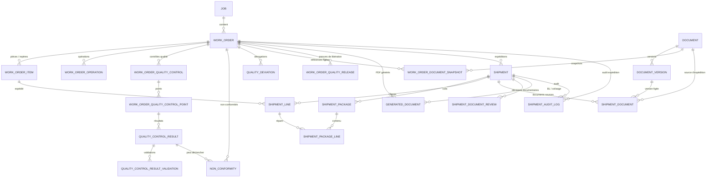
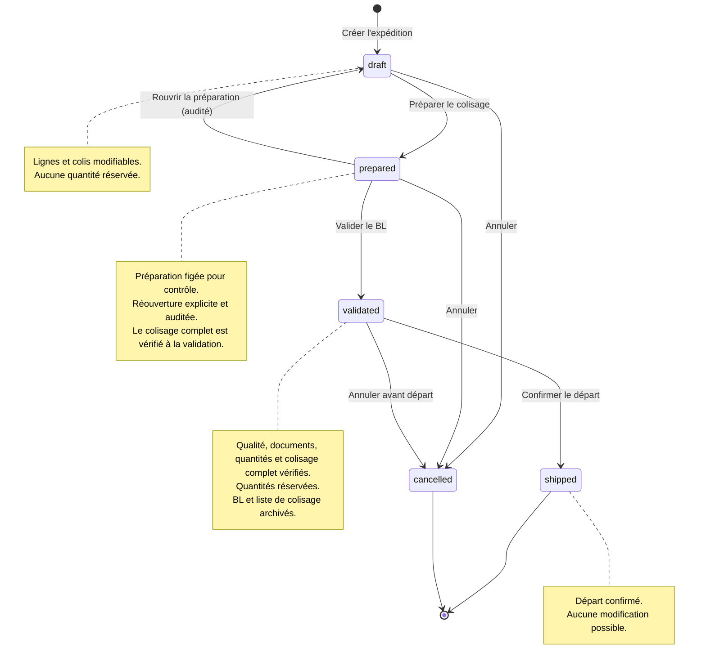
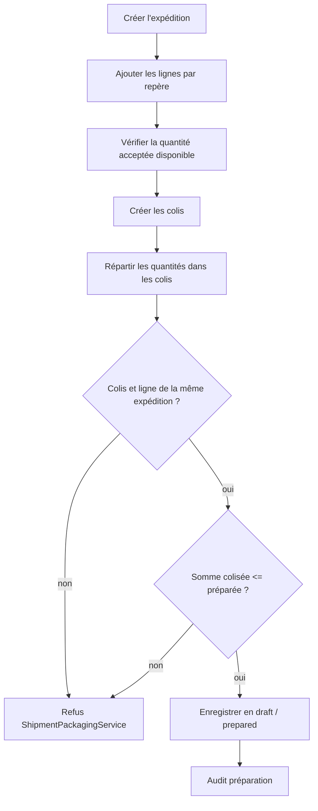
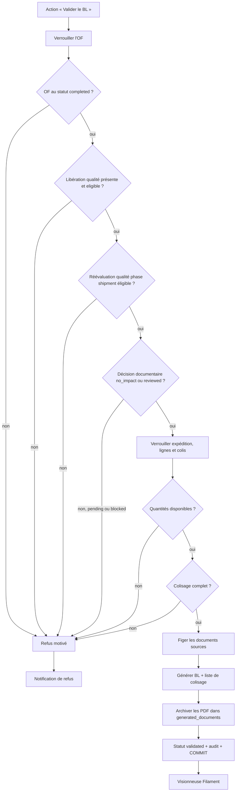
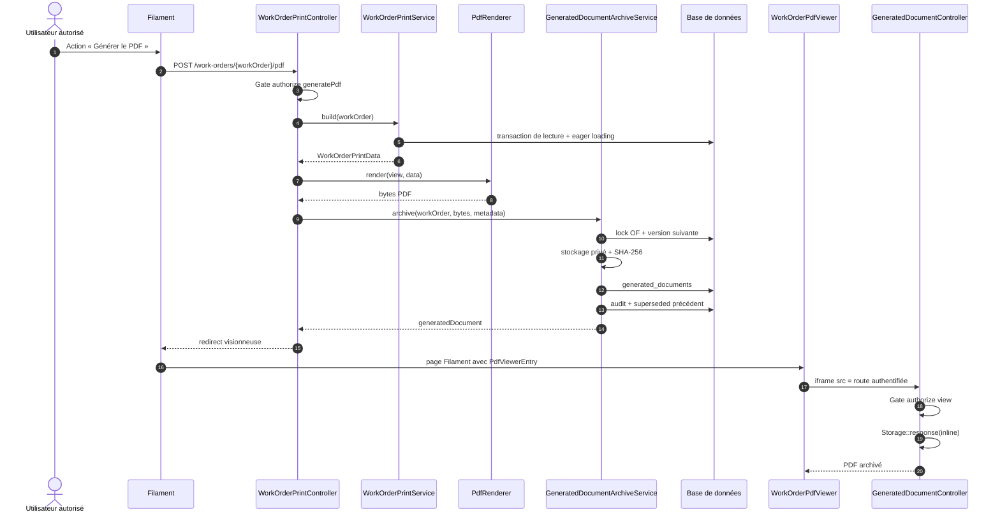
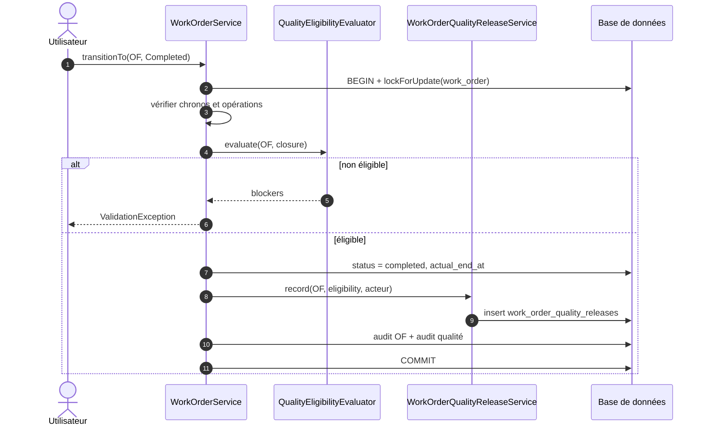
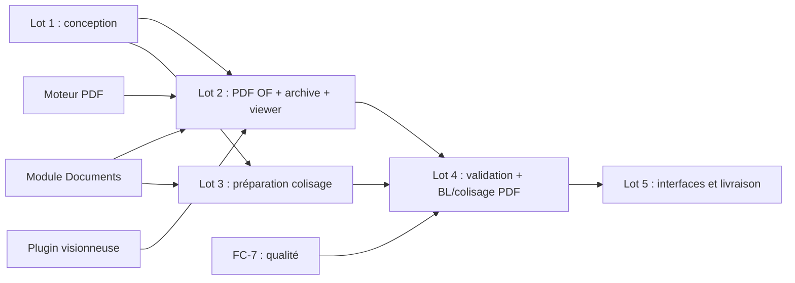

# FC-8 — Lot 1 : Cadrage technique et modèle de données

> **Statut : conception finalisée — décisions métier et techniques intégrées.**
> Ce document est le livrable du **Lot 1** de FC-8. Il ne contient aucune implémentation, aucune migration, aucun modèle et aucune modification applicative.
>
> Branche de travail : `feature/FC-8-technical-design`, créée depuis `develop`.
> Commit de base : `414814d2d78f67e19ddece7f711f4932051a6db4` — `feat(FC-7): contrôles qualité et non-conformités`.
> Date de révision : 2026-11-10.
> Documents liés : [DOMAIN.md](DOMAIN.md), [WORKSHOP.md](WORKSHOP.md), [QUALITY.md](QUALITY.md), [FC-7-QUALITY-DESIGN.md](FC-7-QUALITY-DESIGN.md), [SPECIFICATION.md](SPECIFICATION.md)

## Sommaire

1. [Synthèse de l'architecture existante](#1-synthèse-de-larchitecture-existante)
2. [Inventaire des composants réutilisables](#2-inventaire-des-composants-réutilisables)
3. [Analyse de FC-7 et de la libération qualité](#3-analyse-de-fc-7-et-de-la-libération-qualité)
4. [Architecture cible proposée](#4-architecture-cible-proposée)
5. [Modèle de données proposé](#5-modèle-de-données-proposé)
6. [Diagramme Mermaid des relations principales](#6-diagramme-mermaid-des-relations-principales)
7. [Diagrammes Mermaid des flux](#7-diagrammes-mermaid-des-flux)
8. [Règles métier et invariants](#8-règles-métier-et-invariants)
9. [Stratégie de génération et d'archivage des PDF](#9-stratégie-de-génération-et-darchivage-des-pdf)
10. [Stratégie de stockage documentaire](#10-stratégie-de-stockage-documentaire)
11. [Sécurité et permissions](#11-sécurité-et-permissions)
12. [Transactions et concurrence](#12-transactions-et-concurrence)
13. [Tests à prévoir](#13-tests-à-prévoir)
14. [Découpage détaillé des lots 2 à 5](#14-découpage-détaillé-des-lots-2-à-5)
15. [Arbitrages métier validés et points restants](#15-arbitrages-métier-validés-et-points-restants)
16. [Risques techniques et points de vigilance](#16-risques-techniques-et-points-de-vigilance)
17. [Annexes](#17-annexes)

### Légende de lecture

| Marqueur | Signification |
| --- | --- |
| **Existant** | Vérifié dans le code au commit de base. |
| **Décidé** | Décision métier ou technique validée, intégrée à la conception. |
| **Proposé** | Recommandation de conception, non implémentée. |
| **À préciser** | Point résiduel qui ne remet pas en cause l'architecture. |
| **Risque** | Point de vigilance identifié. |

### Décisions structurantes de cette révision

| Sujet | Décision |
| --- | --- |
| Document OF | Véritable PDF généré côté serveur, archivé, consultable dans une visionneuse Filament |
| HTML `window.print()` | **Rejeté** pour le document final |
| Moteur PDF | `barryvdh/laravel-dompdf` 3.x recommandé ; comparaison détaillée au §9 |
| Visionneuse | `joaopaulolndev/filament-pdf-viewer` 3.x, rôle limité à l'affichage |
| Archivage | Fichier PDF privé + référence en base + SHA-256 + métadonnées + historique |
| Expéditions | Plusieurs expéditions par OF, un BL par expédition |
| Reliquat | Pas de clôture automatique de l'OF |
| Colisage | Colis multi-pièces, pièce répartie sur plusieurs colis, lots hors MVP |
| Réservation | Réservée à la validation de l'expédition, pas à la préparation |
| Rôles | Préparation : responsable atelier ; validation et départ : administrateur |
| PDF et responsable atelier | Consultation et téléchargement uniquement ; génération réservée aux profils habilités |
| Révisions | Révision utilisée figée ; révision courante visible ; décision documentaire explicite obligatoire |
| Visas | Bureau d'études, libération, qualité, atelier : identité, fonction et date, sans signature ni cachet ; Atelier non effectué sans validation dédiée |
| Colisage | Colisage complet obligatoire avant validation du BL |
| Historique qualité | OF historiques sans preuve : re-libération explicite obligatoire |
| Documents d'expédition | BL et liste de colisage générés ; certificats selon contrat |

---

## 1. Synthèse de l'architecture existante

### 1.1 Socle technique réellement installé

| Élément | Constat vérifié | Fichier de référence |
| --- | --- | --- |
| Laravel | `laravel/framework: ^13.0` | `composer.json` |
| PHP | `^8.3` (environnement cible PHP 8.4) | `composer.json` |
| Filament | `filament/filament: ~5.4` | `composer.json` |
| Livewire | `livewire/livewire: ~4.2` | `composer.json` |
| MySQL/MariaDB | connexion de développement `mysql`, base `fab_c2me` | `.env`, `config/database.php` |
| SQLite | suite PHPUnit par défaut, `:memory:` | `phpunit.xml` |
| MySQL de test | base dédiée `fab_c2me_test` | `phpunit.mysql.xml` |
| Fuseau | stockage UTC, affichage `Europe/Paris` pour la qualité | `config/app.php`, `config/quality.php` |

**Constat au commit de base — aucun moteur PDF n'est installé.**
La liste des paquets de `composer.lock` ne contient ni `dompdf`, ni `mpdf`, ni `tcpdf`, ni `snappy`, ni `spatie/laravel-pdf`, ni `browsershot`. `package.json` ne contient ni `puppeteer` ni `playwright`. Le projet ne possède donc **aucun moteur de rendu PDF serveur** à ce jour.

**Décision de cette révision :** FC-8 doit produire un **véritable fichier PDF côté serveur**, l'archiver sur disque privé et l'afficher dans une visionneuse Filament. L'ajout d'une dépendance PDF est donc un prérequis du Lot 2, mais aucune dépendance n'est installée dans le cadre du Lot 1.

### 1.2 Organisation applicative

| Couche | Convention constatée |
| --- | --- |
| Modèles | `app/Models`, PascalCase anglais, attributs `#[Fillable]` |
| Énumérations | `app/Enums`, backed `string`, `HasLabel` / `HasColor`, méthode `options()` |
| DTO | `app/DTO`, objets simples en lecture seule |
| Services | `app/Services`, suffixe `Service`, injection par constructeur |
| Policies | `app/Policies`, auto-découvertes par Laravel |
| Filament | `app/Filament/Resources/{Plural}/{Resource,Pages,Schemas,Tables,RelationManagers,Actions}` |
| Panneaux | `/admin` (administrateurs) et `/workshop` (utilisateurs authentifiés, filtrés par Policies) |
| Migrations | `database/migrations/YYYY_MM_DD_NNNNNN_verbe_objet_table.php` |
| Tests | PHPUnit 12, `tests/Feature` et `tests/Unit`, pas de Pest |
| Audit | Journaux dédiés, majoritairement append-only, écrits dans la transaction métier |

### 1.3 Style d'architecture

Le projet est **impératif par services** :

- les écrans Filament appellent un service ;
- le service porte les règles métier, les transactions, les verrous et l'audit ;
- les formulaires ne sont jamais la source de vérité ;
- les refus métier remontent par `ValidationException::withMessages()`, puis sont affichés par une `Notification` Filament.

Il n'existe **aucun** `app/Events`, `app/Listeners`, `app/Observers`, `app/Jobs` ni `app/Notifications` métier. FC-8 doit conserver ce style, sauf besoin explicite validé.

### 1.4 Ce qui existe déjà et ne doit pas être dupliqué

| Domaine | Mécanisme existant | Réutilisation FC-8 |
| --- | --- | --- |
| Affaires / OF | `WorkOrder`, `Job`, `WorkOrderService` | Identification, statuts, transactions, audit |
| Pièces / repères | `WorkOrderItem`, `WorkOrderItemService` | Quantités, acceptés/rebuts, restant à fabriquer |
| Atelier | `WorkOrderOperation`, `OperationTimeEntry`, services FC-6 | Opérations, statuts, temps, visas d'exécution |
| Qualité | `WorkOrderQualityControl`, `QualityClosureEligibilityService` | Condition de libération qualité et calcul d'éligibilité |
| Documents | `Document`, `DocumentVersion`, `DocumentStorageService` | Stockage privé, révisions, snapshots, téléchargement |
| Audit | `WorkOrderAuditLog`, `WorkOrderOperationAuditLog`, `QualityAuditLog` | Journalisation immuable |
| Numérotation | `WorkOrderNumberGenerator`, `QualityReferenceGenerator` | Pattern de séquence annuelle verrouillée |
| Concurrence | `DB::transaction(..., attempts: 3)`, `lockForUpdate()` | Verrouillage des OF, pièces, documents |
| Autorisations | Drapeaux utilisateurs + Policies | Contrôle serveur des actions |

### 1.5 Ce qui n'existe pas

- Aucun modèle `Shipment`, `ShipmentPackage`, `ShipmentLine` ou équivalent.
- Aucune table d'expédition, de colisage ou de bon de livraison.
- Aucune interface Filament d'expédition.
- Aucun service d'impression ou de génération PDF d'OF.
- Aucun moteur PDF et aucune visionneuse PDF.
- Aucune preuve persistée et dédiée de « libération qualité pour expédition » ; le statut `completed` et le journal qualité sont les seuls indices actuels.
- Aucun mécanisme de lot de fabrication ou de numéro de coulée.
- Aucun transporteur référencé : le champ transporteur n'existe nulle part.
- Aucun archivage de document généré.

### 1.6 Contraintes de non-régression

- `WorkOrderClosureTest` clôture des OF **sans aucun contrôle qualité** : le verrou qualité FC-7 est conditionnel aux exigences obligatoires. FC-8 ne doit pas transformer cette compatibilité en blocage généralisé sans décision métier.
- `WorkOrderPolicy::view()` est réservé aux administrateurs. L'accès atelier au PDF d'OF est décidé en **consultation/téléchargement uniquement** ; sa mise en œuvre nécessite d'étendre `WorkOrderPolicy::view()` ou d'ajouter `viewPdf()`, sans accorder la génération.
- `WorkOrderService::delete()` n'autorise que les brouillons. Les expéditions sont donc naturellement protégées, mais les clés étrangères doivent tout de même empêcher toute suppression historique.
- Les documents et snapshots documentaires sont déjà structurés : FC-8 ne doit pas recréer un stockage de fichiers techniques parallèle.
- Le module `documents` ne doit pas être détourné pour les PDF générés : il porte un workflow de révision et d'approbation inadapté à un snapshot d'impression.

### 1.7 Décisions validées en revue

| # | Décision | Statut |
| --- | --- | --- |
| D1 | PDF réel généré côté serveur, archivé sur disque privé | **Décidé** |
| D2 | HTML avec `window.print()` rejeté pour le document final | **Décidé** |
| D3 | Moteur principal `barryvdh/laravel-dompdf` 3.x | **Décidé** |
| D4 | Visionneuse `joaopaulolndev/filament-pdf-viewer` 3.x, affichage seul | **Décidé** |
| D5 | Plusieurs expéditions par OF, un BL par expédition | **Décidé** |
| D6 | Pas de clôture automatique de l'OF en cas de reliquat | **Décidé** |
| D7 | Colis multi-pièces et pièce répartie sur plusieurs colis | **Décidé** |
| D8 | Lots matière hors MVP | **Décidé** |
| D9 | Quatre catégories de visas prévues ; format identité, fonction et date uniquement, sans signature ni cachet | **Décidé** |
| D10 | Révision utilisée figée + visibilité révision courante + décision documentaire | **Décidé** |
| D11 | Préparation : responsable atelier ; validation/départ : administrateur | **Décidé** |
| D12 | BL et liste de colisage générés ; certificats selon contrat | **Décidé** |
| D13 | Réservation des quantités à la validation, pas à la préparation | **Décidé** |
| D14 | OF historiques sans preuve : re-libération explicite obligatoire, sans preuve rétroactive | **Décidé** |
| D15 | Responsable atelier : consultation et téléchargement des PDF uniquement, jamais génération | **Décidé** |
| D16 | Colisage complet obligatoire avant validation du BL, sans dérogation | **Décidé** |
| D17 | Visa Atelier non acquis sans validation atelier dédiée ; une opération terminée est une information d'avancement, pas un visa | **Décidé** |

---

## 2. Inventaire des composants réutilisables

### 2.1 Ordres de fabrication et affaires

| Élément | Chemin réel | Détail vérifié |
| --- | --- | --- |
| `WorkOrder` | `app/Models/WorkOrder.php` | `job()`, `items()`, `operations()`, `documents()`, `documentSnapshots()`, `qualityControls()`, `qualityResults()`, `nonConformities()`, `qualityDeviations()`, `auditLogs()`, `operationAuditLogs()`, `creator()`, `releaser()`, `responsible()`, `beApprover()` |
| `WorkOrder::PROTECTED_FIELDS` | `app/Models/WorkOrder.php` | `number`, `status`, dates, `created_by`, `released_by`, `released_at`, `responsible_id`, champs BE, `workshop_routing_id` |
| `WorkOrder::isRoutingEditable()` / `isRoutingLocked()` | `app/Models/WorkOrder.php` | Gamme modifiable seulement en `draft` / `ready` |
| `WorkOrder::allowsOperationExecution()` | `app/Models/WorkOrder.php` | Délègue à `WorkOrderStatus::allowsOperationExecution()` |
| `WorkOrder::isLocked()` | `app/Models/WorkOrder.php` | `completed` et `cancelled` sont figés |
| `WorkOrder::hasRecordedItemProduction()` | `app/Models/WorkOrder.php` | Empêche la suppression d'un OF avec production/rebut |
| `Job` | `app/Models/Job.php` | `workOrders()`, `documents()`, `acceptsNewWorkOrders()`, `isClosed()` |
| `WorkOrderStatus` | `app/Enums/WorkOrderStatus.php` | `draft`, `ready`, `released`, `in_progress`, `quality_check`, `completed`, `cancelled` |
| `WorkOrderService` | `app/Services/WorkOrderService.php` | `create()`, `update()`, `transitionTo()`, `approveByBE()`, `delete()`, `lockForMutation()` |
| `WorkOrderNumberGenerator` | `app/Services/WorkOrderNumberGenerator.php` | `nextNumber()`, `format()`, `currentYear()`, verrou `lockForUpdate()` |
| `WorkOrderAuditService` | `app/Services/WorkOrderAuditService.php` | `record()` |
| `WorkOrderAuditLog` | `app/Models/WorkOrderAuditLog.php` | Journal immuable, `performUpdate()` et `performDeleteOnModel()` lèvent une exception |

**Transitions existantes (`WorkOrderStatus::allowedTransitions()`) :**

| Depuis | Vers |
| --- | --- |
| `draft` | `ready`, `cancelled` |
| `ready` | `released`, `cancelled` |
| `released` | `in_progress`, `cancelled` |
| `in_progress` | `quality_check`, `cancelled` |
| `quality_check` | `in_progress`, `completed`, `cancelled` |
| `completed`, `cancelled` | aucun |

**Règles de `WorkOrderService::transitionTo()` vérifiées :**

- verrouillage de l'OF par `lockForUpdate()` ;
- contrôle de la matrice de transitions ;
- pour `completed` et `cancelled` : refus si un chrono est actif, refus si une opération est encore `in_progress` ;
- pour `released` : approbation BE, affaire active, snapshots documentaires valides, éligibilité qualité phase `release`, capture des snapshots de libération ;
- pour `completed` : éligibilité qualité phase `closure`, puis `actual_end_at` ;
- audit dans la même transaction.

### 2.2 Pièces, repères et quantités

| Élément | Chemin réel | Détail vérifié |
| --- | --- | --- |
| `WorkOrderItem` | `app/Models/WorkOrderItem.php` | `mark` normalisé, `quantity_planned`, `quantity_produced`, `quantity_rejected`, `unit_weight_kg`, `total_weight_kg`, `operation_group`, `status` |
| `accepted_quantity` | `app/Models/WorkOrderItem.php` | `max(0, quantity_produced - quantity_rejected)` |
| `remaining_quantity` | `app/Models/WorkOrderItem.php` | `max(0, quantity_planned - accepted_quantity)` |
| `statusForQuantities()` | `app/Services/WorkOrderItemService.php` | Détermine `todo`, `in_progress`, `partially_produced`, `produced` |
| `recordProduction()` | `app/Services/WorkOrderItemService.php` | Verrouille l'OF et la pièce, refuse les états finaux, audite |
| `close()` / `cancel()` | `app/Services/WorkOrderItemService.php` | États finaux explicites |
| `delete()` | `app/Services/WorkOrderItemService.php` | Refuse si production, rebut, historique qualité |
| `WorkOrderItemSummary` | `app/DTO/WorkOrderItemSummary.php` | Totaux prévus, produits, acceptés, rebutés, restants, poids |
| `WorkOrderItemStatus` | `app/Enums/WorkOrderItemStatus.php` | `todo`, `in_progress`, `partially_produced`, `produced`, `closed`, `cancelled` |

**Point vérifié :** `quantity_produced` inclut les rebuts. La quantité réellement disponible pour l'expédition est donc `accepted_quantity`, pas `quantity_produced`.

**Point vérifié :** une pièce peut être expédiée alors qu'elle n'est pas `closed`, si la quantité acceptée est suffisante. Le statut `closed` est une clôture administrative de la pièce, pas une condition actuelle d'expédition.

### 2.3 Opérations, temps et visas d'exécution

| Élément | Chemin réel | Détail vérifié |
| --- | --- | --- |
| `WorkOrderOperation` | `app/Models/WorkOrderOperation.php` | `code`, `name`, `instructions`, `position`, `estimated_duration_minutes`, `is_mandatory`, `status`, `blocked_*`, `started_at`, `completed_at` |
| `WorkOrderOperation::lastStatusAudit()` | `app/Models/WorkOrderOperation.php` | Dernière entrée d'audit de transition, avec utilisateur |
| `WorkOrderOperation::recordedDurationSeconds()` | `app/Models/WorkOrderOperation.php` | Somme des temps effectifs |
| `WorkOrderOperationService` | `app/Services/WorkOrderOperationService.php` | `start`, `pause`, `resume`, `block`, `unblock`, `complete`, `cancel` |
| `OperationTimeEntry` | `app/Models/OperationTimeEntry.php` | `user_id`, `started_at`, `ended_at`, `duration_seconds`, `entry_type`, corrections |
| `OperationTimeAggregationService` | `app/Services/OperationTimeAggregationService.php` | `forOperation()`, `forWorkOrder()`, `realSecondsFromEntries()` |
| `OperationTimeSummary` | `app/DTO/OperationTimeSummary.php` | Temps réel, estimé, écart, consommation, temps par opérateur |
| `WorkOrderTimeSummary` | `app/DTO/WorkOrderTimeSummary.php` | Agrégats OF et par opération |
| `WorkOrderOperationAuditService` | `app/Services/WorkOrderOperationAuditService.php` | `record()` |
| `WorkOrderOperationAuditLog` | `app/Models/WorkOrderOperationAuditLog.php` | Journal immuable |

**Point vérifié important :** les opérations sont **au niveau de l'OF**, pas au niveau d'une pièce. `work_order_operations` ne possède pas de `work_order_item_id`. Le champ `work_order_items.operation_group` est un libellé de regroupement, sans clé étrangère. Le document PDF ne peut donc pas afficher une gamme par repère sans décision métier et sans nouvelle structure.

### 2.4 Qualité FC-7

| Élément | Chemin réel | Détail vérifié |
| --- | --- | --- |
| `WorkOrderQualityControl` | `app/Models/WorkOrderQualityControl.php` | En-tête du contrôle généré, snapshot du modèle, `scope`, `trigger`, `is_mandatory`, `status`, `points()`, `results()`, `nonConformities()` |
| `WorkOrderQualityControlPoint` | `app/Models/WorkOrderQualityControlPoint.php` | Point figé, `required_results`, `requiredValidations()`, `sampledItemIds()` |
| `QualityControlResult` | `app/Models/QualityControlResult.php` | Résultat append-only, `is_conform`, `supersedes_result_id` |
| `QualityControlResultValidation` | `app/Models/QualityControlResultValidation.php` | Validation append-only, `decision`, `validated_by`, `validated_at` |
| `NonConformity` | `app/Models/NonConformity.php` | NC, gravité, `is_blocking`, `verification_required`, `status` |
| `QualityDeviation` | `app/Models/QualityDeviation.php` | Dérogation ciblée, statut, expiration |
| `QualityClosureEligibilityService` | `app/Services/QualityClosureEligibilityService.php` | `evaluate()`, phases `release` et `closure` |
| `QualityControlEvaluationService` | `app/Services/QualityControlEvaluationService.php` | `progress()`, `recalculate()`, règles de résultats retenus |
| `QualityAuditService` | `app/Services/QualityAuditService.php` | `record()` |
| `QualityAuditLog` | `app/Models/QualityAuditLog.php` | Journal immuable |
| `QualityControlPolicy` | `app/Policies/QualityControlPolicy.php` | `view`, `recordResult`, `validateResult`, `cancel`, `generate` |

### 2.5 Documents et révisions

| Élément | Chemin réel | Détail vérifié |
| --- | --- | --- |
| `Document` | `app/Models/Document.php` | `job()`, `workOrder()`, `versions()`, `currentVersion()`, `latestApprovedVersion()`, `snapshots()`, `auditLogs()`, `resolvedJobId()`, scope `active` |
| `DocumentVersion` | `app/Models/DocumentVersion.php` | `revision`, `version_number`, `storage_disk`, `storage_path`, `sha256`, `status`, `validated_by`, `validated_at` |
| `WorkOrderDocumentSnapshot` | `app/Models/WorkOrderDocumentSnapshot.php` | `document_id`, `document_version_id`, `category`, `title`, `reference`, `revision`, `version_number`, `sha256`, `validated_*`, `captured_*`, `reason`, `be_approval_batch_id` |
| `DocumentStatus` | `app/Enums/DocumentStatus.php` | `active`, `archived` |
| `DocumentVersionStatus` | `app/Enums/DocumentVersionStatus.php` | `draft`, `pending_validation`, `approved`, `rejected`, `superseded` |
| `DocumentCategory` | `app/Enums/DocumentCategory.php` | Inclut `shipping_document` et `quality_document` |
| `DocumentSnapshotReason` | `app/Enums/DocumentSnapshotReason.php` | `release`, `be_approval`, `re_review` |
| `DocumentApplicabilityService` | `app/Services/DocumentApplicabilityService.php` | `applicableDocumentsFor()`, `applicableDocumentsForJob()`, `snapshotsWithImpact()`, `releaseSnapshotsFor()`, `impactedReleasedWorkOrders()` |
| `DocumentSnapshotService` | `app/Services/DocumentSnapshotService.php` | `captureForRelease()`, `captureForBEApproval()`, `isBEApprovalStillValid()`, `refreshForWorkOrder()` |
| `DocumentService` | `app/Services/DocumentService.php` | `create()`, `update()`, `archive()` |
| `DocumentVersionService` | `app/Services/DocumentVersionService.php` | `upload()`, `submit()`, `approve()`, `reject()`, `suggestRevision()` |
| `DocumentStorageService` | `app/Services/DocumentStorageService.php` | `store()`, `delete()`, `pathFor()`, MIME réel, SHA-256, disque privé |
| `DocumentDownloadController` | `app/Http/Controllers/DocumentDownloadController.php` | `Gate::authorize('download', $version)` puis `Storage::download()` |
| `DocumentPolicy` / `DocumentVersionPolicy` | `app/Policies/DocumentPolicy.php`, `app/Policies/DocumentVersionPolicy.php` | Accès actuellement réservé aux administrateurs |
| Configuration | `config/documents.php` | Disque `documents`, 50 Mo, extensions/MIME autorisés |
| Disque | `config/filesystems.php` | `documents` privé, racine `storage/app/private/documents` |

**Règles documentaires vérifiées :**

- la version applicable à un OF est la dernière version **approuvée** (`latestApprovedVersion()`), jamais la version courante si elle est encore en brouillon ;
- `current_version_id` pointe vers le dernier dépôt, quel que soit son statut ;
- à la libération, `DocumentSnapshotService::captureForRelease()` fige les versions approuvées applicables ;
- une nouvelle version approuvée ne modifie jamais un snapshot existant ;
- la remise en revue est explicite et ajoute des snapshots `re_review` ;
- les documents d'un autre OF de la même affaire ne sont pas applicables.

### 2.6 Audit et traçabilité

| Journal | Modèle | Immuabilité vérifiée |
| --- | --- | --- |
| OF | `WorkOrderAuditLog` | Oui, exceptions à l'`update` et au `delete` |
| Opérations | `WorkOrderOperationAuditLog` | Oui |
| Qualité | `QualityAuditLog` | Oui |
| Documents | `DocumentAuditLog` | Pas de blocage technique équivalent ; journal applicatif |

**Décision :** le journal d'expédition et l'audit des documents générés doivent suivre le modèle des journaux OF/qualité (append-only, `created_at` seul, exceptions sur `update`/`delete`).

### 2.7 Autorisations existantes

| Drapeau / méthode | Chemin | Usage |
| --- | --- | --- |
| `users.is_admin` | `app/Models/User.php` | Accès admin, gestion OF |
| `users.is_workshop_supervisor` | `app/Models/User.php` | Gammes, déblocage, temps |
| `users.is_quality_manager` | `app/Models/User.php` | Référentiel, NC, dérogations, validations |
| `canManageWorkshopRoutings()` | `app/Models/User.php` | Admin ou responsable atelier |
| `canUnblockWorkshopOperations()` | `app/Models/User.php` | Admin ou responsable atelier |
| `canManageOperationTimes()` | `app/Models/User.php` | Admin ou responsable atelier |
| `canManageQualityTemplates()` | `app/Models/User.php` | Admin ou responsable qualité |
| `canRecordQualityControls()` | `app/Models/User.php` | Tout authentifié |
| `canValidateQualityControls()` | `app/Models/User.php` | Admin, responsable atelier, responsable qualité |
| `canGrantQualityDeviations()` | `app/Models/User.php` | Admin ou responsable qualité |
| `canViewQualityHistory()` | `app/Models/User.php` | Admin, responsable atelier, responsable qualité |
| `WorkOrderPolicy` | `app/Policies/WorkOrderPolicy.php` | `view`, `update`, `delete`, `transition`, `approveBE`, `manageItems`, `manageRouting`, `reReviewDocuments` |
| `WorkOrderItemPolicy` | `app/Policies/WorkOrderItemPolicy.php` | Gestion des pièces, production, statuts |
| `QualityClosurePolicy` | `app/Policies/QualityClosurePolicy.php` | Consultation de l'éligibilité |
| `DocumentPolicy` / `DocumentVersionPolicy` | `app/Policies` | Accès et téléchargement admin |

**Aucune dépendance Spatie Permission n'est installée.** Les rôles sont des drapeaux booléens non mass-assignables. FC-8 doit conserver ce modèle.

### 2.8 Interfaces Filament existantes

| Interface | Chemin réel | Points réutilisables |
| --- | --- | --- |
| Ressource OF | `app/Filament/Resources/WorkOrders/WorkOrderResource.php` | `getRelations()`, `getPages()`, recherche globale, compteurs qualité |
| Liste OF | `app/Filament/Resources/WorkOrders/Tables/WorkOrdersTable.php` | Actions de transition générées depuis l'enum, actions d'approbation, `notifyRefusal()` |
| Fiche OF | `app/Filament/Resources/WorkOrders/Pages/ViewWorkOrder.php` | `getHeaderActions()` |
| Infolist OF | `app/Filament/Resources/WorkOrders/Schemas/WorkOrderInfolist.php` | Sections, rendu Blade de l'éligibilité, documents, audit |
| Relation managers OF | `app/Filament/Resources/WorkOrders/RelationManagers/` | `ItemsRelationManager`, `WorkOrderOperationsRelationManager`, `QualityControlsRelationManager`, `NonConformitiesRelationManager`, `QualityDeviationsRelationManager`, `BomImportsRelationManager` |
| Actions OF | `app/Filament/Resources/WorkOrders/Actions/WorkOrderDocumentActions.php` | Pattern `Action` + service + `try/catch ValidationException` + notification |
| Ressource Documents | `app/Filament/Resources/Documents/DocumentResource.php` | Upload, versions, audit, impact OF |
| Ressource NC | `app/Filament/Resources/NonConformities/NonConformityResource.php` | Cycle de vie qualité |
| Panneau atelier | `app/Providers/Filament/WorkshopPanelProvider.php` | Ressources atelier/qualité, routes de téléchargement |
| Panneau admin | `app/Providers/Filament/AdminPanelProvider.php` | Découverte automatique des ressources |

**Convention à respecter :** toute action Filament appelle un service. Une règle métier ne doit jamais exister uniquement dans un formulaire ou une action.

### 2.9 Tests et helpers réutilisables

| Élément | Chemin | Réutilisation |
| --- | --- | --- |
| `BuildsQualityPlan` | `tests/Feature/Concerns/BuildsQualityPlan.php` | Créer un modèle actif, affecter une exigence, créer des pièces, libérer un OF |
| `BuildsQualityEligibilityScenarios` | `tests/Feature/Concerns/BuildsQualityEligibilityScenarios.php` | Créer contrôles, résultats validés, NC, dérogations, OF prêt avec approbation BE |
| `QualityControlConcurrencyTest` | `tests/Feature/QualityControlConcurrencyTest.php` | Pattern `assertRowIsLocked()` avec `FOR UPDATE NOWAIT`, codes MySQL 1205/3572 |
| `WorkOrderClosureTest` | `tests/Feature/WorkOrderClosureTest.php` | Non-régression de la clôture sans qualité |
| `DatabaseSchemaTest` | `tests/Feature/DatabaseSchemaTest.php` | Vérification des tables, colonnes, index et clés étrangères |
| `FilamentAuthorizationTest` | `tests/Feature/FilamentAuthorizationTest.php` | Non-régression des accès Filament |

---

## 3. Analyse de FC-7 et de la libération qualité

### 3.1 Statuts et sémantique actuelle

`WorkOrderStatus::QualityCheck` existe déjà et sert de phase de contrôle avant clôture. `WorkOrderStatus::Completed` est un état **final et figé** (`isLocked()`).

La libération qualité d'un OF s'appuie aujourd'hui sur deux points d'accroche dans `WorkOrderService::transitionTo()` :

| Transition | Contrôle qualité | Effet |
| --- | --- | --- |
| `ready` → `released` | `QualityClosureEligibilityService::evaluate($of, PHASE_RELEASE)` | Vérifie l'intégrité du plan qualité et les blocages déjà connus |
| `quality_check` → `completed` | `QualityClosureEligibilityService::evaluate($of, PHASE_CLOSURE)` | Vérifie les résultats validés, points critiques, NC bloquantes, vérifications et dérogations |

En cas de refus :

- `WorkOrderService::transitionTo()` lève une `ValidationException` ;
- un audit `WorkOrderAuditEvent::QualityClosureBlocked` est écrit **après le rollback** ;
- un audit qualité `QualityAuditEvent::ClosureBlocked` est écrit après le rollback ;
- en cas de succès, un audit `QualityAuditEvent::ClosureEvaluated` est écrit dans la transaction.

### 3.2 Ce que `QualityClosureEligibilityService` vérifie réellement

Le service construit un `ClosureEligibility` avec :

- `eligible` ;
- `blockers` typés par `ClosureBlockerCode` ;
- `warnings` ;
- les identifiants des contrôles, NC et dérogations concernés ;
- `evaluatedAt` et `phase`.

Blocages vérifiés en phase `closure` :

| Code | Signification |
| --- | --- |
| `missing_mandatory_control` | Point obligatoire sans résultats validés suffisants, ou exigence obligatoire sans contrôle généré |
| `non_conforming_mandatory_control` | Point obligatoire non conforme |
| `unvalidated_mandatory_result` | Validation obligatoire manquante |
| `open_blocking_non_conformity` | NC bloquante ouverte ou en cours |
| `pending_verification_non_conformity` | NC en attente de vérification |
| `ineffective_corrective_action` | Action corrective inefficace |
| `missing_final_documentary_control` | Contrôle final documentaire non conforme |

Les dérogations actives et non expirées peuvent couvrir un constat non conforme déjà enregistré, mais **jamais** une absence de résultat ou une validation manquante. Une NC critique ne peut pas être close par dérogation.

**Le verrou est conditionnel :** `config/quality.php` contient `closure.enforce_only_when_requirements_exist = true`. Un OF sans exigence qualité obligatoire reste clôturable. C'est le comportement de compatibilité FC-6/FC-7, déjà défini et non modifié par FC-8. Un tel OF peut donc être expédié si la preuve de libération qualité est enregistrée avec `requirements_present = false` et que l'évaluation de la phase `shipment` est éligible. Rendre le contrôle qualité obligatoire pour tous les OF serait une **évolution métier distincte**, hors MVP, et ne doit pas être présentée comme un prérequis de FC-8.

### 3.3 Point critique : `evaluate()` ne prouve pas la libération après clôture

Vérifié dans `QualityClosureEligibilityService::evaluate()` :

```php
if ($workOrder->isLocked()) {
    return new ClosureEligibility(
        eligible: true,
        blockers: [],
        warnings: [...],
        ...
    );
}
```

Autrement dit, un OF `completed` ou `cancelled` est **toujours** retourné éligible, avec un simple avertissement. Il est donc **interdit** de fonder la garde d'expédition sur un appel à `evaluate()` après clôture : le résultat serait trompeur.

### 3.4 Extraction d'une logique qualité commune

**Décision :** ne pas dupliquer les règles FC-7 et ne pas réutiliser naïvement `evaluate()` pour l'expédition.

Extraire une logique commune réutilisable, par exemple :

```text
QualityEligibilityEvaluator
  - evaluateRelease(WorkOrder): ClosureEligibility
  - evaluateClosure(WorkOrder): ClosureEligibility
  - evaluateShipment(WorkOrder): ClosureEligibility
  - evaluateHistoricalReview(WorkOrder): ClosureEligibility
  - evaluate(WorkOrder, QualityGatePhase, bool $ignoreLocked = false): ClosureEligibility
```

Ou, avec une évolution minimale de l'existant :

```text
QualityClosureEligibilityService
  + PHASE_SHIPMENT
  + PHASE_HISTORICAL_REVIEW
  + evaluate(WorkOrder, string $phase, bool $ignoreLocked = false)
  + evaluateForShipment(WorkOrder): ClosureEligibility
  + evaluateForHistoricalReview(WorkOrder): ClosureEligibility
```

**Contraintes de conception :**

- la matrice des blocages reste unique ;
- les conditions propres à chaque phase restent explicites ;
- la phase `release` vérifie l'intégrité du plan ;
- la phase `closure` vérifie les résultats, NC et dérogations ;
- la phase `shipment` vérifie les mêmes blocages que `closure`, **sans** le retour anticipé `isLocked()` ;
- la phase `historical_review` vérifie les mêmes blocages que `closure`, **sans** le retour anticipé `isLocked()` et avec un motif explicite ;
- les phases `shipment` et `historical_review` peuvent ajouter des contrôles propres : libération qualité persistée, situation documentaire décidée, quantités disponibles ;
- aucun service d'expédition ne réimplémente la lecture des résultats, des NC ou des dérogations.

**Responsabilités :**

| Service | Responsabilité |
| --- | --- |
| `QualityEligibilityEvaluator` / `QualityClosureEligibilityService` | Produire un `ClosureEligibility` pour une phase |
| `WorkOrderQualityReleaseService` | Écrire et lire la preuve de libération qualité |
| `ShipmentQualityGateService` | Orchestrer le contrôle d'expédition : statut, libération, réévaluation, messages |
| `WorkOrderService` | Écrire la preuve à la clôture, dans la transaction |
| `ShipmentValidationService` | Utiliser la garde qualité avant toute réservation |

**Tests nécessaires :**

- `evaluateForShipment()` retourne bloqué pour un OF `completed` avec NC bloquante rouverte ;
- `evaluateForShipment()` retourne bloqué pour un OF non `completed` ;
- `evaluateForShipment()` retourne éligible pour un OF `completed` avec preuve et aucun blocage ;
- la phase `closure` conserve son comportement existant ;
- `WorkOrderClosureTest` reste vert.

### 3.5 Ce qui doit être réutilisé tel quel

| Besoin FC-8 | Mécanisme FC-7 à réutiliser | Ne pas faire |
| --- | --- | --- |
| Savoir si un OF est éligible | `QualityClosureEligibilityService` / évaluateur commun | Recalculer les résultats dans un service d'expédition |
| Vérifier les NC bloquantes | `NonConformity` + éligibilité | Créer une table de blocage d'expédition parallèle |
| Vérifier les dérogations | `QualityDeviation` + éligibilité | Réimplémenter la couverture des dérogations |
| Vérifier les contrôles critiques | `QualityControlEvaluationService` | Lire directement les résultats sans appliquer les règles de validation |
| Auditer un refus | `QualityAuditService` + journaux existants | Écrire un journal non transactionnel |
| Afficher les contrôles | `WorkOrderQualityControl`, `WorkOrderQualityControlPoint` | Recopier les contrôles dans l'expédition |

### 3.6 OF historiques sans preuve de libération qualité — décision validée

Les OF déjà `completed` avant l'introduction de la preuve de libération n'ont pas de ligne `work_order_quality_releases` conforme au processus FC-7.

**Décision validée : re-libération explicite obligatoire.**

Règles :

1. **Aucune preuve rétroactive** : il est interdit de créer ou de compléter artificiellement une preuve de libération pour un OF historique.
2. **Aucun backfill silencieux** : une migration ou un script ne doit jamais marquer un OF historique comme libéré.
3. **Blocage d'expédition** : tant qu'une re-libération explicite n'est pas enregistrée, l'OF reste bloqué pour l'expédition.
4. **Processus FC-7 existant** : la re-libération réutilise `QualityEligibilityEvaluator` / `QualityClosureEligibilityService` et les mêmes règles de contrôles, NC, dérogations et validations. L'évaluation est forcée hors du court-circuit `isLocked()` (par exemple `evaluate(..., phase: closure, ignoreLocked: true)` ou une phase `historical_review` explicitement définie). Aucun contrôle parallèle n'est créé.
5. **Habilitations existantes** : la re-libération est réservée aux profils autorisés par `WorkOrderQualityReleasePolicy::reRelease` (responsable qualité ou administrateur), sans contournement de la ségrégation FC-7.
6. **Traçabilité** : la nouvelle preuve est ajoutée dans `work_order_quality_releases` avec `reason = historical_review`, `released_by`, `released_at`, `eligibility_snapshot`, `snapshot_hash`, `rules_version` et un motif obligatoire.
7. **Audit** : l'action est écrite dans `quality_audit_logs` et dans le journal OF, dans la même transaction.
8. **Affichage** : l'OF et le PDF affichent « libération historique à confirmer » tant que la preuve n'existe pas ; aucun visa qualité ne doit être présenté comme acquis.

**Conséquence :** un OF historique `completed` sans preuve ne peut pas être expédié, même si son statut semble favorable. Le blocage est levé uniquement après une re-libération explicite et réussie.

---

## 4. Architecture cible proposée

### 4.1 Principes

| Principe | Conséquence |
| --- | --- |
| Réutiliser les agrégats existants | Aucune copie des pièces, opérations, contrôles ou documents dans les tables d'expédition |
| PDF réel et archivé | Le document final est un fichier PDF privé, jamais une page HTML imprimée par le navigateur |
| Séparer quantité commerciale et colisage physique | `shipment_lines` porte les quantités ; `shipment_package_lines` porte la répartition en colis |
| Ne jamais écraser l'historique | Statuts, audits, PDF et snapshots append-only ; pas de suppression après validation |
| Règles côté serveur | `ShipmentValidationService`, `ShipmentPackagingService` et `ShipmentQualityGateService` portent les invariants |
| Documents techniques réutilisés | Pivot `shipment_documents` vers le module `documents` existant |
| Documents générés séparés | `generated_documents` archive les PDF d'OF, BL et listes de colisage |
| Transactions courtes et verrouillage ordonné | Verrou OF d'abord, puis pièces, puis expédition |
| Traçabilité systématique | Utilisateur, date, hash, révision, fichier archivé, journal |

### 4.2 Composants cibles

```text
Génération PDF OF
  WorkOrderPrintController
    -> WorkOrderPrintService
       -> WorkOrderPrintData (DTO)
       -> PdfRenderer (interface)
       -> GeneratedDocumentArchiveService
          -> GeneratedDocument (model)
          -> private disk generated_documents
    -> redirect WorkOrderPdfViewer (Filament)
       -> PdfViewerEntry (plugin)
          -> GeneratedDocumentController@view (route authentifiée)
             -> Storage::disk(...)->response(..., inline)

Libération qualité expédition
  WorkOrderService::transitionTo(Completed)
    -> QualityEligibilityEvaluator / QualityClosureEligibilityService
    -> WorkOrderQualityReleaseService::record()
       -> work_order_quality_releases

Expédition
  Filament / Actions
    -> ShipmentService
       -> ShipmentValidationService
          -> ShipmentQualityGateService
             -> QualityEligibilityEvaluator (phase shipment)
             -> WorkOrderQualityReleaseService
          -> ShipmentQuantityGuard
          -> ShipmentDocumentService
             -> ShipmentDocumentReview (décision documentaire)
          -> ShipmentPackagingService
          -> ShipmentPrintService (BL + liste de colisage)
             -> PdfRenderer + GeneratedDocumentArchiveService
       -> ShipmentAuditService
       -> ShipmentNumberGenerator
```

### 4.3 Responsabilités proposées

| Composant proposé | Responsabilité | Ne doit pas faire |
| --- | --- | --- |
| `WorkOrderPrintService` | Construire un DTO complet, cohérent et hashé, y compris les quatre visas persistés | Modifier l'OF, les pièces ou les contrôles |
| `PdfRenderer` | Convertir une vue HTML en bytes PDF via le moteur choisi | Archiver, décider, autoriser |
| `GeneratedDocumentArchiveService` | Écrire le fichier privé, calculer SHA-256, créer la référence et l'historique | Régénérer un PDF à la consultation |
| `GeneratedDocument` | Modèle d'archive PDF : fichier et métadonnées de contenu immuables | Modifier le fichier, le hash, la référence ou la version |
| `WorkOrderQualityReleaseService` | Enregistrer la preuve FC-7 et vérifier la libération avant expédition | Recalculer les règles qualité à sa façon |
| `ShipmentService` | Créer, préparer, valider, expédier, annuler une expédition | Écrire directement les statuts depuis Filament |
| `ShipmentValidationService` | Orchestrer la validation : qualité, documents, quantités, colisage complet, réservation, PDF | Modifier les pièces |
| `ShipmentPackagingService` | Gérer colis et répartition des lignes ; vérifier le colisage complet à la validation | Modifier les quantités d'OF |
| `ShipmentQuantityGuard` | Vérifier les quantités, les cumuls et les dépassements | Réserver avant validation |
| `ShipmentDocumentService` | Associer les documents sources, figer les versions, gérer les décisions documentaires | Stocker des fichiers hors du module Documents |
| `ShipmentPrintService` | Générer BL et liste de colisage | Modifier l'expédition |
| `ShipmentAuditService` | Écrire le journal append-only | Écrire hors transaction |
| `ShipmentNumberGenerator` | Générer `EXP-AAAA-NNNN` | Réutiliser le compteur OF |

### 4.4 Arborescence proposée (fichiers à créer dans les lots suivants)

```text
app/DTO/
  WorkOrderPrintData.php
  WorkOrderPrintItemLine.php
  WorkOrderPrintOperationLine.php
  WorkOrderPrintQualitySummary.php
  WorkOrderPrintVisa.php
  ShipmentPrintData.php

app/Enums/
  ShipmentStatus.php
  ShipmentPackageType.php
  ShipmentDocumentRole.php
  ShipmentDocumentReviewStatus.php
  ShipmentAuditEvent.php
  GeneratedDocumentType.php
  GeneratedDocumentStatus.php

app/Models/
  Shipment.php
  ShipmentPackage.php
  ShipmentLine.php
  ShipmentPackageLine.php
  ShipmentDocument.php
  ShipmentDocumentReview.php
  ShipmentAuditLog.php
  ShipmentSequence.php
  GeneratedDocument.php
  WorkOrderQualityRelease.php

app/Services/
  PdfRenderer.php (interface)
  DomPdfRenderer.php
  WorkOrderPrintService.php
  GeneratedDocumentArchiveService.php
  GeneratedDocumentStorageService.php
  GeneratedDocumentAuditService.php
  WorkOrderQualityReleaseService.php
  QualityEligibilityEvaluator.php
  ShipmentService.php
  ShipmentValidationService.php
  ShipmentPackagingService.php
  ShipmentQuantityGuard.php
  ShipmentDocumentService.php
  ShipmentPrintService.php
  ShipmentAuditService.php
  ShipmentNumberGenerator.php
  ShipmentQualityGateService.php

app/Policies/
  ShipmentPolicy.php
  ShipmentPackagePolicy.php
  ShipmentDocumentPolicy.php
  GeneratedDocumentPolicy.php
  WorkOrderQualityReleasePolicy.php

app/Http/Controllers/
  WorkOrderPrintController.php
  GeneratedDocumentController.php
  ShipmentPrintController.php

app/Filament/Pages/
  WorkOrderPdfViewer.php
  ShipmentPdfViewer.php

app/Filament/Resources/Shipments/
  ShipmentResource.php
  Pages/{ListShipments,CreateShipment,ViewShipment,EditShipment}.php
  Schemas/ShipmentForm.php
  Schemas/ShipmentInfolist.php
  Tables/ShipmentsTable.php
  RelationManagers/{PackagesRelationManager,LinesRelationManager,DocumentsRelationManager,AuditLogsRelationManager}.php
  Actions/ShipmentActions.php

app/Filament/Resources/WorkOrders/
  Actions/WorkOrderPrintActions.php
  RelationManagers/GeneratedDocumentsRelationManager.php
  RelationManagers/ShipmentsRelationManager.php

resources/views/pdf/
  work-order.blade.php
  work-order-partials/{header,items,operations,quality,visas}.blade.php
  delivery-note.blade.php
  packing-list.blade.php
  partials/{header,footer}.blade.php

config/
  pdf.php
  shipping.php
```

**Important :** cette arborescence est une proposition. Aucun de ces fichiers n'existe au commit de base.

### 4.5 Règles de dépendance

- `WorkOrderPrintService` ne dépend pas de Filament.
- `PdfRenderer` ne dépend ni de l'OF ni de l'expédition : il reçoit une vue et des données.
- `GeneratedDocumentArchiveService` ne génère pas de PDF : il archive des bytes.
- `ShipmentValidationService` orchestre ; il ne contient pas les règles de colisage.
- `ShipmentPackagingService` ne valide pas la qualité.
- Les contrôleurs et actions Filament ne portent aucune règle métier.
- Les PDF archivés ne sont jamais modifiés ; une nouvelle génération crée une nouvelle ligne.

---

## 5. Modèle de données proposé

### 5.1 Principes de modélisation

- Les tables existantes ne sont pas recréées.
- Les identifiants sont des `bigint` auto-incrémentés.
- Les dates sont stockées en UTC.
- Les quantités sont des entiers non signés (`unsignedInteger`) car les pièces sont comptées à l'unité dans le modèle actuel.
- Les poids utilisent `decimal(12,3)`.
- Les clés étrangères sont explicites avec une politique de suppression choisie.
- Les contraintes métier complexes sont appliquées par service sous verrou, avec des index uniques comme dernière barrière.
- Les snapshots sont favorisés pour les données qui doivent rester lisibles après évolution.
- Les fichiers PDF générés sont archivés dans une table dédiée, avec métadonnées et hash.

### 5.2 Preuve de libération qualité — `work_order_quality_releases` (proposé)

| Colonne | Type | Contraintes |
| --- | --- | --- |
| `id` | bigint | PK |
| `work_order_id` | bigint | FK `work_orders.id`, `restrictOnDelete`, index |
| `released_by` | bigint | nullable, FK `users.id`, `nullOnDelete` |
| `released_at` | timestamp | requis |
| `phase` | string(20) | `closure` par défaut ; `historical_review` pour une re-libération forcée hors `isLocked()` |
| `eligible` | boolean | requis ; résultat du calcul FC-7 |
| `requirements_present` | boolean | `true` si l'OF portait au moins une exigence qualité obligatoire |
| `eligibility_snapshot` | json | snapshot de `ClosureEligibility::toArray()` |
| `snapshot_hash` | char(64) | SHA-256 du snapshot normalisé |
| `rules_version` | string(50) | nullable ; version/empreinte de la configuration qualité appliquée |
| `reason` | string(20) | `completion`, `re_release`, `historical_review` |
| `comment` | text | nullable ; motif obligatoire pour `re_release` / `historical_review` |
| `created_at` | timestamp | `useCurrent()` |

Index :

- `index(work_order_id, released_at)` ;
- `index(released_at)` ;
- pas d'unicité sur `work_order_id` : une re-libération ajoute une ligne, l'historique n'est jamais écrasé.

**Règle d'écriture :** une ligne est écrite dans la même transaction que le passage à `completed`, uniquement si `eligible = true`. En cas d'échec, la transaction est annulée.

**Règle de lecture :** la preuve courante est la **dernière** ligne de l'OF, triée par `released_at` puis `id`. Une re-libération ajoute une ligne ; elle ne met jamais à jour la précédente.

**Re-libération historique :** la ligne est créée par une action explicite `WorkOrderQualityReleasePolicy::reRelease`, avec `reason = historical_review` et `comment` obligatoire. Elle ne peut être produite ni par migration, ni par seeder, ni par script de backfill. L'OF reste bloqué pour l'expédition tant que cette ligne n'existe pas ou si sa dernière preuve n'est pas `eligible = true`.

### 5.3 Séquences d'expédition — `shipment_sequences` (proposé)

| Colonne | Type | Contraintes |
| --- | --- | --- |
| `id` | bigint | PK |
| `year` | smallint | unique |
| `last_number` | unsignedInteger | défaut 0 |
| `created_at`, `updated_at` | timestamps | |

**Format proposé :** `EXP-AAAA-NNNN`, généré côté serveur. Le compteur est verrouillé par `lockForUpdate()` dans la transaction de création, sur le modèle de `WorkOrderNumberGenerator`.

### 5.4 Expédition — `shipments` (proposé)

| Colonne | Type | Contraintes |
| --- | --- | --- |
| `id` | bigint | PK |
| `work_order_id` | bigint | FK `work_orders.id`, `restrictOnDelete`, index |
| `number` | string(30) | unique, généré serveur (`EXP-AAAA-NNNN`) |
| `status` | string(20) | `draft` par défaut ; voir §8.3 |
| `planned_ship_at` | timestamp | nullable |
| `actual_ship_at` | timestamp | nullable ; requis au passage `shipped` |
| `carrier_name` | string(150) | nullable ; transporteur saisi librement |
| `carrier_reference` | string(100) | nullable ; numéro de suivi / référence transporteur |
| `delivery_note_reference` | string(100) | nullable ; référence du BL |
| `delivery_address` | string(255) | nullable ; snapshot de l'adresse de livraison |
| `notes` | text | nullable |
| `prepared_by` | bigint | nullable, FK `users.id`, `nullOnDelete` |
| `prepared_at` | timestamp | nullable |
| `validated_by` | bigint | nullable, FK `users.id`, `nullOnDelete` |
| `validated_at` | timestamp | nullable |
| `shipped_by` | bigint | nullable, FK `users.id`, `nullOnDelete` |
| `cancelled_by` | bigint | nullable, FK `users.id`, `nullOnDelete` |
| `cancelled_at` | timestamp | nullable |
| `cancellation_reason` | text | nullable ; requis à l'annulation |
| `created_by` | bigint | nullable, FK `users.id`, `nullOnDelete` |
| `created_at`, `updated_at` | timestamps | |

Index et contraintes :

- `unique(number)` ;
- `index(work_order_id, status)` ;
- `index(status, planned_ship_at)` ;
- `index(delivery_note_reference)` ;
- `unique(work_order_id, delivery_note_reference)` : un même BL ne peut pas être enregistré deux fois sur le même OF ; plusieurs `NULL` restent autorisés (MySQL et SQLite ignorent les `NULL` dans un index unique). La normalisation doit convertir une chaîne vide en `null`.

**Non retenu au MVP :** un statut `delivered` et un `delivered_at`. Le suivi demandé porte sur la sortie d'atelier et l'expédition ; la preuve de livraison pourra être ajoutée plus tard sans casser le modèle.

### 5.5 Colis — `shipment_packages` (proposé)

| Colonne | Type | Contraintes |
| --- | --- | --- |
| `id` | bigint | PK |
| `shipment_id` | bigint | FK `shipments.id`, `cascadeOnDelete`, index |
| `code` | string(50) | requis ; ex. `COLIS-01` |
| `label` | string(150) | nullable |
| `package_type` | string(30) | `pallet`, `crate`, `bundle`, `box`, `other` |
| `position` | unsignedInteger | défaut 0 |
| `weight_kg` | decimal(12,3) | nullable |
| `length_cm` | decimal(10,2) | nullable |
| `width_cm` | decimal(10,2) | nullable |
| `height_cm` | decimal(10,2) | nullable |
| `seal_number` | string(100) | nullable |
| `notes` | text | nullable |
| `created_at`, `updated_at` | timestamps | |

Contraintes :

- `unique(shipment_id, code)` ;
- `index(shipment_id, position)`.

### 5.6 Lignes d'expédition — `shipment_lines` (proposé)

Une ligne représente une quantité d'un repère dans une expédition, indépendamment de sa répartition physique en colis.

| Colonne | Type | Contraintes |
| --- | --- | --- |
| `id` | bigint | PK |
| `shipment_id` | bigint | FK `shipments.id`, `cascadeOnDelete`, index |
| `work_order_item_id` | bigint | FK `work_order_items.id`, `restrictOnDelete`, index |
| `mark_snapshot` | string(100) | snapshot du repère |
| `designation_snapshot` | string(255) | snapshot de la désignation |
| `quantity_prepared` | unsignedInteger | défaut 0 |
| `quantity_shipped` | unsignedInteger | défaut 0 |
| `unit_weight_kg_snapshot` | decimal(12,3) | nullable |
| `notes` | text | nullable |
| `created_at`, `updated_at` | timestamps | |

Contraintes :

- `unique(shipment_id, work_order_item_id)` : une seule ligne par repère et par expédition ;
- `index(work_order_item_id)` ;
- `index(shipment_id, work_order_item_id)`.

**Invariants applicatifs :**

- `quantity_prepared >= 0` ;
- `quantity_shipped >= 0` ;
- `quantity_shipped <= quantity_prepared` ;
- la somme des quantités préparées pour un repère, sur les expéditions validées ou expédiées, ne peut pas dépasser `accepted_quantity` ;
- `quantity_shipped` est renseignée au passage `shipped`, pas à la préparation.

### 5.7 Répartition en colis — `shipment_package_lines` (proposé)

| Colonne | Type | Contraintes |
| --- | --- | --- |
| `id` | bigint | PK |
| `shipment_package_id` | bigint | FK `shipment_packages.id`, `cascadeOnDelete`, index |
| `shipment_line_id` | bigint | FK `shipment_lines.id`, `cascadeOnDelete`, index |
| `quantity` | unsignedInteger | requis |
| `created_at`, `updated_at` | timestamps | |

Contraintes :

- `unique(shipment_package_id, shipment_line_id)` ;
- `index(shipment_line_id)`.

**Pourquoi deux tables ?**

- `shipment_lines` répond à « combien de pièces de ce repère partent dans cette expédition ? » ;
- `shipment_package_lines` répond à « dans quels colis ces pièces sont-elles réparties ? ».

Cette séparation permet :

- un colis contenant plusieurs repères ;
- un repère réparti dans plusieurs colis ;
- des contrôles de somme indépendants ;
- l'ajout ultérieur de lots sans changer la structure de base.

**Intégrité obligatoire :** un colis et une ligne liés par `shipment_package_lines` doivent appartenir à la **même expédition**. Cette règle ne peut pas être exprimée par une simple clé étrangère composite dans le schéma actuel ; elle est contrôlée par `ShipmentPackagingService` et couverte par un test dédié.

### 5.8 Documents sources d'expédition — `shipment_documents` (proposé)

Cette table associe des documents **techniques existants** (plans, certificats matière, certificats de conformité) à une expédition. Les BL et listes de colisage générés ne passent pas par cette table : ils sont archivés dans `generated_documents`.

| Colonne | Type | Contraintes |
| --- | --- | --- |
| `id` | bigint | PK |
| `shipment_id` | bigint | FK `shipments.id`, `cascadeOnDelete`, index |
| `document_id` | bigint | FK `documents.id`, `restrictOnDelete`, index |
| `document_version_id` | bigint | nullable, FK `document_versions.id`, `restrictOnDelete` |
| `role` | string(30) | `material_certificate`, `certificate_of_conformity`, `plan`, `other` |
| `is_required` | boolean | défaut `false` ; snapshot de l'exigence à l'association |
| `reference_snapshot` | string(255) | nullable |
| `revision_snapshot` | string(32) | nullable |
| `sha256_snapshot` | char(64) | nullable |
| `added_by` | bigint | nullable, FK `users.id`, `nullOnDelete` |
| `added_at` | timestamp | requis |
| `created_at`, `updated_at` | timestamps | |

Contraintes :

- `unique(shipment_id, document_id, role)` ;
- `index(shipment_id, role)` ;
- `index(document_id)`.

**Règles :**

- le document doit appartenir à l'affaire ou à l'OF de l'expédition ;
- la version est figée au moment de la validation de l'expédition (`document_version_id`, `revision_snapshot`, `sha256_snapshot`) ;
- un document obligatoire sans version approuvée bloque la validation ;
- après validation, le pivot n'est plus modifiable ;
- les fichiers restent dans le module `documents`, aucun fichier n'est dupliqué.

### 5.9 Décisions documentaires — `shipment_document_reviews` (proposé)

Cette table porte la décision explicite exigée lorsqu'une nouvelle révision approuvée affecte la fabrication ou l'expédition.

| Colonne | Type | Contraintes |
| --- | --- | --- |
| `id` | bigint | PK |
| `shipment_id` | bigint | FK `shipments.id`, `cascadeOnDelete`, index |
| `work_order_id` | bigint | FK `work_orders.id`, `restrictOnDelete`, index |
| `status` | string(20) | `pending`, `no_impact`, `reviewed`, `blocked` |
| `revision_snapshot` | json | révisions figées et révisions courantes comparées |
| `reason` | text | nullable ; requis pour `no_impact`, `reviewed`, `blocked` |
| `requested_by` | bigint | nullable, FK `users.id`, `nullOnDelete` |
| `requested_at` | timestamp | requis |
| `decided_by` | bigint | nullable, FK `users.id`, `nullOnDelete` |
| `decided_at` | timestamp | nullable |
| `created_at` | timestamp | `useCurrent()` |

Index :

- `index(shipment_id, created_at)` ;
- `index(work_order_id, status)`.

**Fonctionnement :**

- la dernière ligne (par `created_at`, puis `id`) est la décision courante ;
- `pending` et `blocked` interdisent la validation et le départ ;
- `no_impact` autorise explicitement à considérer que la nouvelle révision n'a pas d'impact sur l'expédition ;
- `reviewed` autorise après une vérification documentaire explicite ;
- toute décision est motivée et auditée ;
- aucune ligne n'est mise à jour : une nouvelle décision ajoute une ligne.

### 5.10 Documents générés et archivés — `generated_documents` (proposé)

Cette table remplace l'ancien `work_order_print_logs` : elle ne se contente pas de tracer un hash, elle **conserve le fichier PDF**.

| Colonne | Type | Contraintes |
| --- | --- | --- |
| `id` | bigint | PK |
| `work_order_id` | bigint | FK `work_orders.id`, `restrictOnDelete`, index |
| `shipment_id` | bigint | nullable, FK `shipments.id`, `restrictOnDelete`, index |
| `type` | string(30) | `work_order_pdf`, `delivery_note`, `packing_list` |
| `scope_key` | string(100) | clé de portée, ex. `wo:123:work_order_pdf`, `shp:45:delivery_note` |
| `version` | unsignedInteger | version par portée et type |
| `reference` | string(50) | unique, ex. `OF-2026-0001-PDF-0001` |
| `status` | string(20) | `archived`, `superseded`, `cancelled` |
| `disk` | string(32) | disque privé, ex. `generated_documents` |
| `path` | string(500) | unique ; chemin généré serveur |
| `original_filename` | string(255) | nom lisible, ex. `OF-2026-0001-PDF-0001.pdf` |
| `mime_type` | string(150) | `application/pdf` |
| `size_bytes` | unsignedBigInteger | taille réelle |
| `sha256` | char(64) | empreinte du fichier, index |
| `template_version` | string(30) | version du gabarit |
| `source_data_hash` | char(64) | empreinte des données sources |
| `of_revision` | string(100) | nullable ; libellé calculé des révisions utilisées |
| `revision_snapshot` | json | nullable ; détail des révisions documentaires |
| `visa_snapshot` | json | nullable ; état, identité, fonction, date, type et identifiant de preuve des quatre visas (structure §8.9.4) |
| `generated_by` | bigint | nullable, FK `users.id`, `nullOnDelete` |
| `generated_at` | timestamp | requis |
| `supersedes_id` | bigint | nullable, FK self, `nullOnDelete` |
| `superseded_at` | timestamp | nullable |
| `notes` | text | nullable |
| `created_at`, `updated_at` | timestamps | |

Contraintes :

- `unique(reference)` ;
- `unique(scope_key, version)` ;
- `index(work_order_id, type, generated_at)` ;
- `index(shipment_id, type, generated_at)` ;
- `index(sha256)` ;
- `index(status)`.

**Règles :**

- le fichier est stocké avant ou dans la transaction d'archivage, mais jamais écrasé ;
- une nouvelle génération crée une nouvelle ligne et passe l'ancienne à `superseded` ;
- `superseded` reste consultable et téléchargeable ;
- `cancelled` conserve le fichier après annulation d'une expédition ;
- aucune ligne n'est supprimée ; une commande de maintenance peut traiter les orphelins ;
- le fichier, le chemin, le hash, la référence et la version ne sont jamais modifiés après archivage ;
- seuls `status`, `superseded_at` et `supersedes_id` peuvent évoluer, dans une transaction auditée ;
- `version` est calculée sous verrou de l'OF ou de l'expédition ;
- `reference` est unique et lisible ;
- `of_revision` est un **libellé calculé** (l'OF n'a pas de champ révision natif) ; il décrit les révisions documentaires utilisées et le hash des données ;
- la suppression d'un OF portant un PDF archivé est interdite par `restrictOnDelete` ; si le métier veut autoriser la suppression d'un brouillon, il faudra conserver `work_order_number` en dénormalisé et utiliser `nullOnDelete`, décision à prendre avant le Lot 2 ;
- l'audit de génération peut être écrit dans `work_order_audit_logs` ou `shipment_audit_logs` avec un événement dédié ; un journal séparé n'est nécessaire que si l'audit des consultations et téléchargements est exigé.

### 5.11 Journal d'expédition — `shipment_audit_logs` (proposé)

| Colonne | Type | Contraintes |
| --- | --- | --- |
| `id` | bigint | PK |
| `shipment_id` | bigint | nullable, FK `shipments.id`, `nullOnDelete` |
| `work_order_id` | bigint | nullable, FK `work_orders.id`, `nullOnDelete` |
| `shipment_number` | string(30) | nullable, dénormalisé |
| `work_order_number` | string(20) | nullable, dénormalisé |
| `user_id` | bigint | nullable, FK `users.id`, `nullOnDelete` |
| `event` | string(50) | index |
| `from_status` | string(20) | nullable |
| `to_status` | string(20) | nullable |
| `comment` | text | nullable |
| `metadata` | json | nullable |
| `created_at` | timestamp | `useCurrent()` |

Index :

- `index(shipment_id, created_at)` ;
- `index(work_order_id, created_at)` ;
- `index(event)`.

**Immuabilité :** `ShipmentAuditLog` doit lever une exception sur `update` et `delete`, comme `WorkOrderAuditLog` et `QualityAuditLog`.

### 5.12 Reliquat — hors MVP

**Décision acquise :** pas de clôture automatique de l'OF en cas de reliquat. Si le métier demande plus tard de « solder » une expédition avec un reste non expédié, ajouter une table dédiée plutôt qu'un booléen global :

`work_order_shipment_closures` :

- `id` ;
- `work_order_id` FK unique ;
- `closed_by` FK users ;
- `closed_at` ;
- `reason` text requis ;
- `remaining_snapshot` json (par repère : prévu, accepté, expédié, restant) ;
- `created_at`.

Cette table n'est **pas** retenue dans le modèle de base. Elle ne doit être ajoutée qu'après décision métier explicite. Le reliquat est hors MVP et ne bloque pas l'implémentation des Lots 2 à 5.

### 5.13 Tables existantes impactées par des colonnes ou contraintes additionnelles

| Table | Modification proposée | Justification |
| --- | --- | --- |
| `work_orders` | Aucune obligatoire si `work_order_quality_releases` est retenu | La preuve est portée par la table dédiée |
| `work_order_items` | Aucune | Les quantités existantes suffisent |
| `documents` | Aucune | Le pivot `shipment_documents` porte l'association |
| `document_versions` | Aucune | Les versions existantes sont réutilisées |
| `work_order_operations` | Aucune | Les opérations OF existantes suffisent |
| `work_order_quality_controls` | Aucune | Les contrôles existants suffisent |

**Point de vigilance :** si le métier exige un visa « opérateur » par pièce, il faudra une nouvelle structure, car `work_order_items` ne stocke pas l'utilisateur de production. L'audit `ItemProductionRecorded` contient l'utilisateur et la date, mais il n'est pas indexé par pièce de façon dédiée.

### 5.14 Correspondance avec la spécification initiale

| Spécification | Modèle proposé | Écart |
| --- | --- | --- |
| `shipments` : OF, date prévue/réelle, transporteur, référence BL, notes | `shipments` | Conforme, avec statuts et traçabilité |
| `shipment_items` : pièces/lots, quantités expédiées, colis | `shipment_lines` + `shipment_package_lines` + `shipment_packages` | Plus normalisé, pour gérer le colisage |
| Lots | non retenu au MVP | Aucun mécanisme de lot existant |
| Documents d'expédition | `shipment_documents` + `generated_documents` | Sources techniques + PDF générés |
| Journal d'expédition | `shipment_audit_logs` | Nouveau journal dédié |
| Impression PDF de l'OF | `generated_documents` + visionneuse | Conforme à la décision de cette révision |

---

## 6. Diagramme Mermaid des relations principales



### 6.1 Cardinalités et règles

| Relation | Cardinalité | Règle |
| --- | --- | --- |
| `work_orders` → `shipments` | 1..N | Plusieurs expéditions partielles possibles |
| `shipments` → `shipment_packages` | 0..N | Un colis appartient à une seule expédition |
| `shipments` → `shipment_lines` | 0..N | Une ligne par repère et par expédition |
| `shipment_lines` → `shipment_package_lines` | 0..N | Une ligne peut être répartie dans plusieurs colis |
| `shipment_packages` → `shipment_package_lines` | 0..N | Un colis peut contenir plusieurs repères |
| `work_order_items` → `shipment_lines` | 0..N | Un repère peut être expédié sur plusieurs expéditions |
| `shipments` → `shipment_documents` | 0..N | Documents sources obligatoires ou facultatifs |
| `shipments` → `shipment_document_reviews` | 0..N | Décisions documentaires append-only |
| `work_orders` → `generated_documents` | 0..N | PDF d'OF, BL et listes de colisage archivés |
| `shipments` → `generated_documents` | 0..N | BL et listes de colisage de l'expédition |
| `work_orders` → `work_order_quality_releases` | 0..N | Preuve de libération, historique append-only |

---

## 7. Diagrammes Mermaid des flux

### 7.1 Flux de préparation et d'expédition



### 7.2 Préparation d'une expédition



**Règle :** la préparation peut enregistrer un colisage partiel. Le **colisage complet** est exigé au moment de la validation du BL, pas à l'enregistrement du brouillon.

### 7.3 Flux de validation d'une expédition



### 7.4 Génération, archivage et consultation du PDF d'OF



### 7.5 Flux de la libération qualité à la clôture



### 7.6 Parcours utilisateur

#### 7.6.1 Génération du PDF d'OF

1. Un utilisateur **habilité à générer** (administrateur dans le périmètre initial) ouvre la fiche OF dans Filament.
2. Il clique sur « Générer le PDF ».
3. Le serveur vérifie l'autorisation de génération et l'accès à l'OF.
4. Le service construit le DTO depuis les données persistées, y compris le `visa_snapshot` : BE, libération et qualité s'ils sont réellement validés ; Atelier « Non effectué » sans validation dédiée.
5. Le moteur PDF produit un fichier réel.
6. Le fichier est stocké sur le disque privé.
7. Une ligne `generated_documents` est créée avec référence, version, hash, taille, auteur et date.
8. L'utilisateur est redirigé vers la page `WorkOrderPdfViewer`.
9. La page affiche le PDF archivé via `PdfViewerEntry`.
10. Les générations précédentes restent accessibles dans « PDF générés ».

#### 7.6.2 Préparation d'une expédition

1. L'utilisateur crée une expédition depuis l'OF.
2. Il sélectionne les repères et les quantités.
3. Il crée les colis.
4. Il répartit les quantités dans les colis.
5. Le service vérifie l'appartenance colis/ligne/expédition, les quantités positives et les sommes.
6. Il enregistre en brouillon ; le colisage peut être partiel.
7. Il passe en `prepared` lorsque la préparation est terminée ; le colisage complet sera vérifié à la validation.
8. Aucune quantité n'est réservée à ce stade.

#### 7.6.3 Validation d'une expédition

1. L'administrateur clique sur « Valider le BL ».
2. Le service verrouille l'OF.
3. Il vérifie que l'OF est `completed`.
4. Il vérifie la dernière libération qualité.
5. Il réévalue l'éligibilité FC-7 en phase `shipment`.
6. Il vérifie la décision documentaire (pas de `pending` ni `blocked`).
7. Il verrouille l'expédition, les lignes et les colis.
8. Il vérifie que le colisage est **complet** (`ShipmentPackagingService::assertCompleteForValidation`).
9. Il vérifie les quantités disponibles et réserve.
10. Il fige les documents sources.
11. Il génère et archive le BL et la liste de colisage.
12. Il passe l'expédition à `validated`.
13. Il affiche la visionneuse du BL.

#### 7.6.4 Départ de l'expédition

1. L'administrateur clique sur « Confirmer le départ ».
2. Le service vérifie le statut `validated`.
3. Il revérifie la situation documentaire si une nouvelle révision est apparue depuis la validation.
4. Il renseigne `actual_ship_at`, `shipped_by` et `quantity_shipped`.
5. Il passe l'expédition à `shipped`.
6. Les PDF archivés restent consultables.
7. L'audit conserve l'utilisateur, la date et les documents associés.

#### 7.6.5 Consultation d'un PDF archivé par le responsable atelier

1. Le responsable atelier ouvre l'OF auquel il est autorisé à accéder.
2. Il consulte la section « PDF générés ».
3. Il peut voir le PDF courant et les générations précédentes.
4. Il peut télécharger le fichier archivé.
5. Il ne peut ni générer un nouveau PDF, ni modifier, supprimer ou remplacer une génération.
6. La route vérifie l'authentification, la Policy et l'appartenance à l'OF.
7. Le fichier servi est le PDF archivé, jamais une régénération.

---

## 8. Règles métier et invariants

### 8.1 Règles de statut de l'OF

| Code | Règle | Source | Application |
| --- | --- | --- | --- |
| BR-OF-01 | Un OF doit être `completed` pour être expédié | **Décidé** | `ShipmentQualityGateService` |
| BR-OF-02 | Un OF `cancelled` ne peut jamais être expédié | **Existant + décidé** | Garde d'expédition |
| BR-OF-03 | La clôture reste conditionnée par FC-7 | **Existant** | `WorkOrderService::transitionTo()` |
| BR-OF-04 | Les OF terminés ou annulés sont figés | **Existant** | `WorkOrderStatus::isLocked()` |
| BR-OF-05 | Un OF ne peut pas être supprimé s'il possède une expédition ou un PDF archivé | **Proposé** | FK `restrictOnDelete` + `WorkOrderService::delete()` |

### 8.2 Règles de libération qualité

| Code | Règle | Source | Application |
| --- | --- | --- | --- |
| BR-Q-01 | Une expédition exige que la **dernière** preuve `work_order_quality_releases` de l'OF ait `eligible = true` | **Décidé** | `WorkOrderQualityReleaseService` |
| BR-Q-02 | La preuve est écrite dans la transaction de clôture | **Décidé** | `WorkOrderService` + `WorkOrderQualityReleaseService` |
| BR-Q-03 | L'éligibilité est réévaluée à la validation de l'expédition, sans court-circuit `isLocked()` | **Décidé** | `QualityEligibilityEvaluator` phase `shipment` |
| BR-Q-04 | Une NC bloquante rouverte après clôture bloque l'expédition | **Décidé** | Réévaluation FC-7 |
| BR-Q-05 | Une dérogation ne remplace jamais un contrôle manquant | **Existant** | `QualityClosureEligibilityService` |
| BR-Q-06 | Aucun second système de validation qualité n'est créé | **Contrainte** | Réutilisation FC-7 |
| BR-Q-07 | Un OF sans exigence qualité obligatoire reste clôturable et expédiable si FC-7 le considère éligible ; le verrou ne s'applique qu'aux OF avec exigences | **Existant FC-6/FC-7** | `config/quality.php` (`enforce_only_when_requirements_exist`) + `requirements_present` dans la preuve |
| BR-Q-08 | Une libération historique absente exige une re-libération explicite avant toute expédition | **Décidé** | `WorkOrderQualityReleaseService`, `WorkOrderQualityReleasePolicy::reRelease` |
| BR-Q-09 | Aucune preuve de libération historique ne peut être créée rétroactivement ou par backfill | **Décidé** | Service + audit + revue de code |
| BR-Q-10 | Une re-libération historique réutilise les règles FC-7 hors court-circuit `isLocked()` et est tracée avec auteur, date et snapshot | **Décidé** | `QualityEligibilityEvaluator` phase `closure` avec `ignoreLocked` ou phase `historical_review` + audit |

### 8.3 Statuts d'expédition

| Statut | Libellé | Transitions autorisées | Règle |
| --- | --- | --- | --- |
| `draft` | Brouillon | `prepared`, `cancelled` | Préparation modifiable, aucune réservation |
| `prepared` | Préparation terminée | `draft`, `validated`, `cancelled` | Réouverture auditée ; le colisage complet est vérifié à la validation ; aucune réservation |
| `validated` | BL validé | `shipped`, `cancelled` | Qualité, documents, quantités et colisage complet vérifiés ; réservation définitive ; BL et liste de colisage archivés |
| `shipped` | Expédié | — | État final |
| `cancelled` | Annulé | — | État final, motif obligatoire (20 caractères minimum si `validated`), réservation libérée |

### 8.4 Règles de quantités

Notations par repère `i` :

- `planned_i` = `work_order_items.quantity_planned` ;
- `produced_i` = `work_order_items.quantity_produced` ;
- `rejected_i` = `work_order_items.quantity_rejected` ;
- `accepted_i` = `max(0, produced_i - rejected_i)` ;
- `prepared_i` = somme des `shipment_lines.quantity_prepared` pour l'expédition courante ;
- `validated_i` = somme des `quantity_prepared` des expéditions `validated` (réservées) ;
- `shipped_i` = somme des `quantity_shipped` des expéditions `shipped` ;
- `available_i` = `max(0, accepted_i - validated_i - shipped_i)` ;
- `remaining_to_ship_i` = `max(0, accepted_i - shipped_i)`.

| Code | Règle | Application |
| --- | --- | --- |
| BR-QT-01 | `quantity_prepared >= 0` et `quantity_shipped >= 0` | Validation de service + colonnes non signées |
| BR-QT-02 | `quantity_shipped <= quantity_prepared` | `ShipmentQuantityGuard` |
| BR-QT-03 | `quantity_prepared <= available_i` à la préparation | `ShipmentQuantityGuard` (refus explicite) |
| BR-QT-04 | La somme des quantités validées + expédiées ne dépasse jamais `accepted_i` | `ShipmentQuantityGuard` sous verrou OF |
| BR-QT-05 | Une expédition `cancelled` ne consomme aucune quantité | Filtre des statuts |
| BR-QT-06 | Une expédition `draft` ou `prepared` ne réserve pas définitivement la quantité | Filtre des statuts ; la validation tranche |
| BR-QT-07 | Une pièce `cancelled` ne peut pas être expédiée | `ShipmentQuantityGuard` |
| BR-QT-08 | Une pièce dont `accepted_i = 0` ne peut pas être expédiée | `ShipmentQuantityGuard` |
| BR-QT-09 | La quantité expédiée est figée au départ | `ShipmentService::ship()` |
| BR-QT-10 | Une expédition `validated` ne peut plus être modifiée librement | `ShipmentValidationService` / Policy |

**Réservation :** la réservation est **créée à la validation**, pas à la préparation. La préparation peut contrôler la disponibilité pour l'ergonomie, mais aucune quantité n'est réservée avant `validated`.

### 8.5 Règles de colisage

| Code | Règle | Application |
| --- | --- | --- |
| BR-P-01 | Un colis appartient à une seule expédition | FK |
| BR-P-02 | Un code de colis est unique par expédition | `unique(shipment_id, code)` |
| BR-P-03 | Un colis peut contenir plusieurs lignes | `shipment_package_lines` |
| BR-P-04 | Une ligne peut être répartie dans plusieurs colis | `shipment_package_lines` |
| BR-P-05 | Colis et ligne doivent appartenir à la même expédition | `ShipmentPackagingService` |
| BR-P-06 | La quantité colisée doit être strictement positive | `ShipmentPackagingService` |
| BR-P-07 | La somme des quantités colisées d'une ligne ne dépasse pas `quantity_prepared` | `ShipmentPackagingService` |
| BR-P-08 | **Colisage complet obligatoire** : chaque quantité préparée est entièrement affectée à un colis avant validation du BL | `ShipmentPackagingService::assertCompleteForValidation()` |
| BR-P-09 | Aucune quantité préparée ne peut rester sans affectation de colis à la validation | `ShipmentPackagingService` |
| BR-P-10 | Un colis validé n'est plus modifiable | Statut de l'expédition |
| BR-P-11 | Un colis ne peut pas être déplacé vers une autre expédition | Service + `shipment_id` |
| BR-P-12 | Le contrôle du colisage complet est exécuté côté serveur, dans la transaction de validation | `ShipmentValidationService` |

**Décision validée :** le colisage complet est **obligatoire**, sans paramètre de contournement. `ShipmentPackagingService::assertCompleteForValidation()` vérifie, pour chaque ligne de l'expédition, que la somme des quantités affectées aux colis est exactement égale à `quantity_prepared`. Une quantité manquante, une quantité négative ou un dépassement bloque la validation.

Le service vérifie également :

- que le colis et la ligne appartiennent à la même expédition ;
- que la quantité colisée est strictement positive ;
- qu'une pièce peut être répartie sur plusieurs colis ;
- qu'un colis peut contenir plusieurs pièces ;
- qu'aucune ligne préparée n'est laissée hors colis.

### 8.6 Règles de documents et de révisions

| Code | Règle | Application |
| --- | --- | --- |
| BR-D-01 | Un document source doit appartenir à l'affaire ou à l'OF | `ShipmentDocumentService` |
| BR-D-02 | Un document obligatoire doit avoir une version approuvée | `ShipmentDocumentService::validateRequired()` |
| BR-D-03 | La version source est figée à la validation | `shipment_documents.document_version_id` |
| BR-D-04 | Aucun fichier technique n'est dupliqué ni exposé publiquement | Module `documents` |
| BR-D-05 | Un document source validé ne peut pas être remplacé silencieusement | Nouvelle version + décision documentaire |
| BR-D-06 | Les documents facultatifs peuvent être absents | Configuration par rôle |
| BR-D-07 | Une nouvelle révision approuvée après la libération déclenche une comparaison | `ShipmentDocumentService::compareRevisions()` |
| BR-D-08 | Une situation documentaire `pending` ou `blocked` interdit validation et départ | `shipment_document_reviews` |
| BR-D-09 | Une décision `no_impact` ou `reviewed` est explicite, motivée, attribuée et datée | `ShipmentDocumentService::decide()` |
| BR-D-10 | Le PDF d'OF archive la révision utilisée et le hash des données | `generated_documents` |

**Traitement d'une nouvelle révision :**

1. Le service compare les snapshots de libération et la dernière version approuvée.
2. Si aucune différence : aucune décision d'impact n'est nécessaire ; la vérification est tracée.
3. Si différence : la situation passe à `pending` et une décision explicite est requise.
4. `no_impact` : la révision n'a pas d'impact sur l'expédition, motif obligatoire.
5. `reviewed` : une vérification documentaire a été réalisée, motif obligatoire.
6. `blocked` : l'expédition est interdite jusqu'à nouvelle décision.
7. Aucune expédition ne peut être validée ou partir tant que la dernière décision est `pending` ou `blocked`.
8. La revue documentaire ne modifie pas automatiquement le statut de l'OF ; elle agit sur l'autorisation d'expédition.
9. Si le processus retenu exige `DocumentSnapshotService::refreshForWorkOrder()` avant de considérer la révision comme examinée, cette remise en revue doit être exécutée avant `reviewed`. Le caractère obligatoire de cette étape reste à décider.
10. Le rôle habilité à prononcer `no_impact`, `reviewed` ou `blocked` n'est pas défini dans cette conception.
11. Pour un OF `completed` ou `cancelled`, `refreshForWorkOrder()` n'est pas autorisé par le code existant ; le traitement d'une révision postérieure reste à définir.

### 8.7 Règles de génération et d'archivage PDF

| Code | Règle | Application |
| --- | --- | --- |
| BR-PDF-01 | Le document final est un véritable fichier PDF généré côté serveur | `PdfRenderer` |
| BR-PDF-02 | Le PDF est stocké sur un disque privé, jamais dans `public/` | `generated_documents` |
| BR-PDF-03 | Une référence documentaire unique est enregistrée en base | `generated_documents.reference` |
| BR-PDF-04 | Le PDF est lié à l'OF et, le cas échéant, à l'expédition | FK |
| BR-PDF-05 | Une nouvelle génération ne remplace jamais le fichier précédent | `scope_key` + `version` + UUID path |
| BR-PDF-06 | L'ancienne génération reste consultable et téléchargeable | `status = superseded` |
| BR-PDF-07 | La consultation affiche le fichier archivé, sans régénération | `GeneratedDocumentController` |
| BR-PDF-08 | Le SHA-256, la taille, le nom, l'auteur et la date sont conservés | `generated_documents` |
| BR-PDF-09 | La révision documentaire utilisée et le hash des données sont archivés | `of_revision`, `revision_snapshot`, `source_data_hash` |
| BR-PDF-10 | L'accès est protégé par authentification et Policy | Route + Policy |
| BR-PDF-11 | Un PDF d'OF n'est pas un document technique versionné du module `documents` | Table dédiée |
| BR-PDF-12 | Une génération échouée ne laisse ni ligne ni fichier orphelin | Service + nettoyage |
| BR-PDF-13 | Un PDF d'expédition annulée reste archivé avec le statut `cancelled` | `generated_documents.status` |

### 8.8 Règles d'audit

| Code | Règle | Application |
| --- | --- | --- |
| BR-A-01 | Toute mutation d'expédition écrit une entrée d'audit dans la même transaction | `ShipmentAuditService` |
| BR-A-02 | Les journaux d'expédition et l'audit des documents générés sont append-only | Modèles dédiés |
| BR-A-03 | L'utilisateur et la date sont toujours conservés | Colonnes + audit |
| BR-A-04 | Les refus qualité sont audités après rollback, comme FC-7 | `ShipmentQualityGateService` |
| BR-A-05 | Aucune suppression physique d'une expédition validée ou expédiée | Service + Policy |
| BR-A-06 | Chaque génération PDF est auditée avec sa référence et son hash | `GeneratedDocumentAuditService` |
| BR-A-07 | Chaque décision documentaire est auditée | `ShipmentDocumentService` |

### 8.9 Définition et traçabilité des visas du PDF d'OF

**Principe :** un visa est une **validation explicite par une personne habilitée**. Il ne se déduit jamais :

- de la création de l'OF ;
- de son statut courant ;
- de l'existence d'une révision ou d'une approbation documentaire ;
- de la terminaison d'une opération de fabrication ;
- de la seule présence d'une date.

**Décision validée :** les visas présentent uniquement l'identité, la fonction et la date. Aucune signature manuscrite, image de signature, signature électronique ou cachet graphique n'est intégré au MVP.

#### 8.9.1 Preuves persistées par visa

| Visa | Signification métier | Événement déclencheur | Preuve persistée | Identité / date | Référence dans le snapshot | Si absente |
| --- | --- | --- | --- | --- | --- | --- |
| Bureau d'études | Approbation explicite de l'OF par le Bureau d'études avant libération | `WorkOrderService::approveByBE()` → `WorkOrderAuditEvent::BeApproved` | `work_orders.be_approved_by`, `be_approved_at`, `be_approval_batch_id`, `be_approval_snapshot_id` ; `work_order_audit_logs.event = be_approved` ; snapshots `work_order_document_snapshots.reason = be_approval` | `beApprover` via `be_approved_by` ; `be_approved_at` | `work_order_audit_logs.id` et/ou `be_approval_batch_id` | `non_effectue` |
| Libération | Libération explicite de l'OF pour la fabrication ou la suite du processus | `WorkOrderService::transitionTo(..., Released)` → `WorkOrderAuditEvent::Released` | `work_orders.released_by`, `released_at` ; `work_order_audit_logs.event = released` ; `work_order_document_snapshots.reason = release` | `releaser` via `released_by` ; `released_at` | `work_order_audit_logs.id` et/ou snapshot `release` | `non_effectue` |
| Qualité | Libération qualité FC-7 de l'OF, après éligibilité | Passage à `completed` après `QualityClosureEligibilityService::evaluate(..., closure)` | **Cible :** `work_order_quality_releases` (`eligible`, `released_by`, `released_at`, `eligibility_snapshot`, `snapshot_hash`, `reason`, `phase`). **Existant actuel :** `quality_audit_logs.event = closure_evaluated` avec métadonnées d'éligibilité, mais pas de preuve dédiée de libération. | `released_by` ; `released_at` | `work_order_quality_releases.id` et `snapshot_hash` | `non_effectue` |
| Atelier | Validation explicite de l'OF par le responsable atelier | **Aucun événement explicite n'existe dans le code actuel** | Aucune preuve de validation atelier. Une opération terminée (`work_order_operations.completed_at`, `work_order_operation_audit_logs.event = completed`) prouve seulement l'achèvement d'une opération. | Non applicable | `none` | `non_effectue` |

**Précisions :**

- **Bureau d'études** : la création de l'OF, son statut ou l'existence d'une révision ne constituent pas une approbation BE. Seul `approveByBE()` produit la preuve.
- **Libération** : l'approbation d'une version documentaire (`document_versions.status = approved`) et la libération qualité (`work_order_quality_releases`) ne sont pas des libérations d'OF. Chacune conserve sa signification.
- **Qualité** : la preuve dédiée `work_order_quality_releases` est une **évolution nécessaire** proposée au §5.2 ; elle n'existe pas dans le code actuel. Tant qu'elle n'existe pas, aucun visa Qualité ne doit être présenté comme acquis. L'audit `closure_evaluated` est une trace historique, pas une preuve de libération exploitable comme visa stable.
- **Atelier** : aucune validation atelier explicite n'existe. La dernière opération terminée ne doit jamais produire un visa Atelier.

#### 8.9.2 Visa Atelier — situation retenue

**Situation B : aucune validation atelier explicite n'existe dans le code actuel.**

L'événement `completed` de `work_order_audit_logs` (`WorkOrderAuditEvent::Completed`) atteste la clôture de l'OF, pas une validation atelier. Il ne doit pas être utilisé comme visa Atelier.

Décisions :

1. Le visa Atelier est affiché **« Non effectué »**.
2. L'avancement de fabrication peut être affiché dans un bloc distinct intitulé **« Dernière opération terminée »**, avec le code d'opération, la date et, si disponible, l'opérateur issu de `work_order_operation_audit_logs`.
3. Ce bloc d'avancement n'est **pas** un visa et ne doit pas être présenté dans la zone des visas.
4. Une validation atelier dédiée constitue une **évolution fonctionnelle à prévoir** si le métier exige un véritable visa. Elle devra être persistée, attribuée à un utilisateur habilité, datée et auditée. Aucune table ni colonne n'est créée dans le cadre de cette correction.

#### 8.9.3 Fonction affichée

Aucune colonne « fonction » n'existe dans `users`. La fonction est **dérivée** des drapeaux existants :

- `is_admin` → « Administrateur » ;
- `is_quality_manager` → « Responsable qualité » ;
- `is_workshop_supervisor` → « Responsable atelier » ;
- aucun drapeau → « Opérateur ».

Si plusieurs drapeaux sont présents, les libellés sont concaténés dans un ordre déterministe. Cette règle évite d'inventer une donnée RH non persistée. Si le métier exige une fonction RH officielle, il faudra ajouter une colonne dédiée, décision hors MVP.

#### 8.9.4 Structure de `visa_snapshot`

`generated_documents.visa_snapshot` est un JSON qui représente l'état réel au moment de la génération. Structure minimale :

```json
{
  "version": 1,
  "captured_at": "2026-11-10T14:32:00Z",
  "visas": {
    "bureau_etudes": {
      "status": "effectue",
      "person_name": "Nom",
      "function_label": "Administrateur",
      "validated_at": "2026-11-09T10:15:00Z",
      "evidence_type": "work_order_be_approval",
      "evidence_id": 456,
      "evidence_reference": "OF-2026-0001 / work_order_audit_log#456"
    },
    "liberation": {
      "status": "effectue",
      "person_name": "Nom",
      "function_label": "Administrateur",
      "validated_at": "2026-11-09T16:00:00Z",
      "evidence_type": "work_order_release",
      "evidence_id": 460,
      "evidence_reference": "OF-2026-0001 / work_order_audit_log#460"
    },
    "qualite": {
      "status": "effectue",
      "person_name": "Nom",
      "function_label": "Responsable qualité",
      "validated_at": "2026-11-10T09:00:00Z",
      "evidence_type": "work_order_quality_release",
      "evidence_id": 45,
      "evidence_reference": "OF-2026-0001 / release#45 / sha256:..."
    },
    "atelier": {
      "status": "non_effectue",
      "person_name": null,
      "function_label": null,
      "validated_at": null,
      "evidence_type": "none",
      "evidence_id": null,
      "evidence_reference": null
    }
  }
}
```

L'exemple ci-dessus suppose la preuve qualité cible `work_order_quality_releases`. Dans le code actuel, cette table n'existe pas : le visa Qualité serait donc `non_effectue` jusqu'à l'implémentation de cette évolution.

**Champs obligatoires par visa :**

| Champ | Rôle |
| --- | --- |
| `status` | `effectue`, `non_effectue` ou `non_renseigne` |
| `person_name` | Nom de la personne ayant validé, ou `null` |
| `function_label` | Fonction dérivée, ou `null` |
| `validated_at` | Date de validation, ou `null` |
| `evidence_type` | `work_order_be_approval`, `work_order_release`, `work_order_quality_release`, `none` |
| `evidence_id` | Identifiant de la preuve source, ou `null` |
| `evidence_reference` | Référence lisible de la preuve source, ou `null` |

**Sémantique de `evidence_id` :**

- `work_order_be_approval` : identifiant de l'entrée `work_order_audit_logs` de type `be_approved` ;
- `work_order_release` : identifiant de l'entrée `work_order_audit_logs` de type `released` ;
- `work_order_quality_release` : identifiant de la ligne `work_order_quality_releases` ;
- `none` : `null`.

**Sémantique des états :**

- `effectue` : preuve persistée, identité et date disponibles ;
- `non_effectue` : aucune validation explicite persistée ;
- `non_renseigne` : une preuve existe, mais l'identité ou la date est incomplète (par exemple utilisateur supprimé avec `nullOnDelete`) ; le PDF ne complète jamais la donnée manquante.

**Règles du snapshot :**

- le snapshot est écrit au moment de la génération du PDF ;
- une génération archivée n'est jamais modifiée rétroactivement ;
- une nouvelle génération produit un nouveau snapshot ;
- l'absence de preuve est explicite (`non_effectue`), jamais interprétée comme un visa acquis ;
- l'avancement atelier est stocké hors du tableau `visas` (dans le DTO/PDF), pas comme visa.

**Règles métier :**

| Code | Règle | Application |
| --- | --- | --- |
| BR-V-01 | Un visa n'est affiché comme acquis que si la validation persistée existe | `WorkOrderPrintService` |
| BR-V-02 | Un visa absent est affiché « Non effectué » ; une preuve incomplète est « Non renseigné » | Gabarit PDF |
| BR-V-03 | Aucune signature, image, signature électronique ou cachet n'est rendu | Gabarit PDF |
| BR-V-04 | Le snapshot contient type, état, nom, fonction, date, type de preuve et identifiant de preuve | `WorkOrderPrintVisa` DTO |
| BR-V-05 | Le visa Qualité utilise la dernière preuve `work_order_quality_releases` avec `eligible = true` | `WorkOrderQualityReleaseService` |
| BR-V-06 | Une opération terminée ne déclenche jamais automatiquement un visa Atelier | `WorkOrderPrintService` |
| BR-V-07 | Un OF historique sans preuve qualité affiche un visa Qualité non effectué | Gabarit PDF |
| BR-V-08 | La création d'un OF, son statut ou une révision ne valent jamais visa BE | `WorkOrderPrintService` |
| BR-V-09 | Une approbation de version documentaire ne vaut jamais visa de libération | `WorkOrderPrintService` |
| BR-V-10 | Une génération archivée conserve son snapshot initial | `generated_documents.visa_snapshot` |
| BR-V-11 | L'avancement atelier est affiché séparément du visa Atelier | `WorkOrderPrintData` / gabarit |

---

## 9. Stratégie de génération et d'archivage des PDF

### 9.1 Décision

**Décidé :** le document final est un **véritable PDF généré côté serveur**, archivé sur disque privé, référencé en base et affiché dans une visionneuse Filament.

Le HTML avec `window.print()` est **rejeté** pour le document final :

- il ne garantit pas un fichier archivé ;
- il dépend du navigateur et de ses polices ;
- il ne permet pas une consultation ultérieure stable sans régénération ;
- il ne répond pas à l'exigence de traçabilité documentaire.

Le HTML peut rester un format de **gabarit** interne au moteur PDF, jamais le livrable final.

### 9.2 Comparaison des moteurs PDF

> Informations vérifiées sur Packagist le 2026-11-10. Les versions évoluent : refaire `composer why-not` et un test d'installation avant le Lot 2.

| Critère | `barryvdh/laravel-dompdf` 3.x | `spatie/laravel-pdf` 2.x | Chromium / Headless (Browsershot, Gotenberg, Chrome PHP) |
| --- | --- | --- | --- |
| Version observée | 3.1.2 | 2.14.0 | Selon driver |
| Compatibilité Laravel 13 | **Oui**, `illuminate/support ^9\|^10\|^11\|^12\|^13.0` | **Oui**, `illuminate/contracts ^11\|^12\|^13` | Dépend du driver |
| Compatibilité PHP 8.4 | **Oui**, PHP `^8.1` | **Oui**, PHP `^8.2` | Dépend du driver |
| Moteur | Dompdf 3.x, pur PHP | Multi-driver : DOMPDF, Browsershot, Gotenberg, WeasyPrint, Chrome PHP, Cloudflare | Chromium/Chrome |
| Dépendances système | Aucune (extensions PHP usuelles) | Aucune avec DOMPDF ; Node/Chromium avec Browsershot ; Docker avec Gotenberg ; Python avec WeasyPrint | Node, Chromium, bibliothèques système |
| Déploiement Ubuntu | Simple : `composer install` | Simple en DOMPDF ; lourd en Chromium | Lourd : Chromium, fonts, sandbox, mémoire |
| CSS / tableaux | CSS 2.1 et sous-ensemble CSS3 ; tableaux et sauts de page corrects ; flex/grid non supportés | Excellent avec Chromium ; correct avec DOMPDF | Excellent, CSS moderne |
| En-têtes / pieds / numéros de page | Limités ; à valider avec le gabarit | Browsershot : excellent ; DOMPDF : limité | Excellent |
| Sécurité | `isRemoteEnabled=false`, `isPhpEnabled=false`, chroot, pas de HTML utilisateur | Dépend du driver ; Chromium doit être isolé | Isolation et sandbox à concevoir |
| Maintenance | Faible : package stable, 128 M+ téléchargements | Moyenne : abstraction multi-driver, dépendances optionnelles | Élevée : navigateur, OS, processus |
| Coût opérationnel | Faible | Moyen | Élevé |

**Précisions de compatibilité :**

- `barryvdh/laravel-dompdf` 3.1.2 déclare explicitement `illuminate/support ^13.0` et `php ^8.1` : la compatibilité Laravel 13 / PHP 8.4 est donc **déclarée par le package**, pas seulement supposée.
- `spatie/laravel-pdf` 2.14.0 déclare `illuminate/contracts ^13.0` et `php ^8.2` : compatible sur le papier avec Laravel 13 / PHP 8.4. Le driver DOMPDF nécessite `dompdf/dompdf ^3.0` ; le driver Browsershot nécessite `spatie/browsershot` et Puppeteer/Chromium.
- Chromium/Headless n'est pas un package Laravel unique : c'est une famille de solutions (Browsershot, Gotenberg, Chrome PHP). La compatibilité dépend de l'image système et de la version de Chromium ; elle doit être validée sur l'environnement Ubuntu cible.
- Le projet n'ayant installé aucun de ces packages, ces compatibilités sont **documentaires** et devront être confirmées par `composer require --dry-run` puis un test de génération avant implémentation.

### 9.3 Solution principale recommandée

**Recommandation : `barryvdh/laravel-dompdf` 3.x.**

Justifications :

1. **Compatibilité explicite Laravel 13 / PHP 8.4** dans les contraintes du package.
2. **Aucune dépendance système** : déploiement Ubuntu simple, pas de Node, pas de Chromium, pas de Docker.
3. **Suffisant pour le document OF** : tableaux, en-têtes de tableaux répétés, sauts de page, pieds de page simples, images locales.
4. **Sécurité maîtrisable** : `isRemoteEnabled=false`, `isPhpEnabled=false`, chroot, aucun HTML utilisateur.
5. **Archivage direct** : `Pdf::loadView(...)->output()` retourne une chaîne de bytes, facile à hacher et stocker.
6. **Maintenance faible** : package mature, très utilisé, API stable.
7. **PDF/A possible** si le métier exige un archivage normatif : Dompdf 3.1+ le supporte avec le backend CPDF et des polices embarquées ; à valider.

**Prérequis de déploiement Ubuntu (Dompdf) :**

- extensions PHP usuelles à vérifier avant installation (`dom`, `mbstring`, `gd` selon les images) ;
- répertoire `storage/fonts` accessible en écriture pour le cache des polices ;
- répertoire `storage/app/private/generated-documents` accessible en écriture ;
- `memory_limit` et `max_execution_time` suffisants pour les gros OF ;
- sauvegarde conjointe de la base et du disque `generated_documents` ;
- pas de serveur web supplémentaire, pas de Node, pas de Chromium.

**Alternative recommandée si le rendu CSS doit être moderne :** `spatie/laravel-pdf` avec le driver **Browsershot/Chromium**, derrière l'interface `PdfRenderer`. Ce choix ajoute Node/Puppeteer/Chromium sur Ubuntu, des besoins mémoire et une isolation de processus. Il n'est pas retenu pour le MVP car le document OF est principalement composé de tableaux et de textes, pas d'une mise en page CSS complexe.

**Alternative intermédiaire :** `spatie/laravel-pdf` avec le driver **DOMPDF**. Elle apporte une abstraction multi-driver et des tests `Pdf::fake()`, mais ajoute un package sans gain de rendu immédiat. Elle peut être retenue si l'équipe veut pouvoir basculer vers Chromium plus tard sans réécrire les appelants.

**Non retenu :** Chromium/Headless direct comme choix initial. Le gain de rendu ne justifie pas le coût d'exploitation, la surface de sécurité et la complexité de déploiement pour un document d'atelier structuré.

### 9.4 Architecture du moteur PDF

```text
PdfRenderer (interface)
  + render(string $view, array $data, array $options = []): string

DomPdfRenderer implements PdfRenderer
  - Pdf::loadView($view, $data)
  - setPaper('a4', 'portrait'|'landscape')
  - setOption('isRemoteEnabled', false)
  - setOption('isPhpEnabled', false)
  - setOption('chroot', ...)
  - output(): string
```

**Règles :**

- aucun service métier n'appelle directement la façade Dompdf ;
- les tests peuvent remplacer `PdfRenderer` par un faux ;
- un test d'intégration vérifie qu'un vrai PDF est produit (`%PDF-`, taille > 0) ;
- le renderer ne connaît ni l'OF ni l'expédition ;
- les vues PDF sont des vues Blade dédiées, sans composants Filament ni Livewire ;
- les données utilisateur sont échappées ; aucun `{!! !!}` sur des données non maîtrisées ;
- les images sont locales ou absentes ; pas de chargement distant.

### 9.5 Visionneuse Filament

**Candidat retenu :** `joaopaulolndev/filament-pdf-viewer`, branche 3.x.

**Rôle :** afficher un PDF dans une page Filament. Ce n'est **pas** un moteur de génération, ni une couche d'autorisation, ni un stockage.

**Compatibilité vérifiée :**

| Élément | Constat |
| --- | --- |
| Version observée | 3.0.3 (2026-03-04) |
| PHP | `^8.2` — compatible PHP 8.4 |
| Filament | `filament/filament ^5.3` — compatible projet `~5.4` |
| Laravel | Le README annonce Laravel 11 ; **Laravel 13 n'est pas explicitement déclaré** par le package. À valider par un test d'installation. |
| `spatie/laravel-package-tools` | `^1.15` ; déjà présent dans le projet via Filament, à vérifier par `composer show`. |
| Licence | MIT |
| Avis de sécurité Packagist | 0 au 2026-11-10 |
| Rendu | `<iframe>` vers une URL de PDF ; s'appuie sur la visionneuse native du navigateur, pas sur PDF.js |

**Intégration proposée :**

```php
use Joaopaulolndev\FilamentPdfViewer\Infolists\Components\PdfViewerEntry;

PdfViewerEntry::make('pdf_url')
    ->label('PDF archivé')
    ->minHeight('70svh')
    ->fileUrl(fn (GeneratedDocument $record): string => route('generated-documents.view', $record))
    ->columnSpanFull();
```

Dans une page Filament liée à un OF, le `fileUrl` peut être calculé depuis le dernier `GeneratedDocument` de l'OF. Dans une page dédiée à un document, il pointe directement vers le document.

**Sécurité de la visionneuse — point vérifié dans le code du package :**

- le composant accepte un état (chemin) ou une `fileUrl` ;
- si l'état est un chemin et que `visibility('private')` est utilisé, il appelle `temporaryUrl()` ;
- le driver `local` de Laravel ne supporte pas `temporaryUrl()` ; le package attrape l'exception puis retombe sur `Storage::url()` ;
- ce fallback peut produire une URL inutilisable ou exposer une URL de stockage non souhaitée.

**Décision :** ne jamais passer un chemin privé brut à `PdfViewerEntry`. Toujours utiliser `fileUrl()` vers une route Laravel authentifiée et autorisée. Ne pas utiliser `disk()` + `visibility('private')` sur le disque local pour ce cas.

**Protection de la route :**

- authentification Filament ;
- `Gate::authorize('view', $generatedDocument)` ;
- contrôle de l'appartenance à l'OF et, le cas échéant, à l'expédition ;
- `Content-Type: application/pdf` ;
- `Content-Disposition: inline` pour la visionneuse, `attachment` pour le téléchargement ;
- `X-Content-Type-Options: nosniff` ;
- pas de `Content-Disposition` avec un nom non nettoyé ;
- pas d'URL publique de stockage ;
- pas de `X-Frame-Options: DENY` sur la réponse PDF si elle est chargée dans une iframe same-origin ; utiliser une CSP `frame-ancestors 'self'` adaptée.

### 9.6 Archivage documentaire

**Table :** `generated_documents` (voir §5.10).

**Disque privé proposé :** `generated_documents`
- driver `local` ;
- racine `storage/app/private/generated-documents` ;
- visibilité privée ;
- `serve => false` ;
- jamais de lien symbolique public.

**Chemin proposé :**

```text
work-orders/{work_order_id}/{type}/{uuid}.pdf
shipments/{shipment_id}/{type}/{uuid}.pdf
```

Le chemin est généré côté serveur. Le nom d'origine est une métadonnée lisible, jamais un chemin.

**Métadonnées obligatoires :**

- référence documentaire unique ;
- type (`work_order_pdf`, `delivery_note`, `packing_list`) ;
- version par portée ;
- OF et éventuellement expédition ;
- auteur ;
- date et heure ;
- nom du fichier ;
- disque et chemin ;
- MIME ;
- taille ;
- SHA-256 ;
- hash des données sources ;
- révision utilisée ;
- snapshot des visas (nom, fonction dérivée, date, statut) ;
- version du gabarit ;
- état (`archived`, `superseded`, `cancelled`) ;
- lien vers la génération précédente (`supersedes_id`).

**Visas dans l'archive :** le PDF conserve le `visa_snapshot` tel qu'il existait à la génération (état, identité, fonction dérivée, date, type et identifiant de preuve). Une validation effectuée après la génération ne modifie jamais le PDF archivé ; elle est visible dans une nouvelle génération. Un visa absent est écrit « Non effectué » ou « Non renseigné », jamais laissé comme une signature implicite. Le visa Atelier est « Non effectué » tant qu'aucune validation atelier dédiée n'existe ; la dernière opération terminée est affichée dans un bloc d'avancement distinct.

**Cycle de vie :**

1. génération des bytes PDF ;
2. stockage privé sous un chemin UUID ;
3. calcul du SHA-256 et de la taille ;
4. transaction : verrou de l'OF ou de l'expédition, calcul de la version, insertion `generated_documents`, passage de l'ancienne génération à `superseded`, audit ;
5. en cas d'échec DB : suppression du fichier nouvellement écrit ;
6. en cas d'échec d'écriture : aucune ligne ;
7. consultation : lecture du fichier archivé, jamais régénération ;
8. annulation d'une expédition : statut `cancelled`, fichier conservé ;
9. purge : jamais automatique ; commande de maintenance dédiée après validation métier.

**Anciennes générations :**

- accessibles dans un relation manager ou une page « PDF générés » ;
- affichage de la référence, de la version, de la date, de l'auteur, du hash et du statut ;
- boutons « Voir » et « Télécharger » ;
- `superseded` et `cancelled` restent consultables.

**Trois notions à distinguer :**

| Notion | Définition | Source de vérité | Conséquence |
| --- | --- | --- | --- |
| Document généré et archivé | Fichier PDF privé + ligne `generated_documents` | Le fichier archivé et ses métadonnées | Consultable indéfiniment, jamais régénéré |
| Document affiché dans la visionneuse | Flux du fichier archivé vers une iframe Filament | Le fichier archivé | Aucun nouveau fichier, aucun nouveau hash |
| Document transmis à un tiers | Téléchargement, impression, email ou export | Le fichier archivé + trace d'accès | À auditer ; ne crée pas une nouvelle version sauf export explicite |

Un hash seul ou un journal de génération ne remplace jamais la conservation du fichier. La consultation doit toujours servir le fichier archivé.

### 9.7 Cohérence des données et révisions

**Cohérence à la génération :**

1. transaction de lecture avec eager loading ;
2. construction d'un DTO unique ;
3. calcul du hash canonique des données ;
4. rendu PDF à partir du DTO ;
5. archivage du fichier et des métadonnées.

**Isolation :**

- MySQL/MariaDB : le niveau par défaut est `REPEATABLE READ` ; une transaction de lecture donne un snapshot cohérent.
- SQLite : la transaction de lecture est sérialisée.
- Si la configuration MySQL est passée en `READ COMMITTED`, forcer explicitement le niveau pour la transaction de génération ou accepter un risque de lecture incohérente.
- La génération de PDF ne doit pas verrouiller durablement l'atelier ; le verrou d'archivage est court et porte sur la version.

**Révision utilisée :**

- l'OF n'a pas de champ `revision` natif ;
- `of_revision` est un libellé calculé à partir des snapshots documentaires et de la situation courante ;
- `revision_snapshot` conserve les références, indices, numéros de version et SHA-256 ;
- `source_data_hash` couvre les données métier utilisées (OF, pièces, opérations, qualité, documents) ;
- le PDF archivé reste la preuve de ce qui a été généré, même si l'OF ou les documents évoluent ensuite.

**Nouvelle révision approuvée après génération :**

- le PDF archivé n'est pas modifié ;
- une nouvelle génération crée une nouvelle version ;
- une comparaison est affichée dans la fiche OF et dans la fiche expédition ;
- une décision documentaire explicite est requise avant validation/départ de l'expédition (voir §8.6).

### 9.8 Pagination et volumes

- format A4 portrait par défaut ; paysage possible pour les tableaux larges ;
- CSS 2.1 compatible Dompdf :

```css
@page {
    size: A4 portrait;
    margin: 12mm 10mm 15mm 10mm;
}

thead {
    display: table-header-group;
}

tr {
    break-inside: avoid;
}

.section {
    break-inside: avoid;
}

.page-break {
    page-break-before: always;
}
```

- répéter l'en-tête de tableau sur chaque page ;
- éviter les lignes coupées ;
- séparer les sections lourdes : pièces, opérations, qualité, visas ;
- charger par `chunkById()` et construire des tableaux plats pour les gros volumes ;
- limite connue : l'import BOM accepte 5 000 lignes ; prévoir une annexe ou une pagination dédiée si le métier l'exige ;
- Dompdf charge tout le document en mémoire : surveiller `memory_limit` et `max_execution_time` ;
- si le volume devient critique, générer en file d'attente ou passer à un moteur Chromium, sans changer le modèle d'archive.

### 9.9 Limites et risques

| Risque | Impact | Mitigation |
| --- | --- | --- |
| Rendu CSS limité par Dompdf | Mise en page moins riche | Gabarit simple, tableaux, tests visuels |
| Pas de flex/grid | Sections complexes impossibles | Colonnes HTML/CSS 2.1, tableaux |
| En-têtes/pieds limités | Numérotation de page imparfaite | Gabarit dédié, tests, option Chromium si nécessaire |
| Mémoire sur gros volumes | Échec de génération | Chunking, limites, file d'attente |
| Plugin viewer non certifié Laravel 13 | Incompatibilité possible | Test d'installation, `composer why-not`, plan de repli iframe natif |
| Fallback `Storage::url()` du viewer | URL privée inutilisable ou exposée | Toujours utiliser `fileUrl` vers route authentifiée |
| Fichier orphelin si crash | Stockage inutile | Commande de maintenance, transaction et nettoyage |
| Croissance du stockage | Coût disque | Rétention validée, sauvegarde, supervision |
| PDF/A non configuré | Archivage non normatif | Activer si exigence métier, polices embarquées |

---

## 10. Stratégie de stockage documentaire

### 10.1 Deux familles de documents

| Famille | Table | Disque | Rôle |
| --- | --- | --- | --- |
| Documents techniques | `documents` / `document_versions` | `documents` privé | Plans, certificats, documents fournisseurs, révisions et approbations |
| Documents générés | `generated_documents` | `generated_documents` privé | PDF d'OF, BL, listes de colisage archivés |

**Pourquoi ne pas réutiliser `documents` pour les PDF générés :**

- le module `documents` porte un workflow de dépôt, validation, refus, remplacement et snapshot ;
- un PDF d'OF est un **snapshot d'impression** : il ne doit pas être approuvé comme un plan ;
- les révisions documentaires du module `documents` ne doivent pas être polluées par les générations d'impression ;
- l'archivage des PDF générés a ses propres métadonnées (hash de données, version de gabarit, génération précédente).

**Alternative :** si le métier exige une recherche documentaire unifiée, ajouter un lien facultatif `generated_documents.document_id` vers un `Document` de catégorie `quality_document` ou `shipping_document`. Ce lien n'est pas retenu au MVP.

### 10.2 Réutilisation du module Documents pour les sources

Le module `documents` fournit déjà :

- un document logique (`documents`) ;
- des versions immuables (`document_versions`) ;
- un indice métier (`revision`) distinct du numéro de version ;
- un statut d'approbation ;
- un stockage privé (`config/filesystems.php`, disque `documents`) ;
- un contrôle MIME/taille/SHA-256 (`DocumentStorageService`) ;
- un téléchargement authentifié et autorisé (`DocumentDownloadController`) ;
- un audit documentaire (`document_audit_logs`).

**Décision :** les documents sources d'expédition (certificats matière, certificats de conformité, plans) utilisent `shipment_documents` comme pivot vers `documents` et `document_versions`. Aucun stockage parallèle.

### 10.3 Rôles documentaires d'expédition

| Rôle | Libellé | Obligatoire par défaut ? | Source |
| --- | --- | --- | --- |
| `material_certificate` | Certificat matière | Selon contrat | Téléversé |
| `certificate_of_conformity` | Certificat de conformité | Selon contrat | Téléversé |
| `plan` | Plan | Non | Module Documents |
| `other` | Autre | Non | Téléversé |

**Documents générés, hors pivot :**

| Type | Libellé | Généré | Archivé |
| --- | --- | --- | --- |
| `delivery_note` | Bon de livraison | Oui | Oui |
| `packing_list` | Liste de colisage | Oui | Oui |
| `work_order_pdf` | Ordre de fabrication | Oui | Oui |

La configuration `config/shipping.php` proposée peut définir les rôles obligatoires par défaut. Le pivot `is_required` permet de figer le besoin réel de l'expédition.

### 10.4 Cycle de vie d'un document source d'expédition

1. Associer un document existant à l'expédition avec un rôle.
2. Vérifier que le document appartient à l'affaire ou à l'OF.
3. À la validation, figer la version approuvée la plus récente.
4. Refuser si un rôle obligatoire n'a pas de version approuvée.
5. Après validation, interdire toute modification du pivot.
6. En cas de nouvelle version, ne pas remplacer silencieusement : déclencher la décision documentaire.

### 10.5 Cycle de vie d'un PDF généré

1. Générer les bytes PDF.
2. Stocker le fichier privé sous un chemin UUID.
3. Calculer SHA-256 et taille.
4. Créer la référence et la ligne `generated_documents`.
5. Passer l'ancienne génération à `superseded`.
6. Auditer.
7. Afficher le PDF archivé dans la visionneuse.
8. Conserver les anciennes générations.
9. Marquer `cancelled` si l'expédition est annulée.
10. Ne jamais supprimer automatiquement.

### 10.6 Sécurité du stockage

- Disque privé `documents` pour les sources, `generated_documents` pour les PDF générés.
- Jamais `public/`.
- Chemin UUID généré serveur.
- MIME réel vérifié pour les uploads ; `application/pdf` contrôlé pour les générés.
- SHA-256 calculé après écriture.
- Téléchargement/consultation via route authentifiée + Policy.
- Aucun chemin physique exposé.
- Nettoyage du fichier si la transaction métier échoue.
- Les anciennes versions/générations restent accessibles.
- Les documents d'expédition héritent des droits de l'OF et de l'expédition.

### 10.7 Catégories et audit existants

`DocumentCategory::ShippingDocument` existe déjà (`shipping_document`). Il peut être utilisé pour les documents sources d'expédition.

`DocumentAuditAction` ne contient pas encore d'action spécifique à l'expédition. Il faudra, dans un lot ultérieur, ajouter des actions telles que :

- `shipment_document_linked` ;
- `shipment_document_frozen` ;
- `shipment_document_downloaded`.

Ces ajouts sont **proposés** et devront être validés avec le module Documents pour ne pas casser ses tests.

**Pour les PDF générés :** un journal dédié `generated_document_audit_logs` est recommandé si l'audit des consultations/téléchargements est exigé. À défaut, les événements de génération, suppression logique et changement de statut sont écrits dans le journal d'expédition ou le journal OF. Ne pas mélanger les accès de consultation avec les événements métier sans convention explicite.

---

## 11. Sécurité et permissions

### 11.1 Principes

- Aucune règle d'accès uniquement côté Filament.
- Chaque action de service vérifie l'habilitation de l'acteur.
- Chaque route vérifie l'authentification et la Policy.
- Les identifiants des URL ne suffisent jamais : la Policy vérifie la chaîne de rattachement.
- Les téléchargements passent par une route contrôlée, jamais par une URL de stockage.
- Les utilisateurs et dates sont conservés pour chaque action.
- La visionneuse n'est pas une barrière de sécurité : la route l'est.

### 11.2 Matrice de permissions validée

| Action | Admin | Responsable atelier | Responsable qualité | Opérateur |
| --- | --- | --- | --- | --- |
| Consulter l'OF | Oui | Oui, si autorisé par la Policy OF | Oui, si autorisé par la Policy OF | Non |
| Générer le PDF d'OF | Oui | **Non** | **Non** | Non |
| Voir/télécharger un PDF d'OF | Oui | Oui, si accès à l'OF | Oui, si accès à l'OF | Non |
| Consulter les générations PDF précédentes | Oui | Oui, si accès à l'OF | Oui, si accès à l'OF | Non |
| Créer une expédition | Oui | Oui | Non | Non |
| Préparer le colisage | Oui | Oui | Non | Non |
| Valider le BL | Oui | Non | Non | Non |
| Confirmer le départ | Oui | Non | Non | Non |
| Annuler une expédition | Oui | Non | Non | Non |
| Décider une revue documentaire | **Rôle à définir** | **Rôle à définir** | **Rôle à définir** | Non |
| Consulter les documents sources | Oui | Selon Policy | Selon Policy | Non |
| Consulter les PDF générés | Oui | Selon Policy OF | Selon Policy OF | Non |

**Décisions validées :**

- préparation : responsable atelier ;
- validation et départ : administrateur dans le périmètre initial ;
- génération PDF : administrateur uniquement dans le périmètre initial ;
- responsable atelier : consultation et téléchargement des PDF uniquement, jamais génération, modification, suppression ou remplacement ;
- pas de rôle logistique supplémentaire au MVP ;
- pas de Spatie Permission ;
- les drapeaux existants restent la source d'autorisation.

**Mise en œuvre des droits :** `WorkOrderPolicy::view()` est actuellement réservé aux administrateurs. Pour accorder au responsable atelier la consultation du PDF, il faut soit étendre explicitement `WorkOrderPolicy::view()` aux OF autorisés, soit ajouter `WorkOrderPolicy::viewPdf()` avec la même règle d'accès à l'OF. Dans les deux cas :

- `GeneratedDocumentPolicy::view` et `download` vérifient l'accès à l'OF ;
- `GeneratedDocumentPolicy::generate` reste réservé à l'administrateur ;
- `GeneratedDocumentPolicy::update` et `delete` retournent `false` ;
- aucun contournement par le panneau atelier ou par une action Filament n'est autorisé.

### 11.3 Policies proposées

| Policy | Méthodes | Règles |
| --- | --- | --- |
| `ShipmentPolicy` | `viewAny`, `view`, `create`, `update`, `prepare`, `validate`, `ship`, `cancel`, `decideDocumentReview`, `print` | Vérifie le rôle et l'état de l'expédition |
| `ShipmentPackagePolicy` | `create`, `update`, `delete` | Hérite de la préparation de l'expédition |
| `ShipmentDocumentPolicy` | `view`, `download`, `attach`, `detach`, `decide` | Vérifie l'appartenance à l'OF et le rôle |
| `GeneratedDocumentPolicy` | `view`, `download`, `generate`, `update`, `delete` | `view/download` : accès à l'OF ; `generate` : administrateur ; `update/delete` : toujours `false` |
| `WorkOrderQualityReleasePolicy` | `view`, `reRelease` | Réservé aux responsables qualité/admin ; `reRelease` réutilise FC-7 |
| `WorkOrderPolicy` | ajout `generatePdf`, `viewPdf` | `generatePdf` : administrateur ; `viewPdf` : accès à l'OF selon la Policy |

**Réserve :** le rôle autorisé à utiliser `ShipmentPolicy::decideDocumentReview` n'est pas défini par les décisions actuelles. La Policy ne doit attribuer cette capacité ni à l'administrateur, ni au responsable qualité, ni à un autre profil avant décision métier explicite.

### 11.4 Protection contre les accès directs (IDOR)

Scénarios à couvrir :

- accès à `/shipments/{id}` d'un OF non autorisé ;
- accès à `/shipments/{id}/documents/{document}` d'un document d'un autre OF ;
- téléchargement d'une version de document via l'ID de version ;
- accès à `/generated-documents/{id}/view` d'un PDF d'un autre OF ;
- génération d'un PDF d'OF via l'ID d'un OF non autorisé ;
- action Filament forgée avec un ID de colis ou de ligne d'une autre expédition ;
- consultation d'un PDF d'expédition ou d'une génération précédente via un ID d'un autre OF.

**Réponse :**

- Policy sur l'expédition, puis contrôle de `shipment->work_order_id` ;
- Policy sur le document, puis contrôle via `shipment_documents` ;
- Policy sur `GeneratedDocument`, puis contrôle de `generatedDocument->work_order_id` et, le cas échéant, `shipment_id` ;
- route de téléchargement qui recharge le document et vérifie l'appartenance ;
- jamais de `findOrFail()` suivi d'un rendu sans `Gate::authorize()`.

### 11.5 Protection des actions

| Action | Contrôle serveur |
| --- | --- |
| Préparer | `ShipmentPolicy::prepare` + service |
| Rouvrir | `ShipmentPolicy::update` + motif obligatoire |
| Valider | `ShipmentPolicy::validate` + `ShipmentValidationService` |
| Expédier | `ShipmentPolicy::ship` + statut `validated` |
| Annuler | `ShipmentPolicy::cancel` + motif obligatoire (20 caractères minimum si `validated`) |
| Générer un PDF | `WorkOrderPolicy::generatePdf` (administrateur) + `GeneratedDocumentPolicy::generate` |
| Voir un PDF | `GeneratedDocumentPolicy::view` + accès à l'OF |
| Télécharger un PDF | `GeneratedDocumentPolicy::download` + accès à l'OF + audit |
| Modifier/supprimer un PDF | `GeneratedDocumentPolicy::update/delete` → refus systématique |
| Modifier une expédition validée | `ShipmentPolicy::update` → refus ; seules `ship` et `cancel` sont autorisées |
| Décider une revue documentaire | `ShipmentPolicy::decideDocumentReview` |

### 11.6 Sécurité de la visionneuse et des fichiers

- route authentifiée, jamais de chemin privé dans l'URL ;
- `Gate::authorize('view', $generatedDocument)` avant toute lecture ;
- `Storage::disk($document->disk)->response($document->path, $filename, $headers)` ;
- `Content-Disposition: inline` pour la visionneuse ;
- `Content-Disposition: attachment` pour le téléchargement ;
- nom de fichier nettoyé ;
- `X-Content-Type-Options: nosniff` ;
- CSP `frame-ancestors 'self'` adaptée ;
- aucune journalisation du contenu binaire ;
- aucune régénération à la consultation ;
- audit des consultations et téléchargements si exigé ;
- le responsable atelier ne dispose que de `view` et `download`, jamais de `generate`, `update` ou `delete` ;
- une génération précédente (`superseded` ou `cancelled`) reste consultable si l'accès à l'OF est autorisé.

### 11.7 Traçabilité des utilisateurs et des dates

Chaque table d'action porte :

- `created_by`, `prepared_by`, `validated_by`, `shipped_by`, `cancelled_by`, `generated_by` ;
- les dates correspondantes ;
- un journal append-only avec `user_id`, `created_at`, `event`, `metadata`.

Les dates sont stockées en UTC et affichées avec le fuseau de `config('quality.display_timezone')` ou une configuration dédiée.

---

## 12. Transactions et concurrence

### 12.1 Pattern existant à reprendre

Le projet utilise :

```php
DB::transaction(function (): void {
    // verrous + mutations + audit
}, attempts: 3);
```

et `lockForUpdate()` pour sérialiser les mutations critiques.

### 12.2 Ordre de verrouillage imposé

Pour éviter les interblocages, tout service d'expédition doit verrouiller dans cet ordre :

1. `work_orders` (ligne parente) ;
2. `work_order_items` concernées, triées par `id` croissant ;
3. `shipments` (l'expédition courante) ;
4. `shipment_lines` et `shipment_packages` triés par `id` ;
5. `documents` concernés, triés par `id` croissant, si validation documentaire ;
6. `generated_documents` de la portée, triés par `id`.

**Justification :** l'OF est le point de sérialisation naturel de toutes les mutations d'expédition d'un même OF. Deux expéditions concurrentes du même OF se sérialisent sur cette ligne.

### 12.3 Cohérence fichier / base pour les PDF

Un fichier et une ligne de base ne peuvent pas être écrits dans une seule transaction ACID. La procédure retenue est :

```text
1. Construire le DTO et rendre le PDF en mémoire.
2. Écrire le fichier sur le disque privé sous un chemin UUID.
3. Calculer SHA-256 et taille.
4. BEGIN
5.   lock OF ou shipment
6.   calculer la version suivante
7.   insérer generated_documents
8.   passer l'ancienne génération à superseded
9.   audit
10.  COMMIT
11. En cas d'échec DB : supprimer le fichier nouvellement écrit.
12. En cas de crash entre 2 et 10 : fichier orphelin ; commande de maintenance.
```

**Aucune écriture en écrasement :** le chemin contient un UUID ; une nouvelle génération ne réutilise jamais le chemin précédent.

### 12.4 Création d'une expédition

```text
BEGIN
  lock work_order
  vérifier statut (released/in_progress/quality_check/completed selon arbitrage)
  générer le numéro (shipment_sequences, lockForUpdate)
  créer shipment (draft)
  audit created
COMMIT
```

**Décision :** la préparation peut être autorisée après `released`, mais la validation exige `completed` et la libération qualité.

### 12.5 Préparation

```text
BEGIN
  lock work_order
  lock shipment
  vérifier statut draft
  verrouiller les lignes/colis modifiés
  vérifier quantités (accepted, cumuls informatifs)
  vérifier l'intégrité colis/ligne/expédition
  vérifier quantité colisée <= quantité préparée
  remplacer/ajuster lignes et colis
  audit updated
COMMIT
```

La préparation ne réserve pas la quantité. Elle peut enregistrer un colisage partiel ; elle refuse les dépassements manifestes pour l'ergonomie, mais la réservation définitive et le contrôle de colisage complet ont lieu à la validation.

### 12.6 Validation

```text
BEGIN
  lock work_order
  vérifier status = completed
  charger la dernière work_order_quality_release
  vérifier eligible = true
  QualityEligibilityEvaluator::evaluate(work_order, shipment) -> eligible
  ShipmentDocumentService::assertDocumentSituationDecided(shipment)
  lock work_order_items concernées, triées par id
  lock shipment
  vérifier status = prepared
  lock shipment_lines / packages
  vérifier cumuls :
    shipped(autres) + validated(autres) + cette expédition <= accepted
  vérifier quantity_shipped <= quantity_prepared
  ShipmentPackagingService::assertCompleteForValidation(shipment)
  vérifier documents sources obligatoires + figer versions
  générer BL + liste de colisage
  archiver les PDF (fichier + generated_documents)
  status = validated
  audit validated
COMMIT
```

**Colisage complet :** `ShipmentPackagingService::assertCompleteForValidation()` est appelé **dans la transaction**, après le verrouillage de l'expédition, des lignes et des colis. Il vérifie que chaque `shipment_line.quantity_prepared` est intégralement couverte par la somme des `shipment_package_lines.quantity`. Une quantité non colisée bloque la validation ; aucun paramètre ne permet de contourner cette règle.

**Double validation concurrente :** la deuxième transaction attend le verrou de `shipment`, relit `status = validated` et échoue avec un message explicite. Recommandation : refus explicite, pas d'idempotence silencieuse.

**Réservation :** c'est ici que les quantités sont réservées. Une expédition `validated` compte dans `validated_i` jusqu'à son départ ou son annulation.

**PDF dans la transaction :** la génération des BL/listes de colisage peut être coûteuse. Elle est faite après les vérifications, avant le changement de statut. Si elle échoue, toute la validation est annulée et les fichiers écrits sont supprimés. Surveiller le temps d'exécution et la mémoire ; si nécessaire, générer en amont après verrouillage et avant la transaction de statut, avec un état intermédiaire explicitement conçu (non retenu au MVP).

### 12.7 Expédition

```text
BEGIN
  lock work_order
  lock shipment
  vérifier status = validated
  revérifier la situation documentaire (nouvelle révision entre validation et départ)
  actual_ship_at = now()
  quantity_shipped = quantity_prepared pour chaque ligne
  status = shipped
  audit shipped
COMMIT
```

**Pas de modification de quantité au départ :** une expédition partielle doit être une autre expédition. Cela évite les écarts entre BL validé et quantité réellement partie.

### 12.8 Annulation

```text
BEGIN
  lock work_order
  lock shipment
  vérifier status in (draft, prepared, validated)
  motif obligatoire ; 20 caractères minimum si status = validated
  status = cancelled
  cancelled_by / cancelled_at
  generated_documents de l'expédition -> status cancelled (fichiers conservés)
  audit cancelled
COMMIT
```

Une expédition `shipped` ne peut pas être annulée. Une correction après départ doit passer par un retour ou une expédition inverse, hors périmètre FC-8.

**Effet sur la réservation :** l'annulation d'une expédition `validated` libère immédiatement les quantités réservées, car les statuts `cancelled` sont exclus des cumuls.

### 12.9 Contraintes de base et invariants

| Contrainte | Rôle |
| --- | --- |
| `unique(shipments.number)` | Empêche les doublons de numéro |
| `unique(work_order_id, delivery_note_reference)` | Empêche le double BL sur un OF |
| `unique(shipment_id, work_order_item_id)` | Empêche deux lignes du même repère dans une expédition |
| `unique(shipment_id, code)` | Empêche deux colis du même code |
| `unique(shipment_package_id, shipment_line_id)` | Empêche la double affectation d'une ligne à un colis |
| `unique(generated_documents.reference)` | Référence PDF unique |
| `unique(generated_documents.scope_key, version)` | Version unique par portée |
| `restrictOnDelete` sur `work_order_items` | Empêche la suppression d'un repère expédié |
| `restrictOnDelete` sur `work_orders` | Empêche la suppression d'un OF expédié ou archivé |

**Limite portable :** les contraintes `CHECK` ne sont pas utilisées pour les quantités, car leur support varie entre MySQL, MariaDB et SQLite. Les invariants sont appliqués par service et couverts par tests. Les colonnes non signées servent de garde-fou bas niveau.

### 12.10 Requêtes de cumul

Le cumul doit être calculé dans la transaction, après verrouillage de l'OF :

```php
$committed = ShipmentLine::query()
    ->where('work_order_item_id', $itemId)
    ->whereHas('shipment', fn ($q) => $q
        ->where('work_order_id', $workOrderId)
        ->whereIn('status', ['validated', 'shipped'])
    )
    ->sum(DB::raw('CASE WHEN shipments.status = "shipped" THEN quantity_shipped ELSE quantity_prepared END'));
```

La requête exacte doit être isolée dans `ShipmentQuantityGuard::committedQuantityForItem()` pour éviter les divergences entre services. Elle distingue :

- `validated` : quantité préparée réservée ;
- `shipped` : quantité réellement expédiée ;
- `draft`, `prepared`, `cancelled` : exclues.

### 12.11 Tests MySQL spécifiques

Les tests de concurrence doivent vérifier :

- le verrou de la ligne `shipments` pendant la validation ;
- le refus de deux validations simultanées ;
- le refus de deux expéditions qui dépassent ensemble la quantité acceptée ;
- le refus d'une expédition pendant une clôture qualité concurrente ;
- l'absence de double numéro `EXP-AAAA-NNNN` ;
- l'absence de double version de PDF pour une même portée ;
- le refus d'une validation dont le colisage est incomplet, même en concurrence ;
- la libération de quantité après annulation d'une expédition validée.

Pattern existant : `tests/Feature/QualityControlConcurrencyTest.php::assertRowIsLocked()`.

---

## 13. Tests à prévoir

### 13.1 Tests unitaires

| Fichier proposé | Contenu |
| --- | --- |
| `tests/Unit/ShipmentStatusTest.php` | Transitions autorisées/interdites, états finaux |
| `tests/Unit/ShipmentPackageTypeTest.php` | Libellés et options |
| `tests/Unit/ShipmentDocumentRoleTest.php` | Rôles et obligatoires |
| `tests/Unit/ShipmentDocumentReviewStatusTest.php` | Décisions et blocages |
| `tests/Unit/GeneratedDocumentTypeTest.php` | Types et préfixes de référence |
| `tests/Unit/ClosureEligibilityShipmentPhaseTest.php` | Phase `shipment` sans court-circuit `isLocked()` |
| `tests/Unit/ClosureEligibilityHistoricalReviewTest.php` | Phase `historical_review` sans court-circuit `isLocked()` |

### 13.2 Tests fonctionnels SQLite

| Fichier proposé | Contenu |
| --- | --- |
| `tests/Feature/WorkOrderPrintServiceTest.php` | DTO complet, hash stable, révisions figées, OF non libéré, données manquantes |
| `tests/Feature/WorkOrderPdfGenerationTest.php` | Vrai PDF (`%PDF-`), taille, hash, métadonnées, fichier privé |
| `tests/Feature/WorkOrderPdfVisaTest.php` | Visas BE/libération/qualité, nom/fonction dérivée/date, visa absent non acquis, opération terminée non assimilée au visa Atelier, aucune signature/image/cachet |
| `tests/Feature/WorkOrderPdfVisaSnapshotTest.php` | Snapshot des quatre visas, `status` effectue/non_effectue/non_renseigne, type et identifiant de preuve, création/statut/révision non assimilés au visa BE, preuve qualité non éligible, approbation de révision non assimilée à la libération, snapshot archivé immuable, nouvelle génération avec nouvelles validations |
| `tests/Feature/WorkOrderHistoricalQualityReleaseTest.php` | OF historique bloqué, aucune preuve rétroactive, re-libération explicite auditée, réutilisation FC-7 |
| `tests/Feature/GeneratedDocumentArchiveTest.php` | Référence, version, ancienne génération `superseded`, pas d'écrasement |
| `tests/Feature/GeneratedDocumentViewerTest.php` | Route autorisée, refus non autorisé, IDOR, contenu archivé non régénéré, consultation atelier en lecture seule |
| `tests/Feature/WorkOrderPdfFilamentTest.php` | Action, redirection visionneuse, page Filament, plugin |
| `tests/Feature/ShipmentPreparationTest.php` | Création, lignes, colis, répartition, doublons, quantités |
| `tests/Feature/ShipmentPackagingIntegrityTest.php` | Colis/ligne d'expéditions différentes, quantité nulle, dépassement préparé, multi-colis, multi-pièces |
| `tests/Feature/ShipmentPackagingCompletionTest.php` | Colisage complet accepté, incomplet refusé, quantité non affectée refusée, égalité exacte préparée/colisée |
| `tests/Feature/ShipmentValidationTest.php` | OF non terminé, preuve absente, NC rouverte, décision documentaire, docs obligatoires, cumuls, colisage incomplet |
| `tests/Feature/ShipmentDocumentReviewTest.php` | Révision sans impact, revue requise, blocage, décision après revue |
| `tests/Feature/ShipmentShippingTest.php` | Départ, dates, immutabilité, annulation, quantité libérée |
| `tests/Feature/ShipmentPolicyTest.php` | Matrice de rôles et IDOR |
| `tests/Feature/ShipmentSchemaTest.php` | Tables, colonnes, index, clés étrangères |
| `tests/Feature/ShipmentFilamentTest.php` | Ressource, actions, notifications, visibilités |
| `tests/Feature/ShipmentDocumentTest.php` | Pivot, version figée, téléchargement, document d'un autre OF |
| `tests/Feature/WorkOrderQualityReleaseTest.php` | Preuve écrite à la clôture, historique append-only, re-libération |

### 13.3 Tests MySQL de concurrence

| Fichier proposé | Contenu |
| --- | --- |
| `tests/Feature/ShipmentConcurrencyTest.php` | Double validation, double expédition, dépassement cumulé, colisage incomplet concurrent, verrou de ligne |
| `tests/Feature/ShipmentNumberConcurrencyTest.php` | Deux créations simultanées, numéros uniques |
| `tests/Feature/ShipmentQualityGateConcurrencyTest.php` | Clôture qualité et validation d'expédition concurrentes |
| `tests/Feature/GeneratedDocumentConcurrencyTest.php` | Deux générations PDF simultanées, versions uniques, pas d'écrasement |
| `tests/Feature/ShipmentCancellationConcurrencyTest.php` | Annulation et validation concurrentes, libération de quantité |

Commandes ciblées :

```powershell
vendor/bin/phpunit -c phpunit.mysql.xml tests/Feature/ShipmentConcurrencyTest.php
vendor/bin/phpunit -c phpunit.mysql.xml tests/Feature/ShipmentNumberConcurrencyTest.php
vendor/bin/phpunit -c phpunit.mysql.xml tests/Feature/ShipmentQualityGateConcurrencyTest.php
vendor/bin/phpunit -c phpunit.mysql.xml tests/Feature/GeneratedDocumentConcurrencyTest.php
vendor/bin/phpunit -c phpunit.mysql.xml tests/Feature/ShipmentCancellationConcurrencyTest.php
```

Ne jamais exécuter `phpunit.mysql.xml` contre la base de développement.

### 13.4 Non-régression

À exécuter après les lots concernés :

```powershell
php artisan test tests/Feature/WorkOrderClosureTest.php
php artisan test tests/Feature/DatabaseSchemaTest.php
php artisan test tests/Feature/FilamentAuthorizationTest.php
php artisan test --filter=Document
php artisan test --filter=Quality
php artisan test --filter=Workshop
```

### 13.5 Critères d'acceptation des tests

- Un PDF valide est réellement produit et archivé.
- Le fichier archivé existe sur le disque privé.
- Le SHA-256, la taille, le nom, la référence, l'auteur et la date sont en base.
- Un utilisateur autorisé consulte le PDF archivé.
- Un utilisateur non autorisé reçoit `403`.
- Un accès IDOR à un PDF d'un autre OF reçoit `403`.
- Les anciennes générations restent accessibles.
- Le PDF consulté est le fichier archivé, pas une régénération.
- Une nouvelle révision documentaire déclenche une décision explicite.
- Une situation documentaire `pending` ou `blocked` interdit validation et départ.
- Un colis multi-pièces et une pièce multi-colis sont acceptés.
- Une association colis/ligne d'expéditions différentes est refusée.
- Un dépassement de quantité préparée est refusé.
- Un colisage incomplet bloque la validation du BL.
- Une quantité préparée non affectée à un colis bloque la validation.
- Deux validations concurrentes ne peuvent pas réussir.
- Une annulation est auditée et libère la réservation.
- Une expédition validée ne peut plus être modifiée librement ; seuls départ et annulation sont autorisés.
- Un OF non `completed` ne peut pas être expédié.
- Un OF sans preuve de libération ne peut pas être expédié.
- Un OF historique sans preuve est bloqué et ne peut être débloqué que par une re-libération explicite auditée.
- Une NC bloquante rouverte après clôture bloque l'expédition.
- Les visas BE, libération et qualité affichent nom, fonction et date lorsqu'ils existent.
- Un visa absent est affiché comme non effectué et jamais comme acquis.
- La création d'un OF, son statut ou une révision ne produisent pas de visa BE.
- Une opération terminée ne déclenche pas automatiquement un visa Atelier ; elle est affichée dans un bloc d'avancement distinct.
- Une preuve qualité non éligible ne déclenche pas de visa Qualité acquis.
- Une approbation de version documentaire n'est pas assimilée à une libération d'OF.
- Le snapshot des visas conserve le type et l'identifiant de la preuve source.
- Une génération PDF archivée conserve son snapshot initial.
- Une nouvelle génération peut refléter de nouvelles validations sans modifier l'ancienne.
- Aucune signature manuscrite, image, signature électronique ou cachet n'apparaît dans le PDF.
- Le responsable atelier consulte et télécharge un PDF archivé s'il a accès à l'OF, mais ne peut pas le générer.

---

## 14. Découpage détaillé des lots 2 à 5

### 14.1 Lot 2 — PDF d'OF, archivage et visionneuse

**Objectif :** générer un PDF réel, l'archiver, le consulter dans Filament et conserver l'historique.

| Tâche | Livrable proposé | Dépendances |
| --- | --- | --- |
| 2.1 | `PdfRenderer` + `DomPdfRenderer` + config `pdf.php` | Validation dépendance |
| 2.2 | `WorkOrderPrintData`, `WorkOrderPrintVisa` et DTO de lignes, avec bloc d'avancement atelier distinct | Aucune |
| 2.3 | `WorkOrderPrintService` (lecture cohérente, hash, révisions, `visa_snapshot` structuré) | 2.2 |
| 2.4 | `generated_documents` + `GeneratedDocument` + services de stockage/archive | 2.1, 2.3 |
| 2.5 | Vues PDF `work-order.blade.php` + partials, blocs visas sans signature, bloc « Dernière opération terminée » séparé | 2.2 |
| 2.6 | `WorkOrderPrintController` + route de génération | 2.3–2.5 |
| 2.7 | `GeneratedDocumentController` routes view/download | 2.4 |
| 2.8 | `WorkOrderPdfViewer` Filament + `PdfViewerEntry`, consultation atelier en lecture seule | Plugin validé |
| 2.9 | `WorkOrderPolicy::generatePdf` / `viewPdf` + `GeneratedDocumentPolicy` (generate admin, view/download accès OF, update/delete refusés) | 2.6–2.8 |
| 2.10 | Relation manager « PDF générés » + action « Générer le PDF » réservée aux profils habilités | 2.4–2.9 |
| 2.11 | Tests PDF, archive, visionneuse, visas, snapshot, IDOR, anciennes générations, accès atelier en lecture seule | 2.1–2.10 |
| 2.12 | Ne pas implémenter de validation atelier : afficher « Non effectué » et signaler l'évolution fonctionnelle | 2.3, 2.5 |

**Points de vigilance :**

- ne pas utiliser `evaluate()` sur un OF `completed` comme preuve qualité ;
- afficher la révision figée et la révision courante séparément ;
- ne pas exposer le chemin privé ;
- ne pas utiliser `visibility('private')` du plugin sur le disque local ;
- ne pas régénérer le PDF à la consultation ;
- ne pas transformer la dernière opération terminée en visa Atelier ;
- afficher le visa Atelier « Non effectué » tant qu'une validation dédiée n'existe pas ;
- décider du filigrane « BROUILLON » pour les OF non libérés.

### 14.2 Lot 3 — Préparation du colisage

**Objectif :** modéliser et préparer les expéditions partielles, sans réservation définitive.

| Tâche | Livrable proposé | Dépendances |
| --- | --- | --- |
| 3.1 | `work_order_quality_releases` + modèle + service, y compris re-libération historique | Lot 2 / FC-7 |
| 3.2 | Enums `ShipmentStatus`, `ShipmentPackageType`, `ShipmentDocumentRole`, `ShipmentDocumentReviewStatus`, `ShipmentAuditEvent` | Aucune |
| 3.3 | Modèles `Shipment`, `ShipmentPackage`, `ShipmentLine`, `ShipmentPackageLine`, `ShipmentDocument`, `ShipmentDocumentReview`, `ShipmentAuditLog` | 3.2 |
| 3.4 | Migrations `shipment_sequences`, `shipments`, `shipment_packages`, `shipment_lines`, `shipment_package_lines`, `shipment_documents`, `shipment_document_reviews`, `shipment_audit_logs` | 3.3 |
| 3.5 | `ShipmentNumberGenerator` | 3.4 |
| 3.6 | `ShipmentService::create()`, `updateHeader()`, `addLine()`, `updateLine()`, `removeLine()` | 3.3–3.5 |
| 3.7 | `ShipmentPackagingService` (colis, répartition, intégrité croisée, `assertCompleteForValidation()`) | 3.6 |
| 3.8 | `ShipmentQuantityGuard` (disponibilité, cumuls informatifs) | 3.6 |
| 3.9 | `ShipmentAuditService` | 3.3 |
| 3.10 | `ShipmentPolicy`, `ShipmentPackagePolicy` | 3.6 |
| 3.11 | `ShipmentDocumentService` (association, contrôle d'appartenance) | Module Documents |
| 3.12 | Tests préparation, quantités, colis, colisage complet/incomplet, documents, policies, schéma | 3.1–3.11 |

**Point de vigilance :** la préparation peut être autorisée avant `completed`, mais la validation ne l'est pas. Le service doit distinguer les deux.

### 14.3 Lot 4 — Validation, sortie d'atelier et suivi

**Objectif :** valider, réserver, expédier, annuler, suivre et tracer.

| Tâche | Livrable proposé | Dépendances |
| --- | --- | --- |
| 4.1 | `QualityEligibilityEvaluator` phase `shipment` ou `evaluateForShipment()` | FC-7 |
| 4.2 | `ShipmentQualityGateService::assertShippable()` | 4.1 + Lot 3 |
| 4.3 | `WorkOrderService` : écrire la preuve à la clôture | FC-7 |
| 4.4 | `ShipmentValidationService` : qualité, documents, quantités, **colisage complet**, réservation | 4.1–4.3 |
| 4.5 | `ShipmentService::prepare()`, `reopen()`, `ship()`, `cancel()` | 4.4 |
| 4.6 | `ShipmentDocumentService::compareRevisions()` + décisions | 3.11 |
| 4.7 | Figement des documents sources à la validation | 3.11 |
| 4.8 | `ShipmentPrintService` : BL + liste de colisage | Lot 2 |
| 4.9 | Archivage des BL/listes dans `generated_documents` | 4.8 + 2.4 |
| 4.10 | Visionneuse BL/colisage | 4.9 |
| 4.11 | Actions Filament : préparer, valider, expédier, annuler, imprimer | 4.5–4.10 |
| 4.12 | Journal d'expédition et notifications de refus | 4.5 |
| 4.13 | Tests qualité, concurrence MySQL, immuabilité, documents, colisage complet/incomplet, annulation | 4.1–4.12 |

**Point de vigilance :** la validation doit être refusée si l'OF n'est pas `completed`, même si l'expédition est `prepared`. Le message doit lister les blocages qualité et documentaires.

### 14.4 Lot 5 — Interfaces, tests et livraison

**Objectif :** finaliser l'expérience utilisateur, les tests et la documentation.

| Tâche | Livrable proposé | Dépendances |
| --- | --- | --- |
| 5.1 | `ShipmentResource` et pages Filament | Lots 3–4 |
| 5.2 | `ShipmentsRelationManager` sur la fiche OF | 5.1 |
| 5.3 | Relation managers colis, lignes, documents, audit, PDF | 5.1 |
| 5.4 | Tableau de bord : OF à expédier, expéditions partielles, retards | 5.1 |
| 5.5 | Exports éventuels (CSV/XLSX) | 5.1 |
| 5.6 | Tests d'autorisation complets et tests Filament | 5.1–5.5 |
| 5.7 | Documentation `docs/FC-8-*.md` ou mise à jour `DOMAIN.md` | Tous |
| 5.8 | Recette, jeu de démonstration, contrôle de non-régression | Tous |

### 14.5 Dépendances entre lots



**Prérequis transverses :**

1. Valider l'installation de `barryvdh/laravel-dompdf`.
2. Valider la compatibilité du plugin viewer avec Laravel 13.
3. Vérifier l'extension de `WorkOrderPolicy` pour la consultation PDF par le responsable atelier.
4. Décider des documents obligatoires.
5. Décider de la gestion des reliquats.
6. Décider de la politique de rétention/sauvegarde des PDF archivés.

---

## 15. Arbitrages métier validés et points restants

### 15.0 Tableau des décisions validées

| # | Sujet | Décision validée | Conséquence |
| --- | --- | --- | --- |
| 1 | Expéditions | Plusieurs expéditions par OF | `shipments` 1..N, cumuls |
| 2 | Bon de livraison | Un BL par expédition | `delivery_note_reference` par shipment |
| 3 | Reliquat | Pas de clôture automatique de l'OF | Aucune table de clôture au MVP |
| 4 | Colisage | Un colis peut contenir plusieurs pièces ; colisage complet obligatoire avant validation | `shipment_package_lines` + `ShipmentPackagingService` |
| 5 | Répartition | Une pièce peut être répartie entre plusieurs colis | `shipment_package_lines` |
| 6 | Lots matière | Hors MVP | Aucun lot |
| 7 | Visas | BE, libération, qualité, atelier ; nom, fonction, date uniquement ; Atelier non effectué sans validation dédiée | Gabarit PDF, aucune signature |
| 8 | Révisions | Révision utilisée figée + visibilité révision courante | `generated_documents` + décision documentaire |
| 9 | Préparation | Responsable atelier | `ShipmentPolicy::prepare` |
| 10 | Validation et départ | Administrateur | `ShipmentPolicy::validate` / `ship` |
| 11 | Documents | BL et liste de colisage générés | `generated_documents` |
| 12 | Certificats | Selon exigences contractuelles | `shipment_documents` |
| 13 | PDF | Génération serveur + archivage privé | `PdfRenderer` + `generated_documents` |
| 14 | Consultation | Visionneuse Filament ; atelier en lecture seule | `filament-pdf-viewer` + Policy |
| 15 | OF historiques | Re-libération explicite obligatoire, sans preuve rétroactive | `WorkOrderQualityReleaseService` |
| 16 | Accès atelier PDF | Consultation et téléchargement uniquement, jamais génération | `GeneratedDocumentPolicy` |
| 17 | Colisage avant BL | Colisage complet obligatoire, contrôle serveur | `ShipmentPackagingService::assertCompleteForValidation()` |

### 15.1 Expéditions partielles

**Décision :** plusieurs expéditions sont autorisées pour un OF. Chaque expédition porte un seul BL.

**Conséquences :**

- une ligne par repère et par expédition ;
- cumuls par repère ;
- `remaining_to_ship` calculé ;
- tableau de bord des expéditions partielles ;
- verrouillage de l'OF pour éviter les dépassements ;
- une expédition validée ne peut plus être modifiée librement.

**Décision acquise :** une expédition ne clôture jamais automatiquement l'OF lorsqu'il reste une quantité à expédier. Aucun statut d'OF, aucune quantité et aucune procédure de reliquat ne sont modifiés automatiquement.

**Décision métier ultérieure, hors MVP :** le traitement définitif d'un reliquat (rebut, annulation, accord client, autre) n'est pas arrêté. Il ne bloque pas les Lots 2 à 5 : aucune procédure de gestion du reliquat n'est inventée ni implémentée. Si le métier la retient ultérieurement, elle fera l'objet d'une décision et d'une conception dédiées.

### 15.2 Structure du colisage

**Décision :** un colis peut contenir plusieurs pièces ; une pièce peut être répartie dans plusieurs colis. Les lots matière sont hors MVP.

**Conséquences :**

- `shipment_lines` pour la quantité commerciale ;
- `shipment_package_lines` pour la répartition physique ;
- contrôle d'appartenance à la même expédition ;
- contrôle de somme ;
- contrôle de colisage complet avant validation ;
- BL et liste de colisage générés depuis ces tables.

**Décision validée :** le colisage complet est **obligatoire** avant validation du BL. Aucune quantité préparée ne peut rester sans affectation de colis. Le contrôle est réalisé côté serveur par `ShipmentPackagingService::assertCompleteForValidation()` dans la transaction de validation. Aucun paramètre de contournement n'est prévu.

### 15.3 Visas et documents

**Décision validée :** les visas Bureau d'études, libération, qualité et atelier figurent sur le PDF. Chaque visa présente :

- le nom du responsable ;
- sa fonction ;
- la date du visa.

**Décision validée :** le MVP n'intègre ni signature manuscrite, ni image de signature, ni signature électronique, ni cachet graphique. Les visas correspondent uniquement à des validations réellement enregistrées dans l'application. Un visa absent est affiché « Non effectué » ou « Non renseigné » ; il n'est jamais présenté comme acquis. Les sources persistées et la fonction dérivée sont détaillées au §8.9.

**Visa Qualité :** il s'appuie sur la preuve `work_order_quality_releases` (évolution nécessaire proposée) et sur son éligibilité. Sans preuve éligible, le visa est « Non effectué » ; le statut `completed` ou un audit `closure_evaluated` ne suffit pas à lui seul.

**Visa Atelier :** aucune validation atelier explicite n'existe dans le code actuel. Le visa est donc affiché « Non effectué ». La dernière opération terminée est présentée dans un bloc distinct « Dernière opération terminée » et ne constitue pas un visa. Une validation atelier dédiée est une évolution fonctionnelle à prévoir si le métier l'exige.

Les documents BL et liste de colisage sont générés. Les certificats matière et de conformité sont fournis selon les exigences contractuelles.

**Points restants à préciser (hors visas) :**

- présence des temps détaillés par opérateur dans le corps ou en annexe ;
- présence des résultats qualité exhaustifs ou d'un résumé ;
- mentions légales, logo, coordonnées.

### 15.4 Révisions documentaires

**Décision :** la révision utilisée est figée dans le PDF archivé. La révision courante est visible. Une nouvelle révision approuvée déclenche une décision documentaire explicite.

**Décisions acquises :**

1. Comparaison des snapshots figés et des versions approuvées courantes.
2. Si différence : situation `pending`.
3. Décision `no_impact` : la révision n'a pas d'impact sur l'expédition, motif obligatoire.
4. Décision `reviewed` : une vérification documentaire a été réalisée, motif obligatoire.
5. Décision `blocked` : expédition interdite jusqu'à nouvelle décision.
6. Validation et départ interdits tant que la dernière décision est `pending` ou `blocked`.
7. La revue documentaire **ne modifie pas automatiquement le statut de l'OF** : l'OF conserve son statut courant. Elle agit sur l'autorisation d'expédition.
8. `DocumentSnapshotService::refreshForWorkOrder()` ajoute des snapshots `re_review` et ne change pas le statut de l'OF. Il reste limité aux statuts `released`, `in_progress` et `quality_check` prévus par le code existant.
9. Si le processus retenu exige une remise en revue avant de considérer une révision comme examinée, `refreshForWorkOrder()` doit être exécuté **avant** d'enregistrer la décision `reviewed`. Cette obligation n'est pas automatique et reste à décider.

**Décisions métier non prises :**

- le rôle habilité à prononcer `no_impact`, `reviewed` ou `blocked` n'est pas défini ; aucune attribution arbitraire à l'administrateur, au responsable qualité ou au responsable atelier n'est faite ;
- les critères exacts permettant de conclure à l'absence d'impact ne sont pas définis ;
- le caractère obligatoire d'une remise en revue `refreshForWorkOrder()` avant `reviewed` n'est pas tranché ;
- une éventuelle conséquence sur le statut de l'OF (par exemple suspension) n'est pas définie ; le design actuel ne bloque que la validation et le départ de l'expédition ;
- pour un OF `completed` ou `cancelled`, `refreshForWorkOrder()` n'est pas autorisé par le code existant ; le traitement d'une révision approuvée après clôture reste à définir et ne doit pas être simulé.

**Conséquences actuelles :**

- l'OF n'est pas transitionné automatiquement ;
- une expédition en `pending` ou `blocked` ne peut être ni validée ni expédiée ;
- une expédition avec `no_impact` ou `reviewed` peut poursuivre, sous réserve des autres contrôles ;
- les snapshots documentaires restent append-only et les anciennes références ne sont jamais écrasées.

**Point restant à préciser :** rôle décisionnaire, critères d'impact et obligation éventuelle de `refreshForWorkOrder()` avant `reviewed`.

### 15.5 Rôles et validations

**Décision :** préparation par le responsable atelier ; validation et départ par l'administrateur dans le périmètre initial. Aucun rôle logistique supplémentaire au MVP. Aucune dépendance Spatie.

**Champs obligatoires avant validation du BL :**

- transporteur ;
- référence du BL ;
- date prévue ou date réelle ;
- quantités préparées ;
- colisage complet obligatoire ;
- documents sources obligatoires ;
- libération qualité ;
- décision documentaire.

**Annulation :**

- motif obligatoire ;
- **longueur minimale retenue : 20 caractères pour l'annulation d'une expédition `validated`** (`config/shipping.php` → `cancellation_reason_min_length`) ;
- cette règle de 20 caractères ne s'étend pas aux autres opérations ni aux autres statuts ; les annulations `draft` et `prepared` conservent un motif obligatoire sans longueur minimale spécifique dans cette conception ;
- administrateur uniquement ;
- statuts autorisés : `draft`, `prepared`, `validated` ;
- réservation libérée ;
- PDF générés marqués `cancelled`, fichiers conservés ;
- audit obligatoire.

**Accès du responsable atelier au PDF d'OF :** décision validée — consultation et téléchargement uniquement, jamais génération. L'accès est conditionné à l'autorisation d'accès à l'OF. La génération reste réservée aux profils habilités (administrateur dans le périmètre initial).

### 15.6 Documents d'expédition

**Décision :**

| Document | Obligatoire | Généré | Archivé |
| --- | --- | --- | --- |
| Bon de livraison | Oui | Oui | Oui |
| Liste de colisage | Oui | Oui | Oui |
| Certificat matière | Selon contrat | Non | Via module Documents |
| Certificat de conformité | Selon contrat | Non | Via module Documents |
| Plan | Non | Non | Via module Documents |
| Autre | Non | Non | Via module Documents |

**Points restants à préciser :**

- exigences contractuelles par client ;
- génération ou fourniture externe des certificats ;
- nécessité d'un PDF/A pour l'archivage ;
- durée de rétention ;
- transmission à un tiers (email, portail) : hors périmètre du Lot 1.

### 15.7 Points restant à décider

| # | Point | Impact | Échéance |
| --- | --- | --- | --- |
| P1 | Évolution métier éventuelle : rendre le contrôle qualité obligatoire pour tous les OF (hors MVP, non bloquant) | Faible | Après MVP |
| P2 | PDF/A et durée de rétention | Moyen | Avant Lot 5 |
| P3 | Transmission des PDF à un tiers | Faible | Hors MVP |
| P4 | Statut `delivered` | Faible | Hors MVP |
| P5 | Lien optionnel entre PDF généré et module `documents` | Faible | Après MVP |
| P6 | Validation atelier dédiée (évolution fonctionnelle) pour un véritable visa Atelier | Moyen | Après validation métier |
| P7 | Rôle décisionnaire des revues documentaires, obligation éventuelle de `refreshForWorkOrder()` avant `reviewed` et cas des OF `completed`/`cancelled` | Moyen | Avant Lot 4 |

**Lecture :** P1, P3, P4 et P5 ne bloquent pas le MVP. P2 concerne la fin de projet et ne bloque pas les Lots 2 à 4. P7 doit être tranché avant la validation d'expédition du Lot 4. Le comportement des OF sans exigence qualité est déjà défini par FC-6/FC-7 ; seule son extension éventuelle à tous les OF reste une option métier.

### 15.8 Synthèse des quatre arbitrages confirmés

| Arbitrage | Décision | Sections de référence | Statut |
| --- | --- | --- | --- |
| OF historiques sans preuve | Re-libération explicite obligatoire, aucune preuve rétroactive, blocage d'expédition | §3.6, §5.2, §8.2 | **Validé** |
| Accès atelier au PDF | Consultation et téléchargement uniquement, jamais génération | §7.6.5, §11.2, §11.3, §11.5 | **Validé** |
| Visas PDF | Identité, fonction et date ; aucune signature, image, signature électronique ou cachet ; Atelier non effectué sans validation dédiée | §8.9, §9.6, §15.3 | **Validé** |
| Colisage avant BL | Colisage complet obligatoire, contrôle serveur transactionnel, aucun contournement | §7.2, §8.5, §12.6, §15.2 | **Validé** |

Ces quatre décisions sont fermées : elles ne figurent plus dans la liste des points restant à décider du §15.7. L'éventuelle validation atelier dédiée reste une **évolution fonctionnelle distincte**, pas une remise en cause du format des visas.

---

## 16. Risques techniques et points de vigilance

| # | Risque | Gravité | Probabilité | Mitigation |
| --- | --- | --- | --- | --- |
| R1 | Moteur PDF non installé | Moyenne | Certaine | Ajouter `barryvdh/laravel-dompdf` au Lot 2, après validation |
| R2 | Plugin viewer non testé avec Laravel 13 | Moyenne | Moyenne | Test d'installation, `composer why-not`, repli iframe natif |
| R3 | Fallback `Storage::url()` du viewer | Élevée | Moyenne | Utiliser `fileUrl` vers route authentifiée |
| R4 | Rendu CSS limité par Dompdf | Moyenne | Certaine | Gabarit simple, tests visuels, option Chromium |
| R5 | `evaluate()` retourne éligible pour un OF figé | Élevée | Certaine | Phase `shipment` + preuve persistée |
| R6 | OF historiques `completed` sans preuve | Élevée | Moyenne | Re-libération explicite obligatoire, aucune preuve rétroactive |
| R7 | OF terminé avec pièces non produites | Élevée | Moyenne | Pas de clôture automatique ; contrôle des quantités acceptées |
| R8 | Fichier PDF orphelin après crash | Moyenne | Faible | Commande de maintenance, transaction, nettoyage |
| R9 | Croissance du stockage PDF | Moyenne | Moyenne | Rétention, sauvegarde, supervision |
| R10 | Révision documentaire après libération | Élevée | Moyenne | Snapshots + décision documentaire bloquante |
| R11 | Double expédition concurrente | Élevée | Faible | Verrou OF + cumuls + tests MySQL |
| R12 | Dépassement de quantité | Élevée | Moyenne | `ShipmentQuantityGuard`, colonnes non signées, tests |
| R13 | Colis/ligne d'expéditions différentes | Élevée | Faible | `ShipmentPackagingService` + test |
| R14 | Documents d'expédition accessibles par IDOR | Élevée | Faible | Policies + contrôle d'appartenance + tests |
| R15 | Suppression d'un repère expédié | Élevée | Faible | FK `restrictOnDelete` + contrôle service |
| R16 | Transporteur en texte libre | Faible | Certaine | Accepté au MVP ; référentiel transporteurs ultérieur |
| R17 | Lots/coulées non gérés | Moyenne | Moyenne | Hors MVP, champ optionnel après arbitrage |
| R18 | Écart entre BL validé et quantité réellement partie | Moyenne | Moyenne | Pas de modification au départ ; annulation/recréation |
| R19 | Rendu imprimable dépendant du navigateur | Faible | Faible | PDF serveur, pas d'impression HTML |
| R20 | Confusion `quantity_planned` / `quantity_accepted` | Élevée | Moyenne | Afficher les deux, expédier sur l'accepté |
| R21 | Absence de visa opérateur par pièce | Moyenne | Certaine | Utiliser l'audit existant ; nouvelle structure si besoin |
| R22 | Opérations non liées aux pièces | Moyenne | Certaine | Document OF-level ; ne pas inventer une gamme par repère |
| R23 | Panneau atelier et droits OF | Moyenne | Moyenne | Étendre `WorkOrderPolicy::view/viewPdf` pour la consultation, sans génération |
| R24 | MySQL/MariaDB : contraintes CHECK | Faible | Moyenne | Éviter les CHECK, invariants service + tests |
| R25 | Génération PDF longue et verrouillée | Moyenne | Moyenne | Surveiller mémoire/temps, file d'attente si besoin |
| R26 | Dompdf non conforme PDF/A par défaut | Moyenne | Moyenne | Activer PDF/A si exigence, polices embarquées |
| R27 | Plugin viewer dépendant du navigateur natif | Faible | Certaine | Tester Chrome/Firefox/Edge, CSP adaptée |
| R28 | Aucune validation atelier unique n'est persistée | Moyenne | Certaine | Afficher le visa Atelier « Non effectué » et la dernière opération comme information d'avancement distincte ; ne jamais simuler un visa |
| R29 | Aucune fonction RH n'est stockée dans `users` | Faible | Certaine | Dériver la fonction des drapeaux ; ne pas inventer |

### 16.1 Points bloquants avant implémentation

1. Valider l'installation de `barryvdh/laravel-dompdf` et la génération d'un PDF de test.
2. Valider la compatibilité du plugin viewer avec Laravel 13.
3. Valider la preuve de libération qualité (table `work_order_quality_releases`).
4. Valider l'extension de `WorkOrderPolicy` pour la consultation PDF par le responsable atelier.
5. Valider les documents obligatoires.
6. Valider la politique de rétention et de sauvegarde des PDF.
7. Valider le rôle décisionnaire des revues documentaires, l'obligation éventuelle de `refreshForWorkOrder()` avant `reviewed` et le cas des OF `completed`/`cancelled`.

**Points non bloquants pour le MVP :** le verrou qualité conditionnel FC-7 est déjà défini ; le reliquat est une décision métier ultérieure ; la validation atelier dédiée est une évolution fonctionnelle optionnelle. Aucun de ces sujets ne bloque les Lots 2 à 5. Le rôle des revues documentaires (point 7) doit toutefois être tranché avant la validation d'expédition du Lot 4.

### 16.2 Points de vigilance pour les lots suivants

- Ne pas modifier `WorkOrderService` sans tests de non-régression sur `WorkOrderClosureTest`.
- Ne pas ajouter de dépendance Composer/NPM sans validation explicite.
- Ne pas modifier `docs/DEVELOPMENT.md` dans le cadre de FC-8.
- Ne pas réutiliser `DocumentAuditLog` comme journal d'expédition.
- Ne pas afficher de chemins de stockage dans les vues.
- Ne pas confondre `work_order_items.operation_group` et une opération de gamme.
- Ne pas utiliser `quantity_produced` comme quantité expédiable : utiliser `accepted_quantity`.
- Ne pas considérer `evaluate()` sur un OF `completed` comme une preuve d'éligibilité.
- Ne pas utiliser `PdfViewerEntry` avec un chemin privé ou `visibility('private')` sur le disque local.
- Ne pas régénérer un PDF à la consultation.
- Ne pas écraser un PDF archivé.
- Ne jamais marquer un OF historique comme libéré par migration, seeder ou backfill.
- Ne jamais accorder la génération PDF au responsable atelier : consultation et téléchargement seulement.
- Ne jamais valider une expédition dont le colisage est incomplet ou dont une quantité préparée n'est pas affectée à un colis.
- Ne jamais transformer une opération terminée en visa Atelier.
- Ne jamais présenter un visa Qualité comme acquis sans preuve `work_order_quality_releases` éligible.
- Ne jamais assimiler une approbation de version documentaire à une libération d'OF.

---

## 17. Annexes

### 17.1 Fichiers réellement inspectés

**Modèles**

- `app/Models/WorkOrder.php`
- `app/Models/WorkOrderItem.php`
- `app/Models/WorkOrderOperation.php`
- `app/Models/WorkOrderQualityControl.php`
- `app/Models/WorkOrderQualityControlPoint.php`
- `app/Models/WorkOrderDocumentSnapshot.php`
- `app/Models/WorkOrderAuditLog.php`
- `app/Models/WorkOrderOperationAuditLog.php`
- `app/Models/Document.php`
- `app/Models/DocumentVersion.php`
- `app/Models/DocumentAuditLog.php`
- `app/Models/QualityAuditLog.php`
- `app/Models/OperationTimeEntry.php`
- `app/Models/Job.php`
- `app/Models/User.php`

**Énumérations**

- `app/Enums/WorkOrderStatus.php`
- `app/Enums/WorkOrderItemStatus.php`
- `app/Enums/WorkshopOperationStatus.php`
- `app/Enums/WorkOrderAuditEvent.php`
- `app/Enums/ClosureBlockerCode.php`
- `app/Enums/QualityAuditEvent.php`
- `app/Enums/DocumentCategory.php`
- `app/Enums/DocumentStatus.php`
- `app/Enums/DocumentVersionStatus.php`
- `app/Enums/DocumentSnapshotReason.php`
- `app/Enums/DocumentAuditAction.php`
- `app/Enums/JobStatus.php`

**Services**

- `app/Services/WorkOrderService.php`
- `app/Services/WorkOrderItemService.php`
- `app/Services/WorkOrderOperationService.php`
- `app/Services/WorkOrderOperationAuditService.php`
- `app/Services/WorkOrderAuditService.php`
- `app/Services/WorkOrderNumberGenerator.php`
- `app/Services/WorkOrderRoutingService.php`
- `app/Services/WorkOrderQualityPlanService.php`
- `app/Services/QualityClosureEligibilityService.php`
- `app/Services/QualityControlEvaluationService.php`
- `app/Services/QualityAuditService.php`
- `app/Services/QualityReferenceGenerator.php`
- `app/Services/QualityEvidenceStorageService.php`
- `app/Services/DocumentService.php`
- `app/Services/DocumentVersionService.php`
- `app/Services/DocumentStorageService.php`
- `app/Services/DocumentApplicabilityService.php`
- `app/Services/DocumentSnapshotService.php`
- `app/Services/OperationTimeAggregationService.php`

**Policies**

- `app/Policies/WorkOrderPolicy.php`
- `app/Policies/WorkOrderItemPolicy.php`
- `app/Policies/QualityControlPolicy.php`
- `app/Policies/DocumentPolicy.php`
- `app/Policies/DocumentVersionPolicy.php`

**Filament**

- `app/Filament/Resources/WorkOrders/WorkOrderResource.php`
- `app/Filament/Resources/WorkOrders/Tables/WorkOrdersTable.php`
- `app/Filament/Resources/WorkOrders/Pages/ViewWorkOrder.php`
- `app/Filament/Resources/WorkOrders/Schemas/WorkOrderForm.php`
- `app/Filament/Resources/WorkOrders/Schemas/WorkOrderInfolist.php`
- `app/Filament/Resources/WorkOrders/Actions/WorkOrderDocumentActions.php`
- `app/Filament/Resources/WorkOrders/RelationManagers/ItemsRelationManager.php`
- `app/Filament/Resources/Documents/Pages/ViewDocument.php`
- `app/Providers/Filament/AdminPanelProvider.php`
- `app/Providers/Filament/WorkshopPanelProvider.php`

**HTTP et routes**

- `routes/web.php`
- `app/Http/Controllers/DocumentDownloadController.php`

**Configuration et migrations**

- `config/app.php`
- `config/documents.php`
- `config/filesystems.php`
- `config/quality.php`
- `database/migrations/2026_10_27_000004_create_work_orders_table.php`
- `database/migrations/2026_10_27_000006_create_documents_table.php`
- `database/migrations/2026_10_27_000007_create_document_versions_table.php`
- `database/migrations/2026_10_27_000008_create_work_order_document_snapshots_table.php`
- `database/migrations/2026_10_27_000009_create_document_audit_logs_table.php`
- `database/migrations/2026_10_27_000010_create_work_order_audit_logs_table.php`
- `database/migrations/2026_10_27_000011_add_responsible_and_be_approval_to_work_orders_table.php`
- `database/migrations/2026_10_27_000012_add_be_approval_snapshot_to_work_orders.php`
- `database/migrations/2026_11_09_000001_create_work_order_items_table.php`
- `database/migrations/2026_11_09_000013_add_workshop_routing_to_work_orders_table.php`
- `database/migrations/2026_11_09_000014_create_work_order_operations_table.php`
- `database/migrations/2026_11_09_000016_create_operation_time_entries_table.php`
- `database/migrations/2026_11_09_000017_create_work_order_operation_audit_logs_table.php`
- `database/migrations/2026_11_10_000010_create_work_order_quality_controls_table.php`
- `database/migrations/2026_11_10_000011_create_work_order_quality_control_points_table.php`
- `database/migrations/2026_11_10_000012_create_quality_control_results_table.php`
- `database/migrations/2026_11_10_000020_create_quality_sequences_table.php`

**DTO**

- `app/DTO/WorkOrderItemSummary.php`
- `app/DTO/OperationTimeSummary.php`
- `app/DTO/WorkOrderTimeSummary.php`

**Tests et documentation**

- `tests/Feature/WorkOrderClosureTest.php`
- `tests/Feature/DatabaseSchemaTest.php`
- `tests/Feature/QualityControlConcurrencyTest.php`
- `tests/Feature/Concerns/BuildsQualityPlan.php`
- `tests/Feature/Concerns/BuildsQualityEligibilityScenarios.php`
- `docs/DOMAIN.md`
- `docs/QUALITY.md`
- `docs/WORKSHOP.md`
- `docs/FC-7-QUALITY-DESIGN.md`
- `docs/SPECIFICATION.md`
- `docs/DEVELOPMENT.md`
- `docs/STACK.md`
- `composer.json`
- `composer.lock`
- `package.json`
- `phpunit.xml`
- `phpunit.mysql.xml`

### 17.2 Sources externes consultées

| Sujet | Source | Constat |
| --- | --- | --- |
| `barryvdh/laravel-dompdf` | Packagist, version 3.1.2 | `illuminate/support ^9\|^10\|^11\|^12\|^13.0`, PHP `^8.1`, `dompdf/dompdf ^3.0` |
| `spatie/laravel-pdf` | Packagist, version 2.14.0 | `illuminate/contracts ^11\|^12\|^13`, PHP `^8.2`, drivers multiples |
| `joaopaulolndev/filament-pdf-viewer` | Packagist, version 3.0.3 | PHP `^8.2`, `filament/filament ^5.3`, `spatie/laravel-package-tools ^1.15` |
| `joaopaulolndev/filament-pdf-viewer` | README 3.x | Compatibilité déclarée : package 3.x ↔ Filament 5.x ; Laravel 11 annoncé |
| `joaopaulolndev/filament-pdf-viewer` | Code source `PdfViewerEntry.php` | Rendu par `<iframe>` ; fallback `temporaryUrl()` puis `Storage::url()` pour le privé local |
| `joaopaulolndev/filament-pdf-viewer` | Code source `composer.json` | Dépendances exactes ci-dessus ; pas de dépendance Laravel explicite |

**Réserve :** ces informations sont documentaires et datées. Elles doivent être revalidées par `composer why-not`, `composer require --dry-run` et un test d'installation avant le Lot 2.

### 17.3 Fichiers proposés (non créés)

Liste complète au §4.4. Aucun de ces fichiers n'existe au commit de base.

### 17.4 Commandes de vérification ultérieures

```powershell
# Schéma et modèles
php artisan migrate:status
php artisan test tests/Feature/DatabaseSchemaTest.php

# PDF et archive
php artisan test --filter=WorkOrderPdf
php artisan test --filter=GeneratedDocument

# Expédition
php artisan test --filter=Shipment

# Qualité et non-régression
php artisan test --filter=Quality
php artisan test tests/Feature/WorkOrderClosureTest.php

# Concurrence MySQL ciblée
vendor/bin/phpunit -c phpunit.mysql.xml tests/Feature/ShipmentConcurrencyTest.php
vendor/bin/phpunit -c phpunit.mysql.xml tests/Feature/GeneratedDocumentConcurrencyTest.php
```

### 17.5 Checklist de décision avant Lot 2

| Décision | Responsable | Échéance |
| --- | --- | --- |
| Installer `barryvdh/laravel-dompdf` après validation | Technique | Lot 2 |
| Valider le plugin viewer avec Laravel 13 | Technique | Lot 2 |
| Étendre `WorkOrderPolicy` pour la consultation/téléchargement PDF par le responsable atelier (sans génération) | Technique | Lot 2 |
| Valider le gabarit PDF ; format et sources des visas définis au §8.9 | Métier + atelier | Lot 2 |
| Valider le stockage privé `generated_documents` et la sauvegarde | Technique | Lot 2 |
| Valider la preuve de libération qualité | Qualité + technique | Lot 4 |
| Mettre en œuvre la re-libération explicite des OF historiques | Qualité + technique | Lot 4 |
| Décider de l'évolution « validation atelier dédiée » si un visa Atelier acquis est requis | Métier + technique | Après validation métier |
| Valider le rôle décisionnaire des revues documentaires, l'obligation éventuelle de refresh et le cas des OF `completed`/`cancelled` | Qualité + métier | Lot 4 |
| Valider la politique de rétention PDF | Métier + technique | Lot 5 |

## 18. Journal d'implémentation — Lot 3

### 18.1 Décision D-6 confirmée

La décision métier D-6 est confirmée : les responsables atelier et qualité conservent un accès global aux PDF selon leurs rôles et les Policies existantes. Aucune affectation individuelle aux OF n'est ajoutée. `WorkOrderPolicy::viewPdf()` et `WorkOrder::isAccessibleBy()` restent inchangés.

### 18.2 Preuve de libération qualité — implémentée

Réalisé :

- table `work_order_quality_releases` (append-only, index `(work_order_id, released_at)`) ;
- modèle `WorkOrderQualityRelease` avec protection technique contre `update` et `delete` ;
- enums `QualityReleasePhase` (`closure`, `historical_review`) et `QualityReleaseReason` (`completion`, `re_release`, `historical_review`) ;
- `WorkOrderQualityReleaseService` qui réutilise `QualityClosureEligibilityService` sans dupliquer les règles FC-6/FC-7 ;
- écriture automatique de la preuve dans la transaction de passage à `completed` ;
- revue historique explicite (`recordHistoricalReview`) avec motif obligatoire, réservée à l'administrateur ou au responsable qualité (`WorkOrderPolicy::releaseQuality`) ;
- `DatabaseWorkOrderQualityReleaseSource` remplace `NullWorkOrderQualityReleaseSource` dans le conteneur ;
- visa Qualité du PDF calculé uniquement depuis la dernière preuve persistée et éligible ;
- audit dans `quality_audit_logs` (`quality_release_recorded`) et `work_order_audit_logs` (`quality_released`) ;
- action Filament « Libérer la qualité » sur un OF terminé sans preuve, et historique des libérations sur la fiche OF.

Garanties :

- aucune preuve n'est créée depuis un audit, une migration, un seeder ou un backfill ;
- une preuve existante n'est jamais mise à jour ni supprimée ;
- plusieurs libérations ajoutent des lignes successives ;
- la dernière preuve non éligible supprime le visa (aucun repli sur une preuve antérieure).

### 18.3 Expéditions et colisage — préparation implémentée

Réalisé :

- tables `shipment_sequences`, `shipments`, `shipment_packages`, `shipment_lines`, `shipment_package_lines` et `shipment_audit_logs` ;
- clé étrangère différée `generated_documents.shipment_id` vers `shipments` ;
- enums `ShipmentStatus`, `ShipmentPackageType`, `ShipmentAuditEvent` ;
- modèles `Shipment`, `ShipmentPackage`, `ShipmentLine`, `ShipmentPackageLine`, `ShipmentAuditLog`, `ShipmentSequence` ;
- `ShipmentNumberGenerator` (`EXP-AAAA-NNNN`, compteur annuel verrouillé) ;
- `ShipmentService` : création, en-tête, lignes, préparation, réouverture ;
- `ShipmentPackagingService` : colis, répartition, retrait, contrôle de colisage complet ;
- `ShipmentQuantityGuard` : cumuls informatifs préparés, validés, expédiés, disponibles et restants ;
- `ShipmentAuditService` et journal append-only ;
- Policies `ShipmentPolicy`, `ShipmentPackagePolicy`, `ShipmentLinePolicy` ;
- ressource Filament `ShipmentResource` (admin et atelier), relation managers lignes/colis/audit, et onglet Expéditions sur la fiche OF.

Règles effectivement appliquées :

- plusieurs expéditions par OF, plusieurs colis par expédition, plusieurs pièces par colis, pièce répartie sur plusieurs colis ;
- la préparation ne réserve aucune quantité et ne modifie pas les quantités expédiées ;
- la préparation ne clôture jamais l'OF ;
- les quantités préparées et restantes sont calculées depuis les données persistées ;
- une quantité colisée ne dépasse jamais la quantité préparée de la ligne ;
- une ligne ne peut pas descendre sous la quantité déjà colisée ;
- les colis et lignes d'une répartition appartiennent à la même expédition ;
- les codes de colis sont uniques par expédition ;
- seuls les statuts `draft` et `prepared` sont activés ; `validated`, `shipped` et `cancelled` existent dans l'enum mais ne sont exposés par aucune action.

### 18.4 Écarts assumés par rapport au plan initial

1. **Aucune limite définitive de quantité à la préparation.** Le Lot 3 autorise une préparation supérieure à la quantité acceptée, conformément à la consigne du lot. `ShipmentQuantityGuard` expose les cumuls pour le Lot 4, qui réalisera la réservation et le contrôle cumulatif.
2. **`assertCompleteForValidation()` est implémenté mais non appelé.** Il servira au Lot 4 ; aucune validation d'expédition n'est exposée au Lot 3.
3. **`shipment_documents`, `shipment_document_reviews` et les documents sources ne sont pas implémentés.** Ils relèvent des tâches 3.11 et 4.6/4.7 et ne sont pas nécessaires à la préparation demandée.
4. **`shipment_audit_logs` a été ajoutée** pour satisfaire l'exigence d'audit du Lot 3, conformément au §5.11.
5. **Noms d'index MySQL raccourcis** lorsque le nom généré dépassait la limite de 64 caractères (contrainte d'unicité de `shipment_package_lines`).

### 18.5 Reste explicitement au Lot 4

- validation définitive de l'expédition et réservation des quantités ;
- contrôle qualité de phase `shipment` et réévaluation FC-7 ;
- départ, annulation définitive et suivi ;
- génération et archivage des BL et listes de colisage ;
- documents sources d'expédition et décisions documentaires ;
- actions Filament de validation, départ et annulation.

> **Mise à jour Lot 5 :** cette liste a été livrée au Lot 4. Voir le §19.

---

## 19. Journal d'implémentation — Lots 4 et 5

Cette section complète le §18. Elle consigne l'état effectivement livré et remplace les mentions « reste au Lot 4 » du §18.5.

### 19.1 Lot 4 — validation, départ et P7

Réalisé :

- `ShipmentValidationService` : contrôle qualité `shipment`, colisage complet, cumuls, verrouillage OF → pièces → expédition → lignes/colis, réservation et génération du BL et de la liste de colisage ;
- `ShipmentPrintService`, modèles Blade et archivage privé des deux PDF ;
- `ShipmentService::ship()` avec observation facultative, audit et recalcul des quantités expédiées ;
- `ShipmentService::cancel()` avec motif, annulation des documents générés et libération des réservations ;
- `shipment_document_reviews` : décision P7 append-only au niveau OF + document + version ;
- `ShipmentDocumentService` : détection des révisions applicables, décisions `no_impact`/`reviewed`/`blocked`, contrôles avant validation et départ ;
- interface Filament de revue P7, téléchargement documentaire qualité et audit ;
- tests SQLite, MySQL et Filament.

### 19.2 Corrections D-1 et D-2

- **D-1** : verrouillage des documents applicables par `DocumentLockingService` avant relecture des versions, dans l'ordre OF → Job → Documents (ID croissant). L'approbation documentaire verrouille le même Document ; une nouvelle version ne peut plus être approuvée entre le contrôle P7 et le commit.
- **D-2** : `ShipmentValidationRefusalRecorder` écrit un journal JSONL append-only hors transaction, avec `attempt_id`, `flock`, `fflush` et `fsync`. Le miroir SQL `validation_refused` reste en meilleur effort ; un rollback externe peut l'annuler, le fichier reste la preuve durable.

### 19.3 Lot 5 — intégration et préparation de livraison

Réalisé :

- test transversal `Fc8IntegrationTest` : OF → PDF → qualité → préparation → validation → BL/liste de colisage → départ ;
- tests de sécurité `Fc8SecurityTest` : matrice des rôles, routes privées, IDOR, décision P7 hors périmètre, immutabilité, appels directs aux services ;
- test d'interface des statuts d'audit lisibles et du blocage P7 visible ;
- vérification du journal JSONL : disque privé, repli en cas d'échec, confidentialité ;
- exécution des suites ciblées sous PHP 8.4.27 et PHP 8.5.12 ;
- documentation d'exploitation `docs/FC-8-OPERATIONS.md` et checklist `docs/FC-8-DELIVERY-CHECKLIST.md`.

### 19.4 Limites maintenues

- les tests MySQL de verrouillage utilisent une seconde connexion `FOR UPDATE NOWAIT` ; ils ne constituent pas un test multiprocessus réel ;
- PHP 8.4.27 est testé ; le minimum de production est 8.4.1 ;
- le journal JSONL est local au serveur ;
- la table `shipment_documents` n'est pas créée ; le contrôle de présence de documents obligatoires reste à définir ;
- la décision P7 est au niveau OF, pas par expédition ;
- l'accès documentaire atelier/qualité reste global par rôle (D-6).

---

**Fin du document.**
